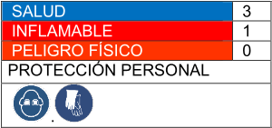
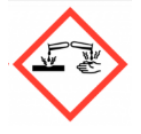
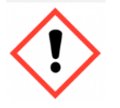

<!-- pagina: 1 -->

108

## HOJA DE SEGURIDAD CATALIZADOR EPOXICO AMIDA

## 1. IDENTIFICACION DEL FABRICANTE Y DE LA SUSTANCIA QUIMICA

- **Empresa:** TECNIDECOR S.A.S  
- **Nit:** 900112215-2  
- **Pbx:** 444 49 44

Nombre del Producto: CATALIZADOR EPOXICO

- **Código del producto:** 108  
- **Sinónimos:** COMPONENTE "B"  
- **Fórmula:** Amida  
- **Número UN:** 1263  
- **Clase UN:** 3

Fecha de actualización: Octubre de 2018

## 2. COMPOSICIÓN, INFORMACIÓN SOBRE INGREDIENTES

Número CAS: Composición (%)

Composición: Resina poliamida 68082-29-1

<99

## 3. IDENTIFICACIÓN DE RIESGOS

Riesgos para la salud humana: irritación de ojos y de piel.

Puede causar sensibilidad por contacto con la piel.

Riesgos para el medio ambiente:

- moderadamente tóxico para peces,
- no es biodegradable,
- potencial bioacumulativo

*Texto del PDF en el área de la imagen (capa de texto, no OCR): SALUD | 3 | INFLAMABLE | 1 | PELIGRO FÍSICO | 0 | PROTECCIÓN PERSONAL | .*

*Texto OCR de la imagen (puede contener errores): +*

## Primeros auxilios:

Inhalación: No hay medidas específicas, pero deben ser observadas prácticas de higiene personal.

Piel: NO SE DEMORE. Quítese la ropa contaminada y Lávese la piel con agua y jabón.

Ojos: Lavar los ojos afectados con agua. Si la irritación persiste, obténgase ayuda médica.

Ingestión: NO INDUZCA AL VÓMITO. Obtenga atención médica.

## Indicaciones para el médico:

Si se ha desarrollado sensibilidad en la piel, y se ha confirmado su relación con el producto, evítese futuras exposiciones

## 5. COMBATE DE INCENDIOS

## Medios de extinción de incendio

Incendio pequeño: Use CO2, polvo químico seco, arena, tierra ó espuma.

Incendio grande: No use chorros de agua. Use espuma ó agua de niebla.

Peligros: Este producto no es inflamable, pero podría arder. Posible presencia de Monóxido de carbono donde ocurra combustión incompleta.

## 6. LIBERACIONES ACCIDENTALES

*Texto del PDF en el área de la imagen (capa de texto, no OCR): 1 0 | 3*

Página 1 de 3

<!-- pagina: 2 -->

*Texto del PDF en el área de la imagen (capa de texto, no OCR): 108*

Derrames y fugas: extinguir cualquier llama.

Pequeños derrames: Absorba el producto derramado con arena y tierra. Barra/recoja y remueva el material a un lugar seguro para su posterior disposición. Lave el área contaminada con abundante agua.

Derrames grandes: prevenga que se riegue el material y evite que pase a los drenajes ó alcantarillas ó rios, mediante el uso de arena o tierra. Transfiere el material a un tambor de salvamento, si es posible. Si no, trátelo según instrucciones para derrame pequeño.

Protección personal: Vea la sección 8

## 7.MANEJO Y ALMACENAJE

Manejo de la temperatura: La máxima temperatura recomendada para bombear ó manejar el producto líquido es 90°C - 95°C.

Almacenamiento: Debe ser almacenado en condiciones tales que no haya humedad, preferiblemente en el empaque original, manteniéndolo herméticamente cerrado.

Bajo estas condiciones y a temperatura normal, la vida de almacenamiento debe ser de al menos un año.

Lavado del empaque: lave con solventes. Incinere los concentrados de ese lavado.

Preferiblemente aplaste los tambores. Como alternativa envíelos para reacondicionarlos

## 8. CONTROLES DE EXPOSICIÓN, PROTECCIÓN PERSONAL

Controles de exposición: no hay niveles de exposición recomendadas ó establecidas.

Protección personal:

Respiración: Normalmente no se requiere. En el evento de un riesgo por inhalación, expulse por ventilación local. Si no es posible, use una máscara para respirar con cartucho de vapor orgánico y construida con filtros de partículas. (NPE 20 - solo gas)

## 9. PROPIEDADES FISICAS Y QUIMICAS.

- **Estado Físico:** Líquido Color: Incoloro  
- **Olor:** Irritante  
- **Solubilidad en agua:** Insoluble

- Punto de inflamación: 30 °C
- Densidad:

3.53 kg/gln

- Gravedad Específica: 0.933
- **Sólidos Volumen:** 68.00 % · PVC: 00.00 %  
- **Volátiles en Peso:** 30.00 %

## 10. ESTABILIDAD Y REACTIVIDAD

Estabilidad: estable en condiciones normales a temperatura ambiente.

Condiciones a evitar: condiciones cáusticas pueden inducir una polimerización vigorosa a temperaturas alrededor de 200°C. Materiales a evitar: Agentes oxidantes fuertes.

Otra información: reacciona exotérmicamente con aminas, mercaptanos y ácidos Lewis a temperatura ambiente

## 11. INFORMACIÓN TOXICOLÓGICA.

- El producto es tóxico. La toxicidad del producto depende de la emanación de los solventes durante la preparación y aplicación del mismo.
- Vapores concentrados causan vértigo, mareo, desvanecimiento, dolor de cabeza y dificultad de la respiración.

## Toxicidad aguda:

Oral LD50 (rata): N.D.

Dérmico LD50 (conejo): N.D.

## Irritación:

Piel: moderado. Ojos: moderado

Sensibilidad: sensibilizador en la piel humana.

Otros efectos toxicológicos: mutágeno in vitro, pero no se observa potencial mutágenico in vivo.

## HOJA DE SEGURIDAD CATALIZADOR EPOXICO AMIDA

*Texto del PDF en el área de la imagen (capa de texto, no OCR): 1 0 | 3*

Página 2 de 3

<!-- pagina: 3 -->

*Texto OCR de la imagen (puede contener errores): Tecnidecor*

*Imagen asociada a la tabla #/tables/0: imagen contenida en el área de la tabla en la página 3 (100% de su área).*

| 108   | HOJA DE SEGURIDAD CATALIZADOR EPOXICO AMIDA   | 1 0 3 Página 3 de 3   |
|-------|-----------------------------------------------|-----------------------|

## 12. INFORMACIÓN ECOLÓGICA.

Ecotoxicidad: moderadamente tóxico en animales acuáticos, no tóxico para algas, insignificante toxicidad en microorganismos. Persistencia: No es fácilmente biodegradable. Moderado potencial a bioacumulación. (log Pow in el rango 3-5)

## 13. CONSIDERACIONES SOBRE LA DISPOSICIÓN.

ELIMINACION DE EMBALAJE: La eliminación de los residuos debe realizarse con arreglo a la legislación nacional y a las disposiciones de protección del medio ambiente.

NOTA: Se requiere la atención del usuario hacia la existencia de regulaciones regionales o nacionales relacionadas con esta materia.

## 14. INFORMACIÓN SOBRE EL TRANSPORTE.

Número UN: 1263

Grupo de embalaje: III

## 15. INFORMACIÓN SOBRE REGLAMENTACIÓN.

Algunos de sus componentes estan regulados para el transporte, se debe dar cumplimiento al Decreto 1609 de 2002. Ministerio de Transporte.

NOTA: La información proporcionada cubre lo descrito en la hoja de seguridad. Se requiere la atención del usuario hacia la existencia de disposiciones complementarias. Consultar las regulaciones nacionales, internacionales y locales aplicables.

## 16. OTRA INFORMACIÓN.

Esta hoja de seguridad tiene como fin sólo a brindar una guía basada en la Norma NTC 4435. Para el manejo del material con la precaución apropiada Las personas que reciban la información deben ejercer su propio criterio para determinar la conveniencia del uso de este producto para un fin específico. TECNIDECOR S.A.S no se hace responsable de ningún daño causado a propiedades o a personas por el uso inadecuado de nuestros productos, ya que no conocemos la manipulación ni las precauciones que cada cliente tiene en el almacenamiento.

*Texto del PDF en el área de la imagen (capa de texto, no OCR): 1 0 | 3*

*Imagen asociada a la tabla #/tables/0: imagen contenida en el área de la tabla en la página 3 (100% de su área).*
