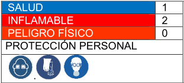
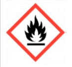
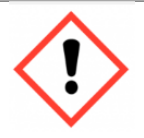
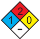

<!-- pagina: 1 -->

039

## 1. IDENTIFICACION DEL FABRICANTE Y DE LA SUSTANCIA QUÍMICA

- **Empresa:** TECNIDECOR S.A.S  
- **Nit:** 900112215-2  
- **Pbx:** 444 49 44

Nombre del Producto: PINTURA ACRILICA PARA TRÁFICO

- **Código del producto:** 039  
- **Sinónimos:** N/A  
- **Fórmula:** Base de co-polímero estireno-acrílica  
- **Número UN:** 1263  
- **Clase UN:** 3

Fecha de actualización: Octubre de 2018

## 2. COMPOSICIÓN, INFORMACIÓN SOBRE INGREDIENTES

| COMPOSICIÓN   | % PESO   | NOMBRE             | N° CAS         |
|---------------|----------|--------------------|----------------|
| Vehículo      | 1 9.60   | Resina Acrílica    | No Determinado |
| Pigmentos     | 53.00    | Dióxido de Titanio | 13463-67-7     |
|               |          | Bentone            | SD2 14808-60-7 |
|               |          | Talco              | 14807-96-6     |
| Solventes     | 12.83    | Xileno             | 1330-20-7 9.45 |
|               |          | Acetona            | 67-64-1 5.12   |
|               |          | Tolueno            | 108-88-3       |

## 3. IDENTIFICACION DE RIESGOS

- Liquido combustible. Irritante. Se puede incendiar fácilmente por calor, chispas o llamas. Los vapores pueden formar mezclas explosivas con el aire. Los vapores pueden causar mareos o sofocación. La inhalación o el contacto con el material pueden irritar o quemar la piel y los ojos.
- El producto puede encenderse por llamas, exceso de calor, chispas o carga electrostática.
- Los solventes pueden provocar irritaciones en los ojos, piel y vías respiratorias. La inhalación prolongada de vapores puede producir vértigos, somnolencia o incluso pérdida de la conciencia. Los solventes son nocivos para la salud si se ingieren.
- En caso de incendio los envases explotarán, aumentando la intensidad de las llamas.

*Texto del PDF en el área de la imagen (capa de texto, no OCR): SALUD | 1 | INFLAMABLE | 2 | PELIGRO FÍSICO | 0 | PROTECCIÓN PERSONAL | .*

*Texto OCR de la imagen (puede contener errores): +*

## 4. PRIMEROS AUXILIOS

INHALACION DE VAPORES: Sacar a la víctima de la zona de peligro. En caso de paro respiratorio, practicar la respiración artificial. Llamar a un médico.

CONTACTO CON LA PIEL: Lavar inmediatamente con agua. Si persiste la irritación, llamar a un médico. Cambiar la ropa contaminada. Lavarla antes de volver a utilizarla.

CONTACTO CON LOS OJOS: Lavar con bastante agua manteniendo los párpados abiertos. Acto seguido, consultar al médico (oculista).

INGESTION: No provocar vómito. Dar agua abundante. Nunca se administrará nada en la boca de una persona que haya perdido la conciencia. Llamar inmediatamente al médico.

## HOJA DE SEGURIDAD PINTURA ACRÍLICA PARA TRÁFICO

*Texto del PDF en el área de la imagen (capa de texto, no OCR): 2 0 | 1*

Página 1 de 4

<!-- pagina: 2 -->

*Texto OCR de la imagen (puede contener errores): Tecnidecor*

*Imagen asociada a la tabla #/tables/1: imagen contenida en el área de la tabla en la página 2 (100% de su área).*

| 039   | HOJA DE SEGURIDAD PINTURA ACRÍLICA PARA TRÁFICO   | 2 0 1   | Página 2 de 4   |
|-------|---------------------------------------------------|---------|-----------------|

## 5. COMBATE DE INCENDIOS

MEDIOS DE EXTINCIÓN: Arena, espuma o producto extintor seco tipo ABC. PELIGROS DE EXPOSICION: Proteger contra llamas de soplete (llamas tipo dardo). Las tapas de los envases pueden salir despedidas con violencia. - Los productos al arder pueden desprender vapores tóxicos. Las personas que hayan inhalado dichos vapores, se tenderán en posición horizontal y se mantendrán en reposo. Avisar de inmediato al médico.

PROTECCION DE LOS BOMBEROS: Los bomberos deben trabajar orientados en la dirección por donde sopla el viento y contar con aparatos de protección respiratoria y trajes de seguridad impermeables para estar protegidos contra vapores tóxicos. - Una vez extinguido el incendio, tomar las precauciones del caso para evitar que se reinicie el fuego..

## 6. LIBERACIONES ACCIDENTALES

- Evitar fuentes que generen chispas. No fumar.
- Procurar que haya ventilación y extracción suficiente.
- Evitar el contacto con la piel y los ojos.
- Evitar la inhalación de vapores por tiempo prolongado.
- Utilizar equipo y ropa de seguridad apropiados.

## 7.MANEJO Y ALMACENAJE

## · MANIPULACION:

Evitar el contacto con álcalis, sustancias cáusticas, aminas e inflamables. Procurar que exista ventilación y extracción suficiente. Proteger de las llamas, calor, sacudidas, golpes, frotes, chispas y cargas electrostáticas. No fumar en las inmediaciones. Se debe prohibir fumar en los recintos en los que se encuentre el producto; colgar carteles de "NO FUMAR". Mantener los recipientes herméticamente cerrados, cuando no están en uso.

Transportar los envases con cuidado, evitando la exposición prolongada bajo el sol.

## CONDICIONES DE ALMACENAMIENTO:

Almacenar dentro de los envases originales, en recintos frescos, secos y suficientemente ventilados; la temperatura recomendada para el almacenaje es <= 25°C. Proteger del calor, llamas, otros focos de chispas y de los rayos solares directos. No fumar en las inmediaciones. Se debe prohibir fumar en los recintos en los que se encuentre el producto; colgar carteles de "NO FUMAR". El producto no debe almacenarse junto con materiales como álcalis, sustancias cáusticas, aminas o sustancias oxidantes. El material que entró en el almacén en primer lugar, deberá ser también el primero en salir y utilizarse. Llevar control de las fechas de fabricación, las que figuran en las etiquetas de los envases. No dejar almacenado el producto por más de un año.

No abrir ni vaciar los envases dentro del almacén.

## 8. CONTROLES DE EXPOSICIÓN, PROTECCIÓN PERSONAL

MEDIDAS DE INGENIERIA: Asegurarse que exista ventilación suficiente en el área. Controlar las concentraciones de vapor en el aire circundante al puesto de trabajo.

PROTECCION RESPIRATORIA: Usar dispositivo de protección respiratoria con filtro de partículas (NIOSH 3M 7090) y de gases (NIOSH 3M 7252). PROTECCION MANUAL: Usar guantes de seguridad anti estáticos, no combustibles. PROTECCION DE LOS OJOS: Usar gafas de seguridad.

PROTECCION CORPORAL: Usar prendas de seguridad.

## 9. PROPIEDADES FÍSICAS Y QUÍMICAS.

Estado Físico: Líquido Color: Varios colores Olor: Irritante

*Texto del PDF en el área de la imagen (capa de texto, no OCR): 2 0 | 1*

*Imagen asociada a la tabla #/tables/1: imagen contenida en el área de la tabla en la página 2 (100% de su área).*

<!-- pagina: 3 -->

*Texto del PDF en el área de la imagen (capa de texto, no OCR): 039*

Solubilidad en agua: Insoluble Punto de inflamación: 30°C Densidad: 5.50 kg/gln Gravedad Específica: 1.453 Sólidos en volumen: 53.0 % PVC: 52.70 %.10

## 10. ESTABILIDAD Y REACTIVIDAD

ESTABILIDAD: Estable bajo condición normal y manipulada de manera adecuada (en almacén la temperatura no debe sobrepasar los 25°C). CONDICIONES A EVITAR: Evitar el calor, golpes y fricción. MATERIALES A EVITAR: Contacto de los envases con álcalis, sustancias cáusticas, aminas o sustancias oxidantes. PRODUCTOS DE DESCOMPOSICIÓN PELIGROSOS: Los productos de descomposición pueden ser monóxido de carbono (CO), dióxido de carbono (CO2), óxidos de nitrógeno y otros vapores potencialmente tóxicos.

## 11. INFORMACIÓN TOXICOLÓGICA.

El producto es tóxico. La toxicidad del producto depende de la emanación de solventes durante la preparación y aplicación del mismo. Alta concentración de vapor produce vértigo, mareo, desvanecimiento, dolor de cabeza y dificultad de la respiración.

## 12. INFORMACIÓN ECOLÓGICA.

MOVILIDAD: Producto volátil, inflamable, tóxico, insoluble en agua. DEGRADABILIDAD: Producto no biodegradable.

## 13. CONSIDERACIONES SOBRE LA DISPOSICIÓN.

ELIMINACION DE EMBALAJE: La eliminación de residuos debe realizarse con arreglo a la legislación nacional y a las disposiciones de protección del medio ambiente. NOTA: Se requiere la atención del usuario hacia la posible existencia de regulaciones regionales o nacionales vinculadas con esta materia.

## 14. INFORMACIÓN SOBRE EL TRANSPORTE.

ADR / RID: Class 3.1.2 IMDG CODE: Class 3.1.2 ICAO / IATA DGR: Class 3.1.2 CLASE: 3 No. ONU: 1263

## 15. INFORMACIÓN SOBRE REGLAMENTACIÓN.

Para el transporte de esta sustancia dentro del territorio nacional se deben cumplir los requisitos técnicos y de seguridad para el manejo y transporte de mercancías peligrosas por carretera en vehículos automotores, estipulados en el Decreto 1079 de 2015, Capítulo7, Sección 8.

NOTA: La información proporcionada cubre lo descrito en la hoja de seguridad. Se requiere la atención del usuario hacia la existencia de disposiciones complementarias. Consultar las regulaciones nacionales, internacionales y locales aplicables.

## 16. OTRA INFORMACIÓN.

*Texto del PDF en el área de la imagen (capa de texto, no OCR): 2 0 | 1*

<!-- pagina: 4 -->

039

Esta hoja de seguridad tiene como fin sólo a brindar una guía basada en la Norma NTC 4435. Para el manejo del material con la precaución apropiada Las personas que reciban la información deben ejercer su propio criterio para determinar la conveniencia del uso de este producto para un fin específico. TECNIDECOR S.A.S no se hace responsable de ningún daño causado a propiedades o a personas por el uso inadecuado de nuestros productos, ya que no conocemos la manipulación ni las precauciones que cada cliente tiene en el almacenamiento.

## HOJA DE SEGURIDAD PINTURA ACRÍLICA PARA TRÁFICO

*Texto del PDF en el área de la imagen (capa de texto, no OCR): 2 0 | 1*

Página 4 de 4
<!-- encabezados y pies de pagina -->

## Encabezados y pies de página

*Texto del margen superior o inferior de las páginas, que Docling separa del cuerpo. Se lista una sola vez, con las páginas donde aparece.*

- [p. 3] HOJA DE SEGURIDAD PINTURA ACRÍLICA PARA TRÁFICO
