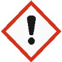

<!-- pagina: 1 -->

## FICHA DE DATOS DE SEGURIDAD (MSDS)

Esmalte Uretano AR Comp. B

*Texto OCR de la imagen (puede contener errores): BUILDING TRUST*

## SECCION 1: Identificación de la sustancia o la mezcla y de la sociedad o la empresa

## 1.1 Identificación del producto

Nombre del producto:

Código:

Esmalte Uretano AR Comp. B 100000030537

## 1.2 Usos pertinentes identificados de la sustancia o de la mezcla y usos desaconsejados

Uso del producto:

Componente B Recubrimiento Uretano.

## 1.3 Datos del proveedor de la ficha de datos de seguridad

- **Fabricante/ Distribuidor:** Sika Colombia S.A.S. Vereda Canavita km 20.5 Autopista Norte Tocancipá, Cundinamarca Colombia col.sika.com  
- **Número de Teléfono:** (+571) 878 - 6333  
- **Número de Fax:** (+571) 878 - 6666  
- **Dirección de email del responsable:** controlcalidad.lab@co.sika.com  
- **de esta FDS:**  
- **1.4 En caso de emergencia:** CISPROQUIM Bogotá: 2886012 / 2886355 Resto del país: 01 8000 916012

## SECCION 2: Identificación de los peligros

## 2.1 Clasificación de la sustancia o de la mezcla

## Clasificación SGA

- **Toxicidad aguda (Inhalación):** Categoría 4  
- **Sensibilización cutánea:** Categoría 1  
- **Toxicidad específica en determinados órganos -:**  
- **exposición única:** Categoría 3 (Sistema respiratorio)

## 2.2 Elementos de la etiqueta

Pictogramas de peligro:

- **Indicaciones de peligro:** Atención  
- **Indicaciones de peligro:** H317 Puede provocar una reacción alérgica en la piel. H332 Nocivo en caso de inhalación.

<!-- pagina: 2 -->

H335 Puede irritar las vías respiratorias.

Consejos de prudencia:

2.3 Otros peligros Otros peligros que no:

conducen a una clasificación

## Prevención:

P261 Evitar respirar el polvo/ el humo/ el gas/ la niebla/ los vapores/ el aerosol.

P271 Utilizar únicamente en exteriores o en un lugar bien ventilado.

P272 Las prendas de trabajo contaminadas no podrán sacarse del lugar de trabajo.

P280 Llevar guantes/ gafas/ máscara de protección.

## Intervención:

P302 + P352 EN CASO DE CONTACTO CON LA PIEL: Lavar con abundante agua.

P304 + P340 + P312 EN CASO DE INHALACIÓN: Transportar a la persona al aire libre y mantenerla en una posición que le facilite la respiración. Llamar a un CENTRO DE TOXICOLOGĺA/médico si la persona se encuentra mal.

P333 + P313 En caso de irritación o erupción cutánea: Consultar a un médico.

P362 + P364 Quitar las prendas contaminadas y lavarlas antes de volver a usarlas.

## Almacenamiento:

P403 + P233 Almacenar en un lugar bien ventilado. Mantener el recipiente cerrado herméticamente.

P405 Guardar bajo llave.

## Eliminación:

P501 Eliminar el contenido/ el recipiente en una planta de eliminación de residuos autorizada.

Ninguno conocido

## SECCION 3: Composición /información sobre los componentes

- **Sustancia/preparado:** Mezcla  
- **Familia química/:** Poliisocianato alifático

| Nombre del producto o ingrediente Identificadores   | %          |
|-----------------------------------------------------|------------|
| Homopolimero Hexametileno-1,6-diisocianato          | 90% - 100% |
| CAS: 28182-81-2                                     |            |
| 1,6-diisocianato de hexametileno                    | 0,1% - 1%  |
| CAS: 822-06-0                                       |            |

No hay ningún ingrediente adicional presente que, bajo el conocimiento actual del proveedor y en las concentraciones aplicables, sea clasificado como de riesgo para la salud o el medio ambiente, como PBT o mPmB o tenga asignado un límite de exposición laboral y por lo tanto deban ser reportados en esta sección.

## SECCION 4: Primeros auxilios

## 4.1 Descripción de los primeros auxilios

- **Recomendaciones generales:** Retirar a la persona de la zona peligrosa. Consultar a un médico. Mostrar esta ficha de seguridad al doctor que esté de servicio.  
- **Contacto con los ojos:** Retirar las lentillas. Manténgase el ojo bien abierto mientras se lava. Si persiste la irritación de los ojos, consultar a un especialista.  
- **Inhalación:** Trasladarse a un espacio abierto.

<!-- pagina: 3 -->

Consultar a un médico después de una exposición importante.  
- **Contacto con la piel:** Quítese inmediatamente la ropa y zapatos contaminados. Eliminar lavando con jabón y mucha agua. Si los síntomas persisten consultar a un médico.  
- **Ingestión:** Lavar la boca con agua y después beber agua abundante.

Principales síntomas y efectos, Provóquense inmediatamente los vómitos y llámese al médico.

No dar leche ni bebidas alcohólicas.

Nunca debe administrarse nada por la boca a una persona inconsciente.

Efectos irritantes

agudos y retardados:

Efectos sensibilizantes

Tos

Problemas respiratorios

Reacciones alérgicas

Dolor de cabeza

Ver la Sección 11 para obtener información detallada sobre la salud y los síntomas.

## 4.3 Indicación de toda atención médica y de los tratamientos especiales que deban dispensarse inmediatamente

## Notas para el médico: Tratar sintomáticamente.

## SECCION 5: Medidas de lucha contra incendios

## 5.1 Medios de extinción

- **Punto de inflamación:** > 203 °C vaso cerrado.  
- **Medios de extinción apropiados:** Usar medidas de extinción que sean apropiadas a las circunstancias del local y a sus alrededores.

Medios de extinción no No se conoce ninguno.

apropiados:

## 5.2 Peligros específicos derivados de la sustancia o la mezcla

Peligros derivados de la No se conoce ninguno.

sustancia o mezcla:

Productos de No se conocen productos de combustión peligrosos.

descomposición térmica

peligrosos:

## 5.3 Recomendaciones para el personal de lucha contra incendios

Equipo de protección

especial para el personal Los bomberos deben llevar equipo de protección apropiado y un equipo de respiración autónomo con una máscara facial completa que opere en modo de presión positiva.

de lucha contra incendios:

## SECCION 6: Medidas en caso de vertido accidental

## 6.1 Precauciones personales, equipo de protección y procedimientos de emergencia

Para el personal que no

forma parte de los

servicios de emergencia:

No se debe realizar ninguna acción que suponga un riesgo personal o sin formación adecuada. Evacuar los alrededores. No permitir que entre el personal innecesario y sin protección. No tocar o caminar sobre el material derramado.

<!-- pagina: 4 -->

## Para el personal de Emergencia:

## 6.2 Precauciones relativas al medio ambiente:

## 6.3 Métodos y material de contención y de limpieza

Si se necesitan prendas especiales para gestionar el vertido, tomar en cuenta las informaciones recogidas en la Sección 8 en relación a los materiales adecuados y no adecuados.

Evitar la dispersión del material derramado, su contacto con el suelo, las vías fluviales, las tuberías de desagüe y las alcantarillas. Informar a las autoridades pertinentes si el producto ha causado contaminación medioambiental (alcantarillas, vías fluviales, suelo o aire).

Detener la fuga si esto no presenta ningún riesgo. Retirar los envases del área del derrame. Evitar que se introduzca en alcantarillas, canales de agua, sótanos o áreas reducidas. Detener y recoger los derrames con materiales absorbentes no combustibles, como arena, tierra, vermiculita o tierra de diatomeas, y colocar el material en un envase para desecharlo de acuerdo con las normativas locales (ver Sección 13).

## SECCIÓN 7: Manipulación y almacenamiento

## 7.1 Precauciones para una manipulación segura

## Medidas de protección:

## Información relativa a higiene en el trabajo de forma general

Usar un equipo de protección personal adecuado (Consultar Sección 8).

No introducir en ojos en la piel o en la ropa.

No respirar los vapores o nieblas. Usar sólo con ventilación adecuada.

Llevar un aparato de respiración apropiado cuando el sistema de ventilación sea inadecuado.

Consérvese en su envase original o en uno alternativo aprobado fabricado en un material compatible, manteniéndose bien cerrado cuando no esté en uso.

Los envases vacíos retienen residuos del producto y pueden ser peligrosos.

Tomar medidas de precaución contra la acumulación de cargas electrostáticas.

Deberá prohibirse comer, beber o fumar en los lugares donde se manipula, almacena o trata este producto.

Los trabajadores deberán lavarse las manos y la cara antes de comer, beber o fumar. Retirar el equipo de protección y las ropas contaminadas antes de acceder a zonas de alimentación.

Consultar también en la Sección 8 la información adicional sobre medidas higiénicas.

## 7.2 Condiciones de almacenamiento seguro, incluidas posibles incompatibilidades

Conservar de acuerdo con las normativas locales. Almacenar en el contenedor original protegido de la luz directa del sol en un área seca, fresca y bien ventilada, separado de materiales incompatibles (ver Sección 10) y comida y bebida.

Mantener el contenedor bien cerrado y sellado hasta el momento de usarlo. Los envases abiertos deben cerrarse perfectamente con cuidado y mantenerse en posición vertical para evitar derrames. No almacenar en contenedores sin etiquetar. Utilícese un envase de seguridad adecuado para evitar la contaminación del medio ambiente.

## SECCIÓN 8: Controles de exposición/protección individual

La información recogida en esta sección contiene consejos e indicaciones generales. La información que se proporciona está basada en los usos habituales anticipados para el producto. Puede ser necesario tomar medidas adicionales para su manipulación a granel u otros usos que pudieran aumentar de manera significativa la exposición de los trabajadores o la liberación al medio ambiente.

## 8.1 Parámetros de control

## Límites de exposición profesional

| Componentes                      | Tipo de valor - Parámetros de control   |
|----------------------------------|-----------------------------------------|
| 1,6-diisocianato de hexametileno | TWA: 0,005 ppm Base: ACGIH              |

<!-- pagina: 5 -->

## 8.2 Controles de Exposición

## Protección respiratoria:

Utilizar protección respiratoria a menos que exista una ventilación de escape adecuada o a menos que la evaluación de la exposición indique que el nivel de exposición está dentro de las pautas recomendadas.  
La clase de filtro para el respirador debe ser adecuado para la concentración máxima prevista del contaminante (gas/vapor/aerosol/particulados) que puede presentarse al manejar el producto. Si se excede esta concentración, se debe utilizar un aparato respiratorio autónomo.  
- **Protección de las manos:** Guantes químico-resistentes e impermeables que cumplan con estándares aprobados deben ser utilizados cuando se manejen productos químicos y la evaluación del riesgo indica que es necesario.  
- **Protección de los ojos:** Equipo de protección ocular que cumpla con estándares aprobados debe ser utilizado cuando la evaluación del riesgo indica que es necesario.  
- **Protección de la piel y del cuerpo:** Elegir la protección para el cuerpo según sus características, la concentración y la cantidad de sustancias peligrosas, y el lugar específico de trabajo.  
- **Medidas de higiene:** Manipular con las precauciones de higiene industrial adecua-das, y respetar las prácticas de seguridad. No comer ni beber durante su utilización. No fumar durante su utilización. Lavarse las manos antes de los descansos y después de terminar la jornada laboral.

## SECCIÓN 9: Propiedades físicas y químicas

## 9.1 Información sobre propiedades físicas y químicas básicas

- **Aspecto:**  
- **Estado físico:** Líquido  
- **Color:** Incoloro  
- **Olor:** Característico  
- **Umbral olfativo:** No disponible  
- **pH:** No disponible

Punto de fusión/punto de

Congelación:

No disponible

Punto inicial de ebullición e

- **intervalo de ebullición:** No disponible  
- **Punto de inflamación:** > 203 °C vaso cerrado (ASTM D3278)

Tasa de evaporación No disponible

- **Inflamabilidad (sólido, gas):** No disponible  
- **Tiempo de Combustión:** No aplicable  
- **Velocidad de Combustión:** No aplicable  
- **Límites superior/inferior de Valor más bajo conocido:**  
- **inflamabilidad o de explosividad:** No disponible  
- **Presión de vapor:** No disponible  
- **Densidad de vapor:** No disponible  
- **Densidad:** 1.15 kg/l ± 0.04 kg/l (20°C)  
- **Densidad relativa:** No disponible  
- **Solubilidad(es):** El producto no es soluble en agua

Coeficiente de reparto noctanol/agua: No disponible

- **Temperatura de autoinflamación:** No disponible  
- **Temperatura de descomposición:** No disponible  
- **Viscosidad:**

<!-- pagina: 6 -->

Esmalte Uretano AR Comp. B

- **Viscosidad, dinámica:** No disponible  
- **Viscosidad, cinemática:** > 7 mm2/s (40 °C)  
- **Propiedades explosivas:** No disponible  
- **Propiedades comburentes:** No disponible

## 9.2 Información adicional

Ninguna información adicional

## SECCIÓN 10: Estabilidad y reactividad

- **10.1 Reactividad:** No hay datos de ensayo disponibles sobre la reactividad de este producto o sus componentes.  
- **10.2 Estabilidad química:** El producto es estable.

10.3 Posibilidad de reacciones En condiciones normales de almacenamiento y uso, no se producen reacciones peligrosas.

peligrosas:

10.4 Condiciones que deben Evitar todas las fuentes posibles de ignición (chispa o llama).

evitarse:

10.5 Materiales incompatibles Reactivo o incompatible con los siguientes materiales:

10.6 Productos de descomposición peligrosos:

Materiales oxidantes, aminas, alcoholes.

En condiciones normales de almacenamiento y uso, no se deberían formar productos de descomposición peligrosa.

## SECCIÓN 11: Información toxicológica

## 11.1 Información sobre los efectos toxicológicos

## Hexamethylene-1,6-diisocyanate homopolymer:

- **Toxicidad oral aguda:** DL50 Oral (Rata): > 5.001 mg/kg  
- **Toxicidad aguda por inhalación:** Estimación de la toxicidad aguda: 1,5 mg/l Prueba de atmosfera: polvo/niebla Método: Juicio de expertos  
- **Toxicidad cutánea aguda:** DL50 cutánea (Rata): > 2.000 mg/kg

## 1,6-diisocianato de hexametileno:

- **Toxicidad oral aguda:** DL50 Oral (Rata): 746 mg/kg  
- **Toxicidad aguda por inhalación:** CL50 (Rata): 0,124 mg/l Tiempo de exposición: 4 h Prueba de atmosfera: vapor  
- **Toxicidad cutánea aguda:** DL50 cutánea (Rata): > 7.000 mg/kg

## SECCIÓN 12: Información Ecológica

## Ecotoxicidad

Sin datos disponibles

<!-- pagina: 7 -->

## Persistencia y degradabilidad

Sin datos disponibles

## Potencial de bioacumulación

Sin datos disponibles

## Movilidad en el suelo

Sin datos disponibles

## Otros efectos adversos

## Producto:

Información ecológica complementaria: No existe ningún dato disponible para ese producto.

## SECCIÓN 13: Consideraciones relativas a la eliminación

## 13.1 Métodos para el tratamiento de residuos

## Producto

Métodos de eliminación:

## Empaquetado:

Evitar o minimizar la generación de residuos cuando sea posible. La eliminación de este producto, sus soluciones y cualquier derivado deben cumplir siempre con los requisitos de la legislación de protección del medio ambiente y eliminación de desechos y todos los requisitos de las autoridades locales. Desechar los sobrantes y productos no reciclables por medio de un contratista autorizado a su eliminación. Los residuos no se deben tirar por la alcantarilla sin tratar a menos que sean compatibles con los requisitos de todas las autoridades con jurisdicción.

Producto curado con su componente A correspondiente, y en la proporción adecuada, completamente sólido, puede ser eliminado como escombro.

Envases/embalajes totalmente vacíos pueden destinarse a reciclaje. Envases/ embalajes que no pueden ser limpiados deben ser eliminados de la misma forma que la sustancia contenida.

## SECCIÓN 14: Información relativa al transporte

*Imagen asociada a la tabla #/tables/2: imagen contenida en el área de la tabla en la página 7 (100% de su área).*

|                                                               | ADR/RID-ADN                                                                     | IMDG                                                                            | IATA                                                                            |
|---------------------------------------------------------------|---------------------------------------------------------------------------------|---------------------------------------------------------------------------------|---------------------------------------------------------------------------------|
| 14.1 Número ONU                                               | UN3082                                                                          | UN3082                                                                          | UN3082                                                                          |
| 14.2 Designación oficial de transporte de las Naciones Unidas | Sustancia líquida peligrosa para el medio ambiente, n.e.p Contiene: Isocianatos | Sustancia líquida peligrosa para el medio ambiente, n.e.p Contiene: Isocianatos | Sustancia líquida peligrosa para el medio ambiente, n.e.p Contiene: Isocianatos |
| 14.3 Clase(s) de peligro para el transporte                   | 9                                                                               | 9                                                                               | 9                                                                               |
| 14.4 Grupo de embalaje                                        | III                                                                             | III                                                                             | III                                                                             |
| 14.5 Peligros para el medio ambiente                          |                                                                                 |                                                                                 |                                                                                 |
| 14.6 Información adicional                                    |                                                                                 | Emergency schedules (EmS) F-A, S-F                                              | -                                                                               |
| Código de clasificación                                       |                                                                                 |                                                                                 |                                                                                 |

*Imagen asociada a la tabla #/tables/2: imagen contenida en el área de la tabla en la página 7 (100% de su área).*

*Imagen asociada a la tabla #/tables/2: imagen contenida en el área de la tabla en la página 7 (100% de su área).*

<!-- pagina: 8 -->

Esmalte Uretano AR Comp. B

## 14.7 Transporte a granel: No disponible

con arreglo al anexo II del

Convenio Marpol 73/78 y del

Código IBC

## SECCIÓN 15: Información reglamentaria

15.1 Reglamentación y legislación en materia de seguridad, salud y medio ambiente específicos para la sustancia o la mezcla Reglamento de la UE (CE) nº. 1907/2006 (REACH)

Anexo XIV - Lista de sustancias sujetas a autorización

## Anexo XIV

Ninguno de los componentes está listado.

Sustancias altamente preocupantes

Ninguno de los componentes está listado.

Contenido de COV (EU):

VOC (w/w): 0%

## Legislación nacional

NTC 1692:1998, Transporte de mercancías peligrosas. Clasificación, etiquetado y rotulado.

Norma técnica NTC-ISO 5500 gestión del transporte de carga terrestre.

Ley 55 del 2 de julio de 1993, Convenio número 170 y la Recomendación número 177 sobre la Seguridad en la Utilización de los Productos Químicos en el Trabajo.

Decreto 1609 de 2002 Por el cual se reglamenta el manejo y transporte terrestre automotor de mercancías peligrosas por carretera.

## Clase de almacenamiento:

NTC 3972:1996, Transporte de mercancías peligrosas clase 9. Sustancias peligrosas varias. Transporte terrestre por carretera.

Requisitos generales para el transporte. Segregación.

15.2 Evaluación de la seguridad química No hay datos disponibles

## SECCIÓN 16: Otra Información

Indica la información que ha cambiado desde la edición de la versión anterior.

Abreviaturas y acrónimos:

ETA = Estimación de Toxicidad Aguda

CLP = Reglamento sobre Clasificación, Etiquetado y Envasado [Reglamento (CE)

No 1272/2008]

DNEL = Nivel sin efecto derivado

Indicación EUH = Indicación de Peligro específica del CLP

PNEC = Concentración Prevista Sin Efecto

RRN = Número de Registro REACH

## Aviso al lector

La información contenida en esta ficha de datos de seguridad corresponde a nuestro nivel de conocimiento en el momento de su publicación. Quedan excluidas todas las garantías. Se aplicaran nuestras condiciones generales de venta en vigor. Por favor, consulte la Hoja de Datos del Producto antes de su uso y procesamiento.
<!-- encabezados y pies de pagina -->

## Encabezados y pies de página

*Texto del margen superior o inferior de las páginas, que Docling separa del cuerpo. Se lista una sola vez, con las páginas donde aparece.*

- [p. 1-8] Fecha de emisión: 27.04.2019
- [p. 1-8] MSDS no. 1115
- [p. 2-5, 7] Esmalte Uretano AR Comp. B
