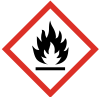
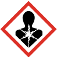
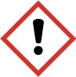
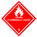
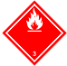
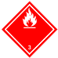
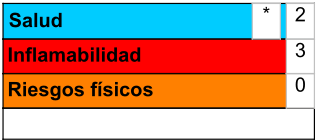
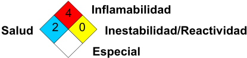

<!-- pagina: 1 -->

*Texto OCR de la imagen (puede contener errores): 1 | AXALTA*

## FICHA DE DATOS DE SEGURIDAD

## Sección 1. Identificación

- **Identificador del producto:** 983  
- **Nombre del producto:** Tufcote 3.5 HH - Aluminum  
- **Fecha de emisión:**

: 2/28/2020

Versión :

2

## Uso recomendado de la sustancia química peligrosa o mezcla, y restricciones de uso

- **Usos identificados:**  
- **Usos contraindicados:** Para uso industrial solo por parte de profesionales capacitados. No está a la venta ni es usado por los consumidores.  
- **Datos del proveedor o fabricante:**  
- **Información de productos Componente de recubrimiento para uso profesional.:**

: Axalta Coating Systems, LLC

Two Commerce Square, 2001 Market Street Suite 3600 Philadelphia, PA 19109 USA

855-6AXALTA

Número de teléfono en caso de emergencia :

(CHEMTREC) - 800-424-9300

## Sección 2. Identificación de los peligros

Estado OSHA/ HCS

: Este material es considerado como peligroso por la Norma de Comunicación de Riesgos de la OSHA (29 CFR 1910.1200).

Clasificación de la sustancia química peligrosa o mezcla :

LÍQUIDOS INFLAMABLES - Categoría 2

IRRITACIÓN CUTÁNEA - Categoría 2

IRRITACIÓN OCULAR - Categoría 2A

SENSIBILIZACIÓN CUTÁNEA - Categoría 1

CARCINOGENICIDAD - Categoría 2

TOXICIDAD ESPECÍFICA DE ÓRGANOS BLANCO (EXPOSICIÓN ÚNICA) (Efecto narcótico) - Categoría 3

## Elementos de las etiquetas del SGA

Pictogramas de peligro :

*Texto OCR de la imagen (puede contener errores): !*

- **Palabra de advertencia:** Peligro  
- **Indicaciones de peligro:** H225 - Líquido y vapores muy inflamables. H319 - Provoca irritación ocular grave. H315 - Provoca irritación cutánea. H317 - Puede provocar una reacción cutánea alérgica. H351 - Susceptible de provocar cáncer. H336 - Puede provocar somnolencia o vértigo.

<!-- pagina: 2 -->

## Sección 2. Identificación de los peligros

## Consejos de prudencia

## Prevención

- : P201 - Procurarse las instrucciones antes del uso.

P202 - No manipular antes de haber leído y comprendido todas las precauciones de seguridad.

- P280 - Usar guantes de protección. Usar protección para los ojos o la cara. Usar ropa protectora.
- P210 - Mantener alejado del calor, chispas, llamas al descubierto, superficies calientes y otras fuentes de ignición. No fumar.
- P241 - Todos los equipos eléctricos, de ventilación, de iluminación y para la manipulación de materiales deben ser antideflagrantes.

P242 - No utilizar herramientas que produzcan chispas.

P243 - Tomar medidas de precaución contra las descargas electrostáticas.

P233 - Mantener el recipiente herméticamente cerrado.

P271 - Utilizar sólo al aire libre o en un lugar bien ventilado.

P261 - Evitar respirar vapor.

P264 - Lavarse cuidadosamente las manos después de la manipulación.

P272 (OSHA) - No se debe permitir que la ropa de trabajo contaminada se deje fuera del lugar de trabajo.

Intervención/Respuesta : P308 + P313 - En caso de exposición demostrada o supuesta: Buscar atención médica.

P304 + P340 + P312 - En caso de inhalación: Transportar a la persona al aire libre y mantenerla en una posición que le facilite la respiración. Llamar a un centro de toxicología o a un médico si la persona se siente mal.  
P303 + P361 + P353 - En caso de contacto con la piel (o el pelo): Quitar  
inmediatamente toda la ropa contaminada. Enjuagar la piel con agua o ducharse. P302 + P352 + P363 - En caso de contacto con la piel: Lavar con abundante agua y jabón. Lavar la ropa contaminada antes de volverla a usar.  
P333 + P313 - En caso de irritación cutánea o sarpullido: Buscar atención médica.  
P305 + P351 + P338 - En caso de contacto con los ojos: Enjuagar con agua cuidadosamente durante varios minutos. Quitar los lentes de contacto, cuando estén presentes y pueda hacerse con facilidad. Proseguir con el lavado.  
P337 + P313 - Si la irritación ocular persiste: Buscar atención médica.  
- **Almacenamiento:** P405 - Guardar bajo llave. P235 - Mantener fresco.  
- **Eliminación:** P501 - Eliminar el contenido y recipiente conforme a todas las reglamentaciones locales, regionales, nacionales e internacionales.  
- **Peligros no clasificados en otra parte P403 - Almacenar en un lugar bien ventilado.:** No se conoce ninguno.

## Sección 3. Composición / información sobre los componentes

## Sustancia/mezcla :

Mezcla

| Nombre de ingrediente                                                  | %         | Número CAS   |
|------------------------------------------------------------------------|-----------|--------------|
| propanona                                                              | ≥25 - ≤38 | 67-64-1      |
| destilado (petróleo), hidrotratado ligero                              | ≥10 - ≤25 | 64742-47-8   |
| heptan-2-ona                                                           | ≤10       | 110-43-0     |
| nafta disolvente (petroleo), fraccion aromatica ligera (<0,1% benceno) | ≤2.5      | 64742-95-6   |
| 2-butanona-oxima                                                       | ≤0.3      | 96-29-7      |

Si alguna concentración se presenta como un rango, es para proteger la confidencialidad o debido a variación en los lotes.

No hay ningún ingrediente adicional presente que, bajo el conocimiento actual del proveedor y en las concentraciones aplicables, sea clasificado como de riesgo para la salud o el medio ambiente y por lo tanto deban ser reportados en esta sección.

Los límites de exposición laboral, en caso de existir, figuran en la sección 8.

<!-- pagina: 3 -->

## Sección 4. Primeros auxilios

## Descripción de los primeros auxilios

| Contacto con los ojos   | :   | Enjuagar los ojos inmediatamente con mucha agua, levantando ocasionalmente los párpados superior e inferior. Verificar si la víctima lleva lentes de contacto y en este caso, retirárselas. Continúe enjuagando por lo menos por 10 minutos. Procurar atención médica.                                                                                                                                                                                                                                                                                                                                                                                                                                                                                                                                                                                                                                                                                                                                  |
|-------------------------|-----|---------------------------------------------------------------------------------------------------------------------------------------------------------------------------------------------------------------------------------------------------------------------------------------------------------------------------------------------------------------------------------------------------------------------------------------------------------------------------------------------------------------------------------------------------------------------------------------------------------------------------------------------------------------------------------------------------------------------------------------------------------------------------------------------------------------------------------------------------------------------------------------------------------------------------------------------------------------------------------------------------------|
| Por inhalación          | :   | Transportar la víctima al aire libre y mantenerla en reposo en una posición que le facilite la respiración. Si se sospecha que los vapores continúan presentes, la persona encargada del rescate deberá usar una máscara adecuada o un aparato de respiración autónoma. Si no hay respiración, ésta es irregular u ocurre un paro respiratorio, el personal capacitado debe proporcionar respiración artificial u oxígeno. Puede ser peligroso para la persona que proporcione ayuda dar respiración boca a boca. Procurar atención médica. Si es necesario, llame a un Centro de Control de Envenenamiento o a un médico. Si está inconsciente, coloque en posición de recuperación y obtenga atención médica inmediatamente. Asegure una buena circulación de aire. Aflojar todo lo que pudiera estar apretado, como el cuello de una camisa, una corbata, un cinturón.                                                                                                                               |
| Contacto con la piel    | :   | Lavar con abundante agua y jabón. Quítese la ropa y calzado contaminados. Lave bien la ropa contaminada con agua antes de quitársela, o use guantes. Continúe enjuagando por lo menos por 10 minutos. Procurar atención médica. En el caso de que existan quejas o síntomas, evite otras exposiciones. Lavar la ropa antes de volver a usarla. Limpiar el calzado completamente antes de volver a usarlo.                                                                                                                                                                                                                                                                                                                                                                                                                                                                                                                                                                                               |
| Ingestión               | :   | Lave la boca con agua. Retirar las prótesis dentales si es posible. Transportar la víctima al aire libre y mantenerla en reposo en una posición que le facilite la respiración. Si se ha ingerido el material y la persona expuesta está consciente, proporcione cantidades pequeñas de agua para beber. Deténgase si la persona expuesta se siente descompuesta porque vomitar sería peligroso. No inducir al vómito a menos que lo indique expresamente el personal médico. En caso de vómito, se debe mantener la cabeza baja de manera que el vómito no entre en los pulmones. Procurar atención médica. Si es necesario, llame a un Centro de Control de Envenenamiento o a un médico. No suministrar nada por vía oral a una persona inconsciente. Si está inconsciente, coloque en posición de recuperación y obtenga atención médica inmediatamente. Asegure una buena circulación de aire. Aflojar todo lo que pudiera estar apretado, como el cuello de una camisa, una corbata, un cinturón. |

## Síntomas y efectos más importantes, agudos o crónicos

## Efectos agudos potenciales en la salud

: Contacto con los ojos

Por inhalación

Contacto con la piel Provoca irritación ocular grave.

: Puede causar una depresión del sistema nervioso central (SNC). Puede provocar somnolencia o vértigo.

: Provoca irritación cutánea. Puede provocar una reacción cutánea alérgica.

: Ingestión Puede causar una depresión del sistema nervioso central (SNC).

## Signos/síntomas de sobreexposición

Contacto con los ojos

: Los síntomas adversos pueden incluir los siguientes: dolor o irritación lagrimeo enrojecimiento

Por inhalación :

Los síntomas adversos pueden incluir los siguientes: náusea o vómito dolor de cabeza somnolencia/cansancio mareo/vértigo inconsciencia

<!-- pagina: 4 -->

## Sección 4. Primeros auxilios

Contacto con la piel

- Los síntomas adversos pueden incluir los siguientes: irritación enrojecimiento :

Ingestión :

Ningún dato específico.

## Indicación de la necesidad de recibir atención médica inmediata y, en su caso, de tratamiento especial

Notas para el médico

: Tratar sintomáticamente. Contactar un especialista en tratamientos de envenenamientos inmediatamente si se ha ingerido o inhalado una gran cantidad.

Tratamientos específicos : No hay un tratamiento específico.

Protección del personal de primeros auxilios

: No se tomará ninguna medida que implique algún riesgo personal o que no contemple el entrenamiento adecuado. Si se sospecha que los vapores continúan presentes, la persona encargada del rescate deberá usar una máscara adecuada o un aparato de respiración autónoma. Puede ser peligroso para la persona que proporcione ayuda dar respiración boca a boca. Lave bien la ropa contaminada con agua antes de quitársela, o use guantes.

Vea la sección 11 para la Información Toxicológica

## Sección 5. Medidas contra incendios

## Medios de extinción

- **Medios de extinción apropiados:** Utilizar polvo químico seco, CO₂, agua pulverizada o espuma (neblina).  
- **Medios no apropiados de extinción:** No usar chorro de agua.  
- **Peligros específicos de la sustancia química peligrosa o mezcla:** Líquido y vapores muy inflamables. Los residuos líquidos que se filtran en el alcantarillado pueden causar un riesgo de incendio o de explosión. En caso de incendio o calentamiento, ocurrirá un aumento de presión y el recipiente estallará, con el riesgo de que ocurra una explosión. El vapor o gas es más pesado que el aire y se extenderá por el suelo. Los vapores pueden acumularse en areas bajas o cerradas o desplazarse una distancia considerable hacia la fuente de encendido y producir un retroceso de llama.  
- **Productos de descomposición térmica peligrosos:**  
- **Medidas especiales que deberán seguir los grupos de combate contra incendio:**  
- **Equipo de protección especial para los bomberos:**

- Los productos de descomposición pueden incluir los siguientes materiales: dióxido de carbono monóxido de carbono óxido/óxidos metálico/metálicos :
- En caso de incendio, aísle rápidamente la zona evacuando a todas las personas de las proximidades del lugar del incidente. No se tomará ninguna medida que implique algún riesgo personal o que no contemple el entrenamiento adecuado. Desplazar los contenedores lejos del incendio si esto puede hacerse sin riesgo. Use agua pulverizada para refrigerar los envases expuestos al fuego. :
- Los bomberos deben llevar equipo de protección apropiado y un equipo de respiración autónomo con una máscara facial completa que opere en modo de presión positiva. :

<!-- pagina: 5 -->

## Sección 6. Medidas que deben tomarse en caso de derrame o fuga accidental

## Precauciones personales, equipo de protección y procedimiento de emergencia

## Para personal de no emergencia

## Para el personal de respuesta a emergencias

## Precauciones relativas al medio ambiente

- : No se tomará ninguna medida que implique algún riesgo personal o que no contemple el entrenamiento adecuado. Evacuar los alrededores. No deje que entre el personal innecesario y sin protección. No toque o camine sobre el material derramado. Apagar todas las fuentes de ignición. No permitir el uso de bengalas, fumar, o el encendido de llamas en el área de peligro. Evite respirar vapor o neblina. Proporcione ventilación adecuada. Llevar un aparato de respiración apropiado cuando el sistema de ventilación sea inadecuado. Llevar puestos equipos de protección personal adecuados.
- : Si fuera necesario usar ropa especial para hacer frente al derrame, se tomará en cuenta la información de la Sección 8 sobre los materiales adecuados y no adecuados. Consultar también la información bajo "Para personal de no emergencia".
- : Evite la dispersión del material derramado, su contacto con el suelo, el medio acuático, los desagües y las alcantarillas. Informe a las autoridades pertinentes si el producto ha causado polución medioambiental (alcantarillas, canales, tierra o aire).

## Métodos y materiales para la contención y limpieza de derrames o fugas

## Derrame pequeño

Gran derrame

- Detener la fuga si esto no presenta ningún riesgo. Retire los envases del área del derrame. Use herramientas a prueba de chispas y equipo a prueba de explosión. Diluir con agua y fregar si es soluble en agua. Alternativamente, o si es insoluble en agua, absorber con un material seco inerte y colocar en un contenedor de residuos adecuado. Disponga por medio de un contratista autorizado para la disposición. :
- Detener la fuga si esto no presenta ningún riesgo. Retire los envases del área del derrame. Use herramientas a prueba de chispas y equipo a prueba de explosión. Aproximarse al vertido en el sentido del viento. Evite la entrada en alcantarillas, canales de agua, sótanos o áreas reducidas. Trate los derrames en una planta de tratamiento de aguas residuales o proceda tal como se indica a continuación. Detener y recoger los derrames con materiales absorbentes no combustibles, como arena, tierra, vermiculita o tierra de diatomeas, y colocar el material en un envase para desecharlo de acuerdo con las normativas locales (ver la Sección 13). Disponga por medio de un contratista autorizado para la disposición. El material absorbente contaminado puede presentar el mismo riesgo que el producto derramado. Nota: Véase la Sección 1 para información de contacto de emergencia y la Sección 13 para eliminación de desechos. :

## Sección 7. Manejo y almacenamiento

## Precauciones que se deben tomar para garantizar un manejo seguro

## Medidas de protección

- Use el equipo de protección personal adecuado (vea la Sección 8). Las personas con antecedentes de sensibilización cutánea no deben trabajar en ningún proceso en el que se utilice este producto. Evítese la exposición - recábense instrucciones especiales antes del uso. No manipular antes de haber leído y comprendido todas las precauciones de seguridad. No introducir en ojos o en la piel o ropa. No ingerir. Evite respirar vapor o neblina. Use sólo con ventilación adecuada. Llevar un aparato de respiración apropiado cuando el sistema de ventilación sea inadecuado. No entre en áreas de almacenamiento y espacios cerrados a menos que estén ventilados adecuadamente. Mantener en el recipiente original o en uno alternativo autorizado hecho de material compatible, conservar herméticamente cerrado cuando no esté en uso. Mantener alejado del calor, chispas, llamas al descubierto, o de cualquier otra fuente de ignición. Use equipo eléctrico (de ventilación, iluminación y manipulación de materiales) a prueba de explosiones. No utilizar herramientas que produzcan chispas. Evitar la acumulación de cargas electrostáticas. Los envases vacíos retienen resíduos del producto y pueden ser peligrosos. No vuelva a usar el envase. :

<!-- pagina: 6 -->

## Sección 7. Manejo y almacenamiento

| Orientaciones sobre higiene ocupacional general                           | :   | Está prohibido comer, beber o fumar en los lugares donde se manipula, almacena o trata este producto. Las personas que trabajan con este producto deberán lavarse las manos y la cara antes comer, beber o fumar. Quitar la ropa contaminada y el equipo de protección antes de entrar a las áreas de comedor. Véase también la Sección 8 acerca de la información adicional sobre las medidas higiénicas.                                                                                                                                                                                                                                                                                                                                                                                                                                          |
|---------------------------------------------------------------------------|-----|-----------------------------------------------------------------------------------------------------------------------------------------------------------------------------------------------------------------------------------------------------------------------------------------------------------------------------------------------------------------------------------------------------------------------------------------------------------------------------------------------------------------------------------------------------------------------------------------------------------------------------------------------------------------------------------------------------------------------------------------------------------------------------------------------------------------------------------------------------|
| Condiciones de almacenamiento seguro, incluida cualquier incompatibilidad | :   | Conservar de acuerdo con las normas locales. Almacenar en un área separada y homologada. Almacenar en el contenedor original protegido de la luz directa del sol en un área seca, fresca y bien ventilada, separado de materiales incompatibles (ver Sección 10) y comida y bebida. Guardar bajo llave. Eliminar todas las fuentes de ignición. Mantener separado de materiales oxidantes. Mantener el contenedor bien cerrado y sellado hasta el momento de usarlo. Los envases que han sido abiertos deben cerrarse cuidadosamente y mantenerse en posición vertical para evitar derrames. No almacenar en contenedores sin etiquetar. Utilícese un envase de seguridad adecuado para evitar la contaminación del medio ambiente. Consulte la Sección 10 para obtener información acerca de los materiales no compatibles previo al manejo o uso. |
| Código de almacenimiento                                                  | :   | IB                                                                                                                                                                                                                                                                                                                                                                                                                                                                                                                                                                                                                                                                                                                                                                                                                                                  |

## Sección 8. Controles de exposición / protección personal

## Parámetros de control

## Límites de exposición laboral

| Nombre de ingrediente                     | Límites de exposición                                                                                                                                                                                                                                                                                                                                                                                      |
|-------------------------------------------|------------------------------------------------------------------------------------------------------------------------------------------------------------------------------------------------------------------------------------------------------------------------------------------------------------------------------------------------------------------------------------------------------------|
| propanona                                 | ACGIH TLV (Estados Unidos, 3/2018). TWA: 250 ppm 8 horas. STEL: 500 ppm 15 minutos. OSHA PEL 1989 (Estados Unidos, 3/1989). TWA: 750 ppm 8 horas. TWA: 1800 mg/m³ 8 horas. STEL: 1000 ppm 15 minutos. STEL: 2400 mg/m³ 15 minutos. NIOSH REL (Estados Unidos, 10/2016). TWA: 250 ppm 10 horas. TWA: 590 mg/m³ 10 horas. OSHA PEL (Estados Unidos, 5/2018). TWA: 1000 ppm 8 horas. TWA: 2400 mg/m³ 8 horas. |
| destilado (petróleo), hidrotratado ligero | ACGIH TLV (Estados Unidos, 3/2018). Absorbido a través de la piel. TWA: 200 mg/m³, (as total hydrocarbon vapor) 8 horas.                                                                                                                                                                                                                                                                                   |
| heptan-2-ona                              | ACGIH TLV (Estados Unidos, 3/2018). TWA: 50 ppm 8 horas. TWA: 233 mg/m³ 8 horas. OSHA PEL 1989 (Estados Unidos, 3/1989). TWA: 100 ppm 8 horas. TWA: 465 mg/m³ 8 horas. NIOSH REL (Estados Unidos, 10/2016). TWA: 100 ppm 10 horas. TWA: 465 mg/m³ 10 horas. OSHA PEL (Estados Unidos, 5/2018).                                                                                                             |

<!-- pagina: 7 -->

## Sección 8. Controles de exposición / protección personal

nafta disolvente (petroleo), fraccion aromatica ligera (<0,1% benceno)

2-butanona-oxima

## Controles técnicos apropiados

## Control de la exposición medioambiental

TWA: 100 ppm 8 horas.

TWA: 465 mg/m³ 8 horas.

Ninguno.

AIHA WEEL (Estados Unidos, 5/2018). Sensibilizante por contacto con la piel.

TWA: 10 ppm 8 horas.

- : Use sólo con ventilación adecuada. Utilizar recintos de proceso, sistemas de ventilación locales, u otros procedimientos de ingeniería para mantener la exposición del obrero a los contaminantes aerotransportados por debajo de todos los límites recomendados o estatutarios. Los controles de ingeniería también deben mantener el gas, vapor o polvo por debajo del menor límite de explosión. Utilizar equipo de ventilación anti-explosión.
- : Emisiones de los equipos de ventilación o de procesos de trabajo deben ser evaluados para verificar que cumplen con los requisitos de la legislación de protección del medio ambiente. En algunos casos será necesario el uso de eliminadores de humo, filtros o modificaciones del diseño del equipo del proceso para reducir las emisiones a un nivel aceptable.

## Medidas de protección individual

| Medidas higiénicas                   | :   | Lave las manos, antebrazos y cara completamente después de manejar productos químicos, antes de comer, fumar y usar el lavabo y al final del período de trabajo. Usar las técnicas apropiadas para remover ropa contaminada. La ropa de trabajo contaminada no debe salir del lugar de trabajo. Lavar las ropas contaminadas antes de volver a usarlas. Verifique que las estaciones de lavado de ojos y duchas de seguridad se encuentren cerca de las estaciones de trabajo.                                                                                                                                                                          |
|--------------------------------------|-----|---------------------------------------------------------------------------------------------------------------------------------------------------------------------------------------------------------------------------------------------------------------------------------------------------------------------------------------------------------------------------------------------------------------------------------------------------------------------------------------------------------------------------------------------------------------------------------------------------------------------------------------------------------|
| Protección de los ojos y la cara     | :   | Equipo protector ocular que cumpla con las normas aprobadas debe ser usado cuando una evaluación del riesgo indique que es necesario para evitar toda exposición a salpicaduras del líquido, lloviznas, gases o polvos. Si existe la posibilidad de contacto con el producto se debe usar el siguiente equipo de protección, a menos que la evaluación del riesgo exija un grado superior de protección: gafas protectoras contra salpicaduras químicas.                                                                                                                                                                                                |
| Protección de la piel                |     |                                                                                                                                                                                                                                                                                                                                                                                                                                                                                                                                                                                                                                                         |
| Protección de las manos              | :   | Guantes impermeables y resistentes a productos químicos que cumplan con las normas aprobadas deben ser usados siempre que se manejen productos químicos si una evaluación del riesgo indica que es necesario. Teniendo en cuenta los parámetros especificados por el fabricante de los guantes, se debe verificar durante el uso si aún mantienen sus propiedades protectoras. Es preciso tener presente que el tiempo de penetración para el material de los guantes puede ser diferente en cada fabricante. En el caso de mezclas formadas por varias sustancias no se puede estimar con exactitud el periodo de tiempo de protección de los guantes. |
| Protección del cuerpo                | :   | Antes de utilizar este producto se debe seleccionar equipo protector personal para el cuerpo basándose en la tarea a ejecutar y los riesgos involucrados y debe ser aprobado por un especialista. Cuando existe riesgo de ignición debido a la electricidad estática, se requiere el uso de ropa antiestática de protección. Para obtener el máximo nivel de protección contra descargas electrostáticas es preciso usar overoles, botas y guantes antiestáticos.                                                                                                                                                                                       |
| Otro tipo de protección para la piel | :   | Antes de manipular este producto se debe elegir el calzado apropiado y cualquier otra medida adicional de protección de la piel basadas en la tarea que se realice y los riesgos asociados, para lo cual se contará con la aprobación de un especialista.                                                                                                                                                                                                                                                                                                                                                                                               |

<!-- pagina: 8 -->

## Sección 8. Controles de exposición / protección personal

Protección de las vías

respiratorias Con base en el riesgo y el potencial de la exposición, seleccione un respirador que cumpla la norma o la certificación apropiada. Los respiradores se deben usar de acuerdo con un programa de protección respiratoria para asegurar el ajuste adecuado, la capacitación y otros aspectos importantes de uso. :

## Sección 9. Propiedades físicas y químicas

- **Apariencia:**  
- **Estado físico:**  
- **Color:** Aluminum.  
- **Olor:** No disponible.  
- **Umbral del olor:** No disponible.  
- **pH:** No aplicable.  
- **Punto de fusión:** No aplicable.  
- **Punto de ebullición Líquido.:** No aplicable.  
- **Punto de inflamación:** Vaso cerrado: -5.556°C (22°F)  
- **Velocidad de evaporación:** No disponible.

Inflamabilidad (sólido o gas) : No disponible.

- **Límites máximo y mínimo de explosión (inflamabilidad):** Punto mínimo: 2.1% Punto maximo: 12.8%  
- **Presión de vapor:** 32 kPa (240 mm Hg) [temperatura ambiente]  
- **Densidad de vapor:** 2 [Aire= 1]  
- **Densidad relativa:** 1.081 g/cm³  
- **Solubilidad:** Soluble en los siguientes materiales: agua fría.  
- **Solubilidad en agua:** No disponible.  
- **Coeficiente de partición:** n-:  
- **octanol/agua:**  
- **Temperatura de ignición espontánea:** 230°C (446°F)  
- **Temperatura de No disponible. descomposición:** No aplicable.  
- **Viscosidad:** No disponible.  
- **Tiempo de flujo (ISO 2431):** No disponible.

## Sección 10. Estabilidad y reactividad

- **Reactividad:** No existen resultados específicos de ensayos respecto a la reactividad del este producto o sus ingredientes.  
- **Estabilidad química:**  
- **Posibilidad de reacciones peligrosas El producto es estable.:** En condiciones normales de almacenamiento y uso, no ocurre reacción peligrosa.  
- **Condiciones que deberán evitarse:** Evitar todas las fuentes posibles de ignición (chispa o llama). No someta a presión, corte, suelde, suelde con latón, taladre, esmerile o exponga los envases al calor o fuentes térmicas. No permita que el vapor se acumule en áreas bajas o cerradas.  
- **Materiales incompatibles:** Reactivo o incompatible con los siguientes materiales: materiales oxidantes

<!-- pagina: 9 -->

## Sección 10. Estabilidad y reactividad

Productos de descomposición peligrosos :

Bajo condiciones normales de almacenamiento y uso, no se deben producir productos de descomposición peligrosos.

## Sección 11. Información toxicológica

## Información sobre efectos toxicológicos

## Toxicidad aguda

| Nombre de producto o ingrediente                                       | Resultado                 | Especies   | Dosis       | Exposición   |
|------------------------------------------------------------------------|---------------------------|------------|-------------|--------------|
| propanona                                                              | CL50 Por inhalación Vapor | Rata       | 21 mg/l     | 4 horas      |
|                                                                        | DL50 Cutánea              | Conejo     | 2001 mg/kg  | -            |
|                                                                        | DL50 Oral                 | Rata       | 5800 mg/kg  | -            |
| heptan-2-ona                                                           | CL50 Por inhalación Vapor | Rata       | 16.8 mg/l   | 4 horas      |
|                                                                        | DL50 Cutánea              | Conejo     | 10332 mg/kg | -            |
|                                                                        | DL50 Oral                 | Rata       | 1600 mg/kg  | -            |
| nafta disolvente (petroleo), fraccion aromatica ligera (<0,1% benceno) | DL50 Cutánea              | Conejo     | 3492 mg/kg  | -            |
|                                                                        | DL50 Oral                 | Rata       | 8400 mg/kg  | -            |
| 2-butanona-oxima                                                       | DL50 Oral                 | Rata       | 930 mg/kg   | -            |

## Irritación/Corrosión

| Nombre de producto o ingrediente   | Resultado                 | Especies                                         | Puntuación   | Exposición                                                                                                          | Observación   |
|------------------------------------|---------------------------|--------------------------------------------------|--------------|---------------------------------------------------------------------------------------------------------------------|---------------|
| propanona                          | Ojos - Irritante leve     | Humano Conejo Conejo Conejo Conejo Conejo Conejo | -            | 186300 parts per million 10 microliters 24 horas 20 milligrams 20 milligrams 24 horas 500 milligrams 395 milligrams | - - - - - -   |
|                                    | Ojos - Irritante leve     |                                                  | -            |                                                                                                                     |               |
|                                    | Ojos - Irritante moderado |                                                  | -            |                                                                                                                     |               |
|                                    | Ojos - Irritante fuerte   |                                                  | -            |                                                                                                                     |               |
|                                    | Piel - Irritante leve     |                                                  | -            |                                                                                                                     |               |
|                                    | Piel - Irritante leve     |                                                  | -            |                                                                                                                     |               |
| heptan-2-ona                       | Piel - Irritante leve     |                                                  | -            | 24 horas 14 milligrams                                                                                              | -             |
| 2-butanona-oxima                   | Ojos - Irritante fuerte   | Conejo                                           | -            | 100 microliters                                                                                                     | -             |

## Sensibilización

No disponible.

## Mutagenicidad

No disponible.

## Carcinogenicidad

No disponible.

## Toxicidad reproductiva

<!-- pagina: 10 -->

## Sección 11. Información toxicológica

No disponible.

## Teratogenicidad

No disponible.

## Toxicidad específica de órganos blanco (exposición única)

| Nombre                                                                                                                                  | Categoría                                                   | Ruta de exposición                                                    | Órganos vitales                                                                                          |
|-----------------------------------------------------------------------------------------------------------------------------------------|-------------------------------------------------------------|-----------------------------------------------------------------------|----------------------------------------------------------------------------------------------------------|
| propanona destilado (petróleo), hidrotratado ligero heptan-2-ona nafta disolvente (petroleo), fraccion aromatica ligera (<0,1% benceno) | Categoría 3 Categoría 3 Categoría 3 Categoría 3 Categoría 3 | No aplicable. No aplicable. No aplicable. No aplicable. No aplicable. | Efecto narcótico Efecto narcótico Efecto narcótico Efecto narcótico Irritación de las vías respiratorias |

## Toxicidad específica de órganos blanco (exposiciones repetidas)

No disponible.

## Peligro de aspiración

| Nombre                                                                                                           | Resultado                                                                 |
|------------------------------------------------------------------------------------------------------------------|---------------------------------------------------------------------------|
| destilado (petróleo), hidrotratado ligero nafta disolvente (petroleo), fraccion aromatica ligera (<0,1% benceno) | PELIGRO POR ASPIRACIÓN - Categoría 1 PELIGRO POR ASPIRACIÓN - Categoría 1 |

Información sobre las posibles vías de ingreso

: No disponible.

## Efectos agudos potenciales en la salud

: Contacto con los ojos

Por inhalación

Contacto con la piel Provoca irritación ocular grave.

: Puede causar una depresión del sistema nervioso central (SNC). Puede provocar somnolencia o vértigo.

: Provoca irritación cutánea. Puede provocar una reacción cutánea alérgica.

: Ingestión Puede causar una depresión del sistema nervioso central (SNC).

## Síntomas relacionados con las características físicas, químicas y toxicológicas

Contacto con los ojos

: Los síntomas adversos pueden incluir los siguientes:

Por inhalación :

dolor o irritación

lagrimeo

enrojecimiento

Los síntomas adversos pueden incluir los siguientes:

Contacto con la piel :

Ingestión :

náusea o vómito

dolor de cabeza

somnolencia/cansancio

mareo/vértigo

inconsciencia

Los síntomas adversos pueden incluir los siguientes:

irritación enrojecimiento

Ningún dato específico.

Efectos inmediatos y retardados, así como efectos crónicos producidos por una exposición a corto y largo plazo Exposición a corto plazo

<!-- pagina: 11 -->

## Sección 11. Información toxicológica

- **Efectos potenciales inmediatos:** No disponible.  
- **Efectos potenciales retardados Exposición a largo plazo:** No disponible.  
- **Efectos potenciales inmediatos:** No disponible.  
- **Efectos potenciales retardados:** No disponible.

## Efectos crónicos potenciales en la salud

- **No disponible.:**  
- **Generales:**  
- **Carcinogenicidad:** Susceptible de provocar cáncer. El riesgo de cáncer depende de la duración y el grado de exposición.  
- **Mutagenicidad:** No se conocen efectos significativos o riesgos críticos.  
- **Teratogenicidad:** No se conocen efectos significativos o riesgos críticos.  
- **Efectos de desarrollo Una vez que la persona esté sensibilizada, puede ocurrir una reacción alérgica severa si posteriormente se expone incluso a muy bajos niveles.:** No se conocen efectos significativos o riesgos críticos.  
- **Efectos de fertilidad:** No se conocen efectos significativos o riesgos críticos.

## Medidas numéricas de toxicidad (tales como estimaciones de toxicidad aguda)

## Estimaciones de toxicidad aguda

| Ruta                 | Valor ETA (estimación de toxicidad aguda según GHS)   |
|----------------------|-------------------------------------------------------|
| Oral                 | 27761.28 mg/kg                                        |
| Cutánea              | 6658.69 mg/kg                                         |
| Inhalación (vapores) | 291.49 mg/l                                           |

## Sección 12. Información ecotoxicológica

No hay datos sobre el producto en sí. No debe permitirse que el producto entre en los desagües o cursos de agua

## Sección 13. Información relativa a la eliminación de los productos

## Métodos de eliminación

- Se debe evitar o minimizar la generación de desechos cuando sea posible. La eliminación de este producto, sus soluciones y cualquier derivado deben cumplir siempre con los requisitos de la legislación de protección del medio ambiente y eliminación de desechos y todos los requisitos de las autoridades locales. Disponga del sobrante y productos no reciclables por medio de un contratista autorizado para la disposición. Los residuos no se deben tirar por la alcantarilla sin tratar a menos que sean compatibles con los requisitos de todas las autoridades con jurisdicción. Los envases desechados se deben reciclar. Sólo se deben contemplar la incineración o el enterramiento cuando el reciclaje no sea factible. Elimínense los residuos del producto y sus recipientes con todas las precauciones posibles. Se tendrá cuidado cuando se manipulen recipientes vacíos que no se hayan limpiado o enjuagado. Los envases vacíos o los revestimentos pueden retener residuos del producto. El vapor de los residuos del producto puede crear un ambiente altamente inflamable o explosivo dentro del recipiente. No recortar, soldar o triturar los recipientes usados a menos que se hayan limpiado a fondo en su interior. Evite la dispersión del material derramado, su :

<!-- pagina: 12 -->

## Sección 13. Información relativa a la eliminación de los productos

contacto con el suelo, el medio acuático, los desagües y las alcantarillas.

## Sección 14. Información relativa al transporte

*Imagen asociada a la tabla #/tables/10: imagen contenida en el área de la tabla en la página 12 (100% de su área).*

|                                   | Clasificación DOT   | Clasificación para el TDG   | Clasificación de México   | IMDG    | IATA    |
|-----------------------------------|---------------------|-----------------------------|---------------------------|---------|---------|
| Número ONU                        | UN1263 UN1263       |                             | UN1263                    | UN1263  | UN1263  |
| Designación oficial de transporte | PINTURA             | PINTURA                     | PINTURA                   | PINTURA | PINTURA |
| Clase(s) relativas al transporte  | 3                   | 3                           | 3                         | 3       | 3       |
| Grupo de embalaje                 | II                  | II                          | II                        | II      | II      |
| Riesgos ambientales               | No.                 | No.                         | No.                       | No.     | No.     |

## Información adicional

- **Clasificación DOT:** Previsiones especiales 383  
- **Clasificación para el TDG:** Product classified as per the following sections of the Transportation of Dangerous Goods Regulations: 2.18-2.19 (Class 3).  
- **Precauciones especiales para el usuario:** Transporte dentro de las instalaciones de usuarios: siempre transporte en recipientes cerrados que estén verticales y seguros. Asegurar que las personas que transportan el producto conocen qué hacer en caso de un accidente o derrame.  
- **Transporte a granel con arreglo al anexo II de MARPOL y al Código IBC:**

: No disponible.

La descripción real del envío de este producto puede variar en función de varios factores, incluyendo, entre otros, el volumen de material, el tamaño del contenedor, el modo de transporte y el uso de las exenciones o excepciones que se encuentran en las regulaciones aplicables. La información proporcionada en la Sección 14 es una posible descripción de envío para este producto. Consulte a su especialista en envíos o proveedor para obtener la información de asignación apropiada.

## Sección 15. Información Reglamentaria

- **Clean Air Act Section 112 (b) Hazardous Air Pollutants (HAPs):** Listado  
- **SARA 304 RQ:**  
- **SARA 304 RQ:** No aplicable.  
- **SARA 311/312:**

*Imagen asociada a la tabla #/tables/10: imagen contenida en el área de la tabla en la página 12 (100% de su área).*

*Imagen asociada a la tabla #/tables/10: imagen contenida en el área de la tabla en la página 12 (100% de su área).*

*Imagen asociada a la tabla #/tables/10: imagen contenida en el área de la tabla en la página 12 (100% de su área).*

*Imagen asociada a la tabla #/tables/10: imagen contenida en el área de la tabla en la página 12 (100% de su área).*

<!-- pagina: 13 -->

## Sección 15. Información Reglamentaria

## Clasificación

: LÍQUIDOS INFLAMABLES - Categoría 2 IRRITACIÓN CUTÁNEA - Categoría 2 IRRITACIÓN OCULAR - Categoría 2A SENSIBILIZACIÓN CUTÁNEA - Categoría 1 CARCINOGENICIDAD - Categoría 2

TOXICIDAD ESPECÍFICA DE ÓRGANOS BLANCO (EXPOSICIÓN ÚNICA) (Efecto narcótico) - Categoría 3

## SARA 313

|                                       | Nombre del producto              | Número CAS   | %         |
|---------------------------------------|----------------------------------|--------------|-----------|
| Formulario R - Requisitos de informes | aluminio en polvo (estabilizado) | 7429-90-5    | ≥25 - ≤50 |
| Notificación del proveedor            | aluminio en polvo (estabilizado) | 7429-90-5    | ≥25 - ≤50 |

Las notificaciones de SARA 313 no se deben remover de la hoja de datos de seguridad FDS y toda copia y distribución de las mismas debe incluir copia y distribución del aviso adjunto a las copias de HDS que sean distribuidas.

## Lista de inventario

- **Canadá:** Todos los componentes están listados o son exentos.  
- **Estados Unidos:** No determinado.

## Sección 16. Otra información incluidas las relativas a la preparación y actualización de las hojas de datos de seguridad

## Hazardous Material Information System (Estados Unidos)

*Texto del PDF en el área de la imagen (capa de texto, no OCR): 2 | 3 | 0 | * | Salud | Inflamabilidad | Riesgos físicos*

Precaución: Las clasificaciones de HMIS® se basan en una escala de clasificación del 0 al 4, donde 0 representa los peligros o riesgos mínimos y 4 representa los peligros o riesgos significativos. Aunque las clasificaciones de HMIS® y la etiqueta asociada no se requieren en las SDS o en los productos que salen de una instalación bajo la sección 29, artículos 1910.1200 de CFR, el preparador podría optar por proporcionarlas. Las clasificaciones de HMIS® se deben utilizar con un programa de HMIS® completamente implementado. HMIS® es una marca registrada y una marca de servicio de American Coatings Association, Inc.

El cliente es responsable de determinar el código PPE para este material. Para obtener más información sobre los códigos del Equipo de protección personal (Personal Protective Equipment, PPE) de HMIS®, consulte el Manual de implementación de HMIS®.

## National Fire Protection Association (Estados Unidos)

*Texto del PDF en el área de la imagen (capa de texto, no OCR): 0 | 4 | 2 | Salud | Especial | Inestabilidad/Reactividad | Inflamabilidad*

Reimpreso con permiso del estándar NFPA 704-2001, Identificación de los riesgos de materiales para respuesta ante casos de emergencia (Identification of the Hazards of Materials for Emergency Response) Copyright ©1997, Asociación Nacional de Protección contra Incendios (National Fire Protection Association, NFPA), Quincy, MA 02269. Este material reimpreso no es la postura completa y oficial de la Asociación Nacional de Protección contra Incendios en el tema al que se hace referencia, la cual está representada solamente por el estándar completo.

Copyright ©2001, Asociación Nacional de Protección contra Incendios, Quincy, MA 02269. Este sistema de advertencia está diseñado para ser interpretado y aplicado solamente por personas debidamente capacitadas para identificar riesgos de incendio, de reactividad y contra la salud representados por sustancias químicas. El usuario es derivado a determinado número limitado de sustancias químicas con clasificaciones recomendadas en los códigos NFPA 49 y NFPA 325, los cuales se utilizarán solamente como lineamientos. Independientemente de que las sustancias químicas estén o no clasificadas por la NFPA, cualquier persona que utilice los sistemas 704 para clasificar sustancias químicas lo hace bajo su propio riesgo.

## Historial

<!-- pagina: 14 -->

## Sección 16. Otra información incluidas las relativas a la preparación y actualización de las hojas de datos de seguridad

MARPOL = Convenio Internacional para Prevenir la Contaminación por los Buques,

Fecha de emisión Versión : : Explicación de Abreviaturas : ETA = Estimación de Toxicidad Aguda SGA = Sistema Globalmente Armonizado IATA = Asociación de Transporte Aéreo Internacional IBC = Contenedor Intermedio para Productos a Granel IMDG = Código Marítimo Internacional de Mercancías Peligrosas Log Kow = logaritmo del coeficiente de reparto octanol/agua 1973 con el Protocolo de 1978. ("Marpol" = polución marina) ONU = Organización de las Naciones Unidas 2/28/2020 2 Administración de productos y cumplimiento regulatorio.

Indica la información que ha cambiado desde la edición de la versión anterior.

## Aviso al lector

Este producto está destinado exclusivamente para uso industrial.

Se cree que el contenido de la Ficha de datos de seguridad (SDS) es exacto a la fecha de su publicación, pero está sujeto a cambios a medida que Axalta Coatings Systems, LLC o cualquiera de sus subsidiarias o afiliadas (Axalta) reciban nueva información. Esta SDS puede incorporar información proporcionada a Axalta por sus proveedores. Los usuarios deben asegurarse de consultar la versión más actualizada de la SDS. Los usuarios son responsables de seguir las precauciones identificadas en esta SDS. Es responsabilidad de los usuarios cumplir con todas las leyes y reglamentos aplicables a la manipulación, uso y eliminación seguros del producto. Los usuarios de los productos Axalta deben leer toda la información relevante del producto antes de utilizarlo, y hacer su propia determinación en cuanto a la idoneidad de los productos para el uso previsto. A menos que la ley aplicable exija lo contrario, AXALTA NO OTORGA GARANTÍAS, EXPRESAS O IMPLÍCITAS, INCLUYENDO, ENTRE OTROS, NINGUNA GARANTÍA IMPLÍCITA DE COMERCIALIZACIÓN O ADECUACIÓN A UN PROPÓSITO EN PARTICULAR. La información sobre esta SDS se refiere únicamente al producto específico establecido en la Sección 1, Identificación, y no se refiere a su posible uso en combinación con cualquier otro material o en cualquier proceso específico. Si este producto se va a utilizar en combinación con otros productos, Axalta le recomienda que lea y comprenda las SDS de todos los productos antes de su uso.

© 2018 Axalta Coating Systems, LLC y todas sus afiliadas. Todos los derechos reservados. Solo se pueden hacer copias para aquellos que utilicen los productos de Axalta Coating Systems.
<!-- encabezados y pies de pagina -->

## Encabezados y pies de página

*Texto del margen superior o inferior de las páginas, que Docling separa del cuerpo. Se lista una sola vez, con las páginas donde aparece.*

- [p. 1-6, 8-9, 11-14] ESPAÑOL US :
- [p. 1-14] Fecha de emisión : 2/28/2020
- [p. 1-14] Versión : 2
- [p. 2-14] Tufcote 3.5 HH - Aluminum
- [p. 7, 10] US :
- [p. 7, 10] ESPAÑOL
