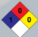
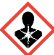
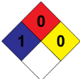
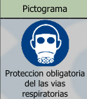
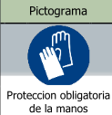
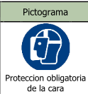
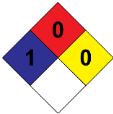
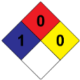
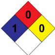

<!-- pagina: 1 -->

*Texto OCR de la imagen (puede contener errores): corona*

## PINTURA PRIMERA MANO & ACABADO

## SECCIÓN 1: IDENTIFICACIÓN DEL PRODUCTO

## 1.1 Identificador SGA del producto: PINTURA PRIMERA MANO & ACABADO

## 1.2 Uso recomendado del producto químico y restricciones:

Usos pertinentes: Pintura decorativa

Usos desaconsejados: Todo aquel uso no especificado en este epígrafe ni en el epígrafe 7.3

## 1.3 Datos sobre el proveedor:

CORLANC S.A.S. Carrera 48 N° 72 sur 01 Avenida Las Vegas 055450 Sabaneta - Antioquia - Colombia Tfno.: +57-4-3787800 materialesypinturascorona@corona.com.co

https://www.corona.co

## 1.4 Número de teléfono para emergencias:

## SECCIÓN 2: IDENTIFICACIÓN DEL PELIGRO O PELIGROS

## 2.1 Clasificación de la sustancia o de la mezcla:

## NFPA:

Salud: 1

Inflamabilidad: 0

Inestabilidad: 0

Especiales: No relevante

## SGA:

La clasificación del producto se ha realizado conforme con al decreto 1496 de 2018, por el cual se adopta el Sistema Globalmente Armonizado de Clasificación y Etiquetado de Productos Químicos y se dictan otras disposiciones en materia de seguridad química.

Carc. 2: Carcinogenicidad, Categoría 2, H351

Sens. Cut. 1: Sensibilización cutánea, Categoría 1, H317

## 2.2 Elementos de las etiquetas del SGA, incluidos los consejos de prudencia:

## NFPA:

*Texto OCR de la imagen (puede contener errores): 1*

## SGA:

## Atención

*Texto OCR de la imagen (puede contener errores): X*

## Indicaciones de peligro:

Carc. 2: H351 - Susceptible de provocar cáncer

Sens. Cut. 1: H317 - Puede provocar una reacción cutánea alérgica

## Consejos de prudencia:

P101: Si se necesita consultar a un médico, tener a mano el recipiente o la etiqueta del producto

P102: Mantener fuera del alcance de los niños

P201: Procurarse las instrucciones antes del uso

P261: Evitar respirar polvos/humos/gases/ nieblas/vapores/aerosoles

P280: Usar guantes/ropa de protección/equipo de protección para los ojos/la cara

P302+P352: EN CASO DE CONTACTO CON LA PIEL: Lavar con abundante agua

P308+P313: EN CASO DE exposición demostrada o supuesta: consultar a un médico

P501: Eliminar el contenido/recipiente mediante el sistema de recogida selectiva habilitado en su municipio

## Sustancias que contribuyen a la clasificación

Dioxido de titanio; Mezcla de: 5-cloro-2-metil-2H-isotiazol-3-ona [EC no. 247-500-7] y 2-metil-2H-isotiazol-3-ona [EC no. 220-2396] (3:1)

## 2.3 Otros peligros que no conducen a una clasificación:

*Texto OCR de la imagen (puede contener errores): 0 | 1 | 0*

<!-- pagina: 2 -->

*Texto OCR de la imagen (puede contener errores): corona*

## Ficha de datos de seguridad

## PINTURA PRIMERA MANO & ACABADO

## SECCIÓN 2: IDENTIFICACIÓN DEL PELIGRO O PELIGROS (continúa)

No relevante

## SECCIÓN 3: COMPOSICIÓN/INFORMACIÓN SOBRE LOS COMPONENTES

## 3.1 Sustancias:

No aplicable

## 3.2 Mezclas:

Descripción química: Mezcla acuosa a base de aditivos, cargas, coalescentes, pigmentos y resinas

## Componentes:

De acuerdo al Decreto 1496 de 2018, el producto presenta:

| Identificación   | Identificación   | Nombre químico/clasificación                | Concentración   |
|------------------|------------------|---------------------------------------------|-----------------|
| CAS:             | 13463-67-7       | Dioxido de titanio Carc. 2: H351 - Atención | 1 - <10 %       |

*Imagen asociada a la tabla #/tables/0: imagen contenida en el área de la tabla en la página 2 (100% de su área).*

Para ampliar información sobre la peligrosidad de la sustancias consultar las secciones 8, 11, 12, 15 y 16. La clasificación respecto Carcinogenicidad de las sustancias se ha establecido en función de las monografías de la IARC adecuandola al sistema de clasificación SGA, para información sobre la clasificación IARC consulte la sección 11.

## SECCIÓN 4: PRIMEROS AUXILIOS

## 4.1 Descripción de los primeros auxilios necesarios:

Los síntomas como consecuencia de una intoxicación pueden presentarse con posterioridad a la exposición, por lo que, en caso de duda, exposición directa al producto químico o persistencia del malestar solicitar atención médica, mostrándole la FDS de este producto.

## Por inhalación:

Se trata de un producto que no contiene sustancias clasificadas como peligrosas por inhalación, sin embargo, en caso de síntomas de intoxicación sacar al afectado de la zona de exposición y proporcionarle aire fresco. Solicitar atención médica si los síntomas se agravan o persisten.

## Por contacto con la piel:

Quitar la ropa y los zapatos contaminados, aclarar la piel o duchar al afectado si procede con abundante agua fría y jabón neutro. En caso de afección importante acudir al médico. Si el producto produce quemaduras o congelación, no se debe quitar la ropa debido a que podría empeorar la lesión producida si esta se encuentra pegada a la piel. En el caso de formarse ampollas en la piel, éstas nunca deben reventarse ya que aumentaría el riesgo de infección.

## Por contacto con los ojos:

Enjuagar los ojos con abundante agua a temperatura ambiente al menos durante 15 minutos. Evitar que el afectado se frote o cierre los ojos. En el caso de que el accidentado use lentes de contacto, éstas deben retirarse siempre que no estén pegadas a los ojos, de otro modo podría producirse un daño adicional. En todos los casos, después del lavado, se debe acudir al médico lo más rápidamente posible con la FDS del producto.

## Por ingestión/aspiración:

En caso de ingestión, solicitar asistencia médica inmediata mostrando la FDS de este producto.

## 4.2 Síntomas/efectos más importantes, agudos o retardados:

Los efectos agudos y retardados son los indicados en las secciones 2 y 11.

## 4.3 Indicación de la necesidad de recibir atención médica inmediata y, en su caso, de tratamiento especial:

No relevante

## SECCIÓN 5: MEDIDAS DE LUCHA CONTRA INCENDIOS

## 5.1 Medios de extinción apropiados:

Producto no inflamable bajo condiciones normales de almacenamiento, manipulación y uso. En caso de inflamación como consecuencia de manipulación, almacenamiento o uso indebido emplear preferentemente extintores de polvo polivalente (polvo ABC). NO SE RECOMIENDA emplear agua a chorro como agente de extinción.

## 5.2 Peligros específicos del producto químico:

Como consecuencia de la combustión o descomposición térmica se generan subproductos de reacción que pueden resultar altamente tóxicos y, consecuentemente, pueden presentar un riesgo elevado para la salud.

*Texto OCR de la imagen (puede contener errores): 0*

<!-- pagina: 3 -->

*Texto OCR de la imagen (puede contener errores): corona*

## Ficha de datos de seguridad

## PINTURA PRIMERA MANO & ACABADO

## SECCIÓN 5: MEDIDAS DE LUCHA CONTRA INCENDIOS (continúa)

## 5.3 Medidas especiales que deben tomar los equipos de lucha contra incendios:

En función de la magnitud del incendio puede hacerse necesario el uso de ropa protectora completa y equipo de respiración autónomo. Disponer de un mínimo de instalaciones de emergencia o elementos de actuación (mantas ignífugas, botiquín portátil,...).

## Disposiciones adicionales:

Actuar conforme el Plan de Emergencia Interior y las Fichas Informativas sobre actuación ante accidentes y otras emergencias. Suprimir cualquier fuente de ignición. En caso de incendio, refrigerar los recipientes y tanques de almacenamiento de productos susceptibles a inflamación, explosión o BLEVE como consecuencia de elevadas temperaturas. Evitar el vertido de los productos empleados en la extinción del incendio al medio acuático.

## SECCIÓN 6: MEDIDAS QUE DEBEN TOMARSE EN CASO DE VERTIDO ACCIDENTAL

## 6.1 Precauciones personales, equipo protector y procedimiento de emergencia:

Aislar las fugas siempre y cuando no suponga un riesgo adicional para las personas que desempeñen esta función. Ante la exposición potencial con el producto derramado se hace obligatorio el uso de elementos de protección personal (ver sección 8). Evacuar la zona y mantener a las personas sin protección alejadas.

## 6.2 Precauciones relativas al medio ambiente:

Producto no clasificado como peligroso para el medioambiente. Mantener el producto alejado de los desagües y de las aguas superficiales y subterráneas.

## 6.3 Métodos y materiales para la contención y limpieza de vertidos:

Se recomienda:

Absorber el vertido mediante arena o absorbente inerte y trasladarlo a un lugar seguro. No absorber en serrín u otros absorbentes combustibles. Para cualquier consideración relativa a la eliminación consultar la sección 13.

## 6.4 Referencias a otras secciones:

Ver secciones 8 y 13.

## SECCIÓN 7: MANIPULACIÓN Y ALMACENAMIENTO

## 7.1 Precauciones que se deben tomar para garantizar una manipulación segura:

## A.- Precauciones generales

Cumplir con la legislación vigente en materia de prevención de riesgos laborales. Mantener los recipientes herméticamente cerrados. Controlar los derrames y residuos, eliminándolos con métodos seguros (sección 6). Evitar el vertido libre desde el recipiente. Mantener orden y limpieza donde se manipulen productos peligrosos.

- B.- Recomendaciones técnicas para la prevención de incendios y explosiones.

Producto no inflamable bajo condiciones normales de almacenamiento, manipulación y uso. Se recomienda trasvasar a velocidades lentas para evitar la generación de cargas electroestáticas que pudieran afectar a productos inflamables. Consultar la sección 10 sobre condiciones y materias que deben evitarse.

- C.- Recomendaciones técnicas para prevenir riesgos ergonómicos y toxicológicos.

Para control de exposición consultar la sección 8. No comer, beber ni fumar en las zonas de trabajo; lavarse las manos después de cada utilización, y despojarse de prendas de vestir y equipos de protección contaminados antes de entrar en las zonas para comer.

- D.- Recomendaciones técnicas para prevenir riesgos medioambientales

Se recomienda disponer de material absorbente en las proximidades del producto (ver epígrafe 6.3)

## 7.2 Condiciones de almacenamiento seguro, incluidas cualesquiera incompatibilidades:

- A.- Medidas técnicas de almacenamiento
- B.- Condiciones generales de almacenamiento.

- **Tª mínima:** 5 ºC  
- **Tª máxima:** 30 ºC  
- **Tiempo máximo:** 36 meses

Evitar fuentes de calor, radiación, electricidad estática y el contacto con alimentos. Para información adicional ver epígrafe 10.5

## 7.3 Usos específicos finales:

*Texto OCR de la imagen (puede contener errores): 0 | 1 | 0*

<!-- pagina: 4 -->

*Texto OCR de la imagen (puede contener errores): corona*

## PINTURA PRIMERA MANO & ACABADO

## SECCIÓN 7: MANIPULACIÓN Y ALMACENAMIENTO (continúa)

Salvo las indicaciones ya especificadas no es preciso realizar ninguna recomendación especial en cuanto a los usos de este producto.

## SECCIÓN 8: CONTROLES DE EXPOSICIÓN/PROTECCIÓN PERSONAL

## 8.1 Parámetros de control:

Sustancias cuyos valores límite de exposición profesional han de controlarse en el ambiente de trabajo (ACGIH):

| Identificación     | Valores límite ambientales   | Valores límite ambientales   |
|--------------------|------------------------------|------------------------------|
| Dioxido de titanio | TLV-TWA                      | 10 mg/m³                     |
| CAS: 13463-67-7    | TLV-STEL                     |                              |

## 8.2 Controles técnicos apropiados:

## A.- Medidas de protección individual, como equipo de protección personal (EPP)

Como medida de prevención se recomienda la utilización de equipos de protección individual básicos. Para más información sobre los equipos de protección individual (almacenamiento, uso, limpieza, mantenimiento, clase de protección,…) consultar el folleto informativo facilitado por el fabricante del EPP. Las indicaciones contenidas en este punto se refieren al producto puro. Las medidas de protección para el producto diluido podrán variar en función de su grado de dilución, uso, método de aplicación, etc. Para determinar la obligación de instalación de duchas de emergencia y/o lavaojos en los almacenes se tendrá en cuenta la normativa referente al almacenamiento de productos químicos aplicable en cada caso. Para más información ver epígrafes 7.1 y 7.2.

Toda la información aquí incluida es una recomendación siendo necesario su concreción por parte de los servicios de prevención de riesgos laborales al desconocer las medidas de prevención adicionales que la empresa pudiese disponer.

## B.- Protección respiratoria.

*Texto del PDF en el área de la imagen (capa de texto, no OCR): Pictograma | Proteccion obligatoria | del las vias | respiratorias*

*Imagen asociada a la tabla #/tables/2: imagen contenida en el área de la tabla en la página 4 (100% de su área).*

| Pictograma                                        | EPP                                        | Observaciones                                                                                                                                                                                                      |
|---------------------------------------------------|--------------------------------------------|--------------------------------------------------------------------------------------------------------------------------------------------------------------------------------------------------------------------|
| Proteccion obligatoria del las vias respiratorias | Máscara autofiltrante para gases y vapores | Reemplazar cuando se detecte olor o sabor del contaminante en el interior de la máscara o adaptador facial. Cuando el contaminante no tiene buenas propiedades de aviso se recomienda el uso de equipos aislantes. |

## C.- Protección específica de las manos.

*Texto del PDF en el área de la imagen (capa de texto, no OCR): Pictograma | Proteccion obligatoria | de la manos*

*Imagen asociada a la tabla #/tables/3: imagen contenida en el área de la tabla en la página 4 (100% de su área).*

| Pictograma                         | EPP                                          | Observaciones                                                                                                                                                                                       |
|------------------------------------|----------------------------------------------|-----------------------------------------------------------------------------------------------------------------------------------------------------------------------------------------------------|
| Proteccion obligatoria de la manos | Guantes NO desechables de protección química | El tiempo de paso (Breakthrough Time) indicado por el fabricante ha de ser superior al del tiempo de uso del producto. No emplear cremas protectoras despues del contacto del producto con la piel. |

Dado que el producto es una mezcla de diferentes materiales, la resistencia del material de los guantes no se puede calcular de antemano con total fiabilidad y por lo tanto tiene que ser controlados antes de su aplicación.

## D.- Protección ocular y facial

*Texto del PDF en el área de la imagen (capa de texto, no OCR): Pictograma | Proteccion obligatoria | de la cara*

*Imagen asociada a la tabla #/tables/4: imagen contenida en el área de la tabla en la página 4 (99% de su área).*

| Pictograma                        | EPP             | Observaciones                                                                                                                                        |
|-----------------------------------|-----------------|------------------------------------------------------------------------------------------------------------------------------------------------------|
|                                   | Pantalla facial | Limpiar a diario y desinfectar periódicamente de acuerdo a las instrucciones del fabricante. Se recomienda su uso en caso de riesgo de salpicaduras. |
| Proteccion obligatoria de la cara |                 |                                                                                                                                                      |

## E.- Protección corporal

| Pictograma                         | EPP                                            | Observaciones                                                                                      |
|------------------------------------|------------------------------------------------|----------------------------------------------------------------------------------------------------|
| Protección obligatoria del cuerpo  | Prenda de protección frente a riesgos químicos | Uso exclusivo en el trabajo. Limpiar periódicamente de acuerdo a las instrucciones del fabricante. |
| Proteccion obligatoria de los pies | Calzado de seguridad contra riesgo químico     | Reemplazar las botas ante cualquier indicio de deterioro.                                          |

- CONTINÚA EN LA SIGUIENTE PÁGINA -

*Texto OCR de la imagen (puede contener errores): 0 | 0*

<!-- pagina: 5 -->

*Texto OCR de la imagen (puede contener errores): corona*

## PINTURA PRIMERA MANO & ACABADO

## SECCIÓN 8: CONTROLES DE EXPOSICIÓN/PROTECCIÓN PERSONAL (continúa)

## F.- Medidas complementarias de emergencia

| Medida de emergencia   | Normas                                       | Medida de emergencia   | Normas                                      |
|------------------------|----------------------------------------------|------------------------|---------------------------------------------|
| Ducha de emergencia    | ANSI Z358-1 ISO 3864-1:2011, ISO 3864-4:2011 | Lavaojos               | DIN 12 899 ISO 3864-1:2011, ISO 3864-4:2011 |

## Controles de la exposición del medio ambiente:

En virtud de la legislación comunitaria de protección del medio ambiente se recomienda evitar el vertido tanto del producto como de su envase al medio ambiente. Para información adicional ver epígrafe 7.1.D

## SECCIÓN 9: PROPIEDADES FÍSICAS Y QUÍMICAS Y CARACTERÍSTICAS DE SEGURIDAD

## 9.1 Información de propiedades físicas y químicas básicas:

Para completar la información ver la ficha técnica/hoja de especificaciones del producto.

## Aspecto físico:

- **Estado físico a 20 ºC:** Líquido  
- **Aspecto:** Denso  
- **Color:**  
- **Olor:**

- [ ] Blanco

Inodoro

Umbral olfativo:

No relevante *

## Volatilidad:

- **Temperatura de ebullición a presión atmosférica:** 102 ºC  
- **Presión de vapor a 20 ºC:** 2342 Pa  
- **Presión de vapor a 50 ºC:** 12337,57 Pa (12,34 kPa)  
- **Tasa de evaporación a 20 ºC:** No relevante *

## Caracterización del producto:

- **Densidad a 20 ºC:** 1371,4 kg/m³  
- **Densidad relativa a 20 ºC:** 1,371  
- **Viscosidad dinámica a 20 ºC:** No relevante *  
- **Viscosidad cinemática a 20 ºC:** No relevante *  
- **Viscosidad cinemática a 40 ºC:** No relevante *  
- **Concentración:** 53 g/L (sustancia activa)  
- **pH:** 8,5 - 9,5  
- **Densidad de vapor a 20 ºC:** No relevante *  
- **Coeficiente de reparto n-octanol/agua a 20 ºC:** No relevante *  
- **Solubilidad en agua a 20 ºC:** No relevante *  
- **Propiedad de solubilidad:** No relevante *  
- **Temperatura de descomposición:** No relevante *  
- **Punto de fusión/punto de congelación:** No relevante *  
- **Propiedades explosivas:** No relevante *  
- **Propiedades comburentes:** No relevante *

## Inflamabilidad:

- **Punto de inflamación:** No inflamable (>93 ºC)  
- **Inflamabilidad (sólido, gas):** No relevante *  
- **Temperatura de auto-inflamación:** 204 ºC  
- **Límite de inflamabilidad inferior:** No relevante *  
- **Límite de inflamabilidad superior:** No relevante *

*No relevante debido a la naturaleza del producto, no aportando información característica de su peligrosidad.

*Texto OCR de la imagen (puede contener errores): 0 | 0*

<!-- pagina: 6 -->

*Texto OCR de la imagen (puede contener errores): corona*

## Ficha de datos de seguridad

según Decreto 1496 de 2018

## PINTURA PRIMERA MANO & ACABADO

## SECCIÓN 9: PROPIEDADES FÍSICAS Y QUÍMICAS Y CARACTERÍSTICAS DE SEGURIDAD (continúa)

## Explosividad:

- **Límite inferior de explosividad:** No relevante *  
- **Límite superior de explosividad:** No relevante *

## 9.2 Información adicional:

- **Tensión superficial a 20 ºC:** No relevante *  
- **Índice de refracción:** No relevante *

*No relevante debido a la naturaleza del producto, no aportando información característica de su peligrosidad.

## SECCIÓN 10: ESTABILIDAD Y REACTIVIDAD

## 10.1 Reactividad:

No se esperan reacciones peligrosas si se cumplen las instrucciones técnicas de almacenamiento de productos químicos. Ver sección 7.

## 10.2 Estabilidad química:

Estable químicamente bajo las condiciones indicadas de almacenamiento, manipulación y uso.

## 10.3 Posibilidad de reacciones peligrosas:

Bajo las condiciones indicadas no se esperan reacciones peligrosas que puedan producir una presión o temperaturas excesivas.

## 10.4 Condiciones que deben evitarse:

Aplicables para manipulación y almacenamiento a temperatura ambiente:

| Choque y fricción   | Contacto con el aire   | Calentamiento   | Luz Solar    | Humedad      |
|---------------------|------------------------|-----------------|--------------|--------------|
| No aplicable        | No aplicable           | No aplicable    | No aplicable | No aplicable |

## 10.5 Materiales incompatibles:

| Ácidos                | Agua         | Materias comburentes   | Materias combustibles   | Otros                          |
|-----------------------|--------------|------------------------|-------------------------|--------------------------------|
| Evitar ácidos fuertes | No aplicable | No aplicable           | No aplicable            | Evitar alcalis o bases fuertes |

## 10.6 Productos de descomposición peligrosos:

Ver epígrafe 10.3, 10.4 y 10.5 para conocer los productos de descomposición específicamente. En dependencia de las condiciones de descomposición, como consecuencia de la misma pueden liberarse mezclas complejas de sustancias químicas: dióxido de carbono (CO2), monóxido de carbono y otros compuestos orgánicos.

## SECCIÓN 11: INFORMACIÓN TOXICOLÓGICA

## 11.1 Información sobre las posibles vías de exposición:

No se dispone de datos experimentales del producto en si mismos relativos a las propiedades toxicológicas

## Efectos peligrosos para la salud:

En caso de exposición repetitiva, prolongada o a concentraciones superiores a las establecidas por los límites de exposición profesionales, pueden producirse efectos adversos para la salud en función de la vía de exposición:

## A- Ingestión (efecto agudo):

- Toxicidad aguda: A la vista de los datos disponibles, no se cumplen los criterios de clasificación, no presentando sustancias clasificadas como peligrosas por ingestión. Para más información ver sección 3.
- Corrosividad/Irritabilidad: A la vista de los datos disponibles, no se cumplen los criterios de clasificación, no presentando sustancias clasificadas como peligrosas por este efecto. Para más información ver sección 3.

## B- Inhalación (efecto agudo):

- Toxicidad aguda: A la vista de los datos disponibles, no se cumplen los criterios de clasificación, no presentando sustancias clasificadas como peligrosas por inhalación. Para más información ver sección 3.
- Corrosividad/Irritabilidad: A la vista de los datos disponibles, no se cumplen los criterios de clasificación, no presentando sustancias clasificadas como peligrosas por este efecto. Para más información ver sección 3.
- C- Contacto con la piel y los ojos (efecto agudo):
- Contacto con la piel: A la vista de los datos disponibles, no se cumplen los criterios de clasificación, no presentando sustancias clasificadas como peligrosas por contacto con la piel. Para más información ver sección 3.
- Contacto con los ojos: A la vista de los datos disponibles, no se cumplen los criterios de clasificación, no presentando sustancias clasificadas como peligrosas por este efecto. Para más información ver sección 3.

*Texto OCR de la imagen (puede contener errores): 0 | 1 | 0*

<!-- pagina: 7 -->

*Texto OCR de la imagen (puede contener errores): corona*

## PINTURA PRIMERA MANO & ACABADO

## SECCIÓN 11: INFORMACIÓN TOXICOLÓGICA (continúa)

- D- Efectos CMR (carcinogenicidad, mutagenicidad y toxicidad para la reproducción):
- Carcinogenicidad: La exposición a este producto puede causar cáncer. Para más información sobre posibles efectos específicos sobre la salud ver sección 2.

IARC: Cuarzo (1 % < RCS < 10 %) (1); Dioxido de silicio (1 % < RCS < 10 %) (3); Dioxido de titanio (2B); Cuarzo (RCS < 1 %) (1)

- Mutagenicidad: A la vista de los datos disponibles, no se cumplen los criterios de clasificación, no presentando sustancias clasificadas como peligrosas por este efecto. Para más información ver sección 3.
- Toxicidad para la reproducción: A la vista de los datos disponibles, no se cumplen los criterios de clasificación, no presentando sustancias clasificadas como peligrosas por este efecto. Para más información ver sección 3.
- E- Efectos de sensibilización:
- Respiratoria: A la vista de los datos disponibles, no se cumplen los criterios de clasificación, no presentando sustancias clasificadas como peligrosas con efectos sensibilizantes. Para más información ver secciónes 2, 3 y 15.
- Cutánea: El contacto prolongado con la piel puede derivar en EPPsodios de dermatitis alérgicas de contacto.
- F- Toxicidad específica en determinados órganos (STOT)-exposición única:

A la vista de los datos disponibles, no se cumplen los criterios de clasificación, no presentando sustancias clasificadas como peligrosas por este efecto. Para más información ver sección 3.

- G- Toxicidad específica en determinados órganos (STOT)-exposición repetida:
- Toxicidad específica en determinados órganos (STOT)-exposición repetida: A la vista de los datos disponibles, no se cumplen los criterios de clasificación, no presentando sustancias clasificadas como peligrosas por este efecto. Para más información ver sección 3.
- Piel: A la vista de los datos disponibles, no se cumplen los criterios de clasificación, no presentando sustancias clasificadas como peligrosas por este efecto. Para más información ver sección 3.
- H- Peligro por aspiración:

A la vista de los datos disponibles, no se cumplen los criterios de clasificación, no presentando sustancias clasificadas como peligrosas por este efecto. Para más información ver sección 3.

## Información adicional:

CAS 13463-67-7 Dióxido de Titanio: IARC lista esta sustancia como un posible carcinógeno humano (grupo 2B), indicando que hay suficientes evidencias para considerarlo carcinógeno en animales pero insuficientes para considerarlo como carcinógeno para seres humanos.

La monografía de IARC para esta sustancia indica que no hay exposición significativa al dióxido de titanio durante el uso normal de productos en los que dióxido de titanio está unido permanentemente a otros materiales, tales como pinturas (Ref: Monografía IARC, Vol. 93, 2010).

El lijado repetido de las superficies de película seca puede producir riesgo de sobreexposición al polvo dependiendo de la duración y nivel de lijado, para evitarla deben tomarse las medidas de protección adecuadas.

## Información toxicológica específica de las sustancias:

| Identificación     | Toxicidad aguda   | Toxicidad aguda   | Género   |
|--------------------|-------------------|-------------------|----------|
| Dioxido de titanio | DL50 oral         | 10000 mg/kg       | Rata     |
| CAS: 13463-67-7    | DL50 cutánea      | 10000 mg/kg       | Conejo   |
|                    | CL50 inhalación   | No relevante      |          |

## SECCIÓN 12: INFORMACIÓN ECOTOXICOLÓGICA

No se disponen de datos experimentales de la mezcla en sí misma relativos a las propiedades ecotoxicológicas.

- 12.1 Toxicidad:

No determinado

- 12.2 Persistencia y degradabilidad:

No disponible

- 12.3 Potencial de bioacumulación:

No determinado

- 12.4 Movilidad en el suelo:

No determinado

- 12.5 Resultados de la valoración PBT y mPmB:

No aplicable

*Texto OCR de la imagen (puede contener errores): 0 | 0*

- CONTINÚA EN LA SIGUIENTE PÁGINA -

<!-- pagina: 8 -->

*Texto OCR de la imagen (puede contener errores): corona*

## PINTURA PRIMERA MANO & ACABADO

## SECCIÓN 12: INFORMACIÓN ECOTOXICOLÓGICA (continúa)

## 12.6 Otros efectos adversos:

No descritos

## SECCIÓN 13: INFORMACIÓN RELATIVA A LA ELIMINACIÓN DE LOS PRODUCTOS

## 13.1 Métodos de eliminación:

## Gestión del residuo (eliminación y valorización):

Consultar al gestor de residuos autorizado las operaciones de valorización y eliminación. En el caso de que el envase haya estado en contacto directo con el producto se gestionará del mismo modo que el propio producto, en caso contrario se gestionará como residuo no peligroso. Se desaconseja su vertido a cursos de agua. Ver epígrafe 6.2.

## Disposiciones legislativas relacionadas con la gestión de residuos:

Legislación relacionada con la gestión de residuos:

Decreto 4741 de 2005, Por el cual se reglamenta parcialmente la prevención y el manejo de los residuos o desechos peligrosos generados en el marco de la gestión integral

## SECCIÓN 14: INFORMACIÓN RELATIVA AL TRANSPORTE

Este producto no está regulado para su transporte

## SECCIÓN 15: INFORMACIÓN SOBRE LA REGLAMENTACIÓN

## 15.1 Disposiciones específicas sobre seguridad, salud y medio ambiente para el producto de que se trate:

NTP (National Toxicology Program): No relevante

## Disposiciones particulares en materia de protección de las personas o el medio ambiente:

Se recomienda emplear la información recopilada en esta hoja de datos de seguridad de materiales como datos de entrada en una evaluación de riesgos de las circunstancias locales con el objeto de establecer las medidas necesarias de prevención de riesgos para el manejo, utilización, almacenamiento y eliminación de este producto.

## Otras legislaciones:

Resolución 0312 de 2019 - Nuevos estándares mínimos del SG-SST

CONPES 3868 - Política de gestión del riesgo asociado al uso de sustancias químicas.

Decreto 1079 de 2015 - decreto único reglamentario del sector transporte

NTC 1692 -Transporte de mercancías peligrosas. Definiciones, clasificación, marcado, etiquetado y rotulado

NTC 4532- Transporte de mercancías peligrosas. Tarjetas de emergencia para transporte de materiales. Elaboración

Decreto número 4741 de 2005

Decreto 1299 de 2008 -Reglamenta departamento de gestión ambiental de empresas a nivel industrial estado

Decreto 321 de 1999 - Adopta el Plan Nacional de Contingencia contra derrames de hidrocarburos, derivados y sustancias nocivas.

NTC 4702 - 1 -Embalaje y Envases para Transporte de Mercancías Peligrosas Clase 1. Explosivos

NTC 4702 - 2 - Embalaje y Envases para Transporte de Mercancías Peligrosas Clase 2. Gases

NTC 4702 - 3 - Embalaje y Envases para Transporte de Mercancías Peligrosas Clase 3. Líquidos Inflamables

NTC 4702 - 4 - Embalaje y Envases para Transporte de Mercancías Peligrosas Clase 4. Sólidos Inflamables, Sustancias que presentan riesgo de combustión espontánea, sustancias que en contacto con el agua desprenden gases inflamables.

NTC 4702 - 5 - Embalaje y Envases para Transporte de Mercancías Peligrosas Clase 5. Sustancias Comburentes y Peróxidos Orgánicos

NTC 4702 - 6 - Embalaje y Envases para Transporte de Mercancías Peligrosas Clase 6. Sustancias Tóxicas e Infecciosas

NTC 4702 - 8 - Embalaje y Envases para Transporte de Mercancías Peligrosas Clase 8. Sustancias Corrosivas

NTC 4702 - 9 - Embalaje y Envases para Transporte de Mercancías Peligrosas Clase 9. Sustancias Peligrosas varias

## SECCIÓN 16: OTRAS INFORMACIONES

## Legislación aplicable a fichas de datos de seguridad:

Esta hoja de datos de seguridad de materiales se ha desarrollado de acuerdo a la norma técnica colombiana NTC 4435:2010

Textos de las frases legislativas contempladas en la sección 2:

H351: Susceptible de provocar cáncer

H317: Puede provocar una reacción cutánea alérgica

*Texto OCR de la imagen (puede contener errores): 0 | 0*

<!-- pagina: 9 -->

*Texto OCR de la imagen (puede contener errores): corona*

## Ficha de datos de seguridad

según Decreto 1496 de 2018

## PINTURA PRIMERA MANO & ACABADO

## SECCIÓN 16: OTRAS INFORMACIONES (continúa)

## Textos de las frases legislativas contempladas en la sección 3:

Las frases indicadas no se refieren al producto en sí, son sólo a título informativo y hacen referencia a los componentes individuales que aparecen en la sección 3

## SGA:

Carc. 2: H351 - Susceptible de provocar cáncer

## Consejos relativos a la formación:

Se recomienda formación mínima en materia de prevención de riesgos laborales al personal que va a manipular este producto, con la finalidad de facilitar la comprensión e interpretación de esta hoja de datos de seguridad de materiales, así como del etiquetado del producto.

## Principales fuentes bibliográficas:

Instituto Colombiano de Normas Técnicas y Certificación (ICONTEC) IARC:Agencia Internacional para la Investigación sobre Cáncer OSHA:Occupational Safety and Health Administration, U.S Department of Labor NTP:National Toxicology Program TOXNET: Toxicology data network

## Abreviaturas y acrónimos:

IMDG: Código Marítimo Internacional de Mercancías Peligrosas IATA: Asociación Internacional de Transporte Aéreo OACI: Organización de Aviación Civil Internacional DQO:Demanda Quimica de oxígeno DBO5:Demanda biológica de oxígeno a los 5 días

## BCF: factor de bioconcentración

DL50: dosis letal 50

CL50: concentración letal 50

EC50: concentración efectiva 50

Log POW: logaritmo coeficiente partición octanol-agua

Koc: coeficiente de partición del carbono orgánico

La información contenida en esta ficha de datos de seguridad está fundamentada en fuentes, conocimientos técnicos y legislación vigente a nivel europeo y estatal, no pudiendo garantizar la exactitud de la misma. Esta información no es posible considerarla como una garantía de las propiedades del producto, se trata simplemente de una descripción en cuanto a los requerimientos en materia de seguridad. La metodología y condiciones de trabajo de los usuarios de este producto se encuentran fuera de nuestro conocimiento y control, siendo siempre responsabilidad última del usuario tomar las medidas necesarias para adecuarse a las exigencias legislativas en cuanto a manipulación, almacenamiento, uso y eliminación de productos químicos. La información de esta ficha de datos de seguridad de materiales únicamente se refiere a este producto, el cual no debe emplearse con fines distintos a los que se especifican.

FIN DE LA FICHA DE DATOS DE SEGURIDAD

*Texto OCR de la imagen (puede contener errores): 0 | 7 | 0*

Emisión: 05/06/2019

Versión: 1

Página 9/9
<!-- encabezados y pies de pagina -->

## Encabezados y pies de página

*Texto del margen superior o inferior de las páginas, que Docling separa del cuerpo. Se lista una sola vez, con las páginas donde aparece.*

- [p. 1] Ficha de datos de seguridad
- [p. 1-3] según Decreto 1496 de 2018
- [p. 1-3, 5-6, 8] - CONTINÚA EN LA SIGUIENTE PÁGINA -
- [p. 1-8] Emisión: 05/06/2019
- [p. 1-8] Versión: 1
- [p. 4-5, 7-8] Ficha de datos de seguridad según Decreto 1496 de 2018
