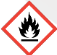
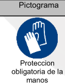
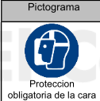
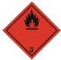
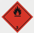
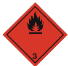

<!-- pagina: 1 -->

*Texto OCR de la imagen (puede contener errores): Pintuco | El Color de la Calidad**

## PINTULACA ROJO CLARO 7587 10014742

## SECCIÓN 1: IDENTIFICACIÓN DEL PRODUCTO

- 1.1 Identificador SGA del producto: PINTULACA ROJO CLARO 7587

10014742

## 1.2 Uso recomendado del producto químico y restricciones:

Usos pertinentes: Pintura industrial. Uso exclusivo usuario profesional.

Usos desaconsejados: Todo aquel uso no especificado en este epígrafe ni en el epígrafe 7.3

## 1.3 Datos sobre el proveedor:

Pintuco Autopista Medellín Bogotá Km 37 Vía Belén Rionegro Km 1 054040 Rionegro - Antioquia - Colombia Tfno.: 57 4 569 81 00 contacto@pintuco.com

http://www.pintuco.com

1.4 Número de teléfono para emergencias: 57 4 561 22 23

## SECCIÓN 2: IDENTIFICACIÓN DEL PELIGRO O PELIGROS

## 2.1 Clasificación de la sustancia o de la mezcla:

## SGA:

La clasificación del producto se ha realizado conforme con al decreto 1496 de 2018, por el cual se adopta el Sistema Globalmente Armonizado de Clasificación y Etiquetado de Productos Químicos y se dictan otras disposiciones en materia de seguridad química.

Acuatico agudo. 3: Peligrosidad aguda para el medio ambiente acuático, Categoría 3, H402 Acuatico cronico. 3: Peligrosidad crónica para el medio ambiente acuático, Categoría 3, H412 Irrit. Cut. 2: Irritación cutánea, categoría 2, H315 Irrit. oc. 2: Irritación ocular, categoría 2, H319 Liq. Infl. 2: Líquidos inflamables, Categoría 2, H225 Repr. 1A: Tóxico para la reproducción, Categoría 1A, H360 Tox. Agud. 4: Toxicidad aguda por inhalación, Categoría 4, H332

## 2.2 Elementos de las etiquetas del SGA, incluidos los consejos de prudencia:

## SGA:

Peligro

## Indicaciones de peligro:

Acuatico cronico. 3: H412 - Nocivo para los organismos acuáticos, con efectos nocivos duraderos Irrit. Cut. 2: H315 - Provoca irritación cutánea Irrit. oc. 2: H319 - Provoca irritación ocular grave

Liq. Infl. 2: H225 - Líquido y vapores muy inflamables

Repr. 1A: H360 - Puede perjudicar la fertilidad o dañar al feto

Tox. Agud. 4: H332 - Nocivo si se inhala

## Consejos de prudencia:

P210: Mantener alejado del calor, superficies calientes, chispas llamas al descubierto y otras fuentes de ignición. No fumar

P280: Usar guantes/ropa de protección/equipo de protección para los ojos/la cara

P304+P340: EN CASO DE INHALACIÓN: Transportar a la persona al aire libre y mantenerla en una posición que le facilite la

P302+P352: EN CASO DE CONTACTO CON LA PIEL: Lavar con abundante agua respiración

P305+P351+P338: EN CASO DE CONTACTO CON LOS OJOS: Enjuagar con agua cuidadosamente durante varios minutos. Quitar las lentes de contacto cuando estén presentes y pueda hacerse con facilidad. Proseguir con el lavado

P308+P313: EN CASO DE exposición demostrada o supuesta: consultar a un médico

P370+P378: En caso de incendio: Utilizar extintor de polvo ABC para la extinción

P501: Eliminar el contenido/recipiente de acuerdo con la normativa sobre residuos peligrosos o envases y residuos de envases respectivamente

## 2.3 Otros peligros que no conducen a una clasificación:

No relevante

## SECCIÓN 3: COMPOSICIÓN/INFORMACIÓN SOBRE LOS COMPONENTES

<!-- pagina: 2 -->

*Texto OCR de la imagen (puede contener errores): Pintuco | El Color de la Calidad**

## Ficha de datos de seguridad

según Decreto 1496 de 2018

## PINTULACA ROJO CLARO 7587 10014742

## SECCIÓN 3: COMPOSICIÓN/INFORMACIÓN SOBRE LOS COMPONENTES (continúa)

## 3.1 Sustancias:

No aplicable

## 3.2 Mezclas:

Descripción química: Mezcla a base de productos químicos

Componentes:

De acuerdo al Decreto 1496 de 2018, el producto presenta:

| Identificación   | Nombre químico/clasificación                               | Concentración   |
|------------------|------------------------------------------------------------|-----------------|
| CAS: 1330-20-7   | Xileno                                                     | 10 - <25 %      |
| CAS: 141-78-6    | Acetato de etilo                                           | 10 - <25 %      |
| CAS: 110-19-0    | Acetato de isobutilo                                       | 2.5 - <10 %     |
| CAS: 12656-85-8  | Rojo de cromato molibdato sulfato de plomo                 | 2.5 - <10 %     |
| CAS: 64-17-5     | Etanol                                                     | 2.5 - <10 %     |
| CAS: 117-81-7    | Ftalato de bis(2-etilhexilo)                               | 2.5 - <10 %     |
| CAS: 111-76-2    | 2-butoxietanol                                             | 2.5 - <10 %     |
| CAS: 67-63-0     | Propan-2-ol                                                | 2.5 - <10 %     |
| CAS: 108-38-3    | m-xileno                                                   | 2.5 - <10 %     |
| CAS: 108-88-3    | Tolueno                                                    | 2.5 - <10 %     |
| CAS: 78-83-1     | 2-metilpropan-1-ol                                         | 1 - <2.5 %      |
| CAS: 78-93-3     | Butanona                                                   | 1 - <2.5 %      |
| CAS: 64742-88-7  | Nafta disolvente (petróleo), fracción alifática intermedia | 1 - <2.5 %      |
| CAS: 100-41-4    | Etilbenceno                                                | <1 %            |

Para ampliar información sobre la peligrosidad de la sustancias consultar las secciones 8, 11, 12, 15 y 16. La clasificación respecto Carcinogenicidad de las sustancias se ha establecido en función de las monografías de la IARC adecuandola al sistema de clasificación SGA, para información sobre la clasificación IARC consulte la sección 11.

## SECCIÓN 4: PRIMEROS AUXILIOS

## 4.1 Descripción de los primeros auxilios necesarios:

Los síntomas como consecuencia de una intoxicación pueden presentarse con posterioridad a la exposición, por lo que, en caso de duda, exposición directa al producto químico o persistencia del malestar solicitar atención médica, mostrándole la FDS de este producto.

## Por inhalación:

Sacar al afectado del lugar de exposición, suministrarle aire limpio y mantenerlo en reposo. En casos graves como parada cardiorespiratoria, se aplicarán técnicas de respiración artificial (respiración boca a boca, masaje cardíaco, suministro de oxígeno,etc.) requiriendo asistencia médica inmediata.

## Por contacto con la piel:

Quitar la ropa y los zapatos contaminados, aclarar la piel o duchar al afectado si procede con abundante agua fría y jabón neutro. En caso de afección importante acudir al médico. Si el producto produce quemaduras o congelación, no se debe quitar la ropa debido a que podría empeorar la lesión producida si esta se encuentra pegada a la piel. En el caso de formarse ampollas en la piel, éstas nunca deben reventarse ya que aumentaría el riesgo de infección.

## Por contacto con los ojos:

<!-- pagina: 3 -->

*Texto OCR de la imagen (puede contener errores): Pintuco | El Color de la Calidad**

según Decreto 1496 de 2018

## PINTULACA ROJO CLARO 7587 10014742

## SECCIÓN 4: PRIMEROS AUXILIOS (continúa)

Enjuagar los ojos con abundante agua a temperatura ambiente al menos durante 15 minutos. Evitar que el afectado se frote o cierre los ojos. En el caso de que el accidentado use lentes de contacto, éstas deben retirarse siempre que no estén pegadas a los ojos, de otro modo podría producirse un daño adicional. En todos los casos, después del lavado, se debe acudir al médico lo más rápidamente posible con la FDS del producto.

## Por ingestión/aspiración:

No inducir al vómito, en el caso de que se produzca mantener inclinada la cabeza hacia delante para evitar la aspiración. Mantener al afectado en reposo. Enjuagar la boca y la garganta, ya que existe la posibilidad de que hayan sido afectadas en la ingestión.

## 4.2 Síntomas/efectos más importantes, agudos o retardados:

Los efectos agudos y retardados son los indicados en las secciones 2 y 11.

## 4.3 Indicación de la necesidad de recibir atención médica inmediata y, en su caso, de tratamiento especial:

No relevante

## SECCIÓN 5: MEDIDAS DE LUCHA CONTRA INCENDIOS

## 5.1 Medios de extinción apropiados:

Emplear preferentemente extintores de polvo polivalente (polvo ABC), alternativamente utilizar espuma física o extintores de dióxido de carbono (CO2). NO SE RECOMIENDA emplear agua a chorro como agente de extinción.

## 5.2 Peligros específicos del producto químico:

Como consecuencia de la combustión o descomposición térmica se generan subproductos de reacción que pueden resultar altamente tóxicos y, consecuentemente, pueden presentar un riesgo elevado para la salud.

## 5.3 Medidas especiales que deben tomar los equipos de lucha contra incendios:

En función de la magnitud del incendio puede hacerse necesario el uso de ropa protectora completa y equipo de respiración autónomo. Disponer de un mínimo de instalaciones de emergencia o elementos de actuación (mantas ignífugas, botiquín portátil,...).

## Disposiciones adicionales:

Actuar conforme el Plan de Emergencia Interior y las Fichas Informativas sobre actuación ante accidentes y otras emergencias. Suprimir cualquier fuente de ignición. En caso de incendio, refrigerar los recipientes y tanques de almacenamiento de productos susceptibles a inflamación, explosión como consecuencia de elevadas temperaturas. Evitar el vertido de los productos empleados en la extinción del incendio al medio acuático.

## SECCIÓN 6: MEDIDAS QUE DEBEN TOMARSE EN CASO DE VERTIDO ACCIDENTAL

## 6.1 Precauciones personales, equipo protector y procedimiento de emergencia:

Aislar las fugas siempre y cuando no suponga un riesgo adicional para las personas que desempeñen esta función. Evacuar la zona y mantener a las personas sin protección alejadas. Ante el contacto potencial con el producto derramado se hace obligatorio el uso de elementos de protección personal (ver sección 8). Evitar de manera prioritaria la formación de mezclas vapor-aire inflamables, ya sea mediante ventilación o el uso de un agente inertizante. Suprimir cualquier fuente de ignición. Eliminar las cargas electroestáticas mediante la interconexión de todas las superficies conductoras sobre las que se puede formar electricidad estática, y estando a su vez el conjunto conectado a tierra.

## 6.2 Precauciones relativas al medio ambiente:

Evitar a toda costa cualquier tipo de vertido al medio acuático. Contener adecuadamente el producto absorbido/recogido en recipientes herméticamente cerrados. Notificar a la autoridad competente en el caso de exposición al público en general o al medioambiente.

## 6.3 Métodos y materiales para la contención y limpieza de vertidos:

Se recomienda:

Absorber el vertido mediante arena o absorbente inerte y trasladarlo a un lugar seguro. No absorber en serrín u otros absorbentes combustibles. Para cualquier consideración relativa a la eliminación consultar la sección 13.

## 6.4 Referencias a otras secciones:

Ver secciones 8 y 13.

## SECCIÓN 7: MANIPULACIÓN Y ALMACENAMIENTO

## 7.1 Precauciones que se deben tomar para garantizar una manipulación segura:

- A.- Precauciones generales

<!-- pagina: 4 -->

*Texto OCR de la imagen (puede contener errores): Pintuco | El Color de la Calidad**

según Decreto 1496 de 2018

## PINTULACA ROJO CLARO 7587 10014742

## SECCIÓN 7: MANIPULACIÓN Y ALMACENAMIENTO (continúa)

Cumplir con la legislación vigente en materia de prevención de riesgos laborales. Mantener los recipientes herméticamente cerrados. Controlar los derrames y residuos, eliminándolos con métodos seguros (sección 6). Evitar el vertido libre desde el recipiente. Mantener orden y limpieza donde se manipulen productos peligrosos.

- B.- Recomendaciones técnicas para la prevención de incendios y explosiones.

Trasvasar en lugares bien ventilados, preferentemente mediante extracción localizada. Controlar totalmente los focos de ignición (teléfonos móviles, chispas,…) y ventilar en las operaciones de limpieza. Evitar la existencia de atmósferas peligrosas en el interior de recipientes, aplicando en lo posible sistemas de inertización. Trasvasar a velocidades lentas para evitar la generación de cargas electroestáticas. Ante la posibilidad de existencia de cargas electroestáticas: asegurar una perfecta conexión equipotencial, utilizar siempre tomas de tierras, no emplear ropa de trabajo de fibras acrílicas, empleando preferiblemente ropa de algodón y calzado conductor. Cumplir con los requisitos esenciales de seguridad para equipos y con las disposiciones mínimas para la protección de la seguridad y salud de los trabajadores. Consultar la sección 10 sobre condiciones y materias que deben evitarse.

- C.- Recomendaciones técnicas para prevenir riesgos ergonómicos y toxicológicos.

LAS MUJERES EMBARAZADAS NO DEBEN EXPONERSE A ESTE PRODUCTO. Manipular en lugares fijos que reúnan las debidas condiciones de seguridad (duchas de emergencia y lavaojos en las proximidades), empleando equipos de protección personal, en especial de cara y manos (ver sección 8). Limitar los trasvases manuales a recipientes de pequeñas cantidad. No comer, beber ni fumar en las zonas de trabajo; lavarse las manos después de cada utilización, y despojarse de prendas de vestir y equipos de protección contaminados antes de entrar en las zonas para comer.

- D.- Recomendaciones técnicas para prevenir riesgos medioambientales

Debido a la peligrosidad de este producto para el medio ambiente se recomienda manipularlo dentro de un área que disponga de barreras de control de la contaminación en caso de vertido, así como disponer de material absorbente en las proximidades del mismo

## 7.2 Condiciones de almacenamiento seguro, incluidas cualesquiera incompatibilidades:

- A.- Medidas técnicas de almacenamiento
- B.- Condiciones generales de almacenamiento.

- **Tª mínima:** 5 ºC  
- **Tª máxima:** 30 ºC  
- **Tiempo máximo:** 18 meses

Evitar fuentes de calor, radiación, electricidad estática y el contacto con alimentos. Para información adicional ver epígrafe 10.5

## 7.3 Usos específicos finales:

Salvo las indicaciones ya especificadas no es preciso realizar ninguna recomendación especial en cuanto a los usos de este producto.

## SECCIÓN 8: CONTROLES DE EXPOSICIÓN/PROTECCIÓN PERSONAL

## 8.1 Parámetros de control:

Sustancias cuyos valores límite de exposición profesional han de controlarse en el ambiente de trabajo (ACGIH):

| Identificación               | Valores límite ambientales   | Valores límite ambientales   | Valores límite ambientales   |
|------------------------------|------------------------------|------------------------------|------------------------------|
| Xileno                       | TLV-TWA                      | 100 ppm                      |                              |
| CAS: 1330-20-7               | TLV-STEL                     | 150 ppm                      |                              |
| Acetato de etilo             | TLV-TWA                      | 150 ppm                      |                              |
| CAS: 141-78-6                | TLV-STEL                     |                              |                              |
| Acetato de isobutilo         | TLV-TWA                      | 150 ppm                      |                              |
| CAS: 110-19-0                | TLV-STEL                     |                              |                              |
| Etanol                       | TLV-TWA                      |                              |                              |
| CAS: 64-17-5                 | TLV-STEL                     | 1000 ppm                     |                              |
| Ftalato de bis(2-etilhexilo) | TLV-TWA                      |                              | 5 mg/m³                      |
| CAS: 117-81-7                | TLV-STEL                     |                              |                              |
| 2-butoxietanol               | TLV-TWA                      | 20 ppm                       |                              |
| CAS: 111-76-2                | TLV-STEL                     |                              |                              |
| Propan-2-ol                  | TLV-TWA                      | 200 ppm                      |                              |
| CAS: 67-63-0                 | TLV-STEL                     | 400 ppm                      |                              |
| Tolueno                      | TLV-TWA                      | 20 ppm                       |                              |
| CAS: 108-88-3                | TLV-STEL                     |                              |                              |
| 2-metilpropan-1-ol           | TLV-TWA                      | 50 ppm                       |                              |
| CAS: 78-83-1                 | TLV-STEL                     |                              |                              |
| Butanona CAS: 78-93-3        | TLV-STEL                     | 50 ppm 100 ppm               |                              |
|                              | TLV-TWA                      |                              |                              |
| Etilbenceno                  | TLV-TWA                      | 20 ppm                       |                              |

<!-- pagina: 5 -->

*Texto OCR de la imagen (puede contener errores): Pintuco | El Color de la Calidad**

## PINTULACA ROJO CLARO 7587 10014742

## SECCIÓN 8: CONTROLES DE EXPOSICIÓN/PROTECCIÓN PERSONAL (continúa)

| Identificación   | Valores límite ambientales   |
|------------------|------------------------------|
| CAS: 100-41-4    | TLV-STEL                     |

## 8.2 Controles técnicos apropiados:

## A.- Medidas de protección individual, como equipo de protección personal (EPP)

Como medida de prevención se recomienda la utilización de equipos de protección individual básicos. Para más información sobre los equipos de protección individual (almacenamiento, uso, limpieza, mantenimiento, clase de protección,…) consultar el folleto informativo facilitado por el fabricante del EPP. Las indicaciones contenidas en este punto se refieren al producto puro. Las medidas de protección para el producto diluido podrán variar en función de su grado de dilución, uso, método de aplicación, etc. Para determinar la obligación de instalación de duchas de emergencia y/o lavaojos en los almacenes se tendrá en cuenta la normativa referente al almacenamiento de productos químicos aplicable en cada caso. Para más información ver epígrafes 7.1 y 7.2.

Toda la información aquí incluida es una recomendación siendo necesario su concreción por parte de los servicios de prevención de riesgos laborales al desconocer las medidas de prevención adicionales que la empresa pudiese disponer.

## B.- Protección respiratoria.

*Texto del PDF en el área de la imagen (capa de texto, no OCR): Proteccion | obligatoria del las | vias respiratorias*

*Imagen asociada a la tabla #/tables/3: imagen contenida en el área de la tabla en la página 5 (100% de su área).*

| Pictograma                                        | EPP                                     | Observaciones                                                                                                                                                                                                      |
|---------------------------------------------------|-----------------------------------------|--------------------------------------------------------------------------------------------------------------------------------------------------------------------------------------------------------------------|
| Proteccion obligatoria del las vias respiratorias | Máscara con filtro para gases y vapores | Reemplazar cuando se detecte olor o sabor del contaminante en el interior de la máscara o adaptador facial. Cuando el contaminante no tiene buenas propiedades de aviso se recomienda el uso de equipos aislantes. |

## C.- Protección específica de las manos.

*Texto del PDF en el área de la imagen (capa de texto, no OCR): Pictograma | Proteccion | obligatoria de la | manos*

*Imagen asociada a la tabla #/tables/4: imagen contenida en el área de la tabla en la página 5 (100% de su área).*

| Pictograma                         | EPP                           | Observaciones                                                                                                                                                                                       |
|------------------------------------|-------------------------------|-----------------------------------------------------------------------------------------------------------------------------------------------------------------------------------------------------|
| Proteccion obligatoria de la manos | Guantes de protección química | El tiempo de paso (Breakthrough Time) indicado por el fabricante ha de ser superior al del tiempo de uso del producto. No emplear cremas protectoras despues del contacto del producto con la piel. |

Dado que el producto es una mezcla de diferentes materiales, la resistencia del material de los guantes no se puede calcular de antemano con total fiabilidad y por lo tanto tiene que ser controlados antes de su aplicación.

## D.- Protección ocular y facial

*Texto del PDF en el área de la imagen (capa de texto, no OCR): Pictograma | Proteccion | obligatoria de la cara*

*Imagen asociada a la tabla #/tables/5: imagen contenida en el área de la tabla en la página 5 (99% de su área).*

| Pictograma                        | EPP                | Observaciones                                                                                                                                        |
|-----------------------------------|--------------------|------------------------------------------------------------------------------------------------------------------------------------------------------|
| Proteccion obligatoria de la cara | Gafas de seguridad | Limpiar a diario y desinfectar periódicamente de acuerdo a las instrucciones del fabricante. Se recomienda su uso en caso de riesgo de salpicaduras. |

## E.- Protección corporal

*Imagen asociada a la tabla #/tables/6: imagen contenida en el área de la tabla en la página 5 (100% de su área).*

*Texto del PDF en el área de la imagen (capa de texto, no OCR): Proteccion | obligatoria de los | pies*

*Imagen asociada a la tabla #/tables/6: imagen contenida en el área de la tabla en la página 5 (100% de su área).*

| Pictograma                         | EPP                                                                                              | Observaciones                                                                                      |
|------------------------------------|--------------------------------------------------------------------------------------------------|----------------------------------------------------------------------------------------------------|
| Proteccion obligatoria del cuerpo  | Prenda de protección frente a riesgos químicos, antiestática e ignífuga                          | Uso exclusivo en el trabajo. Limpiar periódicamente de acuerdo a las instrucciones del fabricante. |
| Proteccion obligatoria de los pies | Calzado de seguridad contra riesgo químico, con propiedades antiestáticas y resistencia al calor | Reemplazar las botas ante cualquier indicio de deterioro.                                          |

## F.- Medidas complementarias de emergencia

<!-- pagina: 6 -->

*Texto OCR de la imagen (puede contener errores): Pintuco | El Color de la Calidad**

según Decreto 1496 de 2018

## PINTULACA ROJO CLARO 7587

## 10014742

## SECCIÓN 8: CONTROLES DE EXPOSICIÓN/PROTECCIÓN PERSONAL (continúa)

*Texto del PDF en el área de la imagen (capa de texto, no OCR): Ducha de emergencia*

*Imagen asociada a la tabla #/tables/7: imagen contenida en el área de la tabla en la página 6 (100% de su área).*

| Medida de emergencia   | Normas                                       | Medida de emergencia   | Normas                                      |
|------------------------|----------------------------------------------|------------------------|---------------------------------------------|
| Ducha de emergencia    | ANSI Z358-1 ISO 3864-1:2011, ISO 3864-4:2011 | Lavaojos               | DIN 12 899 ISO 3864-1:2011, ISO 3864-4:2011 |

## Controles de la exposición del medio ambiente:

En virtud de la legislación comunitaria de protección del medio ambiente se recomienda evitar el vertido tanto del producto como de su envase al medio ambiente. Para información adicional ver epígrafe 7.1.D

## SECCIÓN 9: PROPIEDADES FÍSICAS Y QUÍMICAS Y CARACTERÍSTICAS DE SEGURIDAD

## 9.1 Información de propiedades físicas y químicas básicas:

Para completar la información ver la ficha técnica/hoja de especificaciones del producto.

## Aspecto físico:

- **Estado físico a 20 ºC:** Líquido  
- **Aspecto:** Característico  
- **Color:** Característico  
- **Olor:** Característico  
- **Umbral olfativo:** No relevante *

## Volatilidad:

- **Temperatura de ebullición a presión atmosférica:** 111 ºC  
- **Presión de vapor a 20 ºC:** 3957 Pa  
- **Presión de vapor a 50 ºC:** 17062,59 Pa (17,06 kPa)  
- **Tasa de evaporación a 20 ºC:** No relevante *

## Caracterización del producto:

- **Densidad a 20 ºC:** 1007,8 kg/m³  
- **Densidad relativa a 20 ºC:** 1,004 - 1,03  
- **Viscosidad dinámica a 20 ºC:** No relevante *  
- **Viscosidad cinemática a 20 ºC:** No relevante *  
- **Viscosidad cinemática a 40 ºC:** No relevante *  
- **Concentración:** No relevante *  
- **pH:** No relevante *  
- **Densidad de vapor a 20 ºC:** No relevante *  
- **Coeficiente de reparto n-octanol/agua a 20 ºC:** No relevante *  
- **Solubilidad en agua a 20 ºC:** No relevante *  
- **Propiedad de solubilidad:** No relevante *  
- **Temperatura de descomposición:** No relevante *  
- **Punto de fusión/punto de congelación:** No relevante *  
- **Propiedades explosivas:** No relevante *  
- **Propiedades comburentes:** No relevante *

## Inflamabilidad:

- **Punto de inflamación:** 20 ºC  
- **Inflamabilidad (sólido, gas):** No relevante *  
- **Temperatura de auto-inflamación:** 230 ºC  
- **Límite de inflamabilidad inferior:** No determinado  
- **Límite de inflamabilidad superior:** No determinado

## Explosividad:

*No relevante debido a la naturaleza del producto, no aportando información característica de su peligrosidad.

*Texto OCR de la imagen (puede contener errores): +*

*Imagen asociada a la tabla #/tables/7: imagen contenida en el área de la tabla en la página 6 (100% de su área).*

<!-- pagina: 7 -->

*Texto OCR de la imagen (puede contener errores): Pintuco | El Color de la Calidad**

## Ficha de datos de seguridad

según Decreto 1496 de 2018

## PINTULACA ROJO CLARO 7587 10014742

## SECCIÓN 9: PROPIEDADES FÍSICAS Y QUÍMICAS Y CARACTERÍSTICAS DE SEGURIDAD (continúa)

- **Límite inferior de explosividad:** No relevante *  
- **Límite superior de explosividad:** No relevante *

## 9.2 Información adicional:

- **Tensión superficial a 20 ºC:** No relevante *  
- **Índice de refracción:** No relevante *

*No relevante debido a la naturaleza del producto, no aportando información característica de su peligrosidad.

## SECCIÓN 10: ESTABILIDAD Y REACTIVIDAD

## 10.1 Reactividad:

No se esperan reacciones peligrosas si se cumplen las instrucciones técnicas de almacenamiento de productos químicos. Ver sección 7.

## 10.2 Estabilidad química:

Estable químicamente bajo las condiciones indicadas de almacenamiento, manipulación y uso.

## 10.3 Posibilidad de reacciones peligrosas:

Bajo las condiciones indicadas no se esperan reacciones peligrosas que puedan producir una presión o temperaturas excesivas.

## 10.4 Condiciones que deben evitarse:

Aplicables para manipulación y almacenamiento a temperatura ambiente:

| Choque y fricción   | Contacto con el aire   | Calentamiento         | Luz Solar                 | Humedad      |
|---------------------|------------------------|-----------------------|---------------------------|--------------|
| No aplicable        | No aplicable           | Riesgo de inflamación | Evitar incidencia directa | No aplicable |

## 10.5 Materiales incompatibles:

| Ácidos                | Agua         | Materias comburentes      | Materias combustibles   | Otros                          |
|-----------------------|--------------|---------------------------|-------------------------|--------------------------------|
| Evitar ácidos fuertes | No aplicable | Evitar incidencia directa | No aplicable            | Evitar alcalis o bases fuertes |

## 10.6 Productos de descomposición peligrosos:

Ver epígrafe 10.3, 10.4 y 10.5 para conocer los productos de descomposición específicamente. En dependencia de las condiciones de descomposición, como consecuencia de la misma pueden liberarse mezclas complejas de sustancias químicas: dióxido de carbono (CO2), monóxido de carbono y otros compuestos orgánicos.

## SECCIÓN 11: INFORMACIÓN TOXICOLÓGICA

## 11.1 Información sobre las posibles vías de exposición:

No se dispone de datos experimentales del producto en si mismos relativos a las propiedades toxicológicas

Contiene glicoles, posibilidad de efectos peligrosos para la salud, por lo que se recomienda no respirar sus vapores prolongadamente

## Efectos peligrosos para la salud:

En caso de exposición repetitiva, prolongada o a concentraciones superiores a las establecidas por los límites de exposición profesionales, pueden producirse efectos adversos para la salud en función de la vía de exposición:

## A- Ingestión (efecto agudo):

- Toxicidad aguda: A la vista de los datos disponibles, no se cumplen los criterios de clasificación. Para más información ver sección 3.
- Corrosividad/Irritabilidad: La ingesta de una dosis considerable puede originar irritación de garganta, dolor abdominal, náuseas y vómitos.
- B- Inhalación (efecto agudo):
- Toxicidad aguda: Una exposición a altas concentraciones pueden motivar depresión del sistema nervioso central ocasionando dolor de cabeza, mareos, vértigos, nauseas, vómitos, confusión y en caso de afección grave, pérdida de conciencia.
- Corrosividad/Irritabilidad: A la vista de los datos disponibles, no se cumplen los criterios de clasificación. Para más información ver sección 3.
- C- Contacto con la piel y los ojos (efecto agudo):
- Contacto con la piel: Produce inflamación cutánea.
- Contacto con los ojos: Produce lesiones oculares tras contacto.

<!-- pagina: 8 -->

*Texto OCR de la imagen (puede contener errores): Pintuco | El Color de la Calidad**

## Ficha de datos de seguridad

## PINTULACA ROJO CLARO 7587 10014742

## SECCIÓN 11: INFORMACIÓN TOXICOLÓGICA (continúa)

- D- Efectos CMR (carcinogenicidad, mutagenicidad y toxicidad para la reproducción):
- Carcinogenicidad: A la vista de los datos disponibles, no se cumplen los criterios de clasificación. Para más información ver sección 3.

IARC: Xileno (3); Ftalato de bis(2-etilhexilo) (2B); Propan-2-ol (3); 2-butoxietanol (3); Tolueno (3); Etilbenceno (2B); Rojo de cromato molibdato sulfato de plomo (2A)

- Mutagenicidad: A la vista de los datos disponibles, no se cumplen los criterios de clasificación, no presentando sustancias clasificadas como peligrosas por este efecto. Para más información ver sección 3.
- Toxicidad para la reproducción: Puede perjudicar la fertilidad o dañar al feto

## E- Efectos de sensibilización:

- Respiratoria: A la vista de los datos disponibles, no se cumplen los criterios de clasificación, no presentando sustancias clasificadas como peligrosas con efectos sensibilizantes. Para más información ver secciones 2, 3 y 15.
- Cutánea: A la vista de los datos disponibles, no se cumplen los criterios de clasificación, no presentando sustancias clasificadas como peligrosas por este efecto. Para más información ver sección 3.
- F- Toxicidad específica en determinados órganos (STOT)-exposición única:

A la vista de los datos disponibles, no se cumplen los criterios de clasificación. Para más información ver sección 3.

- G- Toxicidad específica en determinados órganos (STOT)-exposición repetida:
- Toxicidad específica en determinados órganos (STOT)-exposición repetida: A la vista de los datos disponibles, no se cumplen los criterios de clasificación. Para más información ver sección 3.
- Piel: A la vista de los datos disponibles, no se cumplen los criterios de clasificación, no presentando sustancias clasificadas como peligrosas por este efecto. Para más información ver sección 3.

## H- Peligro por aspiración:

A la vista de los datos disponibles, no se cumplen los criterios de clasificación. Para más información ver sección 3.

## Información adicional:

CAS 100-41-4 Etilbenceno: El etilbenceno presente en el producto es un componente del Xileno. El etilbenceno es un componente importante de los xilenos técnicos, la toxicología de estos productos fue revisada (WHO, 1997), IARC ha evaluado a los Xilenos como no clasificables en cuanto a su carcinogenicidad a los humanos (Grupo 3) (IARC, 1999) (Ref: Monografía IARC, Vol. 77, 2000; Vol. 71, 1999).

## Información toxicológica específica de las sustancias:

| Identificación               | Toxicidad aguda   | Toxicidad aguda      | Género   |
|------------------------------|-------------------|----------------------|----------|
| Xileno                       | DL50 oral         | 2100 mg/kg           | Rata     |
| CAS: 1330-20-7               | DL50 cutánea      | 1100 mg/kg (ATEi)    | Rata     |
|                              | CL50 inhalación   | 11 mg/L (4 h) (ATEi) |          |
| 2-metilpropan-1-ol           | DL50 oral         | 3350 mg/kg           | Rata     |
| CAS: 78-83-1                 | DL50 cutánea      | 2460 mg/kg           | Conejo   |
|                              | CL50 inhalación   | 24,6 mg/L (4 h)      | Rata     |
| Ftalato de bis(2-etilhexilo) | DL50 oral         | 29998 mg/kg          | Rata     |
| CAS: 117-81-7                | DL50 cutánea      | 24500 mg/kg          | Conejo   |
|                              | CL50 inhalación   | 10,62 mg/L (4 h)     | Rata     |
| Etanol                       | DL50 oral         | 6200 mg/kg           | Rata     |
| CAS: 64-17-5                 | DL50 cutánea      | 20000 mg/kg          | Conejo   |
|                              | CL50 inhalación   | 124,7 mg/L (4 h)     | Rata     |
| Propan-2-ol                  | DL50 oral         | 5280 mg/kg           | Rata     |
| CAS: 67-63-0                 | DL50 cutánea      | 12800 mg/kg          | Rata     |
|                              | CL50 inhalación   | 72,6 mg/L (4 h)      | Rata     |
| Acetato de etilo             | DL50 oral         | 4100 mg/kg           | Rata     |
| CAS: 141-78-6                | DL50 cutánea      | 20000 mg/kg          | Conejo   |
|                              | CL50 inhalación   | No relevante         |          |

<!-- pagina: 9 -->

*Texto OCR de la imagen (puede contener errores): Pintuco | El Color de la Calidad**

## PINTULACA ROJO CLARO 7587 10014742

## SECCIÓN 11: INFORMACIÓN TOXICOLÓGICA (continúa)

| Identificación - Acetato de isobutilo                      | Toxicidad aguda - DL50 oral   | Toxicidad aguda - 13413 mg/kg   | Género - Rata   |
|------------------------------------------------------------|-------------------------------|---------------------------------|-----------------|
| CAS: 110-19-0                                              | DL50 cutánea                  | 17400 mg/kg                     | Conejo          |
| CAS: 110-19-0                                              | CL50 inhalación               | No relevante                    |                 |
| 2-butoxietanol                                             | DL50 oral                     | 1414 mg/kg                      | Rata            |
| CAS: 111-76-2                                              | DL50 cutánea                  | 1060 mg/kg                      | Conejo          |
| CAS: 111-76-2                                              | CL50 inhalación               | 11 mg/L (4 h)                   | Rata            |
| Butanona                                                   | DL50 oral                     | 4000 mg/kg                      | Rata            |
| CAS: 78-93-3                                               | DL50 cutánea                  | 6400 mg/kg                      | Conejo          |
| CAS: 78-93-3                                               | CL50 inhalación               | 23,5 mg/L (4 h)                 | Rata            |
| Tolueno                                                    | DL50 oral                     | 5580 mg/kg                      | Rata            |
| CAS: 108-88-3                                              | DL50 cutánea                  | 12124 mg/kg                     | Rata            |
| CAS: 108-88-3                                              | CL50 inhalación               | 28,1 mg/L (4 h)                 | Rata            |
| m-xileno                                                   | DL50 oral                     | 1590 mg/kg                      | Ratón           |
| CAS: 108-38-3                                              | DL50 cutánea                  | 1100 mg/kg (ATEi)               |                 |
| CAS: 108-38-3                                              | CL50 inhalación               | 11 mg/L (4 h) (ATEi)            |                 |
| Nafta disolvente (petróleo), fracción alifática intermedia | DL50 oral                     | 5100 mg/kg                      | Rata            |
| CAS: 64742-88-7                                            | DL50 cutánea                  | No relevante                    |                 |
| CAS: 64742-88-7                                            | CL50 inhalación               | No relevante                    |                 |
| Rojo de cromato molibdato sulfato de plomo CAS: 12656-85-8 | DL50 oral                     | 5100 mg/kg                      | Rata            |
|                                                            | DL50 cutánea                  | No relevante                    |                 |
|                                                            | CL50 inhalación               | No relevante                    |                 |
| Etilbenceno                                                | DL50 oral                     | 3500 mg/kg                      | Rata            |
| CAS: 100-41-4                                              | DL50 cutánea                  | 15354 mg/kg                     | Conejo          |
| CAS: 100-41-4                                              | CL50 inhalación               | 17,2 mg/L (4 h)                 | Rata            |

## SECCIÓN 12: INFORMACIÓN ECOTOXICOLÓGICA

No se disponen de datos experimentales de la mezcla en sí misma relativos a las propiedades ecotoxicológicas.

## 12.1 Toxicidad:

| Identificación                                             | Toxicidad aguda   | Toxicidad aguda     | Especie                         | Género    |
|------------------------------------------------------------|-------------------|---------------------|---------------------------------|-----------|
| Xileno                                                     | CL50              | 13,5 mg/L (96 h)    | Oncorhynchus mykiss             | Pez       |
| CAS: 1330-20-7                                             | CE50              | 3,4 mg/L (48 h)     | Ceriodaphnia dubia              | Crustáceo |
|                                                            | CE50              | 10 mg/L (72 h)      | Skeletonema costatum            | Alga      |
| Acetato de etilo                                           | CL50              | 230 mg/L (96 h)     | Pimephales promelas             | Pez       |
| CAS: 141-78-6                                              | CE50              | 717 mg/L (48 h)     | Daphnia magna                   | Crustáceo |
| CAS: 141-78-6                                              | CE50              | 3300 mg/L (48 h)    | Scenedesmus subspicatus         | Alga      |
| Acetato de isobutilo                                       | CL50              | 120 mg/L (48 h)     | Leuciscus idus                  | Pez       |
| CAS: 110-19-0                                              | CE50              | 168 mg/L (24 h)     | Daphnia magna                   | Crustáceo |
| CAS: 110-19-0                                              | CE50              | 80 mg/L (8 h)       | Scenedesmus quadricauda         | Alga      |
| Rojo de cromato molibdato sulfato de plomo CAS: 12656-85-8 | CL50              | 0,1 - 1 mg/L (96 h) |                                 | Pez       |
|                                                            | CE50              | 0,1 - 1 mg/L        |                                 | Crustáceo |
|                                                            | CE50              | 0,1 - 1 mg/L        |                                 | Alga      |
| Etanol                                                     | CL50              | 11000 mg/L (96 h)   | Alburnus alburnus               | Pez       |
| CAS: 64-17-5                                               | CE50              | 9268 mg/L (48 h)    | Daphnia magna                   | Crustáceo |
| CAS: 64-17-5                                               | CE50              | 1450 mg/L (192 h)   | Microcystis aeruginosa          | Alga      |
| Ftalato de bis(2-etilhexilo)                               | CL50              | 7,5 mg/L (96 h)     | Pimephales promelas             | Pez       |
| CAS: 117-81-7                                              | CE50              | 9,4 mg/L (48 h)     | Daphnia magna                   | Crustáceo |
| CAS: 117-81-7                                              | CE50              | 100 mg/L (96 h)     | Gymnodinium breve               | Alga      |
| 2-butoxietanol                                             | CL50              | 1490 mg/L (96 h)    | Lepomis macrochirus             | Pez       |
| CAS: 111-76-2                                              | CE50              | 1815 mg/L (48 h)    | Daphnia magna                   | Crustáceo |
| CAS: 111-76-2                                              | CE50              | 911 mg/L (72 h)     | Pseudokirchneriella subcapitata | Alga      |

<!-- pagina: 10 -->

*Texto OCR de la imagen (puede contener errores): Pintuco | El Color de la Calidad**

## PINTULACA ROJO CLARO 7587

## SECCIÓN 12: INFORMACIÓN ECOTOXICOLÓGICA (continúa)

| Identificación           | Toxicidad aguda   | Toxicidad aguda   | Especie                 | Género    |
|--------------------------|-------------------|-------------------|-------------------------|-----------|
| Propan-2-ol CAS: 67-63-0 | CL50              | 9640 mg/L (96 h)  | Pimephales promelas     | Pez       |
|                          | CE50              | 13299 mg/L (48 h) | Daphnia magna           | Crustáceo |
|                          | CE50              | 1000 mg/L (72 h)  | Scenedesmus subspicatus | Alga      |
| m-xileno                 | CL50              | 16 mg/L (96 h)    | Carassius auratus       | Pez       |
| CAS: 108-38-3            | CE50              | 9,56 mg/L (48 h)  | Daphnia magna           | Crustáceo |
|                          | CE50              | No relevante      |                         |           |
| Tolueno                  | CL50              | 13 mg/L (96 h)    | Carassius auratus       | Pez       |
| CAS: 108-88-3            | CE50              | 11,5 mg/L (48 h)  | Daphnia magna           | Crustáceo |
|                          | CE50              | 125 mg/L (48 h)   | Scenedesmus subspicatus | Alga      |
| 2-metilpropan-1-ol       | CL50              | 2030 mg/L (96 h)  | Carassius auratus       | Pez       |
| CAS: 78-83-1             | CE50              | 1439 mg/L (48 h)  | Daphnia magna           | Crustáceo |
|                          | CE50              | 1250 mg/L (48 h)  | Scenedesmus subspicatus | Alga      |
| Butanona                 | CL50              | 3220 mg/L (96 h)  | Pimephales promelas     | Pez       |
| CAS: 78-93-3             | CE50              | 5091 mg/L (48 h)  | Daphnia magna           | Crustáceo |
|                          | CE50              | 4300 mg/L (168 h) | Scenedesmus quadricauda | Alga      |
| Etilbenceno              | CL50              | 42,3 mg/L (96 h)  | Pimephales promelas     | Pez       |
| CAS: 100-41-4            | CE50              | 75 mg/L (48 h)    | Daphnia magna           | Crustáceo |
|                          | CE50              | 63 mg/L (3 h)     | Chlorella vulgaris      | Alga      |

## 12.2 Persistencia y degradabilidad:

| Identificación - Xileno                    | Degradabilidad - DBO5   | Degradabilidad - No relevante   | Biodegradabilidad - Concentración   | Biodegradabilidad - No relevante   |
|--------------------------------------------|-------------------------|---------------------------------|-------------------------------------|------------------------------------|
| CAS: 1330-20-7                             | DQO                     | No relevante                    | Periodo                             | 28 días                            |
|                                            | DBO5/DQO                | No relevante                    | % Biodegradado                      | 88 %                               |
| Acetato de etilo                           | DBO5                    | 1.36 g O2/g                     | Concentración                       | 100 mg/L                           |
| CAS: 141-78-6                              | DQO                     | 1.69 g O2/g                     | Periodo                             | 14 días                            |
|                                            | DBO5/DQO                | 0.81                            | % Biodegradado                      | 83 %                               |
| Acetato de isobutilo                       | DBO5                    | No relevante                    | Concentración                       | No relevante                       |
| CAS: 110-19-0                              | DQO                     | No relevante                    | Periodo                             | 20 días                            |
|                                            | DBO5/DQO                | No relevante                    | % Biodegradado                      | 81 %                               |
| Etanol CAS: 64-17-5                        | DBO5                    | No relevante                    | Concentración                       | 100 mg/L                           |
|                                            | DQO                     | No relevante                    | Periodo                             | 14 días                            |
|                                            | DBO5/DQO                | 0.57                            | % Biodegradado                      | 89 %                               |
| Ftalato de bis(2-etilhexilo) CAS: 117-81-7 | DBO5                    | No relevante                    | Concentración                       | 100 mg/L                           |
|                                            | DQO                     | No relevante                    | Periodo                             | 28 días                            |
|                                            | DBO5/DQO                | No relevante                    | % Biodegradado                      | 69 %                               |
| 2-butoxietanol                             | DBO5                    | 0.71 g O2/g                     | Concentración                       | 100 mg/L                           |
| CAS: 111-76-2                              | DQO                     | 2.2 g O2/g                      | Periodo                             | 14 días                            |
|                                            | DBO5/DQO                | 0.32                            | % Biodegradado                      | 96 %                               |
| Propan-2-ol                                | DBO5                    | 1.19 g O2/g                     | Concentración                       | 100 mg/L                           |
| CAS: 67-63-0                               | DQO                     | 2.23 g O2/g                     | Periodo                             | 14 días                            |
|                                            | DBO5/DQO                | 0.53                            | % Biodegradado                      | 86 %                               |
| Tolueno                                    | DBO5                    | 2.5 g O2/g                      | Concentración                       | 100 mg/L                           |
| CAS: 108-88-3                              | DQO                     | No relevante                    | Periodo                             | 14 días                            |
|                                            | DBO5/DQO                | No relevante                    | % Biodegradado                      | 100 %                              |
| 2-metilpropan-1-ol                         | DBO5                    | 0.4 g O2/g                      | Concentración                       | 100 mg/L                           |
| CAS: 78-83-1                               | DQO                     | 2.41 g O2/g                     | Periodo                             | 14 días                            |
|                                            | DBO5/DQO                | 0.17                            | % Biodegradado                      | 90 %                               |
| Butanona                                   | DBO5                    | 2.03 g O2/g                     | Concentración                       | No relevante                       |
| CAS: 78-93-3                               | DQO                     | 2.31 g O2/g                     | Periodo                             | 20 días                            |
|                                            | DBO5/DQO                | 0.88                            | % Biodegradado                      | 89 %                               |
| Etilbenceno                                | DBO5                    | No relevante                    | Concentración                       | 100 mg/L                           |
| CAS: 100-41-4                              | DQO                     | No relevante                    | Periodo                             | 14 días                            |
|                                            | DBO5/DQO                | No relevante                    | % Biodegradado                      | 90 %                               |

<!-- pagina: 11 -->

*Texto OCR de la imagen (puede contener errores): Pintuco | El Color de la Calidad*

## PINTULACA ROJO CLARO 7587

## SECCIÓN 12: INFORMACIÓN ECOTOXICOLÓGICA (continúa)

- 12.3 Potencial de bioacumulación:
- 12.4 Movilidad en el suelo:

| Identificación - Xileno            | Potencial de bioacumulación - BCF   | Potencial de bioacumulación - 9   |
|------------------------------------|-------------------------------------|-----------------------------------|
| CAS: 1330-20-7                     | Log POW                             | 2,77                              |
| CAS: 1330-20-7                     | Potencial                           | Bajo                              |
| Acetato de etilo                   | BCF                                 | 30                                |
| CAS: 141-78-6                      | Log POW                             | 0,73                              |
| CAS: 141-78-6                      | Potencial                           | Moderado                          |
| Acetato de isobutilo CAS: 110-19-0 | BCF                                 | 10                                |
|                                    | Log POW                             | 1,78                              |
|                                    | Potencial                           | Bajo                              |
| Etanol                             | BCF                                 | 3                                 |
| CAS: 64-17-5                       | Log POW                             | -0,31                             |
| CAS: 64-17-5                       | Potencial                           | Bajo                              |
| Ftalato de bis(2-etilhexilo)       | BCF                                 | 14                                |
| CAS: 117-81-7                      | Log POW                             | 8                                 |
| CAS: 117-81-7                      | Potencial                           | Bajo                              |
| 2-butoxietanol                     | BCF                                 | 3                                 |
| CAS: 111-76-2                      | Log POW                             | 0,83                              |
| CAS: 111-76-2                      | Potencial                           | Bajo                              |
| Propan-2-ol                        | BCF                                 | 3                                 |
| CAS: 67-63-0                       | Log POW                             | 0,05                              |
| CAS: 67-63-0                       | Potencial                           | Bajo                              |
| m-xileno                           | BCF                                 | 15                                |
| CAS: 108-38-3                      | Log POW                             | 3,2                               |
| CAS: 108-38-3                      | Potencial                           | Bajo                              |
| Tolueno                            | BCF                                 | 13                                |
| CAS: 108-88-3                      | Log POW                             | 2,73                              |
|                                    | Potencial                           | Bajo                              |
| 2-metilpropan-1-ol                 | BCF                                 | 3                                 |
| CAS: 78-83-1                       | Log POW                             | 0,76                              |
|                                    | Potencial                           | Bajo                              |
| Butanona                           | BCF                                 | 3                                 |
| CAS: 78-93-3                       | Log POW                             | 0,29                              |
|                                    | Potencial                           | Bajo                              |
| Etilbenceno                        | BCF                                 | 1                                 |
|                                    | Log                                 | 3,15                              |
| CAS: 100-41-4                      | POW Potencial                       | Bajo                              |

| Identificación - Xileno   | Absorción/Desorción - Koc   | Absorción/Desorción - 202   | Volatilidad - Henry   | Volatilidad - 524,86 Pa·m³/mol   |
|---------------------------|-----------------------------|-----------------------------|-----------------------|----------------------------------|
| CAS: 1330-20-7            | Conclusión                  | Moderado                    | Suelo seco            | Sí                               |
|                           | Tensión superficial         | No relevante                | Suelo húmedo          | Sí                               |
| Acetato de etilo          | Koc                         | 59                          | Henry                 | 13,58 Pa·m³/mol                  |
| CAS: 141-78-6             | Conclusión                  | Muy Alto                    | Suelo seco            | Sí                               |
|                           | Tensión superficial         | 2,324E-2 N/m (25 ºC)        | Suelo húmedo          | Sí                               |
| Acetato de isobutilo      | Koc                         | No relevante                | Henry                 | No relevante                     |
| CAS: 110-19-0             | Conclusión                  | No relevante                | Suelo seco            | No relevante                     |
|                           | Tensión superficial         | 2,297E-2 N/m (25 ºC)        | Suelo húmedo          | No relevante                     |
| Etanol                    | Koc                         | 1                           | Henry                 | 4,61E-1 Pa·m³/mol                |
| CAS: 64-17-5              | Conclusión                  | Muy Alto                    | Suelo seco            | Sí                               |
|                           | Tensión superficial         | 2,339E-2 N/m (25 ºC)        | Suelo húmedo          | Sí                               |

- CONTINÚA EN LA SIGUIENTE PÁGINA -

<!-- pagina: 12 -->

*Texto OCR de la imagen (puede contener errores): Pintuco | El Color de la Calidad**

## Ficha de datos de seguridad

según Decreto 1496 de 2018

## PINTULACA ROJO CLARO 7587 10014742

## SECCIÓN 12: INFORMACIÓN ECOTOXICOLÓGICA (continúa)

| Identificación                  | Absorción/Desorción   | Absorción/Desorción   | Volatilidad   | Volatilidad        |
|---------------------------------|-----------------------|-----------------------|---------------|--------------------|
| 2-butoxietanol CAS: 111-76-2    | Koc                   | 8                     | Henry         | 1,621E-1 Pa·m³/mol |
| 2-butoxietanol CAS: 111-76-2    | Conclusión            | Muy Alto              | Suelo seco    | No                 |
| 2-butoxietanol CAS: 111-76-2    | Tensión superficial   | 2,729E-2 N/m (25 ºC)  | Suelo húmedo  | Sí                 |
| Propan-2-ol CAS: 67-63-0        | Koc                   | 1,5                   | Henry         | 8,207E-1 Pa·m³/mol |
| Propan-2-ol CAS: 67-63-0        | Conclusión            | Muy Alto              | Suelo seco    | Sí                 |
| Propan-2-ol CAS: 67-63-0        | Tensión superficial   | 2,24E-2 N/m (25 ºC)   | Suelo húmedo  | Sí                 |
| m-xileno CAS: 108-38-3          | Koc                   | 182                   | Henry         | 790,34 Pa·m³/mol   |
| m-xileno CAS: 108-38-3          | Conclusión            | Moderado              | Suelo seco    | Sí                 |
| m-xileno CAS: 108-38-3          | Tensión superficial   | 2,826E-2 N/m (25 ºC)  | Suelo húmedo  | Sí                 |
| Tolueno CAS: 108-88-3           | Koc                   | 178                   | Henry         | 672,8 Pa·m³/mol    |
| Tolueno CAS: 108-88-3           | Conclusión            | Moderado              | Suelo seco    | Sí                 |
| Tolueno CAS: 108-88-3           | Tensión superficial   | 2,793E-2 N/m (25 ºC)  | Suelo húmedo  | Sí                 |
| 2-metilpropan-1-ol CAS: 78-83-1 | Koc                   | No relevante          | Henry         | No relevante       |
| 2-metilpropan-1-ol CAS: 78-83-1 | Conclusión            | No relevante          | Suelo seco    | No relevante       |
| 2-metilpropan-1-ol CAS: 78-83-1 | Tensión superficial   | 2,378E-2 N/m (25 ºC)  | Suelo húmedo  | No relevante       |
| Butanona CAS: 78-93-3           | Koc                   | 30                    | Henry         | 5,77 Pa·m³/mol     |
| Butanona CAS: 78-93-3           | Conclusión            | Muy Alto              | Suelo seco    | Sí                 |
| Butanona CAS: 78-93-3           | Tensión superficial   | 2,396E-2 N/m (25 ºC)  | Suelo húmedo  | Sí                 |
| Etilbenceno CAS: 100-41-4       | Koc                   | 520                   | Henry         | 798,44 Pa·m³/mol   |
| Etilbenceno CAS: 100-41-4       | Conclusión            | Moderado              | Suelo seco    | Sí                 |
| Etilbenceno CAS: 100-41-4       | Tensión superficial   | 2,859E-2 N/m (25 ºC)  | Suelo húmedo  | Sí                 |

## 12.5 Resultados de la valoración PBT y mPmB:

No aplicable

## 12.6 Otros efectos adversos:

No descritos

## SECCIÓN 13: INFORMACIÓN RELATIVA A LA ELIMINACIÓN DE LOS PRODUCTOS

## 13.1 Métodos de eliminación:

## Gestión del residuo (eliminación y valorización):

Consultar al gestor de residuos autorizado las operaciones de valorización y eliminación. En el caso de que el envase haya estado en contacto directo con el producto se gestionará del mismo modo que el propio producto, en caso contrario se gestionará como residuo no peligroso. Se desaconseja su vertido a cursos de agua. Ver epígrafe 6.2.

## Disposiciones legislativas relacionadas con la gestión de residuos:

Legislación relacionada con la gestión de residuos:

Decreto 4741 de 2005, Por el cual se reglamenta parcialmente la prevención y el manejo de los residuos o desechos peligrosos generados en el marco de la gestión integral

## SECCIÓN 14: INFORMACIÓN RELATIVA AL TRANSPORTE

## Transporte terrestre de mercancías peligrosas:

En aplicación a la norma técnica colombiana 1692:

<!-- pagina: 13 -->

*Texto OCR de la imagen (puede contener errores): Pintuco | El Color de la Calidad**

## PINTULACA ROJO CLARO 7587 10014742

## SECCIÓN 14: INFORMACIÓN RELATIVA AL TRANSPORTE (continúa)

- 14.1 Número ONU:

14.2

Designación oficial de

transporte de las Naciones

UN1263  
PINTURA  
- **Unidas:**  
- **14.3 Clase(s) relativas al transporte:** 3  
- **3 Etiquetas:**

Grupo de embalaje/envasado si

- **14.4 se aplica:** II

- Riesgos ambientales: Sí 14.5
- 14.6 Precauciones especiales para el usuario

Propiedades físico-químicas:

- Transporte a granel con arreglo al anexo II de MARPOL 73/78 y al Código IBC: 14.7

ver epígrafe 9

No relevante

## Transporte marítimo de mercancías peligrosas:

En aplicación al IMDG 38-16:

- **14.1:**  
- **Número ONU:** UN1263  
- **Designación oficial de:**  
- **14.2 transporte de las Naciones Unidas:** PINTURA  
- **14.3 Clase(s) relativas al transporte:** 3  
- **3 Etiquetas:**  
- **14.4 II Grupo de embalaje/envasado si se aplica:**

- Riesgos ambientales: Sí 14.5
- 14.6 Precauciones especiales para el usuario

- **ver epígrafe 9 Propiedades físico-químicas:**  
- **Transporte a granel con arreglo al anexo II de MARPOL 73/78 y al Código IBC:** 14.7 No relevante

## Transporte aéreo de mercancías peligrosas:

En aplicación al IATA/OACI 2019:

- **14.1:**  
- **Número ONU:** UN1263  
- **14.2 Designación oficial de transporte de las Naciones Unidas:** PINTURA  
- **14.3 Clase(s) relativas al transporte:** 3  
- **3 Etiquetas:**  
- **14.4:**

Grupo de embalaje/envasado si II

se aplica:

- Riesgos ambientales: Sí 14.5
- 14.6 Precauciones especiales para el usuario

Propiedades físico-químicas:

- Transporte a granel con arreglo al anexo II de MARPOL 73/78 y al Código IBC: 14.7

ver epígrafe 9

No relevante

## SECCIÓN 15: INFORMACIÓN SOBRE LA REGLAMENTACIÓN

## 15.1 Disposiciones específicas sobre seguridad, salud y medio ambiente para el producto de que se trate:

NTP (National Toxicology Program): Rojo de cromato molibdato sulfato de plomo ; Ftalato de bis(2-etilhexilo)

## Disposiciones particulares en materia de protección de las personas o el medio ambiente:

Se recomienda emplear la información recopilada en esta hoja de datos de seguridad de materiales como datos de entrada en una evaluación de riesgos de las circunstancias locales con el objeto de establecer las medidas necesarias de prevención de riesgos para el manejo, utilización, almacenamiento y eliminación de este producto.

<!-- pagina: 14 -->

*Texto OCR de la imagen (puede contener errores): Pintuco | El Color de la Calidad**

## PINTULACA ROJO CLARO 7587 10014742

## SECCIÓN 15: INFORMACIÓN SOBRE LA REGLAMENTACIÓN (continúa)

## Otras legislaciones:

Resolución 0312 de 2019 - Nuevos estándares mínimos del SG-SST

CONPES 3868 - Política de gestión del riesgo asociado al uso de sustancias químicas.

Decreto 1079 de 2015 - decreto único reglamentario del sector transporte

NTC 1692 -Transporte de mercancías peligrosas. Definiciones, clasificación, marcado, etiquetado y rotulado

NTC 4532- Transporte de mercancías peligrosas. Tarjetas de emergencia para transporte de materiales. Elaboración

Decreto número 4741 de 2005

Decreto 1299 de 2008 -Reglamenta departamento de gestión ambiental de empresas a nivel industrial estado

Decreto 321 de 1999 - Adopta el Plan Nacional de Contingencia contra derrames de hidrocarburos, derivados y sustancias nocivas.

NTC 4702 - 1 -Embalaje y Envases para Transporte de Mercancías Peligrosas Clase 1. Explosivos

NTC 4702 - 2 - Embalaje y Envases para Transporte de Mercancías Peligrosas Clase 2. Gases

NTC 4702 - 3 - Embalaje y Envases para Transporte de Mercancías Peligrosas Clase 3. Líquidos Inflamables

NTC 4702 - 4 - Embalaje y Envases para Transporte de Mercancías Peligrosas Clase 4. Sólidos Inflamables, Sustancias que

presentan riesgo de combustión espontánea, sustancias que en contacto con el agua desprenden gases inflamables.

NTC 4702 - 5 - Embalaje y Envases para Transporte de Mercancías Peligrosas Clase 5. Sustancias Comburentes y Peróxidos Orgánicos

NTC 4702 - 6 - Embalaje y Envases para Transporte de Mercancías Peligrosas Clase 6. Sustancias Tóxicas e Infecciosas

NTC 4702 - 8 - Embalaje y Envases para Transporte de Mercancías Peligrosas Clase 8. Sustancias Corrosivas

NTC 4702 - 9 - Embalaje y Envases para Transporte de Mercancías Peligrosas Clase 9. Sustancias Peligrosas varias

## SECCIÓN 16: OTRAS INFORMACIONES

## Legislación aplicable a fichas de datos de seguridad:

Esta hoja de datos de seguridad de materiales se ha desarrollado de acuerdo a la norma técnica colombiana NTC 4435:2010

## Textos de las frases legislativas contempladas en la sección 2:

H402: Nocivo para los organismos acuáticos

H412: Nocivo para los organismos acuáticos, con efectos nocivos duraderos

H319: Provoca irritación ocular grave

H225: Líquido y vapores muy inflamables

H360: Puede perjudicar la fertilidad o dañar al feto

H315: Provoca irritación cutánea

H332: Nocivo si se inhala

## Textos de las frases legislativas contempladas en la sección 3:

Las frases indicadas no se refieren al producto en sí, son sólo a título informativo y hacen referencia a los componentes individuales que aparecen en la sección 3

## SGA:

Acuatico agudo. 3: H402 - Nocivo para los organismos acuáticos

Acuatico crónico. 3: H412 - Nocivo para los organismos acuáticos, con efectos nocivos duraderos

Irrit. Cut. 2: H315 - Provoca irritación cutánea

Irrit. Cut. 3: H316 - Provoca una leve irritación cutánea

Irrit. oc. 2: H319 - Provoca irritación ocular grave

Liq. Infl. 2: H225 - Líquido y vapores muy inflamables

Liq. Infl. 3: H226 - Líquido y vapores inflamables

Liq. Infl. 4: H227 - Líquido combustible

Repr. 1A: H360 - Puede perjudicar la fertilidad o dañar al feto

Repr. 1B: H360 - Puede perjudicar la fertilidad o dañar al feto

Repr. 2: H361 - Susceptible de perjudicar la fertilidad o dañar al feto

STOT única 3: H335 - Puede irritar las vías respiratorias

STOT única 3: H336 - Puede provocar somnolencia o vértigo

Tox. Agud. 4: H302+H312+H332 - Nocivo en caso de ingestión, en contacto con la piel o si se inhala

Tox. Agud. 5: H303 - Puede ser nocivo en caso de ingestión

Tox. Agud. 5: H313 - Puede ser nocivo en contacto con la piel

## Consejos relativos a la formación:

Se recomienda formación mínima en materia de prevención de riesgos laborales al personal que va a manipular este producto, con la finalidad de facilitar la comprensión e interpretación de esta hoja de datos de seguridad de materiales, así como del etiquetado del producto.

## Principales fuentes bibliográficas:

<!-- pagina: 15 -->

*Texto OCR de la imagen (puede contener errores): Pintuco | El Color de la Calidad**

| SECCIÓN 16: OTRAS INFORMACIONES (continúa)                                                                                                                                                                                                                                                                                                                                                                                                                                                                                                                                                                                                                                                                                                                                        |
|-----------------------------------------------------------------------------------------------------------------------------------------------------------------------------------------------------------------------------------------------------------------------------------------------------------------------------------------------------------------------------------------------------------------------------------------------------------------------------------------------------------------------------------------------------------------------------------------------------------------------------------------------------------------------------------------------------------------------------------------------------------------------------------|
| Instituto Colombiano de Normas Técnicas y Certificación (ICONTEC) IARC:Agencia Internacional para la Investigación sobre Cáncer OSHA:Occupational Safety and Health Administration, U.S Department of Labor NTP:National Toxicology Program TOXNET: Toxicology data network Abreviaturas y acrónimos: IMDG: Código Marítimo Internacional de Mercancías Peligrosas IATA: Asociación Internacional de Transporte Aéreo OACI: Organización de Aviación Civil Internacional DQO:Demanda Quimica de oxígeno DBO5:Demanda biológica de oxígeno a los 5 días BCF: factor de bioconcentración DL50: dosis letal 50 CL50: concentración letal 50 EC50: concentración efectiva 50 Log POW: logaritmo coeficiente partición octanol-agua Koc: coeficiente de partición del carbono orgánico |
<!-- encabezados y pies de pagina -->

## Encabezados y pies de página

*Texto del margen superior o inferior de las páginas, que Docling separa del cuerpo. Se lista una sola vez, con las páginas donde aparece.*

- [p. 1, 3-6, 9-11, 13-15] Ficha de datos de seguridad
- [p. 1, 5, 8-11, 13-15] según Decreto 1496 de 2018
- [p. 1-10, 12-14] - CONTINÚA EN LA SIGUIENTE PÁGINA -
- [p. 1-9, 12-13] Emisión: 16/05/2018
- [p. 1-9, 12-13] Revisión: 28/01/2019
- [p. 1-9, 12-13] Versión: 3 (sustituye a 2)
- [p. 10, 14] Emisión: 16/05/2018 Revisión: 28/01/2019 Versión: 3 (sustituye a 2)
- [p. 11] Página 11/15 Emisión: 16/05/2018 Revisión: 28/01/2019 Versión: 3 (sustituye a 2)
- [p. 15] PINTULACA ROJO CLARO 7587 10014742
- [p. 15] La información contenida en esta ficha de datos de seguridad está fundamentada en fuentes, conocimientos técnicos y legislación vigente a nivel europeo y estatal, no pudiendo garantizar la exactitud de la misma. Esta información no es posible considerarla como una garantía de las propiedades del producto, se trata simplemente de una descripción en cuanto a los requerimientos en materia de seguridad. La metodología y condiciones de trabajo de los usuarios de este producto se encuentran fuera de nuestro conocimiento y control, siendo siempre responsabilidad última del usuario tomar las medidas necesarias para adecuarse a las exigencias legislativas en cuanto a manipulación, almacenamiento, uso y eliminación de productos químicos. La información de esta ficha de datos de seguridad de materiales únicamente se refiere a este producto, el cual no debe emplearse con fines distintos a los que se especifican.
- [p. 15] FIN DE LA FICHA DE DATOS DE SEGURIDAD
- [p. 15] Página 15/15 Emisión: 16/05/2018 Revisión: 28/01/2019 Versión: 3 (sustituye a 2)
