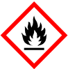
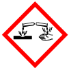
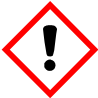
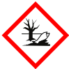

<!-- pagina: 1 -->

## HOJA DE DATOS DE

## SEGURIDAD

Fecha de emisión 29 Diciembre 2021 Versión 5.01

*Texto OCR de la imagen (puede contener errores): PPG*

## Sección 1. Identificación del producto y la compañía

- **Nombre del producto:** DIMETCOTE 302H GREEN RESIN  
- **Código del producto:**

: 00335609

- **Otros medios de:** No disponible.  
- **identificación:**  
- **Tipo de producto:** Líquido.

## Uso recomendado de la sustancia química peligrosa o mezcla, y restricciones de uso

## Usos identificados

Revestimiento. Pinturas. Materiales relacionados con las pinturas.

| Restricciones de uso   | Motivo   |
|------------------------|----------|
| No aplicable.          |          |

## Datos del proveedor o

- **fabricante:**  
- **Proveedor:** PPG Industries Colombia Ltda Calle 51 # 40-13 Municipio de Itagüí Antioquia, Colombia (57) (4) 3787400 (Porteria)  
- **Dirección de Email:** : HazComLatam@ppg.com  
- **Número de teléfono en caso de emergencia:** Colombia: 01 8000 916012 (CISPROQUIM) + 571 288 6012 (CISPROQUIM) Ecuador: 1800-59-3005 (CISPROQUIM) Peru: 080-050-847 (CISPROQUIM)

## Sección 2. Identificación de los peligros

Clasificación de la sustancia química peligrosa o mezcla

:

LÍQUIDOS INFLAMABLES - Categoría 3 TOXICIDAD AGUDA (oral) - Categoría 5 IRRITACIÓN CUTÁNEA - Categoría 2 LESIONES OCULARES GRAVES - Categoría 1 SENSIBILIZACIÓN CUTÁNEA - Categoría 1 PELIGRO (AGUDO) PARA EL MEDIO AMBIENTE ACUÁTICO - Categoría 1 PELIGRO (A LARGO PLAZO) PARA EL MEDIO AMBIENTE ACUÁTICO - Categoría 1

<!-- pagina: 2 -->

## Sección 2. Identificación de los peligros

## Órganos diana

- : Contiene material dañino para los siguientes órganos: cerebro. Contiene material que puede causar daño a los órganos siguientes: pulmones, sistema nervioso periférico, tracto respiratorio superior, piel, sistema nervioso central (SNC), ojo, cristalino o córnea.

Porcentaje de la mezcla que consiste en ingredientes de toxicidad oral aguda desconocida: 72.1 %

Porcentaje de la mezcla consistente de ingrediente(s) con peligros desconocidos para el medio ambiente acuático: 31 %

## Elementos de las etiquetas del SGA

Pictogramas de peligro :

Palabra de advertencia

Peligro  
- **Indicaciones de peligro:** Líquido y vapores inflamables. Provoca irritación cutánea. Puede provocar una reacción cutánea alérgica. Provoca lesiones oculares graves. Muy tóxico para los organismos acuáticos, con efectos nocivos duraderos.  
- **Consejos de prudencia Prevención Puede ser nocivo en caso de ingestión.:** Usar guantes de protección. Usar protección para los ojos o la cara. Mantener alejado del calor, chispas, llamas al descubierto, superficies calientes y otras fuentes de ignición. No fumar. Utilizar equipos eléctricos, de ventilación y de iluminación antideflagrantes. No utilizar herramientas que produzcan chispas. Tomar medidas de precaución contra las descargas electrostáticas. No dispersar en el medio ambiente. Evitar respirar vapor. Lavarse cuidadosamente después de la manipulación.

- Intervención/Respuesta : Recoger los vertidos. Quitar la ropa contaminada y lavarla antes de volverla a usar. En caso de contacto con la piel: Lavar con abundante agua. En caso de irritación cutánea o sarpullido: Consultar a un médico. En caso de contacto con los ojos: Enjuagar con agua cuidadosamente durante varios minutos. Quitar los lentes de contacto, cuando estén presentes y pueda hacerse con facilidad. Proseguir con el lavado. Llamar inmediatamente a un centro de toxicología o a un médico.

- **Almacenamiento:** Almacenar en un lugar bien ventilado. Mantener fresco.  
- **Eliminación:** Eliminar el contenido y recipiente conforme a todas las reglamentaciones locales, regionales, nacionales e internacionales.  
- **Otros peligros que no contribuyen en la clasificación:** El contacto prolongado o repetido puede resecar la piel y causar irritación.

*Texto OCR de la imagen (puede contener errores): !*

<!-- pagina: 3 -->

## Sección 3. Composición / información sobre los componentes

- **Sustancia/mezcla:** Mezcla  
- **Otros medios de identificación:** No disponible.

## Número CAS/otros identificadores

Número CAS

- : No aplicable.

| Nombre de ingrediente        | %          | Número CAS   |
|------------------------------|------------|--------------|
| cinc en polvo (estabilizado) | 30 - <60   | 7440-66-6    |
| Cemento Portland             | 15 - <20   | 65997-15-1   |
| Metil n-amilcetona           | 10 - <12.5 | 110-43-0     |
| Oxido de Cinc                | 1 - <2     | 1314-13-2    |
| Acetato de n-butilo          | 1 - <2     | 123-86-4     |

No hay ningún ingrediente adicional presente que, bajo el conocimiento actual del proveedor y en las concentraciones aplicables, sea clasificado como de riesgo para la salud o el medio ambiente y por lo tanto deban ser reportados en esta sección.

Los límites de exposición laboral, en caso de existir, figuran en la sección 8.

Código SUB indica substancias sin número CAS registrados.

## Sección 4. Primeros auxilios

## Descripción de los primeros auxilios

| Contacto con los ojos   | :   | Verificar si la víctima lleva lentes de contacto y en este caso, retirárselas. Enjuagar los ojos inmediátamente con agua corriente durante al menos 15 minutos con los párpados abiertos. Suministrar inmediatamente ayuda médica.   |
|-------------------------|-----|--------------------------------------------------------------------------------------------------------------------------------------------------------------------------------------------------------------------------------------|
| Por inhalación          | :   | Traslade al aire libre. Mantenga a la persona caliente y en reposo. Si no hay respiración, ésta es irregular u ocurre un paro respiratorio, el personal capacitado debe proporcionar respiración artificial u oxígeno.               |
| Contacto con la piel    | :   | Quítese la ropa y calzado contaminados. Lavar perfectamente la piel con agua y jabón, o con un limpiador cutáneo reconocido. NO utilizar disolventes ni diluyentes.                                                                  |
| Ingestión               | :   | En caso de ingestión, acúdase inmediatamente al médico y muéstrele la etiqueta o el envase. Mantenga a la persona caliente y en reposo. No provocar el vómito.                                                                       |

## Indicación de la necesidad de recibir atención médica inmediata y, en su caso, de tratamiento especial

- **Notas para el médico:** Tratar sintomáticamente. Contactar un especialista en tratamientos de  
- **Tratamientos específicos:** envenenamientos inmediatamente si se ha ingerido o inhalado una gran cantidad. No hay un tratamiento específico.  
- **Protección del personal de primeros auxilios:** No se tomará ninguna medida que implique algún riesgo personal o que no contemple el entrenamiento adecuado. Si se sospecha que los vapores continúan presentes, la persona encargada del rescate deberá usar una máscara adecuada o un aparato de respiración autónoma. Puede ser peligroso para la persona que proporcione ayuda dar respiración boca a boca. Lave bien la ropa contaminada con agua antes de quitársela, o use guantes.

## Efectos agudos potenciales en la salud

- **Contacto con los ojos:** Provoca lesiones oculares graves.  
- **Por inhalación:** No se conocen efectos significativos o riesgos críticos.  
- **Contacto con la piel:** Provoca irritación cutánea. Desengrasante de la piel. Puede provocar una reacción cutánea alérgica.

<!-- pagina: 4 -->

## Sección 4. Primeros auxilios

Ingestión

: Puede ser nocivo en caso de ingestión.

Vea la sección 11 para la Información Toxicológica

## Sección 5. Medidas contra incendios

| Medios de extinción Medios de extinción                                     | :   | Utilizar polvo químico seco, CO₂, agua pulverizada o espuma (neblina).                                                                                                                                                                                                                                                                                                                                                                                                                                         |
|-----------------------------------------------------------------------------|-----|----------------------------------------------------------------------------------------------------------------------------------------------------------------------------------------------------------------------------------------------------------------------------------------------------------------------------------------------------------------------------------------------------------------------------------------------------------------------------------------------------------------|
| apropiados Medios no apropiados de extinción                                | :   | No usar chorro de agua.                                                                                                                                                                                                                                                                                                                                                                                                                                                                                        |
| Peligros específicos de la sustancia química peligrosa o mezcla             | :   | Líquido y vapores inflamables. Los residuos líquidos que se filtran en el alcantarillado pueden causar un riesgo de incendio o de explosión. En caso de incendio o calentamiento, ocurrirá un aumento de presión y el recipiente estallará, con el riesgo de que ocurra una explosión. Este material es muy tóxico para la vida acuática con efectos de larga duración. Se debe impedir que el agua de extinción de incendios contaminada con este material entre en vías de agua, drenajes o alcantarillados. |
| Productos de descomposición térmica peligrosos                              | :   | Los productos de descomposición pueden incluir los siguientes materiales: óxidos de carbono óxido/óxidos metálico/metálicos                                                                                                                                                                                                                                                                                                                                                                                    |
| Medidas especiales que deberán seguir los grupos de combate contra incendio | :   | En caso de incendio, aísle rápidamente la zona evacuando a todas las personas de las proximidades del lugar del incidente. No se tomará ninguna medida que implique algún riesgo personal o que no contemple el entrenamiento adecuado. Desplazar los contenedores lejos del incendio si esto puede hacerse sin riesgo. Use agua pulverizada para refrigerar los envases expuestos al fuego.                                                                                                                   |
| Equipo de protección especial para los bomberos                             | :   | Los bomberos deben llevar equipo de protección apropiado y un equipo de respiración autónomo con una máscara facial completa que opere en modo de presión positiva.                                                                                                                                                                                                                                                                                                                                            |

## Sección 6. Medidas que deben tomarse en caso de derrame o fuga accidental

## Precauciones personales, equipo de protección y procedimiento de emergencia

| Para personal de no emergencia              | :   | No se tomará ninguna medida que implique algún riesgo personal o que no contemple el entrenamiento adecuado. Evacuar los alrededores. No deje que entre el personal innecesario y sin protección. No toque o camine sobre el material derramado. Apagar todas las fuentes de ignición. No permitir el uso de bengalas, fumar, o el encendido de llamas en el área de peligro. No respire los vapores o nieblas. Proporcione ventilación adecuada. Llevar un aparato de respiración apropiado cuando el sistema de ventilación sea inadecuado. Llevar puestos equipos de protección personal adecuados.   |
|---------------------------------------------|-----|----------------------------------------------------------------------------------------------------------------------------------------------------------------------------------------------------------------------------------------------------------------------------------------------------------------------------------------------------------------------------------------------------------------------------------------------------------------------------------------------------------------------------------------------------------------------------------------------------------|
| Para el personal de respuesta a emergencias | :   | Si fuera necesario usar ropa especial para hacer frente al derrame, se tomará en cuenta la información de la Sección 8 sobre los materiales adecuados y no adecuados. Consultar también la información bajo "Para personal de no emergencia".                                                                                                                                                                                                                                                                                                                                                            |

<!-- pagina: 5 -->

## Sección 6. Medidas que deben tomarse en caso de derrame o fuga accidental

## Precauciones relativas al medio ambiente

- : Evite la dispersión del material derramado, su contacto con el suelo, el medio acuático, los desagües y las alcantarillas. Informe a las autoridades pertinentes si el producto ha causado polución medioambiental (alcantarillas, canales, tierra o aire). Material contaminante del agua. Puede ser dañino para el medio ambiente si es liberado en cantidades grandes. Recoger los vertidos.

## Métodos y materiales para la contención y limpieza de derrames o fugas

## Derrame pequeño

## Gran derrame

- Detener la fuga si esto no presenta ningún riesgo. Retire los envases del área del derrame. Use herramientas a prueba de chispas y equipo a prueba de explosión. Diluir con agua y fregar si es soluble en agua. Alternativamente, o si es insoluble en agua, absorber con un material seco inerte y colocar en un contenedor de residuos adecuado. Disponga por medio de un contratista autorizado para la disposición. :
- Detener la fuga si esto no presenta ningún riesgo. Retire los envases del área del derrame. Use herramientas a prueba de chispas y equipo a prueba de explosión. Aproximarse al vertido en el sentido del viento. Evite la entrada en alcantarillas, canales de agua, sótanos o áreas reducidas. Trate los derrames en una planta de tratamiento de aguas residuales o proceda tal como se indica a continuación. Detener y recoger los derrames con materiales absorbentes no combustibles, como arena, tierra, vermiculita o tierra de diatomeas, y colocar el material en un envase para desecharlo de acuerdo con las normativas locales (ver la Sección 13). Disponga por medio de un contratista autorizado para la disposición. El material absorbente contaminado puede presentar el mismo riesgo que el producto derramado. Nota: Véase la Sección 1 para información de contacto de emergencia y la Sección 13 para eliminación de desechos. :

## Sección 7. Manejo y almacenamiento

## Precauciones que se deben tomar para garantizar un manejo seguro

## Condiciones de almacenamiento seguro, incluida cualquier incompatibilidad

- : Use el equipo de protección personal adecuado (vea la Sección 8). Las personas con antecedentes de sensibilización cutánea no deben trabajar en ningún proceso en el que se utilice este producto. No introducir en ojos o en la piel o ropa. No respire los vapores o nieblas. No ingerir. No dispersar en el medio ambiente. Use sólo con ventilación adecuada. Llevar un aparato de respiración apropiado cuando el sistema de ventilación sea inadecuado. No entre en áreas de almacenamiento y espacios cerrados a menos que estén ventilados adecuadamente. Mantener en el recipiente original o en uno alternativo autorizado hecho de material compatible, conservar herméticamente cerrado cuando no esté en uso. Mantener alejado del calor, chispas, llamas al descubierto, o de cualquier otra fuente de ignición. Use equipo eléctrico (de ventilación, iluminación y manipulación de materiales) a prueba de explosiones. No utilizar herramientas que produzcan chispas. Evitar la acumulación de cargas electrostáticas. Los envases vacíos retienen resíduos del producto y pueden ser peligrosos. No vuelva a usar el envase.
- No almacenar por encima de la siguiente temperatura: 50°C (122°F). Conservar de acuerdo con las normas locales. Almacenar en un área separada y homologada. Almacenar en el contenedor original protegido de la luz directa del sol en un área seca, fresca y bien ventilada, separado de materiales incompatibles (ver Sección 10) y comida y bebida. Guardar bajo llave. Eliminar todas las fuentes de ignición. Mantener separado de materiales oxidantes. Mantener el contenedor bien cerrado y sellado hasta el momento de usarlo. Los envases que han sido abiertos deben cerrarse cuidadosamente y mantenerse en posición vertical para :

<!-- pagina: 6 -->

## Sección 7. Manejo y almacenamiento

evitar derrames. No almacenar en contenedores sin etiquetar. Utilícese un envase de seguridad adecuado para evitar la contaminación del medio ambiente. Consulte la Sección 10 para obtener información acerca de los materiales no compatibles previo al manejo o uso.

## Sección 8. Controles de exposición / protección personal

## Parámetros de control Límites de exposición laboral

| Nombre de ingrediente                                                 |                                                                                                                                                                                                                                                                                                                                                                                                                                                                                                 | Límites de exposición                                                                                                                                                                                                                                                                                                                                                                                                                                                                           |
|-----------------------------------------------------------------------|-------------------------------------------------------------------------------------------------------------------------------------------------------------------------------------------------------------------------------------------------------------------------------------------------------------------------------------------------------------------------------------------------------------------------------------------------------------------------------------------------|-------------------------------------------------------------------------------------------------------------------------------------------------------------------------------------------------------------------------------------------------------------------------------------------------------------------------------------------------------------------------------------------------------------------------------------------------------------------------------------------------|
| Cemento Portland Metil n-amilcetona Oxido de Cinc Acetato de n-butilo | Cemento Portland Metil n-amilcetona Oxido de Cinc Acetato de n-butilo                                                                                                                                                                                                                                                                                                                                                                                                                           | ACGIH TLV (Estados Unidos, 1/2021). TWA: 1 mg/m³ 8 horas. Estado: Fracción respirable ACGIH TLV (Estados Unidos, 1/2021). TWA: 233 mg/m³ 8 horas. TWA: 50 ppm 8 horas. ACGIH TLV (Estados Unidos, 1/2021). STEL: 10 mg/m³ 15 minutos. Estado: Fracción respirable TWA: 2 mg/m³ 8 horas. Estado: Fracción respirable ACGIH TLV (Estados Unidos, 1/2021). STEL: 150 ppm 15 minutos. TWA: 50 ppm 8 horas.                                                                                          |
| Procedimientos de control recomendados :                              | Si este producto contiene ingredientes con límites de exposición, puede ser necesaria la supervisión personal, del ambiente de trabajo o biológica para determinar la efectividad de la ventilación o de otras medidas de control y/o la necesidad de usar equipo respiratorio protector. Se debe hacer referencia a las normas adecuadas de monitoreo. También se requiere hacer referencia a los documentos guía nacionales sobre los métodos para la determinación de sustancias peligrosas. | Si este producto contiene ingredientes con límites de exposición, puede ser necesaria la supervisión personal, del ambiente de trabajo o biológica para determinar la efectividad de la ventilación o de otras medidas de control y/o la necesidad de usar equipo respiratorio protector. Se debe hacer referencia a las normas adecuadas de monitoreo. También se requiere hacer referencia a los documentos guía nacionales sobre los métodos para la determinación de sustancias peligrosas. |
| Controles técnicos apropiados                                         | : Use sólo con ventilación adecuada. Utilizar recintos de proceso, sistemas de ventilación locales, u otros procedimientos de ingeniería para mantener la exposición del obrero a los contaminantes aerotransportados por debajo de todos los límites recomendados o estatutarios. Los controles de ingeniería también deben mantener el gas, vapor o polvo por debajo del menor límite de explosión.                                                                                           | : Use sólo con ventilación adecuada. Utilizar recintos de proceso, sistemas de ventilación locales, u otros procedimientos de ingeniería para mantener la exposición del obrero a los contaminantes aerotransportados por debajo de todos los límites recomendados o estatutarios. Los controles de ingeniería también deben mantener el gas, vapor o polvo por debajo del menor límite de explosión.                                                                                           |
| Control de la exposición medioambiental                               | : Emisiones de los equipos de ventilación o de procesos de trabajo deben ser evaluados para verificar que cumplen con los requisitos de la legislación de protección del medio ambiente. En algunos casos será necesario el uso de eliminadores de humo, filtros o modificaciones del diseño del equipo del proceso para reducir las emisiones a un nivel aceptable. Utilizar equipo de ventilación anti-explosión.                                                                             | : Emisiones de los equipos de ventilación o de procesos de trabajo deben ser evaluados para verificar que cumplen con los requisitos de la legislación de protección del medio ambiente. En algunos casos será necesario el uso de eliminadores de humo, filtros o modificaciones del diseño del equipo del proceso para reducir las emisiones a un nivel aceptable. Utilizar equipo de ventilación anti-explosión.                                                                             |
| Medidas de protección individual                                      | Medidas de protección individual                                                                                                                                                                                                                                                                                                                                                                                                                                                                | Medidas de protección individual                                                                                                                                                                                                                                                                                                                                                                                                                                                                |
| Medidas de higiene :                                                  | Lave las manos, antebrazos y cara completamente después de manejar productos químicos, antes de comer, fumar y usar el lavabo y al final del período de trabajo. Usar las técnicas apropiadas para remover ropa contaminada. La ropa de trabajo contaminada no debe salir del lugar de trabajo. Lavar las ropas contaminadas antes de volver a usarlas. Verifique que las estaciones de lavado de ojos y duchas                                                                                 | de las estaciones de trabajo.                                                                                                                                                                                                                                                                                                                                                                                                                                                                   |

<!-- pagina: 7 -->

## Sección 8. Controles de exposición / protección personal

## Protección de los ojos Protección de la piel

Protección de las manos

## Guantes

- Gafas protectoras contra salpicaduras químicas y careta de protección. :
- Guantes impermeables y resistentes a productos químicos que cumplan con las normas aprobadas deben ser usados siempre que se manejen productos químicos si una evaluación del riesgo indica que es necesario. Teniendo en cuenta los parámetros especificados por el fabricante de los guantes, se debe verificar durante el uso si aún mantienen sus propiedades protectoras. Es preciso tener presente que el tiempo de penetración para el material de los guantes puede ser diferente en cada fabricante. En el caso de mezclas formadas por varias sustancias no se puede estimar con exactitud el periodo de tiempo de protección de los guantes. :

:

Protección del cuerpo :

## Otro tipo de protección para la piel

## Protección de las vías respiratorias

caucho butílico

Antes de utilizar este producto se debe seleccionar equipo protector personal para el cuerpo basándose en la tarea a ejecutar y los riesgos involucrados y debe ser aprobado por un especialista. Cuando existe riesgo de ignición debido a la electricidad estática, se requiere el uso de ropa antiestática de protección. Para obtener el máximo nivel de protección contra descargas electrostáticas es preciso usar overoles, botas y guantes antiestáticos.

- : Antes de manipular este producto se debe elegir el calzado apropiado y cualquier otra medida adicional de protección de la piel basadas en la tarea que se realice y los riesgos asociados, para lo cual se contará con la aprobación de un especialista.
- La selección del respirador se debe basar en el conocimiento previo de los niveles, los riesgos de producto y los límites de trabajo de seguridad del respirador seleccionado. Si los trabajadores están expuestos a concentraciones superiores al límite de exposición, deben utilizar respiradores certificados adecuados. Use un respirador purificador de aire o con suministro de aire, que esté ajustado apropiadamente y que cumpla con las normas aprobadas si una evaluación de riesgo indica que es necesario. :

## Sección 9. Propiedades físicas y químicas

## Apariencia

- **Estado físico:**  
- **Color:** Verde.  
- **Olor:** Característico.  
- **pH:** No aplicable.  
- **Punto de fusión:** No disponible.  
- **Punto de ebullición Líquido.:** >37.78°C (>100°F)  
- **Punto de inflamación:** Vaso cerrado: 37°C (98.6°F)  
- **Velocidad de evaporación:** 0.46 (aetato de butilo = 1)

Inflamabilidad (sólido o gas) : No disponible.

- **Límites máximo y mínimo de explosión (inflamabilidad):** No disponible.  
- **Presión de vapor:** 0.4 kPa (3 mm Hg)  
- **Densidad de vapor:** No disponible.  
- **Densidad relativa:** 2.47  
- **Solubilidad:** Insoluble en los siguientes materiales: agua fría.  
- **Agua Solubilidad a temperatura ambiente:** 0.1 g/l

<!-- pagina: 8 -->

## Sección 9. Propiedades físicas y químicas

- **Coeficiente de partición octanol/agua:** n- No aplicable.  
- **Temperatura de ignición:** No disponible.  
- **espontánea:**  
- **Temperatura de descomposición:** No disponible.  
- **Viscosidad:** Cinemática (40°C (104°F)): >21 mm 2 /s (>21 cSt)

## Sección 10. Estabilidad y reactividad

## Reactividad

- : No existen resultados específicos de ensayos respecto a la reactividad del este producto o sus ingredientes.

Estabilidad química :

Posibilidad de reacciones peligrosas

## Condiciones que deberán evitarse

El producto es estable.  
En condiciones normales de almacenamiento y uso, no ocurre reacción peligrosa.  
Si es expuesto a altas temperaturas puede producir productos de descomposición peligrosos.  
- **Materiales incompatibles:** Mantener siempre alejado de los materiales siguientes para evitar reacciones exotérmicas violentas: agentes oxidantes, bases fuertes, ácidos fuertes.  
- **Productos de descomposición peligrosos:** Dependiendo de las condiciones, los productos de descomposición pueden incluir los siguientes materiales: óxidos de carbono óxido/óxidos metálico/metálicos

## Sección 11. Información toxicológica

## Información sobre efectos toxicológicos

## Toxicidad aguda

| cinc en polvo (estabilizado) Metil n-amilcetona Oxido de Cinc Acetato de n-butilo Nombre del producto o ingrediente   | CL50 Por inhalación Polvo nieblas DL50 Oral CL50 Por inhalación Vapor DL50 Cutánea DL50 Oral CL50 Por inhalación Polvo nieblas DL50 Cutánea DL50 Oral CL50 Por inhalación Vapor CL50 Por inhalación Vapor DL50 Cutánea DL50 Oral Resultado   | y Rata Rata Rata Conejo Rata y Rata Rata Rata Rata Rata Conejo Rata Especies   | >5.4 mg/l >2000 mg/kg 16.7 mg/l 10.206 g/kg 1.6 g/kg >5700 mg/m³ >2000 mg/kg >5000 mg/kg >21.1 mg/l 2000 ppm >17600 mg/kg 10.768 g/kg Dosis   | 4 horas - 4 horas - - 4 horas - - 4 horas 4 horas - - Exposición   |
|-----------------------------------------------------------------------------------------------------------------------|----------------------------------------------------------------------------------------------------------------------------------------------------------------------------------------------------------------------------------------------|--------------------------------------------------------------------------------|-----------------------------------------------------------------------------------------------------------------------------------------------|--------------------------------------------------------------------|

## Conclusión/Resumen Irritación/Corrosión

No disponible.

- : No existen datos disponibles sobre la mezcla en sí.

<!-- pagina: 9 -->

## Sección 11. Información toxicológica

## Conclusión/Resumen

- **Piel:** No existen datos disponibles sobre la mezcla en sí.  
- **Ojos:** No existen datos disponibles sobre la mezcla en sí.  
- **Respiratoria:** No existen datos disponibles sobre la mezcla en sí.

## Sensibilización

No disponible.

## Conclusión/Resumen

Piel :

Respiratoria :

## Mutagenicidad

No disponible.

Conclusión/Resumen :

## Carcinogenicidad

No disponible.

Conclusión/Resumen :

## Toxicidad reproductiva

No disponible.

Conclusión/Resumen :

## Teratogenicidad

No disponible.

Conclusión/Resumen :

No existen datos disponibles sobre la mezcla en sí.

No existen datos disponibles sobre la mezcla en sí.

No existen datos disponibles sobre la mezcla en sí.

No existen datos disponibles sobre la mezcla en sí.

No existen datos disponibles sobre la mezcla en sí.

No existen datos disponibles sobre la mezcla en sí.

## Toxicidad específica de órganos blanco (exposición única)

| Nombre              | Categoría   | Ruta de exposición   | Órganos diana                        |
|---------------------|-------------|----------------------|--------------------------------------|
| Cemento Portland    | Categoría 3 | -                    | Irritación de las vías respiratorias |
| Metil n-amilcetona  | Categoría 3 | -                    | Efecto narcótico                     |
| Acetato de n-butilo | Categoría 3 | -                    | Efecto narcótico                     |

## Toxicidad específica de órganos blanco (exposiciones repetidas)

No disponible.

## Órganos diana

: Contiene material dañino para los siguientes órganos: cerebro. Contiene material que puede causar daño a los órganos siguientes: pulmones, sistema nervioso periférico, tracto respiratorio superior, piel, sistema nervioso central (SNC), ojo, cristalino o córnea.

## Peligro de aspiración

| Nombre             | Resultado                            |
|--------------------|--------------------------------------|
| Metil n-amilcetona | PELIGRO POR ASPIRACIÓN - Categoría 2 |

Información sobre las posibles vías de ingreso

: No disponible.

Versión

<!-- pagina: 10 -->

## Sección 11. Información toxicológica

## Efectos agudos potenciales en la salud

- **Contacto con los ojos:** Provoca lesiones oculares graves.  
- **Por inhalación:** No se conocen efectos significativos o riesgos críticos.  
- **Contacto con la piel:** Provoca irritación cutánea. Desengrasante de la piel. Puede provocar una reacción cutánea alérgica.

: Ingestión Puede ser nocivo en caso de ingestión.

## Síntomas relacionados con las características físicas, químicas y toxicológicas

Contacto con los ojos

: Los síntomas adversos pueden incluir los siguientes: dolor lagrimeo enrojecimiento

Por inhalación :

Ningún dato específico.

Contacto con la piel :

Ingestión Los síntomas adversos pueden incluir los siguientes: dolor o irritación enrojecimiento sequedad agrietamiento puede presentarse formación de ampollas

- Los síntomas adversos pueden incluir los siguientes: dolor estomacal :

## Efectos inmediatos y retardados, así como efectos crónicos producidos por una exposición a corto y largo

plazo

## Conclusión/Resumen

No existen datos disponibles sobre la mezcla en sí. La exposición a concentraciones de vapores de disolventes superiores a los límites de exposición ocupacional establecidos puede producir irritación de las mucosas y del aparato respiratorio, y efectos adversos sobre los riñones, el hígado y el sistema nervioso central. Los signos y síntomas pueden ser dolor de cabeza, mareo, fatiga, debilidad muscular, somnolencia y en casos extremos, pérdida de consciencia. Los disolventes pueden causar algunos de los efectos anteriores por absorción a través de la piel. Hay evidencias de que la repetida sobreexposición a vapores de solventes orgánicos y ruido fuerte constante pueden ocasionar una pérdida auditiva mayor de la esperada que la exposición únicamente al ruido. El contacto del líquido con los ojos puede causar irritación y lesiones reversibles. La ingestión puede causar náuseas, diarrea y vómitos. De esta manera se toma en cuenta, cuando se conocen, los efectos retardados e inmediatos, así como también los efectos crónicos de los componentes provocados por la exposición a corto y largo plazo por vía oral, por inhalación y a través de la piel y el contacto con los ojos. :

## Exposición a corto plazo

Efectos potenciales :

inmediatos

Efectos potenciales retardados :

## Exposición a largo plazo

No existen datos disponibles sobre la mezcla en sí.  
No existen datos disponibles sobre la mezcla en sí.  
- **Efectos potenciales inmediatos:** No existen datos disponibles sobre la mezcla en sí.  
- **Efectos potenciales retardados:** No existen datos disponibles sobre la mezcla en sí.

<!-- pagina: 11 -->

## Sección 11. Información toxicológica

## Efectos crónicos potenciales para la salud

No disponible.

## Generales

- El contacto prolongado o repetido puede desengrasar la piel y conducir a irritación, agrietamiento y/o dermatitis. Una vez que la persona esté sensibilizada, puede ocurrir una reacción alérgica severa si posteriormente se expone incluso a muy bajos niveles. :

Carcinogenicidad

Mutagenicidad

- No se conocen efectos significativos o riesgos críticos. :
- No se conocen efectos significativos o riesgos críticos. :

Toxicidad reproductiva :

- No se conocen efectos significativos o riesgos críticos.

## Medidas numéricas de toxicidad (tales como estimaciones de toxicidad aguda)

## Estimaciones de toxicidad aguda

| Nombre de producto o ingrediente                                                | Oral (mg/ kg)         | Cutánea (mg/kg)        | Inhalación (gases) (ppm)   | Inhalación (vapores) (mg/l)   | Inhalación (polvos y nieblas) (mg/l)   |
|---------------------------------------------------------------------------------|-----------------------|------------------------|----------------------------|-------------------------------|----------------------------------------|
| DIMETCOTE 302H GREEN RESIN Metil n-amilcetona Oxido de Cinc Acetato de n-butilo | 3926.5 1600 N/A 10768 | 42586.1 10206 2500 N/A | N/A N/A N/A N/A            | 101.6 16.7 N/A N/A            | 9.1 1.5 N/A N/A                        |

Otra información

- : No disponible.

## Sección 12. Información ecotoxicológica

## Toxicidad

| Nombre del producto o ingrediente | Resultado | Especies | Exposición |
|---|---|---|---|
| cinc en polvo (estabilizado) | Agudo EC50 0.106 mg/l Agua fresca Crónico NOEC 0.0727 mg/l Agua fresca | Algas - Pseudokirchneriella subcapitata Dafnia - Daphnia Magna | 72 horas 21 días |
| Metil n-amilcetona | Agudo CL50 131 mg/l | Pez | 96 horas |
| Oxido de Cinc | Agudo EC50 0.17 mg/l Agudo EC50 0.481 mg/l Agua fresca Crónico NOEC 0.017 mg/l Agua fresca | Algas Dafnia - Daphnia magna - Neonato Algas | 72 horas 48 horas 72 horas |
| Acetato de n-butilo | Agudo CL50 18 mg/l | Pez | 96 horas |

*Tabla reconstruida por posición de renglones: Docling había fusionado sus filas (ver data/metadata/tablas_reconstruidas.csv).*

## Persistencia y degradabilidad

| Nombre del producto o ingrediente | Prueba | Resultado | Dosis | Inóculo |
|---|---|---|---|---|
| Metil n-amilcetona | OECD 310 | 69 % - Fácil - 28 días | - | - |
| Acetato de n-butilo | TEPA and OECD 301D | 83 % - Fácil - 28 días | - | - |

*Tabla reconstruida por posición de renglones: Docling había fusionado sus filas (ver data/metadata/tablas_reconstruidas.csv).*

| Spanish (MX)   | Colombia   | 11/14   |
|----------------|------------|---------|

<!-- pagina: 12 -->

## Sección 12. Información ecotoxicológica

| Nombre del producto o ingrediente      | Período acuático   | Fotólisis   | Biodegradabilidad   |
|----------------------------------------|--------------------|-------------|---------------------|
| Metil n-amilcetona Acetato de n-butilo | -                  | -           | Fácil               |
|                                        | -                  | -           | Fácil               |

## Potencial de bioacumulación

| Nombre del producto o ingrediente      | LogPow   | FBC   | Potencial   |
|----------------------------------------|----------|-------|-------------|
| Metil n-amilcetona Acetato de n-butilo | 2.26 2.3 | - -   | bajo bajo   |

## Movilidad en el suelo

- **Coeficiente de partición tierra/agua (KOC):** No disponible.  
- **Otros efectos adversos:** No se conocen efectos significativos o riesgos críticos.

## Sección 13. Información relativa a la eliminación de los productos

Métodos de eliminación

- : Se debe evitar o minimizar la generación de desechos cuando sea posible. La eliminación de este producto, sus soluciones y cualquier derivado deben cumplir siempre con los requisitos de la legislación de protección del medio ambiente y eliminación de desechos y todos los requisitos de las autoridades locales. Disponga del sobrante y productos no reciclables por medio de un contratista autorizado para la disposición. Los residuos no se deben tirar por la alcantarilla sin tratar a menos que sean compatibles con los requisitos de todas las autoridades con jurisdicción. Los envases desechados se deben reciclar. Sólo se deben contemplar la incineración o el enterramiento cuando el reciclaje no sea factible. Elimínense los residuos del producto y sus recipientes con todas las precauciones posibles. Se tendrá cuidado cuando se manipulen recipientes vacíos que no se hayan limpiado o enjuagado. Los envases vacíos o los revestimentos pueden retener residuos del producto. El vapor de los residuos del producto puede crear un ambiente altamente inflamable o explosivo dentro del recipiente. No recortar, soldar o triturar los recipientes usados a menos que se hayan limpiado a fondo en su interior. Evite la dispersión del material derramado, su contacto con el suelo, el medio acuático, los desagües y las alcantarillas.

## Sección 14. Información relativa al transporte

|                                   | UN      | Brasil (ANTT)   | IMDG   | IATA   |
|-----------------------------------|---------|-----------------|--------|--------|
| Número ONU                        | UN1263  | UN1263          | UN1263 | UN1263 |
| Designación oficial de transporte | PINTURA | PINTURA         | PAINT  | PAINT  |
| Clase(s) relativas al transporte  | 3       | 3               | 3      | 3      |
| Grupo de embalaje                 | III     | III             | III    | III    |

Spanish (MX)

Colombia

12/14

Versión

<!-- pagina: 13 -->

## Sección 14. Información relativa al transporte

| Riesgos ambientales Sustancias contaminantes marinas   | Sí. La marca de substancia peligrosa para el ambiente no es obligatoria. No aplicable.   | Sí. La marca de substancia peligrosa para el ambiente no es obligatoria. No aplicable.   | Yes. (Zinc powder - zinc dust (stabilized), zinc oxide)   | Yes. The environmentally hazardous substance mark is not required. Not applicable.   |
|--------------------------------------------------------|------------------------------------------------------------------------------------------|------------------------------------------------------------------------------------------|-----------------------------------------------------------|--------------------------------------------------------------------------------------|

## Información adicional

UN :

Brasil :

Risk number :

IMDG :

IATA

Ninguno identificado.

Ninguno identificado.

30

The marine pollutant mark is not required when transported in sizes of ≤5 L or ≤5 kg.

- : El marcado como sustancia peligrosa para el medio ambiente puede mostrarse si otras regulaciones de transporte lo requieren.

Precauciones especiales para el usuario

Transporte a granel de acuerdo con instrumentos IMO

- Transporte dentro de las instalaciones de usuarios: siempre transporte en recipientes cerrados que estén verticales y seguros. Asegurar que las personas que transportan el producto conocen qué hacer en caso de un accidente o derrame. :

: No aplicable.

## Sección 15. Información Reglamentaria

Disposiciones específicas sobre seguridad, salud y medio ambiente para las sustancias químicas peligrosas o mezclas de que se trate

- : No hay reglamentos nacionales y/o regionales conocidos que se apliquen a este producto (incluyendo sus ingredientes).

## Sección 16. Otra informaciones

## Historial

- **Fecha de la edición:** 5/21/2021  
- **anterior:**  
- **Versión:** 5.01 EHS

Explicación de Abreviaturas : ADN = Acuerdo Europeo Relativo al Transporte Internacional de Mercancías Peligrosas por Vía Navegable Interior

ADR = Acuerdo Europeo sobre el Transporte Internacional de Mercancias

Peligrosas por Carretera

ETA = Estimación de Toxicidad Aguda

FBC = Factor de Bioconcentración

SGA = Sistema Globalmente Armonizado

IATA = Asociación de Transporte Aéreo Internacional

IMDG = Código Marítimo Internacional de Mercancías Peligrosas

Log Kow = logaritmo del coeficiente de reparto octanol/agua

<!-- pagina: 14 -->

## Sección 16. Otra informaciones

MARPOL = Convenio Internacional para Prevenir la Contaminación por los Buques, 1973 con el Protocolo de 1978. ("Marpol" = polución marina)

RID = Reglamento de Transporte Internacional de Mercancías Peligrosas por Ferrocarril

ONU = Organización de las Naciones Unidas

## Referencias

- : ABNT NBR 14725-4: 2014 ANTT - National Land Transportation Agency

Indica la información que ha cambiado desde la edición de la versión anterior.

## Negador

La información contenida en este documento, está basada en los conocimientos científicos y técnicos actuales. El propósito de esta información es llamar la atención en los aspectos de salud y seguridad respecto de los productos y para recomendar medidas preventivas para el almacenamiento y manejo de los productos. Nada en lo establecido en la presente Hoja de Seguridad será considerado como el otorgamiento de una garantía sobre las propiedades del producto. La falta de observancia de las medidas preventivas descritas en esta Hoja de Seguridad o uso indebido de los productos, será causa exención de responsabilidad por parte del Fabricante.

Versión
<!-- encabezados y pies de pagina -->

## Encabezados y pies de página

*Texto del margen superior o inferior de las páginas, que Docling separa del cuerpo. Se lista una sola vez, con las páginas donde aparece.*

- [p. 1-10, 13-14] Colombia
- [p. 1-10, 13-14] Spanish (MX)
- [p. 2-14] Código
- [p. 2-14] Fecha de emisión
- [p. 2-14] 29 Diciembre 2021
- [p. 2-8, 10-11, 13] Versión
- [p. 2-14] 5.01
- [p. 2-14] Nombre del producto
- [p. 2-14] DIMETCOTE 302H GREEN RESIN
