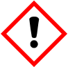
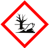

<!-- pagina: 1 -->

## HOJA DE DATOS DE SEGURIDAD

Fecha de emisión 28 Julio 2021 Versión 5

*Texto OCR de la imagen (puede contener errores): PPG*

## Sección 1. Identificación del producto y la compañía

- **Nombre del producto:** PITT-CHAR XP BASE WHITE  
- **Código del producto:**

: 00393292

- **Otros medios de:** No disponible.  
- **identificación:**  
- **Tipo de producto:** Líquido.

## Uso recomendado de la sustancia química peligrosa o mezcla, y restricciones de uso

## Usos identificados

Revestimiento. Pinturas. Materiales relacionados con las pinturas.

| Restricciones de uso   | Motivo   |
|------------------------|----------|
| No aplicable.          |          |

## Datos del proveedor o

- **fabricante:**  
- **Proveedor:** PPG Industries Colombia Ltda Calle 51 # 40-13 Municipio de Itagüí Antioquia, Colombia (57) (4) 3787400 (Porteria)  
- **Dirección de Email:** : HazComLatam@ppg.com  
- **Número de teléfono en caso de emergencia:** Colombia: 01 8000 916012 (CISPROQUIM) + 571 288 6012 (CISPROQUIM) Ecuador: 1800-59-3005 (CISPROQUIM) Peru: 080-050-847 (CISPROQUIM)

## Sección 2. Identificación de los peligros

Clasificación de la sustancia química peligrosa o mezcla

Órganos diana

- TOXICIDAD AGUDA (oral) - Categoría 5 IRRITACIÓN CUTÁNEA - Categoría 3 IRRITACIÓN OCULAR - Categoría 2A SENSIBILIZACIÓN CUTÁNEA - Categoría 1 TOXICIDAD PARA LA REPRODUCCIÓN - Categoría 2 PELIGRO (AGUDO) PARA EL MEDIO AMBIENTE ACUÁTICO - Categoría 2 PELIGRO (A LARGO PLAZO) PARA EL MEDIO AMBIENTE ACUÁTICO - Categoría 2 :
- : Contiene material que puede causar daño a los órganos siguientes: tracto respiratorio superior, piel, ojos.

<!-- pagina: 2 -->

## Sección 2. Identificación de los peligros

Porcentaje de la mezcla que consiste en ingredientes de toxicidad oral aguda desconocida: 27.1 %

Porcentaje de la mezcla consistente de ingrediente(s) con peligros desconocidos para el medio ambiente acuático: 30.1 %

## Elementos de las etiquetas del SGA

Pictogramas de peligro :

Palabra de advertencia

: Atención

Indicaciones de peligro

: Puede ser nocivo en caso de ingestión.

## Consejos de prudencia

Prevención Provoca una leve irritación cutánea.

Puede provocar una reacción cutánea alérgica.

Provoca irritación ocular grave.

Susceptible de perjudicar la fertilidad o dañar al feto.

Tóxico para los organismos acuáticos, con efectos nocivos duraderos.

- : Procurarse las instrucciones antes del uso. Usar guantes de protección, ropa de protección e equipo de protección para la cara o los ojos. No dispersar en el medio ambiente. Evitar respirar vapor.
- Intervención/Respuesta : Recoger los vertidos. En caso de exposición demostrada o supuesta: Consultar a un médico. Quitar la ropa contaminada y lavarla antes de volverla a usar. En caso de contacto con la piel: Lavar con abundante agua. En caso de irritación cutánea o sarpullido: Consultar a un médico. En caso de contacto con los ojos: Enjuagar con agua cuidadosamente durante varios minutos. Quitar los lentes de contacto,

cuando estén presentes y pueda hacerse con facilidad. Proseguir con el lavado. Si la irritación ocular persiste: Consultar a un médico.  
- **Almacenamiento:** No aplicable.  
- **Eliminación:** Eliminar el contenido y recipiente conforme a todas las reglamentaciones locales, regionales, nacionales e internacionales.  
- **Otros peligros que no contribuyen en la clasificación:** No se conoce ninguno.

## Sección 3. Composición / información sobre los componentes

- **Sustancia/mezcla:** Mezcla  
- **Otros medios de identificación:** No disponible.

## Número CAS/otros identificadores

Número CAS

: No aplicable.

<!-- pagina: 3 -->

## Sección 3. Composición / información sobre los componentes

| Nombre de ingrediente                                                                                                                                                                        | %          | Número CAS   |
|----------------------------------------------------------------------------------------------------------------------------------------------------------------------------------------------|------------|--------------|
| undecaóxido de hexaboro y dicinc                                                                                                                                                             | 20 - <30   | 12767-90-7   |
| Dodecanedioic acid, polymer with 2,2'-[1,4-butanediylbis(oxymethylene)] bis[oxirane], (chloromethyl)oxirane, 4,4'-(1-methylethylidene)bis[phenol], nonanedioic acid and 2,2'-oxybis[ethanol] | 20 - <30   | 139651-91-5  |
| Borate(5-), bis[μ-oxotetraoxodiborato(4-)]-, ammonium tetrahydrogen, dihydrate, (T-4)-                                                                                                       | 15 - <20   | 12046-04-7   |
| phosphorous oxychloride, reaction products with propylene oxide                                                                                                                              | 12.5 - <15 | 1244733-77-4 |
| 2,2'-[(1-metiletiliden)bis(4,1-fenilenoximetilen)]bisoxirano                                                                                                                                 | 7 - <10    | 1675-54-3    |
| ácidos polifosfóricos, sales de amonio                                                                                                                                                       | 3 - <5     | 68333-79-9   |
| Vidrio, óxido, sustancias químicas                                                                                                                                                           | 1 - <2     | 65997-17-3   |

No hay ningún ingrediente adicional presente que, bajo el conocimiento actual del proveedor y en las concentraciones aplicables, sea clasificado como de riesgo para la salud o el medio ambiente y por lo tanto deban ser reportados en esta sección.

Los límites de exposición laboral, en caso de existir, figuran en la sección 8.

Código SUB indica substancias sin número CAS registrados.

## Sección 4. Primeros auxilios

## Descripción de los primeros auxilios

| Contacto con los ojos   | :   | Quítese los lentes de contacto, lavar inmediatamente con abundante agua fresca y limpia, manteniendo los párpados separados durante al menos 10 minutos y busque atención médica inmediata.                            |
|-------------------------|-----|------------------------------------------------------------------------------------------------------------------------------------------------------------------------------------------------------------------------|
| Por inhalación          | :   | Traslade al aire libre. Mantenga a la persona caliente y en reposo. Si no hay respiración, ésta es irregular u ocurre un paro respiratorio, el personal capacitado debe proporcionar respiración artificial u oxígeno. |
| Contacto con la piel    | :   | Quítese la ropa y calzado contaminados. Lavar perfectamente la piel con agua y jabón, o con un limpiador cutáneo reconocido. NO utilizar disolventes ni diluyentes.                                                    |
| Ingestión               | :   | En caso de ingestión, acúdase inmediatamente al médico y muéstrele la etiqueta o el envase. Mantenga a la persona caliente y en reposo. No provocar el vómito.                                                         |

## Indicación de la necesidad de recibir atención médica inmediata y, en su caso, de tratamiento especial

- **Notas para el médico:** En caso de inhalación de productos de descomposición en un incendio, los  
- **Tratamientos específicos:** síntomas pueden tardarse en aparecer. La persona expuesta puede necesitar ser mantenida bajo vigilancia médica por 48 horas. No hay un tratamiento específico.  
- **Protección del personal de primeros auxilios:** No se tomará ninguna medida que implique algún riesgo personal o que no contemple el entrenamiento adecuado. Puede ser peligroso para la persona que proporcione ayuda dar respiración boca a boca. Lave bien la ropa contaminada con agua antes de quitársela, o use guantes.

## Efectos agudos potenciales en la salud

- **Contacto con los ojos:** Provoca irritación ocular grave.  
- **Por inhalación:** No se conocen efectos significativos o riesgos críticos.  
- **Contacto con la piel:** Provoca una leve irritación cutánea. Puede provocar una reacción cutánea alérgica.  
- **Ingestión:** Puede ser nocivo en caso de ingestión.

Vea la sección 11 para la Información Toxicológica

<!-- pagina: 4 -->

## Sección 5. Medidas contra incendios

| Medios de extinción                                                         |    |                                                                                                                                                                                                                                                                                                                                                               |
|-----------------------------------------------------------------------------|----|---------------------------------------------------------------------------------------------------------------------------------------------------------------------------------------------------------------------------------------------------------------------------------------------------------------------------------------------------------------|
| Medios de extinción apropiados                                              | :  | Use un agente de extinción adecuado para el incendio circundante.                                                                                                                                                                                                                                                                                             |
| Medios no apropiados de extinción                                           | :  | No se conoce ninguno.                                                                                                                                                                                                                                                                                                                                         |
| Peligros específicos de la sustancia química peligrosa o mezcla             | :  | En caso de incendio o calentamiento, ocurrirá un aumento de presión y el recipiente estallará, con el riesgo de que ocurra una explosión. Este material es tóxico para la vida acuática con efectos de larga duración. Se debe impedir que el agua de extinción de incendios contaminada con este material entre en vías de agua, drenajes o alcantarillados. |
| Productos de descomposición térmica peligrosos                              | :  | Los productos de descomposición pueden incluir los siguientes materiales: óxidos de carbono óxidos del nitrógeno óxidos del fósforo compuestos halógenos. óxido/óxidos metálico/metálicos                                                                                                                                                                     |
| Medidas especiales que deberán seguir los grupos de combate contra incendio | :  | En caso de incendio, aísle rápidamente la zona evacuando a todas las personas de las proximidades del lugar del incidente. No se tomará ninguna medida que implique algún riesgo personal o que no contemple el entrenamiento adecuado.                                                                                                                       |
| Equipo de protección especial para los bomberos                             | :  | Los bomberos deben llevar equipo de protección apropiado y un equipo de respiración autónomo con una máscara facial completa que opere en modo de presión positiva.                                                                                                                                                                                           |

## Sección 6. Medidas que deben tomarse en caso de derrame o fuga accidental

## Precauciones personales, equipo de protección y procedimiento de emergencia

| Para personal de no emergencia              | : No se tomará ninguna medida que implique algún riesgo personal o que no contemple el entrenamiento adecuado. Evacuar los alrededores. No deje que entre el personal innecesario y sin protección. No toque o camine sobre el material derramado. Evite respirar vapor o neblina. Proporcione ventilación adecuada. Llevar un aparato de respiración apropiado cuando el sistema de ventilación sea inadecuado. Llevar puestos equipos de protección personal adecuados. :   |
|---------------------------------------------|-------------------------------------------------------------------------------------------------------------------------------------------------------------------------------------------------------------------------------------------------------------------------------------------------------------------------------------------------------------------------------------------------------------------------------------------------------------------------------|
| Para el personal de respuesta a emergencias | Si fuera necesario usar ropa especial para hacer frente al derrame, se tomará en cuenta la información de la Sección 8 sobre los materiales adecuados y no adecuados. Consultar también la información bajo "Para personal de no emergencia".                                                                                                                                                                                                                                 |
| Precauciones relativas al medio ambiente    | : Evite la dispersión del material derramado, su contacto con el suelo, el medio acuático, los desagües y las alcantarillas. Informe a las autoridades pertinentes si el producto ha causado polución medioambiental (alcantarillas, canales, tierra o aire). Material contaminante del agua. Puede ser dañino para el medio ambiente si es liberado en cantidades grandes. Recoger los vertidos.                                                                             |

Métodos y materiales para la contención y limpieza de derrames o fugas

<!-- pagina: 5 -->

## Sección 6. Medidas que deben tomarse en caso de derrame o fuga accidental

| Derrame pequeño   | :   | Detener la fuga si esto no presenta ningún riesgo. Retire los envases del área del derrame. Diluir con agua y fregar si es soluble en agua. Alternativamente, o si es insoluble en agua, absorber con un material seco inerte y colocar en un contenedor de residuos adecuado. Disponga por medio de un contratista autorizado para la disposición.                                                                                                                                                                                                                                                                                                                                                                                                                                                                                                                               |
|-------------------|-----|-----------------------------------------------------------------------------------------------------------------------------------------------------------------------------------------------------------------------------------------------------------------------------------------------------------------------------------------------------------------------------------------------------------------------------------------------------------------------------------------------------------------------------------------------------------------------------------------------------------------------------------------------------------------------------------------------------------------------------------------------------------------------------------------------------------------------------------------------------------------------------------|
| Gran derrame      | :   | Detener la fuga si esto no presenta ningún riesgo. Retire los envases del área del derrame. Aproximarse al vertido en el sentido del viento. Evite la entrada en alcantarillas, canales de agua, sótanos o áreas reducidas. Trate los derrames en una planta de tratamiento de aguas residuales o proceda tal como se indica a continuación. Detener y recoger los derrames con materiales absorbentes no combustibles, como arena, tierra, vermiculita o tierra de diatomeas, y colocar el material en un envase para desecharlo de acuerdo con las normativas locales (ver la Sección 13). Disponga por medio de un contratista autorizado para la disposición. El material absorbente contaminado puede presentar el mismo riesgo que el producto derramado. Nota: Véase la Sección 1 para información de contacto de emergencia y la Sección 13 para eliminación de desechos. |

## Sección 7. Manejo y almacenamiento

| Precauciones que se deben tomar para garantizar un manejo seguro          | :   | Use el equipo de protección personal adecuado (vea la Sección 8). Las personas con antecedentes de sensibilización cutánea no deben trabajar en ningún proceso en el que se utilice este producto. Evítese la exposición - recábense instrucciones especiales antes del uso. Evite la exposición durante el embarazo. No manipular antes de haber leído y comprendido todas las precauciones de seguridad. No introducir en ojos o en la piel o ropa. No ingerir. Evite respirar vapor o neblina. No dispersar en el medio ambiente. Si durante el uso normal el material representara un peligro respiratorio, garantice ventilación adecuada o use un respirador apropiado. Mantener en el recipiente original o en uno alternativo autorizado hecho de material compatible, conservar herméticamente cerrado cuando no esté en uso. Los envases vacíos retienen resíduos del producto y pueden ser peligrosos. No vuelva a usar el envase.   |
|---------------------------------------------------------------------------|-----|-------------------------------------------------------------------------------------------------------------------------------------------------------------------------------------------------------------------------------------------------------------------------------------------------------------------------------------------------------------------------------------------------------------------------------------------------------------------------------------------------------------------------------------------------------------------------------------------------------------------------------------------------------------------------------------------------------------------------------------------------------------------------------------------------------------------------------------------------------------------------------------------------------------------------------------------------|
| Condiciones de almacenamiento seguro, incluida cualquier incompatibilidad | :   | Almacénese en el siguiente rango de temperatura: 0 a 35°C (32 a 95°F). Conservar de acuerdo con las normas locales. Almacenar en el contenedor original protegido de la luz directa del sol en un área seca, fresca y bien ventilada, separado de materiales incompatibles (ver Sección 10) y comida y bebida. Guardar bajo llave. Mantener el contenedor bien cerrado y sellado hasta el momento de usarlo. Los envases que han sido abiertos deben cerrarse cuidadosamente y mantenerse en posición vertical para evitar derrames. No almacenar en contenedores sin etiquetar. Utilícese un envase de seguridad adecuado para evitar la contaminación del medio ambiente. Consulte la Sección 10 para obtener información acerca de los materiales no compatibles previo al manejo o uso.                                                                                                                                                     |

<!-- pagina: 6 -->

## Sección 8. Controles de exposición / protección personal

## Parámetros de control

## Límites de exposición laboral

| Nombre de ingrediente                                                                                                                                      |                                                                                                                                                                                                                                                                                                                                                                                                               | Límites de exposición                                                                                                                                                                                                                                                                                                                                                                                                                                                                                                                                                                                                                                                                                                                                                                                           |
|------------------------------------------------------------------------------------------------------------------------------------------------------------|---------------------------------------------------------------------------------------------------------------------------------------------------------------------------------------------------------------------------------------------------------------------------------------------------------------------------------------------------------------------------------------------------------------|-----------------------------------------------------------------------------------------------------------------------------------------------------------------------------------------------------------------------------------------------------------------------------------------------------------------------------------------------------------------------------------------------------------------------------------------------------------------------------------------------------------------------------------------------------------------------------------------------------------------------------------------------------------------------------------------------------------------------------------------------------------------------------------------------------------------|
| undecaóxido de hexaboro y dicinc Borate(5-), bis[μ-oxotetraoxodiborato(4-)]-, ammonium tetrahydrogen, dihydrate, (T-4)- Vidrio, óxido, sustancias químicas | undecaóxido de hexaboro y dicinc Borate(5-), bis[μ-oxotetraoxodiborato(4-)]-, ammonium tetrahydrogen, dihydrate, (T-4)- Vidrio, óxido, sustancias químicas                                                                                                                                                                                                                                                    | ACGIH TLV (Estados Unidos, 1/2013). TWA: 10 mg/m³, (Polvo y nieblas) Estado: TWA: 3 mg/m³, (Polvo y nieblas) Estado: Fracción respirable ACGIH TLV (Estados Unidos). TWA: 3 mg/m³ Estado: Polvo respirable TWA: 10 mg/m³ Estado: inhalable dust ACGIH TLV (Estados Unidos). TWA: 1 f/cc Estado: Fibra de vidrio en filamentos continuos TWA: 5 mg/m³, (Inhalable) Estado: Fibra de vidrio en filamentos continuos TWA: 3 mg/m³ Estado: Respirable TWA: 10 mg/m³ Estado: Total dust ACGIH TLV (Estados Unidos, 3/2020). TWA: 5 mg/m³ 8 horas. Estado: Fracción inhalable TWA: 1 f/cc 8 horas. Estado: Respirable fibers: length greater than 5 uM; aspect ratio equal to or greater than 3:1 as determined by the membrane filter method at 400-450X magnification (4-mm objective) phase contrast illumination. |
| Procedimientos de control recomendados                                                                                                                     | Si este producto contiene ingredientes con límites de exposición, puede ser necesaria la supervisión personal, del ambiente de trabajo o biológica para determinar la efectividad de la ventilación o de otras medidas de control y/o la necesidad de usar equipo respiratorio protector. Se debe hacer referencia a las :                                                                                    | También se requiere hacer referencia a los                                                                                                                                                                                                                                                                                                                                                                                                                                                                                                                                                                                                                                                                                                                                                                      |
| Controles técnicos apropiados :                                                                                                                            | Si la operación genera polvo, humos, gas, vapor o llovizna, use cercamientos del proceso, ventilación local, u otros controles de ingeniería para mantener la exposición del obrero a los contaminantes aerotransportados por debajo de todos                                                                                                                                                                 | Si la operación genera polvo, humos, gas, vapor o llovizna, use cercamientos del proceso, ventilación local, u otros controles de ingeniería para mantener la exposición del obrero a los contaminantes aerotransportados por debajo de todos                                                                                                                                                                                                                                                                                                                                                                                                                                                                                                                                                                   |
| Control de la exposición medioambiental                                                                                                                    | : Emisiones de los equipos de ventilación o de procesos de trabajo deben ser evaluados para verificar que cumplen con los requisitos de la legislación de protección del medio ambiente. En algunos casos será necesario el uso de eliminadores de humo, filtros o modificaciones del diseño del equipo del proceso para reducir las emisiones a un nivel aceptable. los límites recomendados o estatutarios. | : Emisiones de los equipos de ventilación o de procesos de trabajo deben ser evaluados para verificar que cumplen con los requisitos de la legislación de protección del medio ambiente. En algunos casos será necesario el uso de eliminadores de humo, filtros o modificaciones del diseño del equipo del proceso para reducir las emisiones a un nivel aceptable. los límites recomendados o estatutarios.                                                                                                                                                                                                                                                                                                                                                                                                   |

## Medidas de protección individual

<!-- pagina: 7 -->

## Sección 8. Controles de exposición / protección personal

| Medidas de higiene                                                   | :   | Lave las manos, antebrazos y cara completamente después de manejar productos químicos, antes de comer, fumar y usar el lavabo y al final del período de trabajo. Usar las técnicas apropiadas para remover ropa contaminada. La ropa de trabajo contaminada no debe salir del lugar de trabajo. Lavar las ropas contaminadas antes de volver a usarlas. Verifique que las estaciones de lavado de ojos y duchas de seguridad se encuentren cerca de las estaciones de trabajo.                                           |
|----------------------------------------------------------------------|-----|--------------------------------------------------------------------------------------------------------------------------------------------------------------------------------------------------------------------------------------------------------------------------------------------------------------------------------------------------------------------------------------------------------------------------------------------------------------------------------------------------------------------------|
| Protección de las manos Protección de los ojos Protección de la piel | : : | Guantes impermeables y resistentes a productos químicos que cumplan con las normas aprobadas deben ser usados siempre que se manejen productos químicos si una evaluación del riesgo indica que es necesario. Teniendo en cuenta los parámetros especificados por el fabricante de los guantes, se debe verificar durante Gafas protectoras contra salpicaduras químicas.                                                                                                                                                |
| Guantes                                                              | :   | el uso si aún mantienen sus propiedades protectoras. Es preciso tener presente que el tiempo de penetración para el material de los guantes puede ser diferente en cada fabricante. En el caso de mezclas formadas por varias sustancias no se puede estimar con exactitud el periodo de tiempo de protección de los guantes. caucho butílico                                                                                                                                                                            |
| Protección del cuerpo                                                | :   | Antes de utilizar este producto se debe seleccionar equipo protector personal para el cuerpo basándose en la tarea a ejecutar y los riesgos involucrados y debe ser                                                                                                                                                                                                                                                                                                                                                      |
| Otro tipo de protección para la piel                                 | :   | aprobado por un especialista. Antes de manipular este producto se debe elegir el calzado apropiado y cualquier otra medida adicional de protección de la piel basadas en la tarea que se realice y los riesgos asociados, para lo cual se contará con la aprobación de un especialista.                                                                                                                                                                                                                                  |
| Protección de las vías respiratorias                                 | :   | La selección del respirador se debe basar en el conocimiento previo de los niveles, los riesgos de producto y los límites de trabajo de seguridad del respirador seleccionado. Si los trabajadores están expuestos a concentraciones superiores al límite de exposición, deben utilizar respiradores certificados adecuados. Use un respirador purificador de aire o con suministro de aire, que esté ajustado apropiadamente y que cumpla con las normas aprobadas si una evaluación de riesgo indica que es necesario. |

## Sección 9. Propiedades físicas y químicas

## Apariencia

- **Estado físico:**  
- **Color:** Blanco hueso.  
- **Olor:** Característico.  
- **pH:** No aplicable.  
- **Punto de fusión:** No disponible.  
- **Punto de ebullición Líquido.:** >37.78°C (>100°F)  
- **Punto de inflamación:** Vaso cerrado: No aplicable.  
- **Velocidad de evaporación:** No disponible.

Inflamabilidad (sólido o gas) : No disponible.

- **Límites máximo y mínimo de explosión (inflamabilidad):** No disponible.  
- **Presión de vapor:** No disponible.  
- **Densidad de vapor:** No disponible.  
- **Densidad relativa:** 1.47  
- **Solubilidad:** Insoluble en los siguientes materiales: agua fría.

<!-- pagina: 8 -->

## Sección 9. Propiedades físicas y químicas

- **Coeficiente de partición octanol/agua:** n- No aplicable.  
- **Temperatura de ignición:** No disponible.  
- **espontánea:**  
- **Temperatura de descomposición:** No disponible.  
- **Viscosidad:** Cinemática (40°C (104°F)): >21 mm 2 /s (>21 cSt)

## Sección 10. Estabilidad y reactividad

## Reactividad

## Estabilidad química

## Posibilidad de reacciones peligrosas

## Condiciones que deberán evitarse

## Materiales incompatibles

## Productos de descomposición peligrosos

- : No existen resultados específicos de ensayos respecto a la reactividad del este producto o sus ingredientes.
- El producto es estable. :
- : En condiciones normales de almacenamiento y uso, no ocurre reacción peligrosa.
- : Si es expuesto a altas temperaturas puede producir productos de descomposición peligrosos.
- : Mantener siempre alejado de los materiales siguientes para evitar reacciones exotérmicas violentas: agentes oxidantes, bases fuertes, ácidos fuertes.
- : Dependiendo de las condiciones, los productos de descomposición pueden incluir los siguientes materiales: óxidos de carbono óxidos del nitrógeno óxidos del fósforo compuestos halógenos. óxido/óxidos metálico/metálicos

## Sección 11. Información toxicológica

## Información sobre efectos toxicológicos

## Toxicidad aguda

| Nombre del producto o ingrediente                                                       | Resultado                                                  | Especies           | Dosis                                     | Exposición    |
|-----------------------------------------------------------------------------------------|------------------------------------------------------------|--------------------|-------------------------------------------|---------------|
| undecaóxido de hexaboro y dicinc                                                        | CL50 Por inhalación Polvo y nieblas DL50 Cutánea DL50 Oral | Rata Conejo Rata   | >5 mg/l >5000 mg/kg >5000 mg/kg           | 4 horas - - - |
| Borate(5-), bis[μ- oxotetraoxodiborato(4-)]-, ammonium tetrahydrogen, dihydrate, (T-4)- | DL50 Cutánea                                               | Conejo             | >2000 mg/kg                               |               |
| phosphorous oxychloride, reaction products with propylene oxide                         | DL50 Oral CL50 Por inhalación Polvo y nieblas              | Rata Rata          | 4200 mg/kg >7 mg/l                        | - 4 horas     |
| 2,2'-[(1-metiletiliden)bis (4,1-fenilenoximetilen)] bisoxirano                          | DL50 Cutánea DL50 Oral DL50 Cutánea                        | Conejo Rata Conejo | >2000 mg/kg 630 a 2000 mg/ kg 23000 mg/kg | - - -         |

Colombia

<!-- pagina: 9 -->

## Sección 11. Información toxicológica

| ácidos polifosfóricos, sales de amonio   | DL50 Oral DL50 Oral   | Rata Rata   | 15000 mg/kg 4.74 g/kg   | - -   |
|------------------------------------------|-----------------------|-------------|-------------------------|-------|

## Conclusión/Resumen

- : No existen datos disponibles sobre la mezcla en sí.

## Irritación/Corrosión

| Nombre del producto o ingrediente                                                    | Resultado                              | Especies      | Puntuación   | Exposición               | Observación   |
|--------------------------------------------------------------------------------------|----------------------------------------|---------------|--------------|--------------------------|---------------|
| undecaóxido de hexaboro y dicinc 2,2'-[(1-metiletiliden)bis (4,1-fenilenoximetilen)] | Ojos - Opacidad corneal                | Conejo Conejo | 33           | 24 horas 0.083g 24 horas | 74 horas      |
| bisoxirano                                                                           | Ojos - Enrojecimiento de la conjuntiva |               | 0.4          |                          | -             |
| bisoxirano                                                                           | Ojos - Irritante leve                  | Conejo        | -            | 24 horas                 | -             |
| bisoxirano                                                                           | Piel - Eritema/Escama                  | Conejo        | 0.8          | 4 horas                  | -             |
| bisoxirano                                                                           | Piel - Edema                           | Conejo        | 0.5          | 4 horas                  | -             |
| bisoxirano                                                                           | Piel - Irritante leve                  | Conejo        | -            | 4 horas                  | -             |

## Conclusión/Resumen

- **Piel:** No existen datos disponibles sobre la mezcla en sí.  
- **Ojos:** No existen datos disponibles sobre la mezcla en sí.  
- **Respiratoria:** No existen datos disponibles sobre la mezcla en sí.

## Sensibilización

| 2,2'-[(1-metiletiliden)bis (4,1-fenilenoximetilen)] bisoxirano Nombre del producto o ingrediente   | piel Ruta de exposición   | Ratón Especies   | Sensibilizante Resultado   |
|----------------------------------------------------------------------------------------------------|---------------------------|------------------|----------------------------|

## Conclusión/Resumen

Piel

- : No existen datos disponibles sobre la mezcla en sí.

## Respiratoria

- : No existen datos disponibles sobre la mezcla en sí.

## Mutagenicidad

No disponible.

## Conclusión/Resumen

:

## Carcinogenicidad

No disponible.

Conclusión/Resumen :

## Grado de riesgo

No existen datos disponibles sobre la mezcla en sí.

No existen datos disponibles sobre la mezcla en sí.

| Nombre del producto o ingrediente                                             | OSHA   |   IARC | NTP   |
|-------------------------------------------------------------------------------|--------|--------|-------|
| 2,2'-[(1-metiletiliden)bis (4,1-fenilenoximetilen)] bisoxirano Vidrio, óxido, | -      |      3 | -     |
| sustancias químicas                                                           | -      |      3 | -     |

Carcinógeno Código de clasificación:

| Spanish (MX)   | Colombia   | 9/15   |
|----------------|------------|--------|

<!-- pagina: 10 -->

Nombre del producto

## Sección 11. Información toxicológica

IARC: 1, 2A, 2B, 3, 4

NTP: Conocido como carcinógeno humano; Se anticipa razonablemente que sea un carcinógeno humano

OSHA: +

No listado/No regulado: -

## Toxicidad reproductiva

| Nombre del producto o ingrediente   | Toxicidad materna   | Fertilidad   | Tóxico para el desarrollo   | Especies   | Dosis           | Exposición                 |
|-------------------------------------|---------------------|--------------|-----------------------------|------------|-----------------|----------------------------|
| undecaóxido de hexaboro y dicinc    | Positivo            | Positivo     | Positivo                    | Rata       | Oral: 375 mg/kg | 90 días; 7 días por semana |

Conclusión/Resumen :

## Teratogenicidad

No disponible.

Conclusión/Resumen :

No existen datos disponibles sobre la mezcla en sí.

No existen datos disponibles sobre la mezcla en sí.

Toxicidad específica de órganos blanco (exposición única)

No disponible.

## Toxicidad específica de órganos blanco (exposiciones repetidas)

No disponible.

Órganos diana

- : Contiene material que puede causar daño a los órganos siguientes: tracto respiratorio superior, piel, ojos.

## Peligro de aspiración

No disponible.

Información sobre las

posibles vías de ingreso

: No disponible.

## Efectos agudos potenciales en la salud

: Contacto con los ojos

Por inhalación Provoca irritación ocular grave.

: No se conocen efectos significativos o riesgos críticos.

Contacto con la piel

: Provoca una leve irritación cutánea. Puede provocar una reacción cutánea alérgica.

: Ingestión Puede ser nocivo en caso de ingestión.

## Síntomas relacionados con las características físicas, químicas y toxicológicas

Contacto con los ojos

: Los síntomas adversos pueden incluir los siguientes:

Por inhalación dolor o irritación lagrimeo enrojecimiento

- Los síntomas adversos pueden incluir los siguientes: :
- reducción de peso fetal incremento de muertes fetales malformaciones esqueléticas

<!-- pagina: 11 -->

Código

Nombre del producto

## Sección 11. Información toxicológica

## Contacto con la piel

## Ingestión

:

Los síntomas adversos pueden incluir los siguientes: irritación enrojecimiento reducción de peso fetal incremento de muertes fetales malformaciones esqueléticas

- Los síntomas adversos pueden incluir los siguientes: reducción de peso fetal incremento de muertes fetales malformaciones esqueléticas :

## Efectos inmediatos y retardados, así como efectos crónicos producidos por una exposición a corto y largo plazo

## Conclusión/Resumen

## Exposición a corto plazo

Efectos potenciales

inmediatos

Efectos potenciales

retardados

## Exposición a largo plazo

Efectos potenciales :

inmediatos

Efectos potenciales

retardados

:

## :

:

:

No existen datos disponibles sobre la mezcla en sí. El contacto del líquido con los ojos puede causar irritación y lesiones reversibles. La ingestión puede causar náuseas, diarrea y vómitos. De esta manera se toma en cuenta, cuando se conocen, los efectos retardados e inmediatos, así como también los efectos crónicos de los componentes provocados por la exposición a corto y largo plazo por vía oral, por inhalación y a través de la piel y el contacto con los ojos.

No existen datos disponibles sobre la mezcla en sí.

No existen datos disponibles sobre la mezcla en sí.

No existen datos disponibles sobre la mezcla en sí.

No existen datos disponibles sobre la mezcla en sí.

## Efectos crónicos potenciales para la salud

- **No disponible.:**  
- **Generales:** Una vez que la persona esté sensibilizada, puede ocurrir una reacción alérgica severa si posteriormente se expone incluso a muy bajos niveles.  
- **Carcinogenicidad:** No se conocen efectos significativos o riesgos críticos.  
- **Mutagenicidad:** No se conocen efectos significativos o riesgos críticos.  
- **Toxicidad reproductiva:** Susceptible de perjudicar la fertilidad o dañar al feto.

## Medidas numéricas de toxicidad (tales como estimaciones de toxicidad aguda)

Estimaciones de toxicidad aguda

<!-- pagina: 12 -->

## Sección 11. Información toxicológica

| Nombre de producto o ingrediente                                                       |   Oral (mg/ kg) | Cutánea (mg/kg)   | Inhalación (gases) (ppm)   | Inhalación (vapores) (mg/l)   | Inhalación (polvos y nieblas) (mg/l)   |
|----------------------------------------------------------------------------------------|-----------------|-------------------|----------------------------|-------------------------------|----------------------------------------|
| PITT-CHAR XP BASE WHITE                                                                |          2363.5 | 5067.8            | N/A                        | N/A                           | N/A                                    |
| Borate(5-), bis[μ-oxotetraoxodiborato(4-)]-, ammonium tetrahydrogen, dihydrate, (T-4)- |            4200 | 2500              | N/A                        | N/A                           | N/A                                    |
| phosphorous oxychloride, reaction products with propylene oxide                        |             500 | 2500              | N/A                        | N/A                           | N/A                                    |
| 2,2'-[(1-metiletiliden)bis(4,1-fenilenoximetilen)] bisoxirano                          |           15000 | 23000             | N/A                        | N/A                           | N/A                                    |
| ácidos polifosfóricos, sales de amonio                                                 |            4740 | N/A               | N/A                        | N/A                           | N/A                                    |

## Otra información

: No disponible.

## Sección 12. Información ecotoxicológica

## Toxicidad

| Nombre del producto o ingrediente                                                                                                                                                                                                                                                              | Resultado                                                                                                                                                                                                   | Especies                                                                                                                                | Exposición                                                                               |
|------------------------------------------------------------------------------------------------------------------------------------------------------------------------------------------------------------------------------------------------------------------------------------------------|-------------------------------------------------------------------------------------------------------------------------------------------------------------------------------------------------------------|-----------------------------------------------------------------------------------------------------------------------------------------|------------------------------------------------------------------------------------------|
| undecaóxido de hexaboro y dicinc Borate(5-), bis[μ- oxotetraoxodiborato(4-)]-, ammonium tetrahydrogen, dihydrate, (T-4)- phosphorous oxychloride, reaction products with propylene oxide 2,2'-[(1-metiletiliden)bis (4,1-fenilenoximetilen)] bisoxirano ácidos polifosfóricos, sales de amonio | Agudo EC50 76 mg/l Agudo CL50 2.17 mg/l Agudo CL50 >100 mg/l EC50 82 mg/l EC50 131 mg/l CL50 56.2 mg/l NOEC 32 mg/l Agudo CL50 1.8 mg/l Agua fresca Crónico NOEC 0.3 mg/l Agudo EC50 730.5 mg/l Agua fresca | Dafnia - Daphnia magna Pez - Salmo gairdneri Pez Algas Dafnia Pez Dafnia Dafnia - daphnia magna Dafnia Dafnia - Daphnia magna - Neonato | 48 horas 96 horas 96 horas 72 horas 48 horas 96 horas 48 horas 48 horas 21 días 48 horas |

## Persistencia y degradabilidad

| Nombre del producto o ingrediente                              | Período acuático   | Fotólisis   | Biodegradabilidad   |
|----------------------------------------------------------------|--------------------|-------------|---------------------|
| 2,2'-[(1-metiletiliden)bis (4,1-fenilenoximetilen)] bisoxirano | -                  | -           | No inmediatamente   |

## Potencial de bioacumulación

| Spanish (MX)   | Colombia   | 12/15   |
|----------------|------------|---------|

<!-- pagina: 13 -->

## Sección 12. Información ecotoxicológica

| Nombre del producto o ingrediente                                                                | LogPow   | FBC     | Potencial   |
|--------------------------------------------------------------------------------------------------|----------|---------|-------------|
| undecaóxido de hexaboro y dicinc phosphorous oxychloride, reaction products with propylene oxide | - 2.68   | 60960 - | alta bajo   |

## Movilidad en el suelo

Coeficiente de partición

: No disponible.

tierra/agua (KOC)

Otros efectos adversos :

No se conocen efectos significativos o riesgos críticos.

## Sección 13. Información relativa a la eliminación de los productos

## Métodos de eliminación

- : Se debe evitar o minimizar la generación de desechos cuando sea posible. La eliminación de este producto, sus soluciones y cualquier derivado deben cumplir siempre con los requisitos de la legislación de protección del medio ambiente y eliminación de desechos y todos los requisitos de las autoridades locales. Disponga del sobrante y productos no reciclables por medio de un contratista autorizado para la disposición. Los residuos no se deben tirar por la alcantarilla sin tratar a menos que sean compatibles con los requisitos de todas las autoridades con jurisdicción. Los envases desechados se deben reciclar. Sólo se deben contemplar la incineración o el enterramiento cuando el reciclaje no sea factible. Elimínense los residuos del producto y sus recipientes con todas las precauciones posibles. Se tendrá cuidado cuando se manipulen recipientes vacíos que no se hayan limpiado o enjuagado. Los envases vacíos o los revestimentos pueden retener residuos del producto. Evite la dispersión del material derramado, su contacto con el suelo, el medio acuático, los desagües y las alcantarillas.

## Sección 14. Información relativa al transporte

|                                   | UN                                                                                                                                                                             | Brasil (ANTT)                                                                                                                                                                  | IMDG                                                                                                                          | IATA                                                                                                                          |
|-----------------------------------|--------------------------------------------------------------------------------------------------------------------------------------------------------------------------------|--------------------------------------------------------------------------------------------------------------------------------------------------------------------------------|-------------------------------------------------------------------------------------------------------------------------------|-------------------------------------------------------------------------------------------------------------------------------|
| Número ONU                        | UN3082                                                                                                                                                                         | UN3082                                                                                                                                                                         | UN3082                                                                                                                        | UN3082                                                                                                                        |
| Designación oficial de transporte | SUBSTANCIA LIQUIDA POTENCIALMENTE PELIGROSA PARA EL MEDIO AMBIENTE, N.E.P. (undecaóxido de hexaboro y dicinc, 2,2'- [(1-metiletiliden)bis (4,1-fenilenoximetilen)] bisoxirano) | SUBSTANCIA LIQUIDA POTENCIALMENTE PELIGROSA PARA EL MEDIO AMBIENTE, N.E.P. (undecaóxido de hexaboro y dicinc, 2,2'- [(1-metiletiliden)bis (4,1-fenilenoximetilen)] bisoxirano) | ENVIRONMENTALLY HAZARDOUS SUBSTANCE, LIQUID, N.O.S. (hexaboron dizinc undecaoxide, bis-[4- (2,3-epoxipropoxi) phenyl]propane) | ENVIRONMENTALLY HAZARDOUS SUBSTANCE, LIQUID, N.O.S. (hexaboron dizinc undecaoxide, bis-[4- (2,3-epoxipropoxi) phenyl]propane) |
| Clase(s) relativas al transporte  | 9                                                                                                                                                                              | 9                                                                                                                                                                              | 9                                                                                                                             | 9                                                                                                                             |
| Grupo de embalaje                 | III                                                                                                                                                                            | III                                                                                                                                                                            | III                                                                                                                           | III                                                                                                                           |

Colombia

<!-- pagina: 14 -->

## Sección 14. Información relativa al transporte

| Riesgos ambientales Sustancias contaminantes marinas   | Sí. No aplicable.   | Sí. No aplicable.   | Yes. (hexaboron dizinc undecaoxide, bis-[4- (2,3-epoxipropoxi) phenyl]propane)   | Yes. Not applicable.   |
|--------------------------------------------------------|---------------------|---------------------|----------------------------------------------------------------------------------|------------------------|

## Información adicional

UN

Brasil

- Este producto no está regulado como un bien peligroso cuando se transporta en tamaños de ≤5 L o ≤5 kg, siempre y cuando los empaques cumplan con las disposiciones generales de 4.1.1.1, 4.1.1.2 y 4.1.1.4 a 4.1.1.8. :
- Este producto no está regulado como un bien peligroso cuando se transporta en tamaños de ≤5 L o ≤5 kg, siempre y cuando los empaques cumplan con las disposiciones generales de 4.1.1.1, 4.1.1.2 y 4.1.1.4 a 4.1.1.8. :

IMDG : Risk number :

IATA

90

- This product is not regulated as a dangerous good when transported in sizes of ≤5 L or ≤5 kg, provided the packagings meet the general provisions of 4.1.1.1, 4.1.1.2 and 4.1.1.4 to 4.1.1.8.
- : Este producto no está regulado como un bien peligroso cuando se transporta en tamaños de ≤5 L o ≤5 kg, siempre y cuando los empaques cumplan con las disposiciones generales de 5.0.2.4.1, 5.0.2.6.1.1 y 5.0.2.8.

Precauciones especiales para el usuario

Transporte a granel de acuerdo con instrumentos IMO

- Transporte dentro de las instalaciones de usuarios: siempre transporte en recipientes cerrados que estén verticales y seguros. Asegurar que las personas que transportan el producto conocen qué hacer en caso de un accidente o derrame. :
- : No aplicable.

## Sección 15. Información Reglamentaria

Disposiciones específicas sobre seguridad, salud y medio ambiente para las sustancias químicas peligrosas o mezclas de que se trate

- : No hay reglamentos nacionales y/o regionales conocidos que se apliquen a este producto (incluyendo sus ingredientes).

## Sección 16. Otra informaciones

## Historial

Fecha de la edición

: 5/3/2021

anterior

Versión :

5

EHS

<!-- pagina: 15 -->

## Sección 16. Otra informaciones

Explicación de Abreviaturas : ADN = Acuerdo Europeo Relativo al Transporte Internacional de Mercancías Peligrosas por Vía Navegable Interior

ADR = Acuerdo Europeo sobre el Transporte Internacional de Mercancias Peligrosas por Carretera

ETA = Estimación de Toxicidad Aguda

FBC = Factor de Bioconcentración

SGA = Sistema Globalmente Armonizado

IATA = Asociación de Transporte Aéreo Internacional

IMDG = Código Marítimo Internacional de Mercancías Peligrosas

Log Kow = logaritmo del coeficiente de reparto octanol/agua

MARPOL = Convenio Internacional para Prevenir la Contaminación por los Buques,

1973 con el Protocolo de 1978. ("Marpol" = polución marina)

RID = Reglamento de Transporte Internacional de Mercancías Peligrosas por Ferrocarril

ONU = Organización de las Naciones Unidas

Referencias

: ABNT NBR 14725-4: 2014

ANTT - National Land Transportation Agency

Indica la información que ha cambiado desde la edición de la versión anterior.

## Negador

La información contenida en esta hoja de datos está basada en el conocimiento científico y técnico presente. El propósito de esta información es atraer atención hacia aspectos de salud y seguridad y relacionados con los productos proporcionados por PPG, y recomendar medidas preventivas para su manejo y almacenamiento. No se ofrece ninguna garantía con respecto a las propiedades de los productos. No se acepta ninguna responsabilidad por cualquier falla en el cumplimiento de las medidas preventivas descritas en esta hoja de datos o por cualquier uso indebido de los productos.
<!-- encabezados y pies de pagina -->

## Encabezados y pies de página

*Texto del margen superior o inferior de las páginas, que Docling separa del cuerpo. Se lista una sola vez, con las páginas donde aparece.*

- [p. 1-7, 10, 14-15] Colombia
- [p. 1-8, 10-11, 13-15] Spanish (MX)
- [p. 2-5, 7-10, 13-15] Código
- [p. 2-15] Fecha de emisión
- [p. 2-15] 28 Julio 2021
- [p. 2-15] Versión
- [p. 2-5, 7-9, 13-15] Nombre del producto
- [p. 2-5, 7-11, 13-15] PITT-CHAR XP BASE WHITE
- [p. 6, 12] Código 00393292 PITT-CHAR XP BASE WHITE Nombre del producto
- [p. 11] Colombia 11/15
