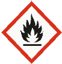
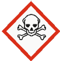
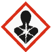
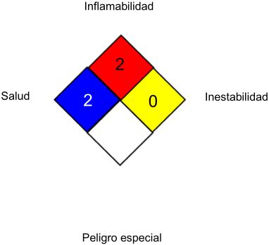
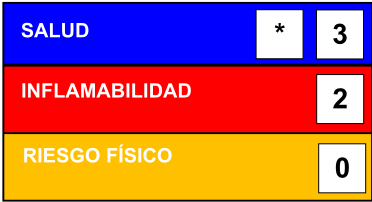

<!-- pagina: 1 -->

## FICHA DE DATOS DE SEGURIDAD

## Esmalte Uretano Part B

*Texto OCR de la imagen (puede contener errores): Sika | R*

Versión 2.0

Número de HDS: 100000033904

Fecha de revisión: 2023/10/07

## SECCIÓN 1. IDENTIFICACIÓN DE LA SUSTANCIA QUÍMICA PELIGROSA O MEZCLA Y DEL PROVEEDOR O FABRICANTE

Nombre del producto

: Esmalte Uretano Part B

## Informaciones sobre el fabricante o el proveedor

- **Compañía:** Sika Colombia S.A.S. Vereda Canavita km 20,5 Autopista Norte Tocancipá, Cundinamarca Colombia  
- **Teléfono:** (57-1) 8786333  
- **Teléfono de emergencia:** CISPROQUIM Bogotá: 2886012 / 2886355 Resto del país: 01 8000 916012  
- **Dirección de correo electróni- co:** controlcalidad.lab@co.sika.com  
- **Fax:** (57-1) 8786660

## Uso recomendado del producto químico y restricciones de uso

Uso del producto

: Catalizador para 2 Comp. Sellantes/Adhesivos

## SECCIÓN 2. IDENTIFICACIÓN DE LOS PELIGROS

## Clasificación según SGA (GHS)

- **Líquidos Inflamables:** Categoría 3  
- **Toxicidad aguda (Inhalación):** Categoría 3

Corrosión/irritación cutáneas : Categoría 2

- **Lesiones oculares graves/irritación ocular:** Categoría 2A  
- **Sensibilización respiratoria:** Categoría 1  
- **Sensibilización cutánea:** Categoría 1  
- **Toxicidad sistémica específi- ca de órganos blanco - exposición única:** Categoría 3 (Sistema respiratorio)  
- **Toxicidad sistémica específica de órganos blanco - Exposiciones repetidas (Inhalación):** Categoría 2  
- **Peligro de aspiración:** Categoría 1  
- **Peligro a corto plazo (agudo):** Categoría 3

<!-- pagina: 2 -->

## FICHA DE DATOS DE SEGURIDAD

## Esmalte Uretano Part B

Versión 2.0

*Texto OCR de la imagen (puede contener errores): Sika | R*

Número de HDS: 100000033904

Fecha de revisión: 2023/10/07

para el medio ambiente acuático

| Etiqueta SGA (GHS) Pictogramas de peligro   | :   |                                                                                                                                                                                                                                                                                                                                                                                                                                                                                                                                                                                                                                                                                                                                                                                                                                                                                                                                                                                                                                                                                                                                                                                                                                                                                                                                                             |
|---------------------------------------------|-----|-------------------------------------------------------------------------------------------------------------------------------------------------------------------------------------------------------------------------------------------------------------------------------------------------------------------------------------------------------------------------------------------------------------------------------------------------------------------------------------------------------------------------------------------------------------------------------------------------------------------------------------------------------------------------------------------------------------------------------------------------------------------------------------------------------------------------------------------------------------------------------------------------------------------------------------------------------------------------------------------------------------------------------------------------------------------------------------------------------------------------------------------------------------------------------------------------------------------------------------------------------------------------------------------------------------------------------------------------------------|
| Palabra de advertencia                      | :   | Peligro                                                                                                                                                                                                                                                                                                                                                                                                                                                                                                                                                                                                                                                                                                                                                                                                                                                                                                                                                                                                                                                                                                                                                                                                                                                                                                                                                     |
| Indicaciones de peligro                     | :   | H226 Líquido y vapores inflamables. H304 Puede ser mortal en caso de ingestión y de penetración en las vías respiratorias. H315 Provoca irritación cutánea. H317 Puede provocar una reacción cutánea alérgica. H319 Provoca irritación ocular grave. H331 Tóxico si se inhala. H334 Puede provocar síntomas de alergia o asma o dificulta- des respiratorias si se inhala. H335 Puede irritar las vías respiratorias. H373 Puede provocar daños en los órganos tras exposiciones prolongadas o repetidas por inhalación. H402 Nocivo para los organismos acuáticos.                                                                                                                                                                                                                                                                                                                                                                                                                                                                                                                                                                                                                                                                                                                                                                                         |
| Consejos de prudencia                       | :   | Prevención: P210 Mantener alejado del calor, chispas, llamas al descubier- to, superficies calientes y otras fuentes de ignición. No fumar. P233 Mantener el recipiente herméticamente cerrado. P240 Toma de tierra y enlace equipotencial del recipiente y del equipo receptor. P241 Utilizar material eléctrico, de ventilación o de iluminación/ antideflagrante. P242 No utilizar herramientas que produzcan chispas. P243 Tomar medidas de precaución contra las descargas elec- trostáticas. P260 No respirar nieblas o vapores. P264 Lavarse la piel cuidadosamente después de la manipula- ción. P271 Utilizar sólo al aire libre o en un lugar bien ventilado. P272 La ropa de trabajo contaminada no debe salir del lugar de trabajo. P273 No dispersar en el medio ambiente. P280 Usar guantes/ ropa de protección/ equipo de protección para los ojos/ la cara. P284 Llevar equipo de protección respiratoria. Intervención: P301 + P310 EN CASO DE INGESTIÓN: Llamar inmediata- mente a un CENTRO DE TOXICOLOGÍA o a un médico. P303 + P361 + P353 EN CASO DE CONTACTO CON LA PIEL (o el pelo): Quitar inmediatamente toda la ropa contaminada. Enjuagar la piel con agua. P304 + P340 + P311 EN CASO DE INHALACIÓN: Transportar a la persona al aire libre y mantenerla en una posición que le facilite la respiración. Llamar a un CENTRO DE |

*Imagen asociada a la tabla #/tables/0: imagen contenida en el área de la tabla en la página 2 (100% de su área).*

*Imagen asociada a la tabla #/tables/0: imagen contenida en el área de la tabla en la página 2 (100% de su área).*

*Imagen asociada a la tabla #/tables/0: imagen contenida en el área de la tabla en la página 2 (100% de su área).*

<!-- pagina: 3 -->

## FICHA DE DATOS DE SEGURIDAD

## Esmalte Uretano Part B

*Texto OCR de la imagen (puede contener errores): Sika | R*

Versión 2.0

Número de HDS: 100000033904

Fecha de revisión: 2023/10/07

## Otros peligros no clasificables

No conocidos.

TOXICOLOGÍA/ médico.

P305 + P351 + P338 EN CASO DE CONTACTO CON LOS OJOS: Enjuagar con agua cuidadosamente durante varios minutos. Quitar las lentes de contacto cuando estén presentes y pueda hacerse con facilidad. Proseguir con el lavado. P331 NO provocar el vómito.

P333 + P313 En caso de irritación cutánea o sarpullido: consultar a un médico.

P337 + P313 Si la irritación ocular persiste, consultar a un médico.

P342 + P311 En caso de síntomas respiratorios: Llamar a un CENTRO DE TOXICOLOGÍA o a un médico.

P362 + P364 Quitar la ropa contaminada y lavarla antes de volverla a usar.

P370 + P378 En caso de incendio: Utilizar arena seca, producto químico seco o espuma resistente al alcohol para la extinción.

## Almacenamiento:

P403 + P233 Almacenar en un lugar bien ventilado. Mantener el recipiente herméticamente cerrado.

P403 + P235 Almacenar en un lugar bien ventilado. Mantener fresco.

P405 Guardar bajo llave.

## Eliminación:

P501 Eliminar el contenido/ recipiente en una planta de eliminación de residuos aprobada.

## SECCIÓN 3. COMPOSICIÓN/INFORMACIÓN SOBRE LOS INGREDIENTES

Sustancia / mezcla

: Mezcla

## Componentes

| Nombre químico                               | CAS No.    | Concentración (% w/w)   |
|----------------------------------------------|------------|-------------------------|
| Homopolímero de hexametilen-1,6-diisocianato | 28182-81-2 | >= 70 - < 90            |
| acetato de n-butilo                          | 123-86-4   | >= 10 - < 20            |
| xileno                                       | 1330-20-7  | >= 10 - < 20            |
| etilbenceno                                  | 100-41-4   | >= 2,5 - < 5            |
| Di-isocianato de hexametileno                | 822-06-0   | >= 0,1 - < 1            |

## SECCIÓN 4. PRIMEROS AUXILIOS

| Consejos generales    | :   | Retire a la persona de la zona peligrosa. Consulte a un médico. Muéstrele esta hoja de seguridad al doctor que esté de servi- cio. Los síntomas de envenenamiento pueden aparecer varias horas después.   |
|-----------------------|-----|-----------------------------------------------------------------------------------------------------------------------------------------------------------------------------------------------------------|
| En caso de inhalación | :   | Llame inmediatamente a un médico o a un centro de informa- ción toxicológica.                                                                                                                             |

<!-- pagina: 4 -->

## FICHA DE DATOS DE SEGURIDAD

## Esmalte Uretano Part B

*Texto OCR de la imagen (puede contener errores): Sika | R*

Versión 2.0

Número de HDS: 100000033904

Fecha de revisión: 2023/10/07

| En caso de contacto con la piel                            | :   | Quítese inmediatamente la ropa y zapatos contaminados. Elimínelo lavando con jabón y mucha agua. Si persisten los síntomas, llame a un médico.                                                                                                                                                                                                                                                                                                                                                                                                                                                                                                                                                                                                                                             |
|------------------------------------------------------------|-----|--------------------------------------------------------------------------------------------------------------------------------------------------------------------------------------------------------------------------------------------------------------------------------------------------------------------------------------------------------------------------------------------------------------------------------------------------------------------------------------------------------------------------------------------------------------------------------------------------------------------------------------------------------------------------------------------------------------------------------------------------------------------------------------------|
| En caso de contacto con los ojos                           | :   | Enjuagar inmediatamente los ojos con agua abundante. Quítese los lentes de contacto. Manténgase el ojo bien abierto mientras se lava. Si persiste la irritación de los ojos, consulte a un especialista.                                                                                                                                                                                                                                                                                                                                                                                                                                                                                                                                                                                   |
| En caso de ingestión                                       | :   | Lávese la boca con agua y después beba agua abundante. No provoque vómitos. No dé leche ni bebidas alcohólicas. Nunca debe administrarse nada por la boca a una persona inconsciente. Lleve al afectado enseguida a un hospital.                                                                                                                                                                                                                                                                                                                                                                                                                                                                                                                                                           |
| Síntomas y efectos más im- portante, agudos y retarda- dos | :   | Riesgo de lesiones pulmonares graves (por aspiración). efectos irritantes efectos sensibilizantes Su inhalación puede causar edema pulmonar y neumonía. Tos Desordenes respiratorios Reacciones alérgicas Lacrimación excesiva Dolor de cabeza Dermatitis Vea la Sección 11 para obtener información detallada sobre la salud y los síntomas. Puede ser mortal en caso de ingestión y de penetración en las vías respiratorias. Provoca irritación cutánea. Puede provocar una reacción cutánea alérgica. Provoca irritación ocular grave. Tóxico si se inhala. Puede provocar síntomas de alergia o asma o dificultades respiratorias si se inhala. Puede irritar las vías respiratorias. Puede provocar daños en los órganos tras exposiciones pro- longadas o repetidas por inhalación. |
| Notas especiales para un medico tratante                   | :   | Trate sintomáticamente.                                                                                                                                                                                                                                                                                                                                                                                                                                                                                                                                                                                                                                                                                                                                                                    |

## SECCIÓN 5. MEDIDAS CONTRA INCENDIOS

- **Medios de extinción apropiados:** Espuma resistente a los alcoholes Dióxido de carbono (CO2) Producto químico seco  
- **Agentes de extinción inapropiados:** Agua  
- **Productos de combustión peligrosos:** No se conocen productos de combustión peligrosos

<!-- pagina: 5 -->

## FICHA DE DATOS DE SEGURIDAD

## Esmalte Uretano Part B

*Texto OCR de la imagen (puede contener errores): Sika | R*

- **Versión 2.0:** Fecha de revisión: 2023/10/07  
- **Métodos específicos de extinción:** Utilice rocío de agua para enfriar los recipientes cerrados.  
- **Equipo de protección especial para los bomberos Número de HDS:** 100000033904 En caso de incendio, utilice un equipo respiratorio autónomo.

## SECCIÓN 6. MEDIDAS QUE DEBEN TOMARSE EN CASO DE DERRAME ACCIDENTAL O FUGA ACCIDENTAL

- **Precauciones personales, equipo de protección y procedimientos de emergencia:** Utilice equipo de protección personal. Retire todas las fuentes de ignición. Negar el acceso a personas sin protección.  
- **Precauciones relativas al medio ambiente:** Evite que el producto vaya al alcantarillado. Si el producto contamina los ríos, lagos o alcantarillados, informar a las autoridades respectivas.  
- **Métodos y materiales de contención y limpieza:** Contener y recoger el derrame con material absorbente que no sea combustible (p. ej. arena, tierra, barro de diatomeas, vermiculita), y meterlo en un envase para su eliminación de acuerdo con las reglamentaciones locales y nacionales (ver sección 13).

## SECCIÓN 7. MANEJO Y ALMACENAMIENTO

- **Sugerencias para la protección contra incendios y explosiones:** Utilice un equipo a prueba de explosiones. Mantener alejado del calor/ de chispas/ de llamas al descubierto/ de superficies calientes. No fumar. Tomar medidas de precaución contra la acumulación de cargas electrostáticas.  
- **Consejos para una manipulación segura:** No respire los vapores ni la niebla de la pulverización. Evitar sobrepasar los límites dados de exposición profesional (ver sección 8). Evitar todo contacto con los ojos, la piel o la ropa. Ver sección 8 para el equipo de protección personal. Las personas que hayan tenido problemas de sensibilisación de la piel, asma, alergías, enfermedades respiratorias crónicas o recurrentes, no deben ser empleadas en ninguna parte del proceso en la cual esté utilizada esta preparación. Fumar, comer y beber debe prohibirse en el área de aplicación. Tomar medidas de precaución contra las descargas electrostáticas. Provea de suficiente intercambio de aire y/o de extracción en los lugares de trabajo. Abra el tambor con precaución, ya que el contenido puede estar presurizado. Adopte las acciones necesarias para evitar descargas de electricidad estática (que podrían ocasionar la inflamación de los vapores orgánicos). Cuando se manejen productos químicos, siga las medidas estándar de higiene.

Condiciones para el almace- : Entrada prohibida a toda persona no autorizada.

<!-- pagina: 6 -->

## FICHA DE DATOS DE SEGURIDAD

## Esmalte Uretano Part B

Versión 2.0

Número de HDS: 100000033904

*Texto OCR de la imagen (puede contener errores): Sika | R*

Fecha de revisión: 2023/10/07

namiento seguro Almacénelo en el envase original. Mantenga en un lugar bien ventilado. Los contenedores que se abren deben ser cuidadosamente resellados y mantenerlos en posición vertical para evitar fugas.

Observar las indicaciones de la etiqueta. Almacenar en conformidad con la reglamentación local.

## SECCIÓN 8. CONTROLES DE EXPOSICIÓN/PROTECCIÓN PERSONAL

## Componentes con parámetros de control en el área de trabajo

| Componentes                   | CAS No.   | Tipo de valor (Forma de exposición)   | Parámetros de control / Concen- tración permisible   | Bases   |
|-------------------------------|-----------|---------------------------------------|------------------------------------------------------|---------|
| acetato de n-butilo           | 123-86-4  | TWA                                   | 50 ppm                                               | ACGIH   |
|                               |           | STEL                                  | 150 ppm                                              | ACGIH   |
| xileno                        | 1330-20-7 | TWA                                   | 20 ppm                                               | ACGIH   |
| etilbenceno                   | 100-41-4  | TWA                                   | 20 ppm                                               | ACGIH   |
| Di-isocianato de hexametileno | 822-06-0  | TWA                                   | 0,005 ppm                                            | ACGIH   |

## Límites biológicos de exposición ocupacional

| Componentes                     | CAS No.   | Parámetros de control                                   | Análisis biológico   | Tiempo de toma de mues- tras                                                         | Concentra- ción permisi- ble   | Bases     |
|---------------------------------|-----------|---------------------------------------------------------|----------------------|--------------------------------------------------------------------------------------|--------------------------------|-----------|
| xileno                          | 1330-20-7 | Acidos me- tilhipúricos                                 | Orina                | Al final del turno (Tan pronto como sea posible después de que cese la exposi- ción) | 1.5 g/g crea- tinina           | ACGIH BEI |
| etilbenceno                     | 100-41-4  | Suma del ácido man- délico y el ácido fenil- glioxílico | Orina                | Al final del turno (Tan pronto como sea posible después de que cese la exposi- ción) | 0.15 g/g creatinina            | ACGIH BEI |
| Di-isocianato de hexa- metileno | 822-06-0  | 1,6- Hexameti- leno diami- na                           | Orina                | Al final del turno de trabajo                                                        | 15 µg/g crea- tinina           | ACGIH BEI |

## Protección personal

Protección respiratoria

: Utilice protección respiratoria a menos que exista una ventilación de escape adecuada o que la evaluación de la exposi-

<!-- pagina: 7 -->

## FICHA DE DATOS DE SEGURIDAD

## Esmalte Uretano Part B

*Texto OCR de la imagen (puede contener errores): Sika | R*

Versión 2.0

Número de HDS: 100000033904

Fecha de revisión: 2023/10/07

|                                      | ción indique que el nivel de exposición está dentro de las pautas recomendadas. La clase de filtro para el respirador debe ser adecuada para la concentración máxima prevista del contaminante (gas/vapor/aerosol/partículas) que puede presentarse al ma- nejar el producto. Si se excede esta concentración, se debe utilizar un aparato respiratorio autónomo.   |
|--------------------------------------|---------------------------------------------------------------------------------------------------------------------------------------------------------------------------------------------------------------------------------------------------------------------------------------------------------------------------------------------------------------------|
| Protección de las manos :            | Guantes químico-resistentes e impermeables que cumplan con estándares aprobados deben ser utilizados cuando se manejen productos químicos y la evaluación del riesgo indica que es necesario.                                                                                                                                                                       |
| Protección de los ojos :             | Equipo de protección ocular que cumpla con estándares aprobados debe ser utilizado cuando la evaluación del riesgo indica que es necesario.                                                                                                                                                                                                                         |
| Protección de la piel y del cuerpo : | Elegir la protección para el cuerpo según sus caraterísticas, la concentración y la cantidad de sustancias peligrosas, y el lugar específico de trabajo.                                                                                                                                                                                                            |
| Medidas de higiene :                 | Evite el contacto con la piel, ojos y ropa. No coma ni beba durante su utilización. No fume durante su utilización. Lávese las manos antes de los descansos e inmediatamente después de manipular la substancia.                                                                                                                                                    |

## SECCIÓN 9. PROPIEDADES FÍSICAS Y QUÍMICAS

| Aspecto                                                               | :   | líquido               |
|-----------------------------------------------------------------------|-----|-----------------------|
| Color                                                                 | :   | amarillo              |
| Olor                                                                  | :   | característico        |
| Umbral de olor                                                        | :   | Sin datos disponibles |
| pH                                                                    | :   | Sin datos disponibles |
| Punto de fusión/rango / Punto de congelación                          | :   | Sin datos disponibles |
| Punto / intervalo de ebullición                                       | :   | Sin datos disponibles |
| Punto de inflamación                                                  | :   | aprox. 50 °C (50 °C)  |
| Tasa de evaporación                                                   | :   | Sin datos disponibles |
| Inflamabilidad (sólido, gas)                                          | :   | Sin datos disponibles |
| Límite superior de explosivi- dad / Límite de inflamabilidad superior | :   | 7 %(v)                |
| Límite inferior de explosividad / Límite de inflamabilidad infe- rior | :   | 1 %(v)                |

<!-- pagina: 8 -->

## FICHA DE DATOS DE SEGURIDAD

## Esmalte Uretano Part B

*Texto OCR de la imagen (puede contener errores): Sika | R*

- **Versión 2.0:** Número de HDS: 100000033904 Fecha de revisión: 2023/10/07  
- **Presión de vapor:** 12,4989 hPa  
- **Densidad relativa de vapor:** Sin datos disponibles  
- **Densidad:** 1,1 g/cm3 (20 °C (20 °C))  
- **Solubilidad:**  
- **Hidrosolubilidad:** Sin datos disponibles  
- **Solubilidad en otros disol- ventes:** Sin datos disponibles  
- **Coeficiente de reparto noctanol/agua:** Sin datos disponibles  
- **Temperatura de ignición es- pontánea:** 415 °C  
- **Temperatura de descomposi- ción Viscosidad:** Sin datos disponibles  
- **Viscosidad, dinámica:** Sin datos disponibles  
- **Viscosidad, cinemática:** Sin datos disponibles  
- **Propiedades explosivas:** Sin datos disponibles  
- **Propiedades comburentes:** Sin datos disponibles

## SECCIÓN 10. ESTABILIDAD Y REACTIVIDAD

- **Reactividad:** No se conoce ninguna reacción peligrosa bajo condiciones de uso normal.  
- **Estabilidad química:** El producto es químicamente estable.  
- **Posibilidad de reacciones peligrosas:** Estable bajo las condiciones de almacenamiento recomendadas.  
- **Condiciones que deben evitarse:** Calor, llamas y chispas.  
- **Materiales incompatibles Los vapores pueden formar una mezcla explosiva con el aire.:** Sin datos disponibles

## SECCIÓN 11. INFORMACIÓN TOXICOLÓGICA

## Toxicidad aguda

Tóxico si se inhala.

## Componentes:

## Homopolímero de hexametilen-1,6-diisocianato:

- **Toxicidad oral aguda:** DL50 Oral (Rata): > 2.500 mg/kg  
- **Toxicidad aguda por inhala-:** CL50: 1,5 mg/l  
- **ción:** Tiempo de exposición: 4 h

<!-- pagina: 9 -->

## FICHA DE DATOS DE SEGURIDAD

## Esmalte Uretano Part B

*Texto OCR de la imagen (puede contener errores): Sika | R*

Versión 2.0

Número de HDS: 100000033904

Fecha de revisión: 2023/10/07

Toxicidad dérmica aguda Prueba de atmosfera: polvo/niebla Método: Juicio experto

: LD50 Dermico (Rata): > 2.000 mg/kg

## acetato de n-butilo:

- **Toxicidad oral aguda:** DL50 Oral (Rata): > 5.000 mg/kg  
- **Toxicidad aguda por inhalación:** CL50 (Rata): 23,4 mg/l Tiempo de exposición: 4 h Prueba de atmosfera: vapor  
- **Toxicidad dérmica aguda:** LD50 Dermico (Conejo): > 5.000 mg/kg

## xileno:

Toxicidad oral aguda

: DL50 Oral (Rata): 3.523 mg/kg

## etilbenceno:

- **Toxicidad oral aguda:** DL50 Oral (Rata): 3.500 mg/kg  
- **Toxicidad dérmica aguda:** LD50 Dermico (Conejo): 5.510 mg/kg

## Di-isocianato de hexametileno:

- **Toxicidad oral aguda:** DL50 Oral (Rata): 746 mg/kg  
- **Toxicidad aguda por inhala-:** CL50 (Rata): 0,124 mg/l  
- **ción:** Tiempo de exposición: 4 h Prueba de atmosfera: vapor  
- **Toxicidad dérmica aguda:** LD50 Dermico (Rata): > 7.000 mg/kg

## Corrosión o irritación cutáneas

Provoca irritación cutánea.

## Lesiones oculares graves/irritación ocular

Provoca irritación ocular grave.

## Sensibilización respiratoria o cutánea

## Sensibilización cutánea

Puede provocar una reacción cutánea alérgica.

## Sensibilización respiratoria

Puede provocar síntomas de alergia o asma o dificultades respiratorias si se inhala.

## Mutagenicidad en células germinales

No se clasifica debido a la falta de datos.

## Carcinogenicidad

No se clasifica debido a la falta de datos.

## Toxicidad para la reproducción

No se clasifica debido a la falta de datos.

## Toxicidad sistémica específica de órganos blanco - exposición única

Puede irritar las vías respiratorias.

## Toxicidad sistémica específica de órganos blanco - exposiciones repetidas

Puede provocar daños en los órganos tras exposiciones prolongadas o repetidas por inhalación.

<!-- pagina: 10 -->

## FICHA DE DATOS DE SEGURIDAD

## Esmalte Uretano Part B

*Texto OCR de la imagen (puede contener errores): Sika | R*

Versión 2.0

Número de HDS: 100000033904

Fecha de revisión: 2023/10/07

## Toxicidad por aspiración

Puede ser mortal en caso de ingestión y de penetración en las vías respiratorias.

## SECCIÓN 12. INFORMACIÓN ECOTOXICOLOGICA

## Ecotoxicidad

## Componentes:

## acetato de n-butilo:

Toxicidad para las al-

gas/plantas acuáticas

## xileno:

CE50 (Desmodesmus subspicatus (alga verde)): 647,7 mg/l  
Tiempo de exposición: 72 h  
- **Toxicidad para peces (Toxi-:** NOEC (Oncorhynchus mykiss (trucha irisada)): > 1,3 mg/l  
- **cidad crónica):** Tiempo de exposición: 56 d  
- **Toxicidad para la dafnia y:** NOEC (Daphnia (Dafnia)): 1,17 mg/l  
- **otros invertebrados acuáticos (Toxicidad crónica):** Tiempo de exposición: 7 d

## Persistencia y degradabilidad

Sin datos disponibles

## Potencial de bioacumulación

Sin datos disponibles

## Movilidad en el suelo

Sin datos disponibles

## Otros efectos adversos

## Producto:

Información ecológica complementaria

: No existe ningún dato disponible para ese producto.

## SECCIÓN 13. INFORMACIÓN RELATIVA A LA ELIMINACIÓN DE LOS PRODUCTOS

## Métodos de eliminación

- **Residuos:** Envíese a una compañía autorizada para la gestión de residuos. Evite que el producto penetre en los desagües, tuberías, o la tierra (suelos). No contamine los estanques, cursos de agua o zanjas con el producto químico o el contendor utilizado.  
- **Envases contaminados:** Vacíe el contenido restante. Eliminar como producto no usado. No reutilice los recipientes vacíos. No queme, ni utilice un soplete de corte, en el tambor vacío.

## SECCIÓN 14. INFORMACIÓN RELATIVA AL TRANSPORTE

## Regulaciones internacionales

<!-- pagina: 11 -->

## FICHA DE DATOS DE SEGURIDAD

## Esmalte Uretano Part B

*Texto OCR de la imagen (puede contener errores): Sika | R*

Versión 2.0

Número de HDS: 100000033904

Fecha de revisión: 2023/10/07

## UNRTDG

- **Número ONU:** UN 1263  
- **Designación oficial de trans-:** PAINT RELATED MATERIAL  
- **porte:** (acetato de n-butilo)  
- **Clase:** 3  
- **Grupo de embalaje:** III  
- **Etiquetas:** 3

## IATA-DGR

- **No. UN/ID:** UN 1263  
- **Designación oficial de transporte:** Paint related material (n-butyl acetate)  
- **Clase:** 3  
- **Grupo de embalaje:** III  
- **Etiquetas Instrucción de embalaje (avión de carga) Instrucción de embalaje (avión de pasajeros):** Flammable Liquids

## Código-IMDG

366  
355  
- **Número ONU:** UN 1263  
- **Designación oficial de trans-:** PAINT RELATED MATERIAL  
- **porte:** (n-butyl acetate)  
- **Clase:** 3  
- **Grupo de embalaje:** III  
- **Etiquetas:** 3  
- **Código EmS:** F-E, S-E  
- **Contaminante marino:** no

## Transporte a granel de acuerdo a instrumentos IMO

No aplicable para el producto tal y como se proveyó.

## Precauciones especiales para los usuarios

La(s) clasificación(es) de transporte presente(s) tienen solamente propósitos informativos y se basa(n) únicamente en las propiedades del material sin envasar/embalar, descritas dentro de esta Hoja de Datos de Seguridad. Las clasificaciones de transporte pueden variar según el modo de transporte, el tamaño del envase/embalaje y las variaciones en los reglamentos regionales o del país.

## SECCIÓN 15. INFORMACIÓN REGLAMENTARIA

## Reglamentación medioambiental, seguridad y salud específica para la sustancia o mezcla

Convención Internacional sobre las Armas Químicas

(CWC) Programas sobre los Productos Químicos Tó-

xicos y los Precursores (Louisiana Administrative Co-

de, Title 33,Part V Section 10101 et. seq.)

Sustancias y productos químicos controlados por el

Ministerio de Justicia

Listado de Sustancias incluídas como Sustancias de

Control Especial y Sometidas a Fiscalización por el

Ministerio de Salud y Protección Social

Resolución 2715 de 2014 Por la cual se establecen las : No aplicable

: No aplicable

: acetato de n-butilo

xileno

: No aplicable

<!-- pagina: 12 -->

## FICHA DE DATOS DE SEGURIDAD

## Esmalte Uretano Part B

*Texto OCR de la imagen (puede contener errores): Sika | R*

## Versión 2.0

Número de HDS: 100000033904

Fecha de revisión: 2023/10/07

sustancias que deben ser objeto de registro de control de venta al menudeo, con base en los criterios de clasificación que se definen.

## SECCIÓN 16. OTRA INFORMACIÓN INCLUIDAS LAS RELATIVAS A LA PREPARACIÓN Y ACTUALIZACIÓN DE LAS HOJAS DE DATOS DE SEGURIDAD

- **Fecha de revisión:** 2023/10/07  
- **formato de fecha:** aaaa/mm/dd

## Información adicional

## NFPA:

## HMIS® IV:

*Texto del PDF en el área de la imagen (capa de texto, no OCR): Inflamabilidad | Inestabilidad | Salud | 2 | 0 | 2 | Peligro especial*

## Texto completo de otras abreviaturas

- **ACGIH:** Valores límite (TLV) de la ACGIH,USA  
- **ACGIH BEI:** ACGIH - Índices Biológicos de Exposición (BEI)  
- **ACGIH / TWA:** Tiempo promedio ponderado  
- **ACGIH / STEL:** Límite de exposición a corto plazo  
- **ADR:** Accord européen relatif au transport international des mar- chandises Dangereuses par Route  
- **CAS:** Chemical Abstracts Service  
- **DNEL:** Derived no-effect level  
- **EC50:** Half maximal effective concentration  
- **GHS:** Globally Harmonized System  
- **IATA:** International Air Transport Association  
- **IMDG:** International Maritime Code for Dangerous Goods  
- **LD50:** Median lethal dosis (the amount of a material, given all at once, which causes the death of 50% (one half) of a group of test animals)  
- **LC50:** Median lethal concentration (concentrations of the chemical in air that kills 50% of the test animals during the observation period)  
- **MARPOL:** International Convention for the Prevention of Pollution from Ships, 1973 as modified by the Protocol of 1978  
- **OEL:** Occupational Exposure Limit

*Texto del PDF en el área de la imagen (capa de texto, no OCR): 3 | 0 | 2 | * | RIESGO FÍSICO | INFLAMABILIDAD | SALUD*

Las clasificaciones HMIS® se basan en una escala del 0 al 4 en la que 0 significa riesgos o peligros mínimos y 4 significa riesgos o peligros serios. El "*" representa un peligro crónico, mientras que la "/" representa la ausencia de un peligro crónico.

<!-- pagina: 13 -->

## FICHA DE DATOS DE SEGURIDAD

## Esmalte Uretano Part B

*Texto OCR de la imagen (puede contener errores): Sika | R*

| Versión 2.0   | Número de HDS: 100000033904                                                                                                                                                                                                                | Fecha de revisión: 2023/10/07                                                                                                                                                                                                              |
|---------------|--------------------------------------------------------------------------------------------------------------------------------------------------------------------------------------------------------------------------------------------|--------------------------------------------------------------------------------------------------------------------------------------------------------------------------------------------------------------------------------------------|
| PBT           | : Persistent, bioaccumulative and toxic                                                                                                                                                                                                    |                                                                                                                                                                                                                                            |
| PNEC          | : Predicted no effect concentration                                                                                                                                                                                                        |                                                                                                                                                                                                                                            |
| REACH         | : Regulation (EC) No 1907/2006 of the European Parliament and of the Council of 18 December 2006 concerning the Re- gistration, Evaluation, Authorisation and Restriction of Chemi- cals (REACH), establishing a European Chemicals Agency | : Regulation (EC) No 1907/2006 of the European Parliament and of the Council of 18 December 2006 concerning the Re- gistration, Evaluation, Authorisation and Restriction of Chemi- cals (REACH), establishing a European Chemicals Agency |
| SVHC          | : Substances of Very High Concern                                                                                                                                                                                                          |                                                                                                                                                                                                                                            |
| vPvB          | : Very persistent and very bioaccumulative                                                                                                                                                                                                 |                                                                                                                                                                                                                                            |

La informacion contenida en este ficha de datos de seguridad corresponde a nuestro nivel de conocimiento en el momento de su publicacion. Quedan excluidas todas las garantias. Se aplicaran nuestras condiciones generales de venta en vigor. Por favor, consulte la Hoja de Datos del Producto antes de su uso y procesamiento. CO / 1X
