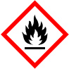
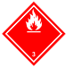

<!-- pagina: 1 -->

*Texto OCR de la imagen (puede contener errores): Pintuco | El Color de la Calidad*

## FICHA DE DATOS DE SEGURIDAD

## PQ CORROTEC PREMIUM 507 GRIS

## Sección 1. Identificación

Identificador SGA del producto SDS code

:

PQ CORROTEC PREMIUM 507 GRIS

: 507

## Usos pertinentes identificados de la sustancia o de la mezcla y usos desaconsejados

Uso profesional Uso industrial Uso por el consumidor

Todos los demás usos Usos identificados Usos contraindicados

Uso del producto

: Recubrimiento base disolvente para uso interior y exterior.

## Datos sobre el proveedor

Compañía Global de Pinturas S.A.S. Autopista Medellín Bogotá Km 37. Vía Belén Rionegro Km 1. 054040 Rionegro - Antioquia - Colombia 01 8000 111 247 Medellín 604 325 2523 www.pintuco.com

- **Dirección de e-mail de la persona responsable de esta FDS:** PSRA.southamerica@akzonobel.com  
- **Teléfono de emergencias (con horas de funcionamiento):** CISTEMA SURA Colombia al 018000 51 14 14, fuera de Colombia (0574) 4444578 24 horas

<!-- pagina: 2 -->

## Sección 2. Identificación de los peligros

## Clasificación de la sustancia o de la mezcla

:

LÍQUIDOS INFLAMABLES - Categoría 3

IRRITACIÓN CUTÁNEA - Categoría 2

IRRITACIÓN OCULAR - Categoría 2A

SENSIBILIZACIÓN RESPIRATORIA - Categoría 1

SENSIBILIZACIÓN CUTÁNEA - Categoría 1

MUTAGENICIDAD EN CÉLULAS GERMINALES - Categoría 1B

CARCINOGENICIDAD - Categoría 1A

TOXICIDAD PARA LA REPRODUCCIÓN - Categoría 2

TOXICIDAD ESPECÍFICA EN DETERMINADOS ÓRGANOS (STOT) -

EXPOSICIONES REPETIDAS - Categoría 2

PELIGRO ACUÁTICO A CORTO PLAZO (AGUDO) - Categoría 3

PELIGRO ACUÁTICO A LARGO PLAZO (CRÓNICO) - Categoría 3

## Elementos de las etiquetas del SGA

## Pictogramas de peligro

:

## Palabra de advertencia

## : Peligro

## Indicaciones de peligro

## Consejos de prudencia

## General

: H226 - Líquidos y vapores inflamables.

H315 - Provoca irritación cutánea.

H317 - Puede provocar una reacción alérgica en la piel.

H319 - Provoca irritación ocular grave.

H334 - Puede provocar síntomas de alergia o asma o dificultades respiratorias en

caso de inhalación.

H340 - Puede provocar defectos genéticos.

H350 - Puede provocar cáncer.

H361 - Se sospecha que puede perjudicar la fertilidad o dañar el feto.

H373 - Puede provocar daños en los órganos tras exposiciones prolongadas o

repetidas. (sistema nervioso central (SNC))

H412 - Nocivo para los organismos acuáticos, con efectos nocivos duraderos.

: P102 - Mantener fuera del alcance de los niños.

## Prevención

P101 - Si se necesita consejo médico, tener a mano el envase o la etiqueta.

: P201 - Solicitar instrucciones especiales antes del uso.

## Respuesta

P280 - Usar guantes de protección, ropa de protección e equipo de protección para la cara o los ojos.

P284 - Llevar equipo de protección respiratoria.

P210 - Mantener alejado del calor, de superficies calientes, de chispas, de llamas

abiertas y de cualquier otra fuente de ignición. No fumar.

P273 - Evitar su liberación al medio ambiente.

P260 - No respirar los vapores.

P264 - Lavarse las manos concienzudamente tras la manipulación.

: P308 + P313 - EN CASO DE exposición manifiesta o presunta: Consultar a un médico.

P304 + P340 - EN CASO DE INHALACIÓN: Transportar a la persona al aire libre y mantenerla en una posición que le facilite la respiración.

P342 + P311 - En caso de síntomas respiratorios: Llamar a un CENTRO DE INFORMACIÓN TOXICOLÓGICA o a un médico.

P362 + P364 - Quitar las prendas contaminadas y lavarlas antes de volver a usarlas.

P302 + P352 - EN CASO DE CONTACTO CON LA PIEL: Lavar con abundante agua.

P333 + P313 - En caso de irritación o erupción cutánea: Consultar a un médico.

P305 + P351 + P338 - EN CASO DE CONTACTO CON LOS OJOS: Aclarar

cuidadosamente con agua durante varios minutos. Quitar las lentes de contacto, si lleva y resulta fácil. Seguir aclarando.

P337 + P313 - Si persiste la irritación ocular: Consultar a un médico.

<!-- pagina: 3 -->

## Sección 2. Identificación de los peligros

- **Almacenamiento:** P405 - Guardar bajo llave.  
- **Eliminación:** P501 - Eliminar el contenido / el recipiente en conformidad con las reglamentaciones locales y nacionales.  
- **Otros peligros que no conducen a una clasificación P403 + P235 - Almacenar en un lugar bien ventilado. Mantener en lugar fresco.:** No se conoce ninguno.

## Sección 3. Composición/información sobre los componentes

Otros medios de identificación Sustancia/preparado

:

Mezcla

: No disponible.

| Nombre del ingrediente          | Número de CAS   | Concentración   |
|---------------------------------|-----------------|-----------------|
| gasolina                        | 86290-81-5      | ≤5              |
| disolvente de Stoddard          | 8052-41-3       | ≤5              |
| ácidos grasos, aceite de resina | 61790-12-3      | ≤5              |
| anhídrido ftalico               | 85-44-9         | <3              |
| ligroína                        | 8032-32-4       | ≤1              |
| benceno                         | 71-43-2         | <1              |
| bis(2-etilhexanoato) de cobalto | 136-52-7        | <0.3            |
| tetraóxido de bario y diboro    | 13701-59-2      | <0.3            |

No hay ningún ingrediente adicional presente que, bajo el conocimiento actual del proveedor y en las concentraciones aplicables, sea clasificado como de riesgo para la salud o el medio ambiente y por lo tanto deban ser reportados en esta sección.

Los límites de exposición laboral, en caso de existir, figuran en la sección 8.

## Sección 4. Primeros auxilios

## Descripción de los primeros auxilios necesarios

- **Contacto con los ojos:** Enjuaguar los ojos inmediatamente con mucha agua, levantando de vez en cuando los párpados superior e inferior. Verificar si la víctima lleva lentes de contacto y en este caso, retirárselas. Continúe enjuagando por lo menos durante 10 minutos. Procurar atención médica.  
- **Por inhalación:** Transportar a la víctima al exterior y mantenerla en reposo en una posición confortable para respirar. Si se sospecha que los vapores continúan presentes, la persona encargada del rescate deberá usar una máscara adecuada o un aparato de respiración autónoma. Si no hay respiración, ésta es irregular u ocurre un paro respiratorio, el personal capacitado debe proporcionar respiración artificial u oxígeno. Puede ser peligroso para la persona que proporcione ayuda al dar respiración boca a boca. Procurar atención médica. En caso necesario, llamar a un centro de información toxicológica o a un médico. Si está inconsciente, coloque en posición de recuperación y consiga atención médica inmediatamente. Asegure una buena circulación de aire. Aflojar todo lo que pudiera estar apretado, como el cuello de una camisa, una corbata, un cinturón. En el caso de que existan molestias o síntomas, evite más exposición.

<!-- pagina: 4 -->

## Sección 4. Primeros auxilios

## Contacto con la piel

Ingestión

:

:

Lavar con agua y jabón abundantes. Quítese la ropa y calzado contaminados. Lave bien la ropa contaminada con agua antes de quitársela, o use guantes. Continúe enjuagando por lo menos durante 10 minutos. Procurar atención médica. En el caso de que existan molestias o síntomas, evite más exposición. Lavar la ropa antes de volver a usarla. Limpiar completamente el calzado antes de volver a usarlo.

Lave la boca con agua. Retirar las prótesis dentales si es posible. Si se ha ingerido material y la persona expuesta está consciente, suminístrele pequeñas cantidades de agua para beber. Deje de proporcionarle agua si la persona expuesta se encuentra mal ya que los vómitos pueden ser peligrosos. No inducir al vómito a menos que lo indique expresamente el personal médico. Si vomita, mantener la cabeza baja de manera que el vómito no entre en los pulmones. Procurar atención médica. No suministrar nada por vía oral a una persona inconsciente. Si está inconsciente, coloque en posición de recuperación y consiga atención médica inmediatamente. Asegure una buena circulación de aire. Aflojar todo lo que pudiera estar apretado, como el cuello de una camisa, una corbata, un cinturón.

## Síntomas/efectos más importantes, agudos o retardados

## Efectos agudos potenciales para la salud

- **Contacto con los ojos:** Provoca irritación ocular grave.  
- **Por inhalación:** Puede provocar síntomas de alergia o asma o dificultades respiratorias en caso de inhalación.  
- **Ingestión Contacto con la piel:** Provoca irritación cutánea. Puede provocar una reacción alérgica en la piel. No se conocen efectos significativos o riesgos críticos.

## Signos/síntomas de sobreexposición

- **Contacto con los ojos:** Los síntomas adversos pueden incluir los siguientes:  
- **Por inhalación:** Jadeos y dificultades para respirar asma reducción de peso fetal incremento de muertes fetales malformaciones esqueléticas  
- **Contacto con la piel:** Los síntomas adversos pueden incluir los siguientes: irritación rojez reducción de peso fetal incremento de muertes fetales malformaciones esqueléticas  
- **Ingestión dolor o irritación lagrimeo rojez Los síntomas adversos pueden incluir los siguientes:** Los síntomas adversos pueden incluir los siguientes: reducción de peso fetal incremento de muertes fetales malformaciones esqueléticas

## Indicación de la necesidad de recibir atención médica inmediata y, en su caso, de tratamiento especial

- **Notas para el médico:** Tratar sintomáticamente. Contactar un especialista en tratamientos de envenenamientos inmediatamente si se ha ingerido o inhalado una gran cantidad.  
- **Protección del personal de primeros auxilios Tratamientos específicos:** No hay un tratamiento específico. No se debe realizar ninguna acción que suponga un riesgo personal o sin formación adecuada. Si se sospecha que los vapores continúan presentes, la persona encargada del rescate deberá usar una máscara adecuada o un aparato de respiración autónoma. Puede ser peligroso para la persona que proporcione ayuda al dar respiración boca a boca. Lave bien la ropa contaminada con agua antes de quitársela, o use guantes.

<!-- pagina: 5 -->

## Sección 4. Primeros auxilios

Vea la sección 11 para la Información Toxicológica

## Sección 5. Medidas de lucha contra incendios

## Medios de extinción

- **Medios de extinción apropiados:** Utilizar polvos químicos secos, CO₂, agua pulverizada (niebla de agua) o espuma.  
- **Medios de extinción no apropiados:** No usar chorro de agua.  
- **Peligros específicos del producto químico:** Líquidos y vapores inflamables. Los residuos líquidos que se filtran en el alcantarillado pueden causar un riesgo de incendio o de explosión. La presión puede aumentar y el contenedor puede explotar en caso de calentamiento o incendio, con el riesgo de producirse una explosión. Este material es nocivo para la vida acuática con efectos de larga duración. Se debe impedir que el agua de extinción de incendios contaminada con este material entre en vías de agua, drenajes o alcantarillados.  
- **Productos de descomposición térmica peligrosos:** Los productos de descomposición pueden incluir los siguientes materiales: dióxido de carbono monóxido de carbono compuestos halogenados óxido/óxidos metálico/metálicos  
- **Medidas especiales que deben tomar los equipos de lucha contra incendios:** En caso de incendio, aislar rápidamente la zona, evacuando a todas las personas de las proximidades del lugar del incidente. No se debe realizar ninguna acción que suponga un riesgo personal o sin formación adecuada. Desplazar los contenedores lejos del incendio si puede hacerse sin peligro. Use agua pulverizada para refrigerar los envases expuestos al fuego.  
- **Equipo de protección especial para el personal de lucha contra incendios:** Los bomberos deben llevar equipo de protección apropiado y un equipo de respiración autónomo con una máscara facial completa que opere en modo de presión positiva.

## Sección 6. Medidas en caso de vertido accidental

## Precauciones personales, equipo de protección y procedimientos de emergencia

Para el personal que no forma parte de los servicios de emergencia

Para el personal de emergencia

## Precauciones relativas al medio ambiente

: No se debe realizar ninguna acción que suponga un riesgo personal o sin formación adecuada. Evacuar los alrededores. No deje que entre el personal innecesario y sin protección. No toque o camine sobre el material derramado. Apagar todas las fuentes de ignición. Ni bengalas, ni humo, ni llamas en en el área de riesgo. Evite respirar vapor o neblina. Proporcione ventilación adecuada. Llevar un aparato de respiración apropiado cuando el sistema de ventilación sea inadecuado. Llevar puesto un equipo de protección individual adecuado.

: Si se necesitan prendas especiales para gestionar el vertido, tomar en cuenta las informaciones recogidas en la Sección 8 en relación a los materiales adecuados y no adecuados. Consultar también la información mencionada en "Para el personal que no forma parte de los servicios de emergencia".

:

Evitar la dispersión del material derramado, su contacto con el suelo, las vias fluviales, las tuberías de desagüe y las alcantarillas. Informar a las autoridades pertinentes si el producto ha causado contaminación medioambiental (alcantarillas, vias fluviales, suelo o aire). Material contaminante del agua. Puede ser dañino para el medio ambiente si es liberado en cantidades grandes.

## Métodos y material de contención y de limpieza

<!-- pagina: 6 -->

## Sección 6. Medidas en caso de vertido accidental

## Derrame pequeño

:

## Gran derrame

:

Detener la fuga si esto no presenta ningún riesgo. Retire los envases del área del derrame. Use herramientas a prueba de chispas y equipo a prueba de explosión. Diluir con agua y fregar si es soluble en agua. Alternativamente, o si es insoluble en agua, absorber con un material seco inerte y colocar en un contenedor de residuos adecuado. Elimine por medio de un contratista autorizado para la eliminación.

Detener la fuga si esto no presenta ningún riesgo. Retire los envases del área del derrame. Use herramientas a prueba de chispas y equipo a prueba de explosión. Aproximarse al vertido en el sentido del viento. Evite que se introduzca en alcantarillas, canales de agua, sótanos o áreas reducidas. Lave los vertidos hacia una planta de tratamiento de efluentes o proceda como se indica a continuación. Detener y recoger los derrames con materiales absorbentes no combustibles, como arena, tierra, vermiculita o tierra de diatomeas, y colocar el material en un envase para desecharlo de acuerdo con las normativas locales (ver Sección 13). Elimine por medio de un contratista autorizado para la eliminación. El material absorbente contaminado puede presentar el mismo riesgo que el producto derramado. Nota: Ver la Sección 1 para información sobre los contactos de emergencia y la Sección 13 para la eliminación de los residuos.

## Sección 7. Manipulación y almacenamiento

## Precauciones para una manipulación segura

## Medidas de protección

## Información relativa a higiene en el trabajo de forma general

## Condiciones de almacenamiento seguro, incluidas posibles incompatibilidades

:

:

:

Usar un equipo de proteccion personal adecuado (Consultar Sección 8). Personas con un historial de problemas de sensibilización de la piel o asma, alergias o enfermedades respiratorias crónicas o recurrentes no deberían ser empleadas en cualquier proceso en el cual este producto es utilizado. Evítese la exposición - recábense instrucciones especiales antes del uso. Evite la exposición durante el embarazo. No manipular la sustancia antes de haber leído y comprendido todas las instrucciones de seguridad. No introducir en ojos en la piel o en la ropa. No respire los vapores o nieblas. No ingerir. Evitar su liberación al medio ambiente. Use sólo con ventilación adecuada. Llevar un aparato de respiración apropiado cuando el sistema de ventilación sea inadecuado. No entre en áreas de almacenamiento y espacios cerrados a menos que estén ventilados adecuadamente. Consérvese en su envase original o en uno alternativo aprobado fabricado en un material compatible, manteniéndose bien cerrado cuando no esté en uso. Mantener alejado del calor, chispas, llamas al descubierto, o de cualquier otra fuente de ignición. Use equipo eléctrico (de ventilación, iluminación y manipulación de materiales) a prueba de explosiones. Utilizar únicamente herramientas que no produzcan chispas. Tomar medidas de precaución contra la acumulación de cargas electrostáticas. Los envases vacíos retienen resíduos del producto y pueden ser peligrosos. No vuelva a usar el envase.

Deberá prohibirse comer, beber o fumar en los lugares donde se manipula, almacena o trata este producto. Los trabajadores deberan lavarse las manos y la cara antes de comer, beber o fumar. Retirar el equipo de protección y las ropas contaminadas antes de acceder a zonas donde se coma. Consultar también en la Sección 8 la información adicional sobre medidas higiénicas.

Almacenar conforme a las normativas locales. Almacenar en un área separada y homologada. Almacenar en el contenedor original protegido de la luz directa del sol en un área seca, fresca y bien ventilada, separado de materiales incompatibles (ver Sección 10) y comida y bebida. Guardar bajo llave. Eliminar todas las fuentes de ignición. Manténgase alejado de los materiales oxidantes. Mantener el contenedor bien cerrado y sellado hasta el momento de usarlo. Los envases abiertos deben cerrarse perfectamente con cuidado y mantenerse en posición vertical para evitar derrames. No almacenar en contenedores sin etiquetar. Utilícese un envase de seguridad adecuado para evitar la contaminación del medio ambiente. Antes de manipularlo o utilizarlo vea en la sección 10 los materiales incompatibles.

<!-- pagina: 7 -->

## Sección 8. Controles de exposición/protección individual

## Parámetros de control

## Límites de exposición profesional

| Nombre del ingrediente          | Límites de exposición                                                                                                                                                                                                                                                                               |
|---------------------------------|-----------------------------------------------------------------------------------------------------------------------------------------------------------------------------------------------------------------------------------------------------------------------------------------------------|
| gasolina                        | ACGIH TLV (Estados Unidos, 1/2022). TWA: 300 ppm 8 horas. TWA: 890 mg/m³ 8 horas. STEL: 500 ppm 15 minutos. STEL: 1480 mg/m³ 15 minutos.                                                                                                                                                            |
| disolvente de Stoddard          | ACGIH TLV (Estados Unidos, 1/2022). TWA: 525 mg/m³ 8 horas. TWA: 100 ppm 8 horas.                                                                                                                                                                                                                   |
| ácidos grasos, aceite de resina | ACGIH TLV (Estados Unidos). TWA: 5 mg/m³ 8 horas.                                                                                                                                                                                                                                                   |
| anhídrido ftalico               | STEL: 10 mg/m³ 15 minutos. ACGIH TLV (Estados Unidos, 1/2022). Absorbido a través de la piel. Sensibilizante por contacto con la piel. Sensibilizante si se inhala. TWA: 0.002 mg/m³ 8 horas. Forma: Inhalable fraction and vapor STEL: 0.005 mg/m³ 15 minutos. Forma: Inhalable fraction and vapor |
| ligroína                        | ACGIH TLV (Estados Unidos). TWA: 300 ppm 8 horas.                                                                                                                                                                                                                                                   |
| benceno                         | ACGIH TLV (Estados Unidos, 1/2022). Absorbido a través de la piel. TWA: 0.5 ppm 8 horas. TWA: 1.6 mg/m³ 8 horas. STEL: 2.5 ppm 15 minutos. STEL: 8 mg/m³ 15 minutos.                                                                                                                                |
| bis(2-etilhexanoato) de cobalto | ACGIH TLV (Estados Unidos, 1/2022). [cobalt and inorganic compounds] Sensibilizante por contacto con la piel. Sensibilizante si se inhala.                                                                                                                                                          |
| tetraóxido de bario y diboro    | TWA: 0.02 mg/m³, (as Co) 8 horas. ACGIH TLV (Estados Unidos, 1/2022). [Barium and soluble compounds] TWA: 0.5 mg/m³, (as Ba) 8 horas.                                                                                                                                                               |

## Controles técnicos apropiados

## Controles de exposición medioambiental

: Use sólo con ventilación adecuada. Utilizar aislamientos de áreas de producción, sistemas de ventilación locales, u otros procedimientos de ingeniería para mantener la exposición del obrero a los contaminantes aerotransportados por debajo de todos los límites recomendados o estatutarios. Los controles de ingeniería también deben mantener el gas, vapor o polvo por debajo del menor límite de explosión. Utilizar equipo de ventilación anti-explosión.

: Se deben verificar las emisiones de los equipos de ventilación o de los procesos de trabajo para verificar que cumplen con los requisitos de la legislación de protección del medio ambiente. En algunos casos para reducir las emisiones hasta un nivel aceptable, será necesario usar depuradores de humo, filtros o modificar el diseño del equipo del proceso.

## Medidas de protección individual

<!-- pagina: 8 -->

## Sección 8. Controles de exposición/protección individual

| Medidas higiénicas :              | Lave las manos, antebrazos y cara completamente después de manejar productos químicos, antes de comer, fumar y usar el lavabo y al final del período de trabajo. Usar las técnicas apropiadas para eliminar ropa contaminada. Las prendas de trabajo contaminadas no podrán sacarse del lugar de trabajo. Lavar las ropas contaminadas antes de volver a usarlas. Verifique que las estaciones de lavado de ojos y duchas de seguridad se encuentren cerca de las estaciones de trabajo.                                                                                                                                                                                                                      |
|-----------------------------------|---------------------------------------------------------------------------------------------------------------------------------------------------------------------------------------------------------------------------------------------------------------------------------------------------------------------------------------------------------------------------------------------------------------------------------------------------------------------------------------------------------------------------------------------------------------------------------------------------------------------------------------------------------------------------------------------------------------|
| Protección de los ojos/la cara :  | Se debe usar un equipo protector ocular que cumpla con las normas aprobadas cuando una evaluación del riesgo indique que es necesario, a fin de evitar toda exposición a salpicaduras del líquido, lloviznas, gases o polvos. Si es posible el contacto, se debe utilizar la siguiente protección, salvo que la valoración indique un grado de protección más alto: gafas protectoras contra salpicaduras químicas.                                                                                                                                                                                                                                                                                           |
| Protección de la piel             |                                                                                                                                                                                                                                                                                                                                                                                                                                                                                                                                                                                                                                                                                                               |
| Protección de las manos :         | Si una evaluación del riesgo indica que es necesario, se deben usar guantes químico-resistentes e impenetrables que cumplan con las normas aprobadas siempre que se manejen productos químicos. Tomando en consideración los parámetros especificados por el fabricante de los guantes, comprobar durante el uso que los guantes siguen conservando sus propiedades protectoras. Hay que observar que el tiempo de paso de cualquier material utilizado con guantes puede ser diferente para distintos fabricantes de guantes. En el caso de mezclas, consistentes en varias sustancias, no es posible estimar de manera exacta, el                                                                           |
| Protección corporal :             | tiempo de protección que ofrecen los guantes. Antes de utilizar este producto se debe seleccionar equipo protector personal para el cuerpo basándose en la tarea a ejecutar y los riesgos involucrados y debe ser aprobado por un especialista. Cuando haya riesgo de ignición a consecuencia de cargas electrostáticas, utilizar indumentaria de protección antiestática. Para ofrecer la máxima protección frente a descargas electrostáticas, la indumentaria debe incluir monos, botas y guantes con propiedades antiestáticas.                                                                                                                                                                           |
| Otro tipo de protección cutánea : | Se deben elegir el calzado adecuado y cualquier otra medida de protección cutánea necesaria dependiendo de la tarea que se lleve a cabo y de los riesgos implicados. Tales medidas deben ser aprobadas por un especialista antes de proceder a la manipulación de este producto.                                                                                                                                                                                                                                                                                                                                                                                                                              |
| Protección respiratoria :         | Basándose en la evaluación de los riesgos y la exposición, seleccionar un respirador que satisfaga los estándares o certificaciones apropiados. Los respiradores deben usarse de conformidad con un programa de protección respiratoria para asegurar su adecuación, formación y otros aspectos del buen uso. Llevar un respirador conforme a la norma EN140 con filtro de tipo A/P2 o mejor. El lijado en seco, el cortado con llama y/o el soldado de películas secas de pintura producirá polvo y/o humos nocivos. Un lijado o matizado húmedos son preferibles si es posible. Si no puede evitarse la exposición por la ventilación de extracción debe usarse adecuado equipo de protección respiratoria. |

## Sección 9. Propiedades físicas y químicas y características de seguridad

Las condiciones de medición de todas las propiedades son a temperatura y presión estándar a menos que se indique lo contrario.

## Aspecto

- **Estado físico:** Líquido.  
- **Color:** Gris.  
- **Olor:** Característico.  
- **Umbral olfativo:** No disponible.  
- **pH:** No disponible.  
- **Punto de fusión/punto de congelación:** No disponible.  
- **Punto de ebullición, punto de ebullición inicial e intervalo de ebullición:** 100°C (212°F)

<!-- pagina: 9 -->

## Sección 9. Propiedades físicas y químicas y características de seguridad

- **Punto de inflamación:** Vaso cerrado: 46°C (114.8°F)  
- **Tasa de evaporación:** No disponible.  
- **Inflamabilidad Límite superior e inferior de explosividad:** No disponible. Intervalo más amplio conocido: Punto mínimo: 0.6% Punto maximo: 8% (disolvente de Stoddard)  
- **Presión de vapor:**  
- **Densidad de vapor relativa:**  
- **Densidad:**

| Nombre del ingrediente                                     | Presión de vapor a 20 ºC - mm Hg   | Presión de vapor a 20 ºC - kPa   | Presión de vapor a 20 ºC - Método   |
|------------------------------------------------------------|------------------------------------|----------------------------------|-------------------------------------|
| nafta disolvente (petróleo), fracción alifática intermedia | 1.5 a 4.5                          | 0.2 a 0.6                        |                                     |
| nafta disolvente (petróleo), fracción alifática intermedia | 1.5 a 4.5                          | 0.2 a 0.6                        |                                     |
| disolvente de Stoddard                                     | 0.75 a 10.5                        | 0.1 a 1.4                        |                                     |

No disponible.

: 1.19 g/cm³

## Solubilidad(es)

:

| Soporte   | Resultado                  |
|-----------|----------------------------|
| agua fría | No soluble [OECD (TG 105)] |

- **Coeficiente de reparto octanol/agua:** n- No aplicable.  
- **Temperatura de auto- inflamación:**

| Nombre del ingrediente                                     | °C        | °F        |
|------------------------------------------------------------|-----------|-----------|
| disolvente de Stoddard                                     | 230 a 240 | 446 a 464 |
| nafta disolvente (petróleo), fracción alifática intermedia | >220      | >428      |
| nafta disolvente (petróleo), fracción alifática intermedia | >220      | >428      |

Viscosidad Temperatura de descomposición

: No disponible.

:

Cinemática (temperatura ambiente): 1349 mm 2 /s (1349 cSt)

Cinemática (40°C (104°F)): 201 mm 2 /s (201 cSt)

Características de las partículas

Tamaño de partícula medio : No aplicable.

Porcentaje de partículas con diámetro aerodinámico ≤ 10 μm

: 0

## Sección 10. Estabilidad y reactividad

- **Reactividad:** No hay datos de ensayo disponibles sobre la reactividad de este producto o sus componentes.  
- **Estabilidad química:**  
- **Posibilidad de reacciones peligrosas El producto es estable.:** En condiciones normales de almacenamiento y uso, no se producen reacciones peligrosas.  
- **Fecha de emisión/Fecha de revisión:** 2-5-2024  
- **Fecha de la emisión anterior:** No hay validación anterior Versión : 1

<!-- pagina: 10 -->

## Sección 10. Estabilidad y reactividad

## Condiciones que deben evitarse

Evitar todas las fuentes posibles de ignición (chispa o llama). No someta a presión, corte, suelde, suelde con latón, taladre, esmerile o exponga los envases al calor o fuentes térmicas.  
- **Materiales incompatibles:** Reactivo o incompatible con los siguientes materiales: materiales oxidantes  
- **Productos de descomposición peligrosos:** En condiciones normales de almacenamiento y uso, no se deberían formar productos de descomposición peligrosos.

## Sección 11. Información toxicológica

## Información sobre los efectos toxicológicos

## Toxicidad aguda

| Nombre del producto o ingrediente                                                                                                                                                   | Resultado                                                                                                                                                                                                                                                                                                                                                                                                                       | Especies                                                                                                                                                          | Dosis                                                                                                                                                                                                                                                                                               | Exposición                                                            |
|-------------------------------------------------------------------------------------------------------------------------------------------------------------------------------------|---------------------------------------------------------------------------------------------------------------------------------------------------------------------------------------------------------------------------------------------------------------------------------------------------------------------------------------------------------------------------------------------------------------------------------|-------------------------------------------------------------------------------------------------------------------------------------------------------------------|-----------------------------------------------------------------------------------------------------------------------------------------------------------------------------------------------------------------------------------------------------------------------------------------------------|-----------------------------------------------------------------------|
| gasolina ácidos grasos, aceite de resina anhídrido ftalico bis(ortofosfato) de tricinc ligroína benceno bis(2-etilhexanoato) de cobalto tetraóxido de bario y diboro butanona-oxima | DL50 Oral DL50 Oral DL50 Intraperitoneal DL50 Oral DL50 Oral DL50 Rectal DL50 Intraperitoneal DL50 Intraperitoneal CL50 Por inhalación Gas. DL50 Intravenosa CL50 Por inhalación Gas. DL50 Cutánea DL50 Intraperitoneal DL50 Intraperitoneal DL50 Oral DL50 Oral DL50 Oral DL50 Oral DL50 Oral DL50 Cutánea DL50 Oral DL50 Oral DL50 Oral DL50 Cutánea DL50 Intraperitoneal DL50 Oral DL50 Oral DL50 Subcutánea DL50 Subcutánea | Rata Rata Cobaya Ratón Rata Ratón Ratón Rata Rata Ratón Rata Ratón Ratón Rata Ratón Rata Rata Rata Rata Conejo Rata Ratón Rata Conejo Ratón Ratón Rata Ratón Rata | 13.6 g/kg >10000 mg/kg 100 mg/kg 1500 mg/kg 1530 mg/kg 400 mg/kg 552 mg/kg 551 mg/kg 3400 ppm 40 mg/kg 10000 ppm 48 mg/kg 340 mg/kg 1100 µg/kg 4700 mg/kg 1 mL/kg 930 mg/kg 1800 mg/kg 6400 mg/kg >5 g/kg 1.22 g/kg 640 mg/kg 3800 mg/kg 200 uL/kg 200 mg/kg 1 g/kg 930 mg/kg 2700 mg/kg 2702 mg/kg | - - - - - - - - 4 horas - 7 horas - - - - - - - - - - - - - - - - - - |

## Irritación/Corrosión

| Nombre del producto o ingrediente   | Resultado                 | Especies   | Puntuación   | Exposición      | Observación   |
|-------------------------------------|---------------------------|------------|--------------|-----------------|---------------|
| disolvente de Stoddard              | Ojos - Irritante moderado | Conejo     | -            | 24 horas 500 mg | -             |
| anhídrido ftalico                   | Ojos - Irritante moderado | Conejo     | -            | 24 horas 50 mg  | -             |
| benceno                             | Ojos - Irritante moderado | Conejo     | -            | 88 mg           | -             |
|                                     | Ojos - Muy irritante      | Conejo     | -            | 24 horas 2 mg   | -             |
|                                     | Piel - Irritante leve     | Conejo     | -            | 24 horas 15 mg  | -             |

: 2-5-2024

<!-- pagina: 11 -->

## Sección 11. Información toxicológica

| butanona-oxima   | Piel - Irritante leve Piel - Irritante moderado Ojos - Muy irritante   | Rata Conejo Conejo   | - - -   | 8 horas 60 Ul 24 horas 20 mg 100 Ul   | - - -   |
|------------------|------------------------------------------------------------------------|----------------------|---------|---------------------------------------|---------|

## Sensibilización

No disponible.

## Mutagénesis

No disponible.

## Carcinogenicidad

No disponible.

## Clasificación

| Nombre del producto o ingrediente   | IARC   |
|-------------------------------------|--------|
| benceno                             | 1      |
| bis(2-etilhexanoato) de cobalto     | 2B     |

## Toxicidad para la reproducción

No disponible.

## Teratogenicidad

No disponible.

## Toxicidad específica en determinados órganos (STOT) - exposición única

| Nombre                                    | Categoría                                       | Vía de exposición   | Órganos destino                                                                                         |
|-------------------------------------------|-------------------------------------------------|---------------------|---------------------------------------------------------------------------------------------------------|
| gasolina anhídrido ftalico butanona-oxima | Categoría 3 Categoría 3 Categoría 1 Categoría 3 | - - -               | Efectos narcóticos Irritación de las vías respiratorias tracto respiratorio superior Efectos narcóticos |

## Toxicidad específica en determinados órganos (STOT) - exposición repetida

| Nombre                                                     | Categoría   | Vía de exposición   | Órganos destino                |
|------------------------------------------------------------|-------------|---------------------|--------------------------------|
| nafta disolvente (petróleo), fracción alifática intermedia | Categoría 1 | -                   | sistema nervioso central (SNC) |
| disolvente de Stoddard                                     | Categoría 1 | inhalación          | sistema nervioso central (SNC) |
| benceno                                                    | Categoría 1 | -                   | -                              |
| butanona-oxima                                             | Categoría 2 | -                   | sistema sanguíneo              |

## Peligro de aspiración

| Nombre                                                                                                                                                                 | Resultado                                                                                                                                                                                                                     |
|------------------------------------------------------------------------------------------------------------------------------------------------------------------------|-------------------------------------------------------------------------------------------------------------------------------------------------------------------------------------------------------------------------------|
| nafta disolvente (petróleo), fracción alifática intermedia nafta disolvente (petróleo), fracción alifática intermedia gasolina disolvente de Stoddard ligroína benceno | PELIGRO POR ASPIRACIÓN - Categoría 1 PELIGRO POR ASPIRACIÓN - Categoría 1 PELIGRO POR ASPIRACIÓN - Categoría 1 PELIGRO POR ASPIRACIÓN - Categoría 1 PELIGRO POR ASPIRACIÓN - Categoría 1 PELIGRO POR ASPIRACIÓN - Categoría 1 |

Información sobre posibles vías de exposición

: No disponible.

## Efectos agudos potenciales para la salud

Contacto con los ojos

:

Provoca irritación ocular grave.

| Fecha de emisión/Fecha de revisión   | : 2-5-2024                   | Versión   | : 1   |
|--------------------------------------|------------------------------|-----------|-------|
| Fecha de la emisión anterior         | : No hay validación anterior | 11/17     |       |

*Imagen asociada a la tabla #/tables/13: imagen contenida en el área de la tabla en la página 11 (100% de su área).*

<!-- pagina: 12 -->

## Sección 11. Información toxicológica

- **Por inhalación:** Puede provocar síntomas de alergia o asma o dificultades respiratorias en caso de inhalación.  
- **Ingestión Contacto con la piel:** Provoca irritación cutánea. Puede provocar una reacción alérgica en la piel. No se conocen efectos significativos o riesgos críticos.

## Síntomas relacionados con las características físicas, químicas y toxicológicas

- **Contacto con los ojos:** Los síntomas adversos pueden incluir los siguientes:  
- **Por inhalación:** Jadeos y dificultades para respirar asma reducción de peso fetal incremento de muertes fetales malformaciones esqueléticas  
- **Contacto con la piel:** Los síntomas adversos pueden incluir los siguientes: irritación rojez reducción de peso fetal incremento de muertes fetales malformaciones esqueléticas  
- **Ingestión dolor o irritación lagrimeo rojez Los síntomas adversos pueden incluir los siguientes:** Los síntomas adversos pueden incluir los siguientes: reducción de peso fetal incremento de muertes fetales malformaciones esqueléticas

## Efectos retardados e inmediatos, así como efectos crónicos producidos por una exposición a corto y largo plazo

## Exposición a corto plazo

Posibles efectos

inmediatos

Posibles efectos

retardados

## Exposición a largo plazo

No disponible.  
No disponible.  
- **Posibles efectos inmediatos:** No disponible.  
- **Posibles efectos retardados:** No disponible.

## Efectos crónicos potenciales para la salud

- **No disponible.:**  
- **General:**  
- **Carcinogenicidad:** Puede provocar cáncer. El riesgo de cáncer depende de la duración y el grado de exposición.  
- **Mutagénesis:** Puede provocar defectos genéticos.  
- **Toxicidad para la reproducción Puede provocar daños en los órganos tras exposiciones prolongadas o repetidas. Una vez producida la sensibilización, podría observarse una reacción alérgica grave al exponerse posteriormente a niveles muy bajos.:** Se sospecha que puede perjudicar la fertilidad o dañar el feto.

## Medidas numéricas de toxicidad

Estimaciones de toxicidad aguda

<!-- pagina: 13 -->

## Sección 11. Información toxicológica

| Nombre del producto o ingrediente                                                                                                                   | Oral (mg/ kg)   | Cutánea (mg/kg)   | Inhalación (gases) (ppm)   | Inhalación (vapores) (mg/l)   | Inhalación (polvos y nieblas) (mg/l)   |
|-----------------------------------------------------------------------------------------------------------------------------------------------------|-----------------|-------------------|----------------------------|-------------------------------|----------------------------------------|
| Producto tal y como suministrado nafta disolvente (petróleo), fracción alifática intermedia gasolina anhídrido ftalico tetraóxido de bario y diboro | 28990.7 N/A     | 14610.9 1100 N/A  | N/A N/A N/A N/A N/A        | 146.1 11                      | N/A N/A                                |
|                                                                                                                                                     | 13600           |                   |                            | N/A                           | N/A                                    |
|                                                                                                                                                     | 500             | N/A               |                            | N/A                           | N/A                                    |
|                                                                                                                                                     | 100             | N/A               |                            | N/A                           | 1.5                                    |
| butanona-oxima                                                                                                                                      | 100             | 1100              | N/A                        | N/A                           | N/A                                    |

## Sección 12. Información ecológica

## Toxicidad

| Nombre del producto o ingrediente   | Resultado                                                            | Especies                                                                        | Exposición                                                                                                                                                                                   |
|-------------------------------------|----------------------------------------------------------------------|---------------------------------------------------------------------------------|----------------------------------------------------------------------------------------------------------------------------------------------------------------------------------------------|
| anhídrido ftalico                   | Agudo EC50 4140 µg/l Agua fresca                                     | Algas - Pseudokirchneriella subcapitata Algas - Pseudokirchneriella subcapitata | 96 horas 96 horas 96 horas 96 horas 72 horas 96 horas 48 horas 48 horas 48 horas 48 horas 48 horas 48 horas 48 horas 48 horas 48 horas 48 horas 96 horas 96 horas 96 horas 96 horas 96 horas |
|                                     | Agudo EC50 78530 µg/l Agua fresca                                    |                                                                                 |                                                                                                                                                                                              |
|                                     | Agudo EC50 147 µg/l Agua fresca                                      | Algas - Pseudokirchneriella subcapitata                                         |                                                                                                                                                                                              |
| bis(ortofosfato) de tricinc benceno | Agudo CL50 90 µg/l Agua fresca Agudo EC50 29000 µg/l Agua fresca     | Pescado - Oncorhynchus mykiss Algas - Pseudokirchneriella subcapitata           |                                                                                                                                                                                              |
|                                     | Agudo EC50 1600000 µg/l Agua fresca Agudo EC50 9.23 mg/l Agua fresca | Algas - Selenastrum sp. Dafnia - Daphnia magna - Neonato                        |                                                                                                                                                                                              |
|                                     | Agudo EC50 10 mg/l Agua fresca                                       | Dafnia - Daphnia magna - Neonato                                                |                                                                                                                                                                                              |
|                                     | Agudo EC50 11.73 mg/l Agua fresca                                    | Dafnia - Daphnia magna - Neonato                                                |                                                                                                                                                                                              |
|                                     | Agudo EC50 10 mg/l Agua fresca                                       | Dafnia - Daphnia magna - Neonato                                                |                                                                                                                                                                                              |
|                                     | Agudo EC50 10000 µg/l Agua fresca                                    | Dafnia - Daphnia magna - Juvenil (Nuevo, Cría, Destetado)                       |                                                                                                                                                                                              |
|                                     | Agudo CL50 21 mg/l Agua marina Agudo CL50 42000 µg/l Agua fresca     | Crustáceos - Artemia salina Crustáceos - Gammarus pulex                         |                                                                                                                                                                                              |
|                                     | Agudo CL50 35 ppm Agua marina                                        | Crustáceos - Palaemonetes pugio - Adulto                                        |                                                                                                                                                                                              |
|                                     | Agudo CL50 35000 µg/l Agua marina                                    | Crustáceos - Palaemonetes pugio                                                 |                                                                                                                                                                                              |
|                                     | Agudo CL50 33000 µg/l Agua marina                                    | Crustáceos - Palaemonetes pugio                                                 |                                                                                                                                                                                              |
|                                     | Agudo CL50 5.8 ul/L Agua marina                                      | Pescado - Morone saxatilis - Juvenil (Nuevo, Cría, Destetado)                   |                                                                                                                                                                                              |
|                                     | Agudo CL50 5.28 ul/L Agua fresca                                     | Pescado - Oncorhynchus gorbuscha - Alevín                                       |                                                                                                                                                                                              |
|                                     | Agudo CL50 5900 µg/l Agua fresca                                     | Pescado - Oncorhynchus mykiss                                                   |                                                                                                                                                                                              |
|                                     | Agudo CL50 5300 µg/l Agua fresca                                     | Pescado - Oncorhynchus mykiss - Juvenil (Nuevo, Cría, Destetado)                |                                                                                                                                                                                              |
|                                     | Agudo CL50 5.55 ul/L Agua marina                                     | Pescado - Oncorhynchus nerka - Smolt                                            |                                                                                                                                                                                              |
|                                     | Crónico NOEC 98 mg/l Agua fresca Crónico NOEC 98 mg/l Agua fresca    | Dafnia - Daphnia magna Dafnia - Daphnia magna                                   | 21 días 21 días                                                                                                                                                                              |
|                                     | Crónico NOEC 1.5 a 5.4 ul/L Agua                                     | Pescado - Morone saxatilis -                                                    | 4 semanas                                                                                                                                                                                    |

<!-- pagina: 14 -->

## Sección 12. Información ecológica

| tetraóxido de bario y diboro   | marina Crónico NOEC 3.6 a 8.1 ul/L Agua marina Agudo EC50 20.3 ppm Agua fresca Agudo CL50 151 ppm Agua fresca Agudo CL50 62 ppm Agua fresca Agudo CL50 145 mg/l Agua fresca   | Juvenil (Nuevo, Cría, Destetado) Pescado - Morone saxatilis - Juvenil (Nuevo, Cría, Destetado) Dafnia - Daphnia magna Pescado - Lepomis macrochirus Pescado - Oncorhynchus mykiss Pescado - Rasbora heteromorpha   | 4 semanas 48 horas 96 horas 96 horas 96 horas   |
|--------------------------------|-------------------------------------------------------------------------------------------------------------------------------------------------------------------------------|--------------------------------------------------------------------------------------------------------------------------------------------------------------------------------------------------------------------|-------------------------------------------------|
| butanona-oxima                 | Agudo CL50 843000 µg/l Agua fresca                                                                                                                                            | Pescado - Pimephales promelas                                                                                                                                                                                      | 96 horas                                        |

## Persistencia/degradabilidad

No disponible.

## Potencial de bioacumulación

| Nombre del producto o ingrediente                                                                                                             | LogPow                                | FBC                                                | Potencial                               |
|-----------------------------------------------------------------------------------------------------------------------------------------------|---------------------------------------|----------------------------------------------------|-----------------------------------------|
| gasolina disolvente de Stoddard anhídrido ftalico bis(ortofosfato) de tricinc ligroína benceno bis(2-etilhexanoato) de cobalto butanona-oxima | 2 a 7 3.16 a 7.06 1.6 - - 2.13 - 0.63 | 10 a 2500 - 3.4 60960 10 a 2500 11 15600 2.5 a 5.8 | alta alta bajo alta alta bajo alta bajo |

## Movilidad en el suelo

- **Coeficiente de partición tierra/agua (KOC):** No disponible.  
- **Otros efectos adversos:** No se conocen efectos significativos o riesgos críticos.

## Sección 13. Consideraciones relativas a la eliminación

## Métodos de eliminación

:

Evitar o minimizar la generación de residuos cuando sea posible. La eliminación de este producto, sus soluciones y cualquier derivado deben cumplir siempre con los requisitos de la legislación de protección del medio ambiente y eliminación de desechos y todos los requisitos de las autoridades locales. Desechar los sobrantes y productos no reciclables por medio de un constratista autorizado a su eliminación. Los residuos no se deben tirar por la alcantarilla sin tratar a menos que sean compatibles con los requisitos de todas las autoridades con jurisdicción. Los envases residuales deben reciclarse. Sólo se deben contemplar la incineración o el enterramiento cuando el reciclaje no sea factible. Elimínense los residuos del producto y sus recipientes con todas las precauciones posibles. Deben tomarse precauciones cuando se manipulen recipientes vaciados que no hayan sido limpiados o enjuagados. Los envases vacíos o los revestimentos pueden retener residuos del producto. El vapor procedente de residuos del producto puede crear una atmósfera altamente inflamable o explosiva en el interior del recipiente. No cortar, soldar ni esmerilar recipientes usados salvo que se hayan limpiado a fondo por dentro. Evitar la dispersión del material derramado, su contacto con el suelo, las vias fluviales, las tuberías de desagüe y las alcantarillas.

<!-- pagina: 15 -->

## Sección 14. Información relativa al transporte

*Texto OCR de la imagen (puede contener errores): 3*

*Imagen asociada a la tabla #/tables/18: imagen contenida en el área de la tabla en la página 15 (100% de su área).*

*Imagen asociada a la tabla #/tables/18: imagen contenida en el área de la tabla en la página 15 (100% de su área).*

*Imagen asociada a la tabla #/tables/18: imagen contenida en el área de la tabla en la página 15 (100% de su área).*

|                                                          | Carretera - UN   | Marítimo - IMDG   | Aéreo - IATA   |
|----------------------------------------------------------|------------------|-------------------|----------------|
| Número ONU                                               | UN1263 UN1263    |                   | UN1263         |
| Designación oficial de transporte de las Naciones Unidas | PINTURAS         | PINTURAS          | PAINT          |
| Clase(s) de peligro para el transporte                   | 3                | 3                 | 3              |
| Grupo de embalaje                                        | III              | III               | III            |
| Peligros para el medio ambiente                          | No.              | No.               | No.            |

## Información adicional

- **IMDG:** Programas de emergencia F-E, _S-E_ Excepción de líquido viscoso Este líquido viscoso de clase 3 no está sujeto a regulación en embalajes de hasta 450 l según 2.3.2.5.  
- **Precauciones particulares para los usuarios:** Transporte dentro de las premisas de usuarios: siempre transporte en recipientes cerrados que estén verticales y seguros. Asegurar que las personas que transportan el producto conocen qué hacer en caso de un accidente o derrame.  
- **Transporte a granel según los instrumentos de la IMO:** No disponible.

## Sección 15. Información reglamentaria

## Lista de inventario

- **Australia:** No determinado.  
- **Canadá:** No determinado.  
- **China:** No determinado.  
- **Unión Económica Euroasiática:** Inventario de la Federación Rusa: No determinado.  
- **Japón:** Inventario de Sustancias de Japón (CSCL): No determinado. Inventario de Sustancias de Japón (ISHL): No determinado.  
- **Nueva Zelandia:** No determinado.  
- **Filipinas:** No determinado.  
- **República de Corea:** No determinado.  
- **Taiwán:** No determinado.  
- **Tailandia:** No determinado.  
- **Turquía:** No determinado.  
- **Estados Unidos:** No determinado.  
- **Vietnam:** No determinado.

<!-- pagina: 16 -->

## Sección 15. Información reglamentaria

Regulaciones Nacionales: El receptor debería verificar la posible existencia de regulaciones locales aplicables al producto químico.

Decreto 1496 del 2018 Por el cual se adopta el Sistema Globalmente Armonizado de Clasificación y Etiquetado de Productos Químicos y se dictan otras disposiciones en materia de seguridad química.

Decreto 0773 del 2021 Por la cual se definen las acciones que deben desarrollar los empleadores para la aplicación del Sistema Globalmente Armonizado (SGA) de Clasificación y Etiquetado de Productos Químicos en los lugares de trabajo y se dictan otras disposiciones en materia de seguridad química.

## Sección 16. Otra información

## Historial

- **Fecha de impresión:** 6-5-2024  
- **Fecha de emisión/ Fecha de revisión:** 2-5-2024  
- **Fecha de la emisión anterior:** No hay validación anterior  
- **Versión:** 1  
- **Unique ID:** 4E8F22E7220C1EEF828C00037AB8833F  
- **Clave para las abreviaciones:** ETA = Estimación de Toxicidad Aguda FBC = Factor de Bioconcentración SGA - Sistema Globalmente Armonizado de clasificación y etiquetado de productos químicos IATA = Asociación de Transporte Aéreo Internacional IBC = Contenedor Intermedio para Productos a Granel IMDG = Código Marítimo Internacional de Mercancías Peligrosas Log Kow = logaritmo del coeficiente de reparto octanol/agua MARPOL = Convenio Internacional para Prevenir la Contaminación por los Buques, 1973 con el Protocolo de 1978. ("Marpol" = polución marina) N/A = No disponible SGG = Grupo de segregación ONU = Organización de las Naciones Unidas

## Procedimiento utilizado para obtener la clasificación

| Clasificación                                                                                                                                                                                                                                                                                                                                                                                                                                                                                                                | Justificación                                                                                                                                                                                                  |
|------------------------------------------------------------------------------------------------------------------------------------------------------------------------------------------------------------------------------------------------------------------------------------------------------------------------------------------------------------------------------------------------------------------------------------------------------------------------------------------------------------------------------|----------------------------------------------------------------------------------------------------------------------------------------------------------------------------------------------------------------|
| LÍQUIDOS INFLAMABLES - Categoría 3 IRRITACIÓN CUTÁNEA - Categoría 2 IRRITACIÓN OCULAR - Categoría 2A SENSIBILIZACIÓN RESPIRATORIA - Categoría 1 SENSIBILIZACIÓN CUTÁNEA - Categoría 1 MUTAGENICIDAD EN CÉLULAS GERMINALES - Categoría 1B CARCINOGENICIDAD - Categoría 1A TOXICIDAD PARA LA REPRODUCCIÓN - Categoría 2 TOXICIDAD ESPECÍFICA EN DETERMINADOS ÓRGANOS (STOT) - EXPOSICIONES REPETIDAS - Categoría 2 PELIGRO ACUÁTICO A CORTO PLAZO (AGUDO) - Categoría 3 PELIGRO ACUÁTICO A LARGO PLAZO (CRÓNICO) - Categoría 3 | En base a datos de ensayos Método de cálculo Método de cálculo Método de cálculo Método de cálculo Método de cálculo Método de cálculo Método de cálculo Método de cálculo Método de cálculo Método de cálculo |

Indica la información que ha cambiado desde la edición de la versión anterior.

## Aviso al lector

## PARA USO PROFESIONAL SOLAMENTE

NOTA IMPORTANTE: La información en esta hoja de datos no pretende ser exhaustiva y está basada en el estado actual de nuestro conocimiento y en las leyes vigentes : cualquier persona usando el producto para cualquier otro propósito que el especificamente recomendado en la hoja técnica de datos, sin primero obtener nuestra confirmación escrita de la idoneidad para el propósito pretendido, lo hará bajo su propia cuenta y riesgo. Es siempre responsabilidad del usuario seguir todos los pasos necesarios para cumplir toda la serie de demandas de las leyes locales y la legislación. Siempre lea la hoja de datos de seguridad y la hoja técnica de datos para este producto, si están disponibles. Todo consejo que demos o cualquier declaración hecha por nosotros acerca del producto (tanto en esta hoja técnica o en otro lugar distinto) es correcto según nuestro mejor conocimiento pero nosotros no tenemos control sobre la calidad o el estado del substrato ni de los muchos factores que afectan al uso y aplicación del

<!-- pagina: 17 -->

PQ CORROTEC PREMIUM 507 GRIS

## Sección 16. Otra información

producto. Por consiguiente, a menos que especificamente lo acordemos por escrito de otro modo, no aceptamos ninguna responsabilidad en todo lo que sea relacionado con las prestaciones técnicas del producto o por cualquier pérdida o daño emanado del uso del producto. Todos los productos suministrados y los consejos técnicos dados están sujetos a nuestros plazos de tiempo normales y condiciones de venta. Debería solicitar una copia de este documento y revisarlo cuidadosamente. La información contenida en esta hoja técnica está sujeta a modificación de cuando en cuando a las luces de la experencia y de nuestra política de continuo desarrollo. Es responsabilidad del usuario verificar que esta hoja técnica es la actual antes de usar el producto.

Las marcas de fábrica mencionadas en esta hoja técnica son marcas registradas o licenciatarias de Akzo Nobel.

<!-- encabezados y pies de pagina -->

## Encabezados y pies de página

*Texto del margen superior o inferior de las páginas, que Docling separa del cuerpo. Se lista una sola vez, con las páginas donde aparece.*

- [p. 1-8, 10, 12, 14-17] Fecha de emisión/Fecha de revisión Fecha de la emisión anterior
- [p. 1-8, 12-17] : 2-5-2024
- [p. 1-8, 10, 12-16] Versión : 1
- [p. 1-8, 10, 12-17] : No hay validación anterior
- [p. 2-16] PQ CORROTEC PREMIUM 507 GRIS
- [p. 13] Fecha de emisión/Fecha de revisión
- [p. 13] Fecha de la emisión anterior
- [p. 17] Versión : 1 17/17
