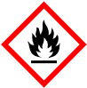
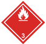
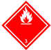

<!-- pagina: 1 -->

## FICHA DE DATOS DE SEGURIDAD

ACRILICA MANTENIMIENTO 13883 BLANCO RAL9003 BRILLANTE

## Sección 1. Identificación

- **Identificador SGA del producto:** ACRILICA MANTENIMIENTO 13883 BLANCO RAL9003 BRILLANTE  
- **SDS code:** 11Z028

## Usos pertinentes identificados de la sustancia o de la mezcla y usos desaconsejados

Uso industrial

Todos los demás usos Usos identificados Usos contraindicados

Uso del producto

: Pintura base disolvente.

## Datos sobre el proveedor

Compañía Global de Pinturas S.A.S. Autopista Medellín Bogotá Km 37 Vía Belén Rionegro Km 1 054040 Rionegro - Antioquia - Colombia 01 8000 111 247

- **Medellín 604 325 2523:**  
- **Dirección de e-mail de la persona responsable de esta FDS:** PSRA.southamerica@akzonobel.com  
- **Teléfono de emergencias (con horas de funcionamiento):** CISTEMA SURA Colombia al 018000 51 14 14, fuera de Colombia (0574) 4444578 24 horas

## Sección 2. Identificación de los peligros

Clasificación de la sustancia o de la mezcla

:

LÍQUIDOS INFLAMABLES - Categoría 2

TOXICIDAD AGUDA (dérmica) - Categoría 5 IRRITACIÓN CUTÁNEA - Categoría 2 IRRITACIÓN OCULAR - Categoría 2A TOXICIDAD PARA LA REPRODUCCIÓN - Categoría 2 TOXICIDAD ESPECÍFICA EN DETERMINADOS ÓRGANOS (STOT) -

EXPOSICIONES REPETIDAS - Categoría 2

## Elementos de las etiquetas del SGA

Pictogramas de peligro

:

Palabra de advertencia

: Peligro

- **Fecha de emisión/Fecha de revisión:** 13-11-2024  
- **Fecha de la emisión anterior:** No hay validación anterior Versión : 1

<!-- pagina: 2 -->

## Sección 2. Identificación de los peligros

## Indicaciones de peligro

: H225 - Líquido y vapores muy inflamables.

## Consejos de prudencia

Prevención H313 - Puede ser nocivo en contacto con la piel.

H315 - Provoca irritación cutánea.

H319 - Provoca irritación ocular grave.

H361 - Se sospecha que puede perjudicar la fertilidad o dañar el feto.

H373 - Puede provocar daños en los órganos tras exposiciones prolongadas o repetidas.

: P201 - Solicitar instrucciones especiales antes del uso.

## Respuesta

P210 - Mantener alejado del calor, de superficies calientes, de chispas, de llamas abiertas y de cualquier otra fuente de ignición. No fumar.  
P260 - No respirar los vapores.  
P264 - Lavarse las manos concienzudamente tras la manipulación.  
P308 + P313 - EN CASO DE exposición manifiesta o presunta: Consultar a un médico.  
P362 + P364 - Quitar las prendas contaminadas y lavarlas antes de volver a usarlas.  
P302 + P312 + P352 - EN CASO DE CONTACTO CON LA PIEL: Llamar a un  
CENTRO DE INFORMACIÓN TOXICOLÓGICA o a un médico si la persona se encuentra mal. Lavar con abundante agua.  
P305 + P351 + P338 - EN CASO DE CONTACTO CON LOS OJOS: Aclarar cuidadosamente con agua durante varios minutos. Quitar las lentes de contacto, si lleva y resulta fácil. Seguir aclarando.  
P337 + P313 - Si persiste la irritación ocular: Consultar a un médico.  
- **Almacenamiento P280 - Usar guantes de protección, ropa de protección e equipo de protección para la cara o los ojos.:** P403 + P235 - Almacenar en un lugar bien ventilado. Mantener en lugar fresco.  
- **Eliminación:** P501 - Eliminar el contenido / el recipiente en conformidad con las reglamentaciones locales y nacionales.  
- **Otros peligros que no conducen a una clasificación:** No se conoce ninguno.

## Sección 3. Composición/información sobre los componentes

## Sustancia/preparado

:

Otros medios de identificación Mezcla

: No disponible.

No hay ningún ingrediente adicional presente que, bajo el conocimiento actual del proveedor y en las concentraciones aplicables, sea clasificado como de riesgo para la salud o el medio ambiente y por lo tanto deban ser reportados en esta sección.

Los límites de exposición laboral, en caso de existir, figuran en la sección 8.

## Sección 4. Primeros auxilios

## Descripción de los primeros auxilios necesarios

## Contacto con los ojos

Por inhalación

:

:

Enjuaguar los ojos inmediatamente con mucha agua, levantando de vez en cuando los párpados superior e inferior. Verificar si la víctima lleva lentes de contacto y en este caso, retirárselas. Continúe enjuagando por lo menos durante 10 minutos. Procurar atención médica.

Transportar a la víctima al exterior y mantenerla en reposo en una posición confortable para respirar. Si no hay respiración, ésta es irregular u ocurre un paro respiratorio, el personal capacitado debe proporcionar respiración artificial u oxígeno. Puede ser peligroso para la persona que proporcione ayuda al dar respiración boca a boca. Procurar atención médica. Si está inconsciente, coloque en posición de recuperación y consiga atención médica inmediatamente. Asegure una buena circulación de aire. Aflojar todo lo que pudiera estar apretado, como el

<!-- pagina: 3 -->

## Sección 4. Primeros auxilios

cuello de una camisa, una corbata, un cinturón.  
- **Contacto con la piel:** Lave con agua abundante la piel contaminada. Quítese la ropa y calzado contaminados. Lave bien la ropa contaminada con agua antes de quitársela, o use guantes. Continúe enjuagando por lo menos durante 10 minutos. Procurar atención médica. En caso necesario, llamar a un centro de información toxicológica o a un médico. Lavar la ropa antes de volver a usarla. Limpiar completamente el calzado antes de volver a usarlo.  
- **Ingestión:** Lave la boca con agua. Retirar las prótesis dentales si es posible. Si se ha ingerido material y la persona expuesta está consciente, suminístrele pequeñas cantidades de agua para beber. Deje de proporcionarle agua si la persona expuesta se encuentra mal ya que los vómitos pueden ser peligrosos. No inducir al vómito a menos que lo indique expresamente el personal médico. Si vomita, mantener la cabeza baja de manera que el vómito no entre en los pulmones. Procurar atención médica. No suministrar nada por vía oral a una persona inconsciente. Si está inconsciente, coloque en posición de recuperación y consiga atención médica inmediatamente. Asegure una buena circulación de aire. Aflojar todo lo que pudiera estar apretado, como el cuello de una camisa, una corbata, un cinturón.

## Síntomas/efectos más importantes, agudos o retardados

## Efectos agudos potenciales para la salud

- **Contacto con los ojos:** Provoca irritación ocular grave.  
- **Por inhalación:** No se conocen efectos significativos o riesgos críticos.  
- **Contacto con la piel:** Puede ser nocivo en contacto con la piel. Provoca irritación cutánea.  
- **Ingestión:** No se conocen efectos significativos o riesgos críticos.

## Signos/síntomas de sobreexposición

- **Contacto con los ojos:** Los síntomas adversos pueden incluir los siguientes:  
- **Por inhalación:** reducción de peso fetal incremento de muertes fetales malformaciones esqueléticas  
- **Contacto con la piel:** Los síntomas adversos pueden incluir los siguientes: irritación rojez reducción de peso fetal incremento de muertes fetales malformaciones esqueléticas  
- **Ingestión dolor o irritación lagrimeo rojez Los síntomas adversos pueden incluir los siguientes:** Los síntomas adversos pueden incluir los siguientes: reducción de peso fetal incremento de muertes fetales malformaciones esqueléticas

## Indicación de la necesidad de recibir atención médica inmediata y, en su caso, de tratamiento especial

- **Notas para el médico:** Tratar sintomáticamente. Contactar un especialista en tratamientos de envenenamientos inmediatamente si se ha ingerido o inhalado una gran cantidad.  
- **Protección del personal de primeros auxilios Tratamientos específicos:** No hay un tratamiento específico. No se debe realizar ninguna acción que suponga un riesgo personal o sin formación adecuada. Puede ser peligroso para la persona que proporcione ayuda al dar respiración boca a boca. Lave bien la ropa contaminada con agua antes de quitársela, o use guantes.

## Vea la sección 11 para la Información Toxicológica

<!-- pagina: 4 -->

## Sección 5. Medidas de lucha contra incendios

## Medios de extinción

- **Medios de extinción apropiados:** Utilizar polvos químicos secos, CO₂, agua pulverizada (niebla de agua) o espuma.  
- **Medios de extinción no apropiados:** No usar chorro de agua.  
- **Peligros específicos del producto químico:** Líquido y vapores muy inflamables. Los residuos líquidos que se filtran en el alcantarillado pueden causar un riesgo de incendio o de explosión. La presión puede aumentar y el contenedor puede explotar en caso de calentamiento o incendio, con el riesgo de producirse una explosión.  
- **Productos de descomposición térmica peligrosos:** Los productos de descomposición pueden incluir los siguientes materiales: dióxido de carbono monóxido de carbono óxido/óxidos metálico/metálicos  
- **Medidas especiales que deben tomar los equipos de lucha contra incendios:** En caso de incendio, aislar rápidamente la zona, evacuando a todas las personas de las proximidades del lugar del incidente. No se debe realizar ninguna acción que suponga un riesgo personal o sin formación adecuada. Desplazar los contenedores lejos del incendio si puede hacerse sin peligro. Use agua pulverizada para refrigerar los envases expuestos al fuego.  
- **Equipo de protección especial para el personal de lucha contra incendios:** Los bomberos deben llevar equipo de protección apropiado y un equipo de respiración autónomo con una máscara facial completa que opere en modo de presión positiva.

## Sección 6. Medidas en caso de vertido accidental

## Precauciones personales, equipo de protección y procedimientos de emergencia

- **Para el personal que no forma parte de los servicios de emergencia:** No se debe realizar ninguna acción que suponga un riesgo personal o sin formación adecuada. Evacuar los alrededores. No deje que entre el personal innecesario y sin protección. No toque o camine sobre el material derramado. Apagar todas las fuentes de ignición. Ni bengalas, ni humo, ni llamas en en el área de riesgo. Evite respirar vapor o neblina. Proporcione ventilación adecuada. Llevar un aparato de respiración apropiado cuando el sistema de ventilación sea inadecuado. Llevar puesto un equipo de protección individual adecuado.  
- **Para el personal de emergencia:** Si se necesitan prendas especiales para gestionar el vertido, tomar en cuenta las informaciones recogidas en la Sección 8 en relación a los materiales adecuados y no adecuados. Consultar también la información mencionada en "Para el personal que no forma parte de los servicios de emergencia".  
- **Precauciones relativas al medio ambiente:** Evitar la dispersión del material derramado, su contacto con el suelo, las vias fluviales, las tuberías de desagüe y las alcantarillas. Informar a las autoridades pertinentes si el producto ha causado contaminación medioambiental (alcantarillas, vias fluviales, suelo o aire).

## Métodos y material de contención y de limpieza

Derrame pequeño

:

Detener la fuga si esto no presenta ningún riesgo. Retire los envases del área del derrame. Use herramientas a prueba de chispas y equipo a prueba de explosión. Diluir con agua y fregar si es soluble en agua. Alternativamente, o si es insoluble en agua, absorber con un material seco inerte y colocar en un contenedor de residuos adecuado. Elimine por medio de un contratista autorizado para la eliminación.

<!-- pagina: 5 -->

## Sección 6. Medidas en caso de vertido accidental

## Gran derrame

:

Detener la fuga si esto no presenta ningún riesgo. Retire los envases del área del derrame. Use herramientas a prueba de chispas y equipo a prueba de explosión. Aproximarse al vertido en el sentido del viento. Evite que se introduzca en alcantarillas, canales de agua, sótanos o áreas reducidas. Lave los vertidos hacia una planta de tratamiento de efluentes o proceda como se indica a continuación. Detener y recoger los derrames con materiales absorbentes no combustibles, como arena, tierra, vermiculita o tierra de diatomeas, y colocar el material en un envase para desecharlo de acuerdo con las normativas locales (ver Sección 13). Elimine por medio de un contratista autorizado para la eliminación. El material absorbente contaminado puede presentar el mismo riesgo que el producto derramado. Nota: Ver la Sección 1 para información sobre los contactos de emergencia y la Sección 13 para la eliminación de los residuos.

## Sección 7. Manipulación y almacenamiento

## Precauciones para una manipulación segura

## Medidas de protección

## Información relativa a higiene en el trabajo de forma general

Condiciones de almacenamiento seguro, incluidas posibles incompatibilidades

:

:

:

Usar un equipo de proteccion personal adecuado (Consultar Sección 8). Evítese la exposición - recábense instrucciones especiales antes del uso. Evite la exposición durante el embarazo. No manipular la sustancia antes de haber leído y comprendido todas las instrucciones de seguridad. No introducir en ojos en la piel o en la ropa. No respire los vapores o nieblas. No ingerir. Use sólo con ventilación adecuada. Llevar un aparato de respiración apropiado cuando el sistema de ventilación sea inadecuado. No entre en áreas de almacenamiento y espacios cerrados a menos que estén ventilados adecuadamente. Consérvese en su envase original o en uno alternativo aprobado fabricado en un material compatible, manteniéndose bien cerrado cuando no esté en uso. Mantener alejado del calor, chispas, llamas al descubierto, o de cualquier otra fuente de ignición. Use equipo eléctrico (de ventilación, iluminación y manipulación de materiales) a prueba de explosiones. Utilizar únicamente herramientas que no produzcan chispas. Tomar medidas de precaución contra la acumulación de cargas electrostáticas. Los envases vacíos retienen resíduos del producto y pueden ser peligrosos. No vuelva a usar el envase.

Deberá prohibirse comer, beber o fumar en los lugares donde se manipula, almacena o trata este producto. Los trabajadores deberan lavarse las manos y la cara antes de comer, beber o fumar. Retirar el equipo de protección y las ropas contaminadas antes de acceder a zonas donde se coma. Consultar también en la Sección 8 la información adicional sobre medidas higiénicas.

Almacenar conforme a las normativas locales. Almacenar en un área separada y homologada. Almacenar en el contenedor original protegido de la luz directa del sol en un área seca, fresca y bien ventilada, separado de materiales incompatibles (ver Sección 10) y comida y bebida. Guardar bajo llave. Eliminar todas las fuentes de ignición. Manténgase alejado de los materiales oxidantes. Mantener el contenedor bien cerrado y sellado hasta el momento de usarlo. Los envases abiertos deben cerrarse perfectamente con cuidado y mantenerse en posición vertical para evitar derrames. No almacenar en contenedores sin etiquetar. Utilícese un envase de seguridad adecuado para evitar la contaminación del medio ambiente. Antes de manipularlo o utilizarlo vea en la sección 10 los materiales incompatibles.

## Sección 8. Controles de exposición/protección individual

Parámetros de control

Límites de exposición profesional

<!-- pagina: 6 -->

## Sección 8. Controles de exposición/protección individual

| Nombre del ingrediente   | Límites de exposición                                                                                                                                                                              |
|--------------------------|----------------------------------------------------------------------------------------------------------------------------------------------------------------------------------------------------|
| xileno                   | ACGIH TLV (Estados Unidos, 1/2022). [xylene] STEL: 651 mg/m³ 15 minutos. TWA: 434 mg/m³ 8 horas. TWA: 20 ppm 8 horas. ACGIH TLV (Estados Unidos, 2/2010).                                          |
| m-xileno                 | STEL: 150 ppm 15 minutos. ACGIH TLV (Estados Unidos, 1/2022). [xylene] TWA: 20 ppm 8 horas.                                                                                                        |
| tolueno                  | TWA: 434 mg/m³ 8 horas. STEL: 651 mg/m³ 15 minutos. ACGIH TLV (Estados Unidos, 1/2022). Ototóxico.                                                                                                 |
| etilbenceno              | TWA: 20 ppm 8 horas. ACGIH TLV (Estados Unidos, 1/2022). Ototóxico.                                                                                                                                |
| o-xileno                 | TWA: 20 ppm 8 horas. ACGIH TLV (Estados Unidos, 1/2022). [xylene] TWA: 20 ppm 8 horas. TWA: 434 mg/m³ 8 horas.                                                                                     |
| p-xileno                 | STEL: 651 mg/m³ 15 minutos. ACGIH TLV (Estados Unidos). STEL: 150 ppm 15 minutos. ACGIH TLV (Estados Unidos, 1/2022). [p- xylene and mixtures containing p-xylene] Ototóxico. TWA: 20 ppm 8 horas. |

## Controles técnicos apropiados

## Controles de exposición medioambiental

: Use sólo con ventilación adecuada. Utilizar aislamientos de áreas de producción, sistemas de ventilación locales, u otros procedimientos de ingeniería para mantener la exposición del obrero a los contaminantes aerotransportados por debajo de todos los límites recomendados o estatutarios. Los controles de ingeniería también deben mantener el gas, vapor o polvo por debajo del menor límite de explosión. Utilizar equipo de ventilación anti-explosión.

: Se deben verificar las emisiones de los equipos de ventilación o de los procesos de trabajo para verificar que cumplen con los requisitos de la legislación de protección del medio ambiente. En algunos casos para reducir las emisiones hasta un nivel aceptable, será necesario usar depuradores de humo, filtros o modificar el diseño del equipo del proceso.

## Medidas de protección individual

## Medidas higiénicas

:

## Protección de los ojos/la cara

## Protección de la piel

:

Lave las manos, antebrazos y cara completamente después de manejar productos químicos, antes de comer, fumar y usar el lavabo y al final del período de trabajo. Usar las técnicas apropiadas para eliminar ropa contaminada. Lavar las ropas contaminadas antes de volver a usarlas. Verifique que las estaciones de lavado de ojos y duchas de seguridad se encuentren cerca de las estaciones de trabajo.

Se debe usar un equipo protector ocular que cumpla con las normas aprobadas cuando una evaluación del riesgo indique que es necesario, a fin de evitar toda exposición a salpicaduras del líquido, lloviznas, gases o polvos. Si es posible el contacto, se debe utilizar la siguiente protección, salvo que la valoración indique un grado de protección más alto: gafas protectoras contra salpicaduras químicas.

<!-- pagina: 7 -->

## Sección 8. Controles de exposición/protección individual

## Protección de las manos

Si una evaluación del riesgo indica que es necesario, se deben usar guantes químico-resistentes e impenetrables que cumplan con las normas aprobadas siempre que se manejen productos químicos. Tomando en consideración los parámetros especificados por el fabricante de los guantes, comprobar durante el uso que los guantes siguen conservando sus propiedades protectoras. Hay que observar que el tiempo de paso de cualquier material utilizado con guantes puede ser diferente para distintos fabricantes de guantes. En el caso de mezclas, consistentes en varias sustancias, no es posible estimar de manera exacta, el tiempo de protección que ofrecen los guantes.  
- **Protección corporal:** Antes de utilizar este producto se debe seleccionar equipo protector personal para el cuerpo basándose en la tarea a ejecutar y los riesgos involucrados y debe ser aprobado por un especialista. Cuando haya riesgo de ignición a consecuencia de cargas electrostáticas, utilizar indumentaria de protección antiestática. Para ofrecer la máxima protección frente a descargas electrostáticas, la indumentaria debe incluir monos, botas y guantes con propiedades antiestáticas.  
- **Otro tipo de protección cutánea:** Se deben elegir el calzado adecuado y cualquier otra medida de protección cutánea necesaria dependiendo de la tarea que se lleve a cabo y de los riesgos implicados. Tales medidas deben ser aprobadas por un especialista antes de proceder a la manipulación de este producto.  
- **Protección respiratoria:** Basándose en la evaluación de los riesgos y la exposición, seleccionar un respirador que satisfaga los estándares o certificaciones apropiados. Los respiradores deben usarse de conformidad con un programa de protección respiratoria para asegurar su adecuación, formación y otros aspectos del buen uso. Llevar un respirador conforme a la norma EN140 con filtro de tipo A/P2 o mejor. El lijado en seco, el cortado con llama y/o el soldado de películas secas de pintura producirá polvo y/o humos nocivos. Un lijado o matizado húmedos son preferibles si es posible. Si no puede evitarse la exposición por la ventilación de extracción debe usarse adecuado equipo de protección respiratoria.

## Sección 9. Propiedades físicas y químicas y características de seguridad

Las condiciones de medición de todas las propiedades son a temperatura y presión estándar a menos que se indique lo contrario.

## Aspecto

- **Estado físico:** Líquido.  
- **Color:** Blanco.  
- **Olor:** Característico.  
- **Umbral olfativo:** No disponible.  
- **pH:** No aplicable.  
- **Punto de fusión/punto de congelación:** No disponible.  
- **Punto de ebullición, punto de ebullición inicial e intervalo de ebullición:** 110°C (230°F)  
- **Punto de inflamación:** Vaso cerrado: 11°C (51.8°F)  
- **Tasa de evaporación:** No disponible.  
- **Inflamabilidad:** No disponible.  
- **Límite superior e inferior de explosividad:** 20 - 70 g/m3  
- **Presión de vapor:**

<!-- pagina: 8 -->

## Sección 9. Propiedades físicas y químicas y características de seguridad

| Nombre del ingrediente   |   Presión de vapor a 20 ºC - mm Hg |   Presión de vapor a 20 ºC - kPa | Presión de vapor a 20 ºC - Método   |
|--------------------------|------------------------------------|----------------------------------|-------------------------------------|
| tolueno                  |                              23.17 |                              3.1 |                                     |
| etilbenceno              |                                9.3 |                              1.2 |                                     |
| p-xileno                 |                               6.75 |                              0.9 |                                     |

No disponible.

:

: 1.117 g/cm³

:

## Densidad de vapor relativa Solubilidad(es) Densidad

| Soporte   | Resultado                  |
|-----------|----------------------------|
| agua fría | No soluble [OECD (TG 105)] |

Coeficiente de reparto: noctanol/agua

Temperatura de autoinflamación

:

:

| Nombre del ingrediente   |     °C |    °F |
|--------------------------|--------|-------|
| xileno                   |    432 | 809.6 |
| etilbenceno              | 432.22 |   810 |
| o-xileno                 |    463 | 865.4 |

## Temperatura de descomposición

Viscosidad

: No disponible.

:

Cinemática (temperatura ambiente): 403 mm 2 /s (403 cSt)

Cinemática (40°C (104°F)): 51 mm 2 /s (51 cSt)

## Características de las partículas

Tamaño de partícula medio : No aplicable.

Porcentaje de partículas con diámetro aerodinámico ≤ 10 μm

: 0

## Sección 10. Estabilidad y reactividad

## Reactividad

No hay datos de ensayo disponibles sobre la reactividad de este producto o sus componentes.  
- **Estabilidad química:** El producto es estable.  
- **Posibilidad de reacciones peligrosas:** En condiciones normales de almacenamiento y uso, no se producen reacciones peligrosas.  
- **Condiciones que deben evitarse:** Evitar todas las fuentes posibles de ignición (chispa o llama). No someta a presión, corte, suelde, suelde con latón, taladre, esmerile o exponga los envases al calor o fuentes térmicas.  
- **Materiales incompatibles:** Reactivo o incompatible con los siguientes materiales: materiales oxidantes  
- **Productos de descomposición peligrosos:** En condiciones normales de almacenamiento y uso, no se deberían formar productos de descomposición peligrosos. 13-11-2024

No aplicable.

<!-- pagina: 9 -->

## Sección 11. Información toxicológica

## Información sobre los efectos toxicológicos

## Toxicidad aguda

| Nombre del producto o ingrediente | Resultado | Especies | Dosis | Exposición |
|---|---|---|---|---|
| xileno | DL50 Oral DL50 Subcutánea | Rata Rata | 4300 mg/kg 1700 mg/kg | - - |
| m-xileno | CL50 Por inhalación Gas. DL50 Cutánea DL50 Intraperitoneal DL50 Oral | Ratón Conejo Ratón Rata | 5267 ppm 14100 uL/kg 2003 uL/kg 4988 mg/kg | 6 horas - - - |
| tolueno | CL50 Por inhalación Gas. CL50 Por inhalación Vapor CL50 Por inhalación Vapor CL50 Por inhalación Vapor DL50 Cutánea DL50 Intraperitoneal DL50 Intraperitoneal DL50 Intraperitoneal DL50 Intravenosa DL50 Oral DL50 Ruta de exposición sin informar DL50 Ruta de exposición sin informar DL50 Subcutánea | Ratón Ratón Ratón Rata Conejo Cobaya Ratón Rata Rata Rata Ratón Rata Ratón | 400 ppm 30000 mg/m³ 19900 mg/m³ 49 g/m³ 14100 uL/kg 500 mg/kg 59 mg/kg 1332 mg/kg 1960 mg/kg 636 mg/kg 2 g/kg 6900 mg/kg 2250 mg/kg | 24 horas 2 horas 7 horas 4 horas - - - - - - - - - |
| etilbenceno | CL50 Por inhalación Gas. CL50 Por inhalación Vapor CL50 Por inhalación Vapor DL50 Cutánea DL50 Cutánea DL50 Intraperitoneal DL50 Oral DL50 Oral | Conejo Ratón Rata Conejo Conejo Ratón Rata Rata | 4000 ppm 35500 mg/m³ 55000 mg/m³ >5000 mg/kg 17800 uL/kg 2624 uL/kg 3500 mg/kg 3500 mg/kg | 4 horas 2 horas 2 horas - - - - - |
| o-xileno | CL50 Por inhalación Gas. DL50 Intraperitoneal DL50 Oral | Ratón Ratón Rata | 4595 ppm 1550 uL/kg 3567 mg/kg | 6 horas - - |
| p-xileno | CL50 Por inhalación Gas. DL50 Intraperitoneal DL50 Intraperitoneal DL50 Oral | Rata Ratón Rata Rata | 4550 ppm 2450 uL/kg 3810 mg/kg 3910 mg/kg | 4 horas - - - |
| propilidintrimetanol | DL50 Oral DL50 Oral DL50 Oral DL50 Oral | Ratón Ratón Rata Rata | 13700 mg/kg 14000 mg/kg 14100 mg/kg 14000 mg/kg | - - - - |

*Tabla reconstruida por posición de renglones: Docling había fusionado sus filas (ver data/metadata/tablas_reconstruidas.csv).*

## Irritación/Corrosión

| Nombre del producto o ingrediente   | Resultado                 | Especies      | Puntuación   | Exposición                                                                 | Observación   |
|-------------------------------------|---------------------------|---------------|--------------|----------------------------------------------------------------------------|---------------|
| xileno                              | Ojos - Irritante leve     | Conejo Conejo | -            | 87 mg 24 horas 5 mg 8 horas 60 100 % 24 horas mg 24 horas 5 mg 24 horas 20 | - - - - - -   |
|                                     | Ojos - Muy irritante      |               | -            |                                                                            |               |
|                                     | Piel - Irritante leve     | Rata          | -            | Ul                                                                         |               |
|                                     | Piel - Irritante moderado | Conejo        | -            |                                                                            |               |
|                                     | Piel - Irritante moderado | Conejo        | -            | 500                                                                        |               |
| m-xileno                            | Ojos - Muy irritante      | Conejo        | -            |                                                                            |               |
|                                     | Piel - Irritante moderado | Conejo        | -            | mg                                                                         | -             |

: 13-11-2024

Versión : 1

<!-- pagina: 10 -->

## Sección 11. Información toxicológica

|             | Piel - Muy irritante      | Conejo   | -   | 24 horas 10 ug     | -   |
|-------------|---------------------------|----------|-----|--------------------|-----|
| tolueno     | Ojos - Irritante leve     | Conejo   | -   | 0.5 minutos 100 mg | -   |
|             | Ojos - Irritante leve     | Conejo   | -   | 870 ug             | -   |
|             | Ojos - Muy irritante      | Conejo   | -   | 24 horas 2 mg      | -   |
|             | Piel - Irritante leve     | Conejo   | -   | 435 mg             | -   |
|             | Piel - Irritante moderado | Conejo   | -   | 24 horas 20 mg     | -   |
|             | Piel - Irritante moderado | Conejo   | -   | 500 mg             | -   |
| etilbenceno | Ojos - Muy irritante      | Conejo   | -   | 500 mg             | -   |
|             | Piel - Irritante leve     | Conejo   | -   | 24 horas 15 mg     | -   |

## Sensibilización

No disponible.

## Mutagénesis

No disponible.

## Carcinogenicidad

No disponible.

## Clasificación

| Nombre del producto o ingrediente   | IARC   |
|-------------------------------------|--------|
| xileno                              | 3      |
| m-xileno                            | 3      |
| tolueno                             | 3      |
| etilbenceno                         | 2B     |
| o-xileno                            | 3      |
| p-xileno                            | 3      |

## Toxicidad para la reproducción

No disponible.

## Teratogenicidad

No disponible.

## Toxicidad específica en determinados órganos (STOT) - exposición única

| Nombre   | Categoría   | Vía de exposición   | Órganos destino                      |
|----------|-------------|---------------------|--------------------------------------|
| xileno   | Categoría 3 | -                   | Irritación de las vías respiratorias |
| tolueno  | Categoría 3 | -                   | Efectos narcóticos                   |
| o-xileno | Categoría 3 | -                   | Irritación de las vías respiratorias |

## Toxicidad específica en determinados órganos (STOT) - exposición repetida

| Nombre              | Categoría               | Vía de exposición   | Órganos destino     |
|---------------------|-------------------------|---------------------|---------------------|
| tolueno etilbenceno | Categoría 2 Categoría 2 | - -                 | - órganos auditivos |

## Peligro de aspiración

<!-- pagina: 11 -->

## Sección 11. Información toxicológica

| Nombre                              | Resultado                                                                                                                                           |
|-------------------------------------|-----------------------------------------------------------------------------------------------------------------------------------------------------|
| xileno tolueno etilbenceno o-xileno | PELIGRO POR ASPIRACIÓN - Categoría 1 PELIGRO POR ASPIRACIÓN - Categoría 1 PELIGRO POR ASPIRACIÓN - Categoría 1 PELIGRO POR ASPIRACIÓN - Categoría 1 |

## Información sobre posibles vías de exposición

: No disponible.

## Efectos agudos potenciales para la salud

- **Contacto con los ojos:** Provoca irritación ocular grave.  
- **Por inhalación:** No se conocen efectos significativos o riesgos críticos.  
- **Contacto con la piel:** Puede ser nocivo en contacto con la piel. Provoca irritación cutánea.  
- **Ingestión:** No se conocen efectos significativos o riesgos críticos.

## Síntomas relacionados con las características físicas, químicas y toxicológicas

- **Contacto con los ojos:** Los síntomas adversos pueden incluir los siguientes:  
- **Por inhalación:**  
- **Contacto con la piel:** irritación rojez reducción de peso fetal incremento de muertes fetales malformaciones esqueléticas  
- **Ingestión dolor o irritación lagrimeo rojez Los síntomas adversos pueden incluir los siguientes:** reducción de peso fetal incremento de muertes fetales malformaciones esqueléticas Los síntomas adversos pueden incluir los siguientes: Los síntomas adversos pueden incluir los siguientes: reducción de peso fetal incremento de muertes fetales malformaciones esqueléticas

## Efectos retardados e inmediatos, así como efectos crónicos producidos por una exposición a corto y largo plazo

## Exposición a corto plazo

Posibles efectos

inmediatos

Posibles efectos

retardados

## Exposición a largo plazo

No disponible.  
No disponible.  
- **Posibles efectos inmediatos:** No disponible.  
- **Posibles efectos retardados:** No disponible.

## Efectos crónicos potenciales para la salud

- **No disponible.:**  
- **General:** Puede provocar daños en los órganos tras exposiciones prolongadas o repetidas.  
- **Carcinogenicidad:** No se conocen efectos significativos o riesgos críticos.  
- **Mutagénesis:** No se conocen efectos significativos o riesgos críticos. 13-11-2024 No hay validación anterior

<!-- pagina: 12 -->

## Sección 11. Información toxicológica

Toxicidad para la reproducción

: Se sospecha que puede perjudicar la fertilidad o dañar el feto.

## Medidas numéricas de toxicidad

## Estimaciones de toxicidad aguda

| Nombre del producto o ingrediente                                              | Oral (mg/ kg)   | Cutánea (mg/kg)                | Inhalación (gases) (ppm)   | Inhalación (vapores) (mg/l)   | Inhalación (polvos y nieblas) (mg/l)   |
|--------------------------------------------------------------------------------|-----------------|--------------------------------|----------------------------|-------------------------------|----------------------------------------|
| Producto tal y como suministrado xileno m-xileno etilbenceno o-xileno p-xileno | N/A N/A N/A     | 3360.4 1100 1100 N/A 1100 1100 | N/A N/A N/A N/A N/A N/A    | 29.6 11 11 11 11              | N/A N/A N/A N/A N/A N/A                |
|                                                                                | N/A             |                                |                            |                               |                                        |
|                                                                                | N/A             |                                |                            |                               |                                        |
|                                                                                | N/A             |                                |                            | 11                            |                                        |

## Sección 12. Información ecológica

## Toxicidad

| Nombre del producto o ingrediente | Resultado | Especies | Exposición |
|---|---|---|---|
| xileno | Agudo EC50 90 mg/l Agua fresca Agudo CL50 8.5 ppm Agua marina Agudo CL50 8500 µg/l Agua marina Agudo CL50 16940 µg/l Agua fresca Agudo CL50 15700 µg/l Agua fresca Agudo CL50 20870 µg/l Agua fresca Agudo CL50 19000 µg/l Agua fresca Agudo CL50 13400 µg/l Agua fresca | Crustáceos - Cypris subglobosa Crustáceos - Palaemonetes pugio - Adulto Crustáceos - Palaemonetes pugio Pescado - Carassius auratus Pescado - Lepomis macrochirus - Juvenil (Nuevo, Cría, Destetado) Pescado - Lepomis macrochirus Pescado - Lepomis macrochirus Pescado - Pimephales promelas | 48 horas 48 horas 48 horas 96 horas 96 horas 96 horas 96 horas 96 horas |
| m-xileno | Agudo EC50 4900 µg/l Agua fresca Agudo EC50 8.54 mg/l Agua marina Agudo EC50 7.09 mg/l Agua marina Agudo EC50 5.77 mg/l Agua marina Agudo EC50 5 mg/l Agua fresca Agudo EC50 3.53 mg/l Agua fresca Agudo CL50 8.84 mg/l Agua marina Agudo CL50 8.52 mg/l Agua marina Agudo CL50 55.7 mg/l Agua fresca Agudo CL50 23.6 mg/l Agua fresca Agudo CL50 9.2 ul/L Agua marina Agudo CL50 8400 µg/l Agua fresca Agudo CL50 16000 µg/l Agua fresca | Algas - Pseudokirchneriella subcapitata Crustáceos - Artemia sp. - Nauplio Crustáceos - Artemia sp. - Nauplio Crustáceos - Artemia sp. - Nauplio Dafnia - Daphnia magna - Neonato Dafnia - Daphnia magna - Neonato Crustáceos - Artemia sp. - Nauplio Crustáceos - Artemia sp. - Nauplio Dafnia - Daphnia magna - Neonato Dafnia - Daphnia magna - Neonato Pescado - Morone saxatilis - Juvenil (Nuevo, Cría, Destetado) Pescado - Oncorhynchus mykiss Pescado - Pimephales promelas | 72 horas 48 horas 48 horas 48 horas 48 horas 48 horas 48 horas 48 horas 48 horas 48 horas 96 horas 96 horas 96 horas |

*Tabla reconstruida por posición de renglones: Docling había fusionado sus filas (ver data/metadata/tablas_reconstruidas.csv).*

Versión : 1

<!-- pagina: 13 -->

## Sección 12. Información ecológica

| tolueno     | Agudo CL50 12900 µg/l Agua fresca Agudo EC50 12500 µg/l Agua fresca                                 | Pescado - Poecilia reticulata Algas - Pseudokirchneriella subcapitata                          | 96 horas 72 horas          |
|-------------|-----------------------------------------------------------------------------------------------------|------------------------------------------------------------------------------------------------|----------------------------|
|             | Agudo EC50 16500 µg/l Agua fresca                                                                   | Crustáceos - Gammarus pseudolimnaeus - Adulto                                                  | 48 horas                   |
|             | Agudo EC50 11600 µg/l Agua fresca                                                                   | Crustáceos - Gammarus pseudolimnaeus - Adulto                                                  | 48 horas                   |
|             | Agudo EC50 6.88 mg/l Agua fresca                                                                    | Dafnia - Daphnia magna - Neonato                                                               | 48 horas                   |
|             | Agudo EC50 6.56 mg/l Agua fresca                                                                    | Dafnia - Daphnia magna - Neonato                                                               | 48 horas                   |
|             | Agudo EC50 19600 µg/l Agua fresca Agudo EC50 6000 µg/l Agua fresca                                  | Dafnia - Daphnia magna - Larva Dafnia - Daphnia magna - Juvenil (Nuevo, Cría, Destetado)       | 48 horas 48 horas          |
|             | Agudo EC50 6780 µg/l Agua fresca                                                                    | Pescado - Oncorhynchus mykiss - Juvenil (Nuevo, Cría, Destetado)                               | 96 horas                   |
|             | Agudo CL50 56.3 ppm Agua marina                                                                     | Crustáceos - Americamysis bahia                                                                | 48 horas                   |
|             | Agudo CL50 15.5 ppm Agua marina                                                                     | Crustáceos - Palaemonetes pugio - Adulto                                                       | 48 horas                   |
|             | Agudo CL50 15500 µg/l Agua marina                                                                   | Crustáceos - Palaemonetes pugio                                                                | 48 horas                   |
|             | Agudo CL50 86.3 mg/l Agua fresca                                                                    | Dafnia - Daphnia magna -                                                                       | 48 horas                   |
|             | Agudo CL50 6410 µg/l Agua marina                                                                    | Neonato Pescado - Oncorhynchus gorbuscha - Alevín                                              | 96 horas                   |
|             | Agudo CL50 5500 µg/l Agua fresca                                                                    | Pescado - Oncorhynchus kisutch - Alevín                                                        | 96 horas                   |
|             | Agudo CL50 5800 µg/l Agua fresca Agudo CL50 6780 µg/l Agua fresca                                   | Pescado - Oncorhynchus mykiss Pescado - Oncorhynchus mykiss - Juvenil (Nuevo, Cría, Destetado) | 96 horas 96 horas          |
| etilbenceno | Crónico NOEC 2 mg/l Agua fresca Crónico NOEC 1000 µg/l Agua fresca Agudo EC50 4600 µg/l Agua fresca | Dafnia - Daphnia magna Dafnia - Daphnia magna Algas - Pseudokirchneriella subcapitata          | 21 días 21 días 72 horas   |
|             | Agudo EC50 5400 µg/l Agua fresca                                                                    | Algas - Pseudokirchneriella subcapitata                                                        | 72 horas                   |
|             | Agudo EC50 3600 µg/l Agua fresca                                                                    | Algas - Pseudokirchneriella subcapitata                                                        | 96 horas                   |
|             | Agudo EC50 4900 µg/l Agua marina Agudo EC50 7700 µg/l Agua marina Agudo EC50 6.53 mg/l Agua marina  | Algas - Skeletonema costatum Algas - Skeletonema costatum Crustáceos - Artemia sp. - Nauplio   | 72 horas 96 horas 48 horas |
|             | Agudo EC50 13.3 mg/l Agua marina                                                                    | Crustáceos - Artemia sp. - Nauplio                                                             | 48 horas                   |
|             | Agudo EC50 2.97 mg/l Agua fresca                                                                    | Dafnia - Daphnia magna - Neonato                                                               | 48 horas                   |
|             | Agudo EC50 2.93 mg/l Agua fresca                                                                    | Dafnia - Daphnia magna -                                                                       | 48 horas                   |
|             | Agudo CL50 8.78 mg/l Agua marina                                                                    | Neonato Crustáceos - Artemia sp. - Nauplio                                                     | 48 horas                   |
|             | Agudo CL50 13.3 mg/l Agua marina                                                                    | Crustáceos - Artemia sp. - Nauplio                                                             | 48 horas                   |
|             | Agudo CL50 40000 µg/l Agua marina                                                                   | Crustáceos - Cancer magister - Zoea                                                            | 48 horas                   |
|             | Agudo CL50 18.4 mg/l Agua fresca                                                                    | Dafnia - Daphnia magna - Neonato                                                               | 48 horas                   |
|             | Agudo CL50 13.9 mg/l Agua fresca                                                                    | Dafnia - Daphnia magna - Neonato                                                               | 48 horas                   |
|             | Agudo CL50 75000 µg/l Agua fresca                                                                   | Dafnia - Daphnia magna                                                                         | 48 horas                   |

<!-- pagina: 14 -->

## Sección 12. Información ecológica

|                      | Agudo CL50 5100 µg/l Agua marina Agudo CL50 4.3 ul/L Agua marina                                                                    | Pescado - Menidia menidia Pescado - Morone saxatilis -                                                                                                 | 96 horas 96 horas                   |
|----------------------|-------------------------------------------------------------------------------------------------------------------------------------|--------------------------------------------------------------------------------------------------------------------------------------------------------|-------------------------------------|
| o-xileno             | Agudo CL50 4200 µg/l Agua fresca Agudo CL50 9090 µg/l Agua fresca Agudo CL50 9100 µg/l Agua fresca Agudo EC50 4700 µg/l Agua fresca | Juvenil (Nuevo, Cría, Destetado) Pescado - Oncorhynchus mykiss Pescado - Pimephales promelas Pescado - Pimephales promelas Algas - Pseudokirchneriella | 96 horas 96 horas 96 horas 72 horas |
|                      | Agudo EC50 12.7 mg/l Agua marina                                                                                                    | subcapitata Crustáceos - Artemia sp. - Nauplio                                                                                                         | 48 horas                            |
|                      | Agudo EC50 10.7 mg/l Agua marina                                                                                                    | Crustáceos - Artemia sp. -                                                                                                                             | 48 horas                            |
|                      | Agudo EC50 1.87 mg/l Agua fresca                                                                                                    |                                                                                                                                                        | 48 horas                            |
|                      | Agudo EC50 1.39 mg/l Agua fresca                                                                                                    | Nauplio Dafnia - Daphnia magna - Neonato                                                                                                               | 48 horas                            |
|                      | Agudo EC50 3820 µg/l Agua fresca                                                                                                    | Dafnia - Daphnia magna - Neonato                                                                                                                       | 48 horas                            |
|                      | Agudo CL50 22.4 mg/l Agua marina                                                                                                    | Dafnia - Daphnia magna Crustáceos - Artemia sp. - Nauplio                                                                                              | 48 horas                            |
|                      | Agudo CL50 27.1 mg/l Agua marina                                                                                                    | Crustáceos - Artemia sp. - Nauplio                                                                                                                     | 48 horas                            |
|                      | Agudo CL50 38000 µg/l Agua marina                                                                                                   | Crustáceos - Cancer magister - Zoea                                                                                                                    | 48 horas 48 horas                   |
|                      | Agudo CL50 17.2 mg/l Agua fresca Agudo CL50 15.7 mg/l Agua fresca                                                                   | Dafnia - Daphnia magna - Neonato                                                                                                                       | 48 horas                            |
|                      | Agudo CL50 16100 µg/l Agua                                                                                                          | Dafnia - Daphnia magna - Neonato                                                                                                                       | 96 horas 96 horas                   |
|                      | fresca Agudo CL50 11 ul/L Agua marina                                                                                               | Pescado - Lepomis macrochirus Pescado - Morone saxatilis -                                                                                             |                                     |
|                      | Agudo CL50 8050 µg/l Agua fresca Agudo CL50 7600 µg/l Agua fresca                                                                   | Juvenil (Nuevo, Cría, Destetado) Pescado - Oncorhynchus mykiss Pescado - Oncorhynchus mykiss                                                           | 96 horas 96 horas                   |
| p-xileno             | Agudo CL50 12000 µg/l Agua fresca Agudo EC50 3200 µg/l Agua fresca                                                                  | Pescado - Poecilia reticulata Algas - Pseudokirchneriella subcapitata                                                                                  | 96 horas 72 horas                   |
| p-xileno             | Agudo EC50 5.03 mg/l Agua fresca                                                                                                    | Dafnia - Daphnia magna - Neonato                                                                                                                       | 48 horas                            |
| p-xileno             | Agudo EC50 4.73 mg/l Agua fresca                                                                                                    | Dafnia - Daphnia magna - Neonato                                                                                                                       | 48 horas                            |
| p-xileno             | Agudo CL50 31.5 mg/l Agua fresca                                                                                                    | Dafnia - Daphnia magna - Neonato                                                                                                                       | 48 horas                            |
| p-xileno             | Agudo CL50 33.1 mg/l Agua fresca                                                                                                    | Dafnia - Daphnia magna - Neonato                                                                                                                       | 48 horas                            |
| p-xileno             | Agudo CL50 28 mg/l Agua fresca                                                                                                      | Dafnia - Daphnia magna - Neonato                                                                                                                       | 48 horas                            |
| p-xileno             | Agudo CL50 2 ul/L Agua marina                                                                                                       | Pescado - Morone saxatilis - Juvenil (Nuevo, Cría,                                                                                                     | 96 horas                            |
| p-xileno             | Agudo CL50 2600 µg/l Agua fresca                                                                                                    | Destetado) Pescado - Oncorhynchus mykiss                                                                                                               | 96 horas                            |
| p-xileno             | Agudo CL50 8.87 mg/l Agua fresca                                                                                                    |                                                                                                                                                        | 96 horas                            |
| p-xileno             | Agudo CL50 8400 µg/l Agua fresca Agudo CL50 8800 µg/l Agua fresca                                                                   | Pescado - Pimephales promelas Pescado - Pimephales promelas                                                                                            | 96 horas 96 horas                   |
| propilidintrimetanol | Agudo EC50 13000000 µg/l Agua fresca Agudo CL50 14400000 µg/l Agua                                                                  | Pescado - Poecilia reticulata Dafnia - Daphnia magna                                                                                                   | 48 horas                            |
| p-xileno             | marina                                                                                                                              | Pescado - Cyprinodon variegatus                                                                                                                        | 96 horas                            |

## Persistencia/degradabilidad

No disponible.

## Potencial de bioacumulación

<!-- pagina: 15 -->

## Sección 12. Información ecológica

| Nombre del producto o ingrediente   |   LogPow | FBC        | Potencial   |
|-------------------------------------|----------|------------|-------------|
| xileno                              |     3.12 | 8.1 a 25.9 | bajo        |
| m-xileno                            |      3.2 | 8.1 a 25.9 | bajo        |
| tolueno                             |     2.73 | 90         | bajo        |
| etilbenceno                         |      3.6 | -          | bajo        |
| o-xileno                            |     3.12 | 8.1 a 25.9 | bajo        |
| p-xileno                            |     3.15 | 8.1 a 25.9 | bajo        |
| propilidintrimetanol                |    -0.47 | <1         | bajo        |

## Movilidad en el suelo

- **Coeficiente de partición tierra/agua (KOC):** No disponible.  
- **Otros efectos adversos:** No se conocen efectos significativos o riesgos críticos.

## Sección 13. Consideraciones relativas a la eliminación

## Métodos de eliminación

:

Evitar o minimizar la generación de residuos cuando sea posible. La eliminación de este producto, sus soluciones y cualquier derivado deben cumplir siempre con los requisitos de la legislación de protección del medio ambiente y eliminación de desechos y todos los requisitos de las autoridades locales. Desechar los sobrantes y productos no reciclables por medio de un constratista autorizado a su eliminación. Los residuos no se deben tirar por la alcantarilla sin tratar a menos que sean compatibles con los requisitos de todas las autoridades con jurisdicción. Los envases residuales deben reciclarse. Sólo se deben contemplar la incineración o el enterramiento cuando el reciclaje no sea factible. Elimínense los residuos del producto y sus recipientes con todas las precauciones posibles. Deben tomarse precauciones cuando se manipulen recipientes vaciados que no hayan sido limpiados o enjuagados. Los envases vacíos o los revestimentos pueden retener residuos del producto. El vapor procedente de residuos del producto puede crear una atmósfera altamente inflamable o explosiva en el interior del recipiente. No cortar, soldar ni esmerilar recipientes usados salvo que se hayan limpiado a fondo por dentro. Evitar la dispersión del material derramado, su contacto con el suelo, las vias fluviales, las tuberías de desagüe y las alcantarillas.

## Sección 14. Información relativa al transporte

*Texto OCR de la imagen (puede contener errores): 3*

*Imagen asociada a la tabla #/tables/16: imagen contenida en el área de la tabla en la página 15 (100% de su área).*

|                                                          | Carretera - NTC 1692   | Marítimo - IMDG   | Aéreo - IATA   |
|----------------------------------------------------------|------------------------|-------------------|----------------|
| Número ONU                                               | UN1263                 | UN1263            | UN1263         |
| Designación oficial de transporte de las Naciones Unidas | PINTURAS               | PINTURAS          | PAINT          |
| Clase(s) de peligro para el transporte                   | 3                      | 3                 | 3              |
| Grupo de embalaje                                        | II                     | II                | II             |
| Peligros para el medio ambiente                          | No.                    | No.               | No.            |

## Información adicional IMDG

:

*Imagen asociada a la tabla #/tables/16: imagen contenida en el área de la tabla en la página 15 (100% de su área).*

Programas de emergencia F-E, _S-E_

Fecha de emisión/Fecha de revisión

: 13-11-2024

: No hay validación anterior Versión : 1

*Imagen asociada a la tabla #/tables/16: imagen contenida en el área de la tabla en la página 15 (100% de su área).*

<!-- pagina: 16 -->

## Sección 14. Información relativa al transporte

Excepción de líquido viscoso Este material de clase 3 puede transportarse como Grupo de embalaje III en envases de hasta 450 litros.  
- **IATA:** Viscous liquid exception This class 3 material can be shipped as Packing Group III in packagings up to 30 L (100 L for cargo aircraft). Transport in accordance with this provision must be noted on the Shipper's Declaration.  
- **Precauciones particulares para los usuarios:** Transporte dentro de las premisas de usuarios: siempre transporte en recipientes cerrados que estén verticales y seguros. Asegurar que las personas que transportan el producto conocen qué hacer en caso de un accidente o derrame.  
- **Transporte a granel según los instrumentos de la IMO:** No disponible.

## Sección 15. Información reglamentaria

## Lista de inventario

- **Australia:** No determinado.  
- **Canadá:** No determinado.  
- **China:** No determinado.  
- **Unión Económica Euroasiática:** Inventario de la Federación Rusa: No determinado.  
- **Japón:** Inventario de Sustancias de Japón (CSCL): No determinado. Inventario de Sustancias de Japón (ISHL): No determinado.  
- **Nueva Zelandia:** No determinado.  
- **Filipinas:** No determinado.  
- **República de Corea:** No determinado.  
- **Taiwán:** No determinado.  
- **Tailandia:** No determinado.  
- **Turquía:** No determinado.  
- **Estados Unidos:** No determinado.  
- **Vietnam:** No determinado.

Regulaciones Nacionales: El receptor debería verificar la posible existencia de regulaciones locales aplicables al producto químico.

Decreto 1496 del 2018 Por el cual se adopta el Sistema Globalmente Armonizado de Clasificación y Etiquetado de Productos Químicos y se dictan otras disposiciones en materia de seguridad química.

Decreto 0773 del 2021 Por la cual se definen las acciones que deben desarrollar los empleadores para la aplicación del Sistema Globalmente Armonizado (SGA) de Clasificación y Etiquetado de Productos Químicos en los lugares de trabajo y se dictan otras disposiciones en materia de seguridad química.

## Sección 16. Otra información

## Historial

- **Fecha de impresión:** 13-11-2024  
- **Fecha de emisión/ Fecha de revisión:** 13-11-2024  
- **Fecha de la emisión anterior:** No hay validación anterior  
- **Versión:** 1  
- **Unique ID:** 655BA9EE76931EDFA8B7494003117103

<!-- pagina: 17 -->

## Sección 16. Otra información

## Clave para las abreviaciones

:

ETA = Estimación de Toxicidad Aguda

FBC = Factor de Bioconcentración

SGA - Sistema Globalmente Armonizado de clasificación y etiquetado de productos químicos

IATA = Asociación de Transporte Aéreo Internacional

IBC = Contenedor Intermedio para Productos a Granel

IMDG = Código Marítimo Internacional de Mercancías Peligrosas

Log Kow = logaritmo del coeficiente de reparto octanol/agua

MARPOL = Convenio Internacional para Prevenir la Contaminación por los Buques,

1973 con el Protocolo de 1978. ("Marpol" = polución marina)

N/A = No disponible

SGG = Grupo de segregación

ONU = Organización de las Naciones Unidas

## Procedimiento utilizado para obtener la clasificación

| Clasificación                                                                                                                                                                                                                                                                        | Justificación                                                                                                        |
|--------------------------------------------------------------------------------------------------------------------------------------------------------------------------------------------------------------------------------------------------------------------------------------|----------------------------------------------------------------------------------------------------------------------|
| LÍQUIDOS INFLAMABLES - Categoría 2 TOXICIDAD AGUDA (dérmica) - Categoría 5 IRRITACIÓN CUTÁNEA - Categoría 2 IRRITACIÓN OCULAR - Categoría 2A TOXICIDAD PARA LA REPRODUCCIÓN - Categoría 2 TOXICIDAD ESPECÍFICA EN DETERMINADOS ÓRGANOS (STOT) - EXPOSICIONES REPETIDAS - Categoría 2 | En base a datos de ensayos Método de cálculo Método de cálculo Método de cálculo Método de cálculo Método de cálculo |

*Texto del PDF en el área de la imagen (capa de texto, no OCR): Indica la información que ha cambiado desde la edición de la versión anterior.*

Indica la información que ha cambiado desde la edición de la versión anterior.

## Aviso al lector

## PARA USO PROFESIONAL SOLAMENTE

NOTA IMPORTANTE: La información en esta hoja de datos no pretende ser exhaustiva y está basada en el estado actual de nuestro conocimiento y en las leyes vigentes : cualquier persona usando el producto para cualquier otro propósito que el especificamente recomendado en la hoja técnica de datos, sin primero obtener nuestra confirmación escrita de la idoneidad para el propósito pretendido, lo hará bajo su propia cuenta y riesgo. Es siempre responsabilidad del usuario seguir todos los pasos necesarios para cumplir toda la serie de demandas de las leyes locales y la legislación. Siempre lea la hoja de datos de seguridad y la hoja técnica de datos para este producto, si están disponibles. Todo consejo que demos o cualquier declaración hecha por nosotros acerca del producto (tanto en esta hoja técnica o en otro lugar distinto) es correcto según nuestro mejor conocimiento pero nosotros no tenemos control sobre la calidad o el estado del substrato ni de los muchos factores que afectan al uso y aplicación del producto. Por consiguiente, a menos que especificamente lo acordemos por escrito de otro modo, no aceptamos ninguna responsabilidad en todo lo que sea relacionado con las prestaciones técnicas del producto o por cualquier pérdida o daño emanado del uso del producto. Todos los productos suministrados y los consejos técnicos dados están sujetos a nuestros plazos de tiempo normales y condiciones de venta. Debería solicitar una copia de este documento y revisarlo cuidadosamente. La información contenida en esta hoja técnica está sujeta a modificación de cuando en cuando a las luces de la experencia y de nuestra política de continuo desarrollo. Es responsabilidad del usuario verificar que esta hoja técnica es la actual antes de usar el producto.

Las marcas de fábrica mencionadas en esta hoja técnica son marcas registradas o licenciatarias de Akzo Nobel.

<!-- encabezados y pies de pagina -->

## Encabezados y pies de página

*Texto del margen superior o inferior de las páginas, que Docling separa del cuerpo. Se lista una sola vez, con las páginas donde aparece.*

- [p. 2-17] ACRILICA MANTENIMIENTO 13883 BLANCO RAL9003 BRILLANTE
- [p. 2-7, 10, 12, 14, 16-17] Fecha de emisión/Fecha de revisión Fecha de la emisión anterior
- [p. 2-7, 10, 12-14, 16-17] : 13-11-2024
- [p. 2-8, 10-11, 13-14, 16-17] Versión : 1
- [p. 2-10, 12-14, 16-17] : No hay validación anterior
- [p. 8-9, 11, 13] Fecha de emisión/Fecha de revisión
- [p. 8-9, 11, 13, 15] Fecha de la emisión anterior
