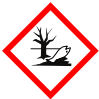

<!-- pagina: 1 -->

## FICHA DE DATOS DE SEGURIDAD

EPOXY ZINC PRIMER 10056

## Sección 1. Identificación

- **Identificador SGA del producto:** EPOXY ZINC PRIMER 10056  
- **SDS code:** UEA651

## Usos pertinentes identificados de la sustancia o de la mezcla y usos desaconsejados

Uso industrial

Todos los demás usos Usos identificados Usos contraindicados

## Uso del producto

: Recubrimiento de dos componentes para uso interior y exterior.

## Datos sobre el proveedor

Compañía Global de Pinturas S.A.S. Autopista Medellín Bogotá Km 37 Vía Belén Rionegro Km 1 054040 Rionegro - Antioquia - Colombia 01 8000 111 247 Medellín 604 325 2523

- **Dirección de e-mail de la persona responsable de esta FDS:** PSRA.southamerica@akzonobel.com  
- **Teléfono de emergencias (con horas de funcionamiento):** CISTEMA SURA Colombia al 018000 51 14 14, fuera de Colombia (0574) 4444578 24 horas

## Sección 2. Identificación de los peligros

Clasificación de la sustancia o de la mezcla

:

PELIGRO ACUÁTICO A CORTO PLAZO (AGUDO) - Categoría 1 PELIGRO ACUÁTICO A LARGO PLAZO (CRÓNICO) - Categoría 1

## Elementos de las etiquetas del SGA

Pictogramas de peligro

:

- **Palabra de advertencia:** Atención  
- **Indicaciones de peligro:** H410 - Muy tóxico para los organismos acuáticos, con efectos nocivos duraderos.  
- **Consejos de prudencia:**  
- **Prevención Respuesta:** P273 - Evitar su liberación al medio ambiente. P391 - Recoger el vertido.  
- **Almacenamiento:** No aplicable.  
- **Fecha de emisión/Fecha de revisión:** 13-11-2024  
- **Fecha de la emisión anterior:** No hay validación anterior Versión : 1

<!-- pagina: 2 -->

## Sección 2. Identificación de los peligros

- **Eliminación:** P501 - Eliminar el contenido / el recipiente en conformidad con las reglamentaciones locales y nacionales.  
- **Otros peligros que no conducen a una clasificación:** No se conoce ninguno.

## Sección 3. Composición/información sobre los componentes

- **Sustancia/preparado:**  
- **Otros medios de identificación Mezcla:** No disponible.

| Nombre del ingrediente       | %   | Número CAS   |
|------------------------------|-----|--------------|
| cinc en polvo (estabilizado) | ≥90 | 7440-66-6    |
| óxido de cinc                | ≤10 | 1314-13-2    |

No hay ningún ingrediente adicional presente que, bajo el conocimiento actual del proveedor y en las concentraciones aplicables, sea clasificado como de riesgo para la salud o el medio ambiente y por lo tanto deban ser reportados en esta sección.

Los límites de exposición laboral, en caso de existir, figuran en la sección 8.

## Sección 4. Primeros auxilios

## Descripción de los primeros auxilios necesarios

- **Contacto con los ojos:** Enjuaguar los ojos inmediatamente con mucha agua, levantando de vez en cuando los párpados superior e inferior. Verificar si la víctima lleva lentes de contacto y en este caso, retirárselas. Buscar atención médica si se produce una irritación.  
- **Por inhalación:** Transportar a la víctima al exterior y mantenerla en reposo en una posición confortable para respirar.  
- **Contacto con la piel:** Lave con agua abundante la piel contaminada. Quítese la ropa y calzado contaminados. Busque atención médica si se presentan síntomas.  
- **Ingestión:** Lave la boca con agua. Si se ha ingerido material y la persona expuesta está consciente, suminístrele pequeñas cantidades de agua para beber. No inducir al vómito a menos que lo indique expresamente el personal médico.

## Síntomas/efectos más importantes, agudos o retardados

## Efectos agudos potenciales para la salud

- **Contacto con los ojos:** No se conocen efectos significativos o riesgos críticos.  
- **Por inhalación:** No se conocen efectos significativos o riesgos críticos.  
- **Contacto con la piel:** No se conocen efectos significativos o riesgos críticos.  
- **Ingestión:** No se conocen efectos significativos o riesgos críticos.

## Signos/síntomas de sobreexposición

- **Contacto con los ojos:** Ningún dato específico.  
- **Por inhalación:** Ningún dato específico.  
- **Contacto con la piel:** Ningún dato específico.  
- **Ingestión:** Ningún dato específico.

## Indicación de la necesidad de recibir atención médica inmediata y, en su caso, de tratamiento especial

- **Notas para el médico:** Tratar sintomáticamente. Contactar un especialista en tratamientos de envenenamientos inmediatamente si se ha ingerido o inhalado una gran cantidad.  
- **Protección del personal de primeros auxilios Tratamientos específicos:** No hay un tratamiento específico. No se debe realizar ninguna acción que suponga un riesgo personal o sin formación adecuada.

*Imagen asociada a la tabla #/tables/1: imagen contenida en el área de la tabla en la página 2 (100% de su área).*

| Fecha de emisión/Fecha de revisión   | : 13-11-2024                 | Versión   | : 1   |
|--------------------------------------|------------------------------|-----------|-------|
| Fecha de la emisión anterior         | : No hay validación anterior | 2/12      |       |

<!-- pagina: 3 -->

## Sección 4. Primeros auxilios

Vea la sección 11 para la Información Toxicológica

## Sección 5. Medidas de lucha contra incendios

## Medios de extinción

- **Medios de extinción apropiados:** Usar un agente de extinción adecuado para el incendio circundante.  
- **Medios de extinción no apropiados:** No se conoce ninguno.  
- **Peligros específicos del producto químico:** Este material es muy tóxico para la vida acuática con efectos de larga duración. Se debe impedir que el agua de extinción de incendios contaminada con este material entre en vías de agua, drenajes o alcantarillados.  
- **Productos de descomposición térmica peligrosos:** Los productos de descomposición pueden incluir los siguientes materiales: óxido/óxidos metálico/metálicos  
- **Equipo de protección especial para el personal de Medidas especiales que deben tomar los equipos de lucha contra incendios lucha contra incendios:** En caso de incendio, aislar rápidamente la zona, evacuando a todas las personas de las proximidades del lugar del incidente. No se debe realizar ninguna acción que suponga un riesgo personal o sin formación adecuada. Los bomberos deben llevar equipo de protección apropiado y un equipo de respiración autónomo con una máscara facial completa que opere en modo de presión positiva.

## Sección 6. Medidas en caso de vertido accidental

## Precauciones personales, equipo de protección y procedimientos de emergencia

- **Para el personal que no forma parte de los servicios de emergencia:** No se debe realizar ninguna acción que suponga un riesgo personal o sin formación adecuada. Evacuar los alrededores. No deje que entre el personal innecesario y sin protección. No toque o camine sobre el material derramado. Llevar puesto un equipo de protección individual adecuado.  
- **Para el personal de emergencia:** Si se necesitan prendas especiales para gestionar el vertido, tomar en cuenta las informaciones recogidas en la Sección 8 en relación a los materiales adecuados y no adecuados. Consultar también la información mencionada en "Para el personal que no forma parte de los servicios de emergencia".  
- **Precauciones relativas al medio ambiente:** Evitar la dispersión del material derramado, su contacto con el suelo, las vias fluviales, las tuberías de desagüe y las alcantarillas. Informar a las autoridades pertinentes si el producto ha causado contaminación medioambiental (alcantarillas, vias fluviales, suelo o aire). Material contaminante del agua. Puede ser dañino para el medio ambiente si es liberado en cantidades grandes. Recoger el vertido.

## Métodos y material de contención y de limpieza

- **Derrame pequeño:** Retire los envases del área del derrame. Vacíe o barra el material y colóquelo en un envase de desperdicio etiquetado. Elimine por medio de un contratista autorizado para la eliminación.  
- **Gran derrame:** Retire los envases del área del derrame. Aproximarse al vertido en el sentido del viento. Evite que se introduzca en alcantarillas, canales de agua, sótanos o áreas reducidas. Vacíe o barra el material y colóquelo en un envase de desperdicio etiquetado. Elimine por medio de un contratista autorizado para la eliminación. Nota: Ver la Sección 1 para información sobre los contactos de emergencia y la Sección 13 para la eliminación de los residuos.

<!-- pagina: 4 -->

## Sección 7. Manipulación y almacenamiento

## Precauciones para una manipulación segura

Medidas de protección

## Información relativa a higiene en el trabajo de forma general

Condiciones de almacenamiento seguro, incluidas posibles incompatibilidades

:

:

:

Usar un equipo de proteccion personal adecuado (Consultar Sección 8). No ingerir. Evite el contacto con los ojos, la piel y la ropa. Evitar su liberación al medio ambiente. Consérvese en su envase original o en uno alternativo aprobado fabricado en un material compatible, manteniéndose bien cerrado cuando no esté en uso. Los envases vacíos retienen resíduos del producto y pueden ser peligrosos. No vuelva a usar el envase.

Deberá prohibirse comer, beber o fumar en los lugares donde se manipula, almacena o trata este producto. Los trabajadores deberan lavarse las manos y la cara antes de comer, beber o fumar. Retirar el equipo de protección y las ropas contaminadas antes de acceder a zonas donde se coma. Consultar también en la Sección 8 la información adicional sobre medidas higiénicas.

Almacenar conforme a las normativas locales. Almacenar en el contenedor original protegido de la luz directa del sol en un área seca, fresca y bien ventilada, separado de materiales incompatibles (ver Sección 10) y comida y bebida. Mantener el contenedor bien cerrado y sellado hasta el momento de usarlo. Los envases abiertos deben cerrarse perfectamente con cuidado y mantenerse en posición vertical para evitar derrames. No almacenar en contenedores sin etiquetar. Utilícese un envase de seguridad adecuado para evitar la contaminación del medio ambiente. Antes de manipularlo o utilizarlo vea en la sección 10 los materiales incompatibles.

## Sección 8. Controles de exposición/protección individual

## Parámetros de control

## Límites de exposición profesional

| Nombre del ingrediente   | Límites de exposición                                                                                                                      |
|--------------------------|--------------------------------------------------------------------------------------------------------------------------------------------|
| óxido de cinc            | ACGIH TLV (Estados Unidos, 1/2023). STEL: 10 mg/m³ 15 minutos. Forma: Fracción respirable TWA: 2 mg/m³ 8 horas. Forma: Fracción respirable |

## Controles de exposición Controles técnicos apropiados

medioambiental

: Una ventilación usual debería ser suficiente para controlar la exposición del obrero a los contaminantes aerotransportados.

: Se deben verificar las emisiones de los equipos de ventilación o de los procesos de trabajo para verificar que cumplen con los requisitos de la legislación de protección del medio ambiente. En algunos casos para reducir las emisiones hasta un nivel aceptable, será necesario usar depuradores de humo, filtros o modificar el diseño del equipo del proceso.

## Medidas de protección individual

Medidas higiénicas

:

## Protección de los ojos/la cara

Protección de la piel

:

Lave las manos, antebrazos y cara completamente después de manejar productos químicos, antes de comer, fumar y usar el lavabo y al final del período de trabajo. Usar las técnicas apropiadas para eliminar ropa contaminada. Lavar las ropas contaminadas antes de volver a usarlas. Verifique que las estaciones de lavado de ojos y duchas de seguridad se encuentren cerca de las estaciones de trabajo.

Se debe usar un equipo protector ocular que cumpla con las normas aprobadas cuando una evaluación del riesgo indique que es necesario, a fin de evitar toda exposición a salpicaduras del líquido, lloviznas, gases o polvos. Si es posible el contacto, se debe utilizar la siguiente protección, salvo que la valoración indique un grado de protección más alto: gafas de seguridad con protección lateral.

<!-- pagina: 5 -->

## Sección 8. Controles de exposición/protección individual

## Protección de las manos

## Protección corporal

Si una evaluación del riesgo indica que es necesario, se deben usar guantes químico-resistentes e impenetrables que cumplan con las normas aprobadas siempre que se manejen productos químicos. Tomando en consideración los parámetros especificados por el fabricante de los guantes, comprobar durante el uso que los guantes siguen conservando sus propiedades protectoras. Hay que observar que el tiempo de paso de cualquier material utilizado con guantes puede ser diferente para distintos fabricantes de guantes. En el caso de mezclas, consistentes en varias sustancias, no es posible estimar de manera exacta, el tiempo de protección que ofrecen los guantes.  
Antes de utilizar este producto se debe seleccionar equipo protector personal para el cuerpo basándose en la tarea a ejecutar y los riesgos involucrados y debe ser aprobado por un especialista.  
- **Otro tipo de protección cutánea:** Se deben elegir el calzado adecuado y cualquier otra medida de protección cutánea necesaria dependiendo de la tarea que se lleve a cabo y de los riesgos implicados. Tales medidas deben ser aprobadas por un especialista antes de proceder a la manipulación de este producto.  
- **Protección respiratoria:** Basándose en la evaluación de los riesgos y la exposición, seleccionar un respirador que satisfaga los estándares o certificaciones apropiados. Los respiradores deben usarse de conformidad con un programa de protección respiratoria para asegurar su adecuación, formación y otros aspectos del buen uso. Llevar un respirador conforme a la norma EN140 con filtro de tipo A/P2 o mejor. El lijado en seco, el cortado con llama y/o el soldado de películas secas de pintura producirá polvo y/o humos nocivos. Un lijado o matizado húmedos son preferibles si es posible. Si no puede evitarse la exposición por la ventilación de extracción debe usarse adecuado equipo de protección respiratoria.

## Sección 9. Propiedades físicas y químicas y características de seguridad

Las condiciones de medición de todas las propiedades son a temperatura y presión estándar a menos que se indique lo contrario.

## Aspecto

- **Estado físico:** Sólido.  
- **Color:** Gris.  
- **Olor:** Característico.  
- **Umbral olfativo:** No disponible.  
- **pH:** No aplicable.  
- **Punto de fusión/punto de congelación:** No disponible.  
- **Punto de ebullición, punto de ebullición inicial e intervalo de ebullición:** No aplicable.  
- **Punto de inflamación:** No aplicable.  
- **Tasa de evaporación:** No disponible.  
- **Inflamabilidad:** No disponible.  
- **Presión de vapor:** No disponible.  
- **Densidad de vapor relativa:** No aplicable.  
- **Densidad:** 7.1 g/cm³  
- **Solubilidad(es):**

| Soporte   | Resultado                  |
|-----------|----------------------------|
| agua fría | No soluble [OECD (TG 105)] |

- **Coeficiente de reparto:** noctanol/agua No aplicable.  
- **Temperatura de autoinflamación:** No aplicable.

<!-- pagina: 6 -->

## Sección 9. Propiedades físicas y químicas y características de seguridad

- **No inscrito.:**  
- **Temperatura de descomposición:** No disponible.  
- **Viscosidad:** Cinemática (temperatura ambiente): 14084 mm 2 /s (14084 cSt) Cinemática (40°C (104°F)): 201 mm 2 /s (201 cSt)

## Características de las partículas

Tamaño de partícula medio : No disponible.

Porcentaje de partículas con diámetro aerodinámico ≤ 10 μm

: 0

## Sección 10. Estabilidad y reactividad

- **Reactividad:** No hay datos de ensayo disponibles sobre la reactividad de este producto o sus componentes.  
- **Estabilidad química:** El producto es estable.  
- **Posibilidad de reacciones peligrosas:** En condiciones normales de almacenamiento y uso, no se producen reacciones peligrosas.  
- **Condiciones que deben evitarse:** Ningún dato específico.  
- **Materiales incompatibles:** Ningún dato específico.  
- **Productos de descomposición peligrosos:** En condiciones normales de almacenamiento y uso, no se deberían formar productos de descomposición peligrosos.

## Sección 11. Información toxicológica

## Información sobre los efectos toxicológicos

## Toxicidad aguda

| Nombre del producto o ingrediente   | Resultado                      | Especies   | Dosis                | Exposición   |
|-------------------------------------|--------------------------------|------------|----------------------|--------------|
| óxido de cinc                       | DL50 Intraperitoneal DL50 Oral | Rata Ratón | 240 mg/kg 7950 mg/kg | - -          |

## Irritación/Corrosión

| Nombre del producto o ingrediente   | Resultado                                   | Especies      | Puntuación   | Exposición                      | Observación   |
|-------------------------------------|---------------------------------------------|---------------|--------------|---------------------------------|---------------|
| óxido de cinc                       | Ojos - Irritante leve Piel - Irritante leve | Conejo Conejo | - -          | 24 horas 500 mg 24 horas 500 mg | - -           |

## Sensibilización

No disponible.

## Mutagénesis

No disponible.

## Carcinogenicidad

<!-- pagina: 7 -->

## Sección 11. Información toxicológica

No disponible.

| Nombre del producto o ingrediente   | IARC   |
|-------------------------------------|--------|
| No disponible.                      |        |

## Toxicidad para la reproducción

No disponible.

## Teratogenicidad

No disponible.

## Toxicidad específica en determinados órganos (STOT) - exposición única

No disponible.

## Toxicidad específica en determinados órganos (STOT) - exposición repetida

No disponible.

## Peligro de aspiración

No disponible.

Información sobre posibles

vías de exposición

: No disponible.

## Efectos agudos potenciales para la salud

- **Contacto con los ojos:** No se conocen efectos significativos o riesgos críticos.  
- **Por inhalación:** No se conocen efectos significativos o riesgos críticos.  
- **Contacto con la piel:** No se conocen efectos significativos o riesgos críticos.  
- **Ingestión:** No se conocen efectos significativos o riesgos críticos.

## Síntomas relacionados con las características físicas, químicas y toxicológicas

- **Contacto con los ojos:** Ningún dato específico.  
- **Por inhalación:** Ningún dato específico.  
- **Contacto con la piel:** Ningún dato específico.  
- **Ingestión:** Ningún dato específico.

## Efectos retardados e inmediatos, así como efectos crónicos producidos por una exposición a corto y largo plazo

## Exposición a corto plazo

Posibles efectos

inmediatos

Posibles efectos

retardados

## Exposición a largo plazo

No disponible.  
No disponible.  
- **Posibles efectos inmediatos:** No disponible.  
- **Posibles efectos retardados:** No disponible.

## Efectos crónicos potenciales para la salud

- **No disponible.:**  
- **General Carcinogenicidad Mutagénesis:** No se conocen efectos significativos o riesgos críticos. No se conocen efectos significativos o riesgos críticos. No se conocen efectos significativos o riesgos críticos. 13-11-2024 No hay validación anterior

<!-- pagina: 8 -->

## Sección 11. Información toxicológica

Toxicidad para la reproducción

: No se conocen efectos significativos o riesgos críticos.

## Medidas numéricas de toxicidad

## Estimaciones de toxicidad aguda

N/A

## Sección 12. Información ecológica

## Toxicidad

| Nombre del producto o ingrediente   | Resultado                                                         | Especies                                                                  | Exposición        |
|-------------------------------------|-------------------------------------------------------------------|---------------------------------------------------------------------------|-------------------|
| cinc en polvo (estabilizado)        | Agudo EC50 0.005 mg/l                                             | Algas - Pseudokirchneriella subcapitata                                   | 72 horas          |
|                                     | Agudo EC50 0.0092 mg/l                                            | Algas - Pseudokirchneriella subcapitata                                   | 72 horas          |
|                                     | Agudo EC50 106 µg/l Agua fresca                                   | Algas - Pseudokirchneriella subcapitata - Fase de crecimiento exponencial | 72 horas          |
|                                     | Agudo EC50 246 µg/l Agua fresca                                   | Algas - Pseudokirchneriella subcapitata - Fase de crecimiento exponencial | 72 horas          |
|                                     | Agudo EC50 10000 µg/l Agua fresca Agudo EC50 70 µg/l Agua fresca  | Plantas acuáticas - Lemna minor Crustáceos - Ceriodaphnia dubia - Neonato | 4 días 48 horas   |
|                                     | Agudo EC50 356 µg/l Agua fresca                                   | Dafnia - Daphnia magna                                                    | 48 horas          |
|                                     | Agudo EC50 354 µg/l Agua fresca Agudo EC50 175 µg/l Agua fresca   | Dafnia - Daphnia magna Pescado - Pimephales                               | 48 horas          |
|                                     |                                                                   | promelas - Larva Crustáceos -                                             | 96 horas 48 horas |
|                                     | Agudo CL50 70 µg/l Agua fresca                                    | Ceriodaphnia dubia - Neonato                                              | 48 horas          |
|                                     | Agudo CL50 65 µg/l Agua fresca                                    | Crustáceos - Ceriodaphnia dubia - Neonato                                 |                   |
|                                     | Agudo CL50 76 µg/l Agua fresca                                    | Crustáceos - Ceriodaphnia reticulata                                      | 48 horas          |
|                                     | Agudo CL50 96 µg/l Agua fresca                                    | Crustáceos - Ceriodaphnia reticulata                                      | 48 horas          |
|                                     | Agudo CL50 100 ppb Agua fresca Agudo CL50 68 µg/l Agua fresca     | Dafnia - Daphnia magna Dafnia - Daphnia magna                             | 48 horas 48 horas |
|                                     | Agudo CL50 107 µg/l Agua fresca                                   | Dafnia - Daphnia pulex                                                    | 48 horas          |
|                                     | Agudo CL50 0.24 mg/l Agua fresca                                  | Pescado - Oncorhynchus mykiss Pescado - Oncorhynchus                      | 96 horas          |
|                                     | Agudo CL50 182 µg/l Agua fresca                                   | tshawytscha                                                               | 96 horas          |
|                                     | Agudo CL50 12.21 µg/l Agua marina                                 | Pescado - Periophthalmus waltoni - Adulto                                 | 96 horas          |
|                                     | Agudo CL50 238 µg/l Agua fresca Crónico NOEC 105 µg/l Agua fresca | Pescado - Pimephales promelas - Recién nacido Algas - Pseudokirchneriella | 96 horas 72 horas |
|                                     | Crónico NOEC 72.9 µg/l Agua fresca                                | subcapitata - Fase de crecimiento exponencial Algas - Pseudokirchneriella | 72 horas          |
|                                     |                                                                   | subcapitata - Fase de crecimiento exponencial                             |                   |
|                                     | Crónico NOEC 91 µg/l Agua fresca                                  | Algas - Pseudokirchneriella subcapitata - Fase de crecimiento exponencial | 72 horas 3 días   |
|                                     | Crónico NOEC 9 mg/l Agua fresca                                   | Plantas acuáticas -                                                       |                   |

<!-- pagina: 9 -->

## Sección 12. Información ecológica

| óxido de cinc   | Crónico NOEC 9 mg/l Agua fresca Crónico NOEC 178 µg/l Agua marina Crónico NOEC 62.6 µg/l Agua fresca Crónico NOEC 94.5 µg/l Agua fresca Crónico NOEC 72.7 µg/l Agua fresca Crónico NOEC 172 µg/l Agua fresca Crónico NOEC 8.3 µg/l Agua fresca Crónico NOEC 2.6 µg/l Agua fresca Crónico NOEC 199 µg/l Agua fresca Agudo EC50 1 mg/l Agua fresca Agudo EC50 0.622 mg/l Agua fresca Agudo EC50 0.481 mg/l Agua fresca Agudo CL50 1.25 mg/l Agua fresca Agudo CL50 98 µg/l Agua fresca Agudo CL50 3.969 mg/l Agua fresca Agudo CL50 2.525 mg/l Agua fresca Agudo CL50 1.1 ppm Agua fresca Agudo CL50 2246000 µg/l Agua fresca   | Ceratophyllum demersum Plantas acuáticas - Ceratophyllum demersum Crustáceos - Palaemon elegans Dafnia - Daphnia magna Dafnia - Daphnia magna Dafnia - Daphnia magna Pescado - Cottus bairdi Pescado - Cyprinus carpio Pescado - Cyprinus carpio Pescado - Oncorhynchus mykiss - Juvenil (Nuevo, Cría, Destetado) Dafnia - Daphnia magna - Neonato Dafnia - Daphnia magna - Neonato Dafnia - Daphnia magna - Neonato Dafnia - Daphnia magna - Neonato Dafnia - Daphnia magna - Neonato Pescado - Danio rerio - Adulto Pescado - Danio rerio - Adulto Pescado - Oncorhynchus mykiss Pescado - Pimephales promelas - Neonato   | 3 días 21 días 21 días 21 días 21 días 30 días 4 semanas 4 semanas 30 días 48 horas 48 horas 48 horas 48 horas 48 horas 96 horas 96 horas 96 horas 96 horas   |
|-----------------|-------------------------------------------------------------------------------------------------------------------------------------------------------------------------------------------------------------------------------------------------------------------------------------------------------------------------------------------------------------------------------------------------------------------------------------------------------------------------------------------------------------------------------------------------------------------------------------------------------------------------------|------------------------------------------------------------------------------------------------------------------------------------------------------------------------------------------------------------------------------------------------------------------------------------------------------------------------------------------------------------------------------------------------------------------------------------------------------------------------------------------------------------------------------------------------------------------------------------------------------------------------------|---------------------------------------------------------------------------------------------------------------------------------------------------------------|

## Persistencia/degradabilidad

No disponible.

## Potencial de bioacumulación

| Nombre del producto o ingrediente   | LogPow   |   FBC | Potencial   |
|-------------------------------------|----------|-------|-------------|
| óxido de cinc                       | -        | 28960 | alta        |

## Movilidad en el suelo

- **Coeficiente de partición tierra/agua (KOC):** No disponible.  
- **Otros efectos adversos:** No se conocen efectos significativos o riesgos críticos.

## Sección 13. Consideraciones relativas a la eliminación

## Métodos de eliminación

:

Evitar o minimizar la generación de residuos cuando sea posible. La eliminación de este producto, sus soluciones y cualquier derivado deben cumplir siempre con los requisitos de la legislación de protección del medio ambiente y eliminación de desechos y todos los requisitos de las autoridades locales. Desechar los sobrantes y productos no reciclables por medio de un constratista autorizado a su eliminación. Los residuos no se deben tirar por la alcantarilla sin tratar a menos que sean compatibles con los requisitos de todas las autoridades con jurisdicción. Los envases residuales deben reciclarse. Sólo se deben contemplar la incineración o el enterramiento cuando el reciclaje no sea factible. Elimínense los residuos del producto y sus recipientes con todas las precauciones posibles. Deben tomarse precauciones cuando se manipulen recipientes vaciados que no hayan sido limpiados o enjuagados. Los envases vacíos o los revestimentos pueden retener residuos del producto. Evitar la dispersión del material derramado, su contacto con

<!-- pagina: 10 -->

## Sección 13. Consideraciones relativas a la eliminación

el suelo, las vias fluviales, las tuberías de desagüe y las alcantarillas.

## Sección 14. Información relativa al transporte

*Imagen asociada a la tabla #/tables/10: imagen contenida en el área de la tabla en la página 10 (100% de su área).*

|                                                          | Carretera - NTC 1692                                                                                    | Marítimo - IMDG                                                                                         | Aéreo - IATA                                                                                          |
|----------------------------------------------------------|---------------------------------------------------------------------------------------------------------|---------------------------------------------------------------------------------------------------------|-------------------------------------------------------------------------------------------------------|
| Número ONU                                               | UN3077                                                                                                  | UN3077                                                                                                  | UN3077                                                                                                |
| Designación oficial de transporte de las Naciones Unidas | SUSTANCIA SÓLIDA PELIGROSA PARA EL MEDIO AMBIENTE, N.E.P. (cinc en polvo (estabilizado), óxido de cinc) | SUSTANCIA SÓLIDA PELIGROSA PARA EL MEDIO AMBIENTE, N.E.P. (cinc en polvo (estabilizado), óxido de cinc) | ENVIRONMENTALLY HAZARDOUS SUBSTANCE, SOLID, N.O.S. (Zinc powder - zinc dust (stabilized), zinc oxide) |
| Clase(s) de peligro para el transporte                   | 9                                                                                                       | 9                                                                                                       | 9                                                                                                     |
| Grupo de embalaje                                        | III                                                                                                     | III                                                                                                     | III                                                                                                   |
| Peligros para el medio ambiente                          | Sí.                                                                                                     | cinc en polvo (estabilizado), óxido de cinc Sustancias contaminantes marinas:                           | Yes.                                                                                                  |

## Información adicional

IMDG

IATA

Precauciones particulares para los usuarios

Transporte a granel según los instrumentos de la IMO

*Imagen asociada a la tabla #/tables/10: imagen contenida en el área de la tabla en la página 10 (100% de su área).*

:

:

:

*Imagen asociada a la tabla #/tables/10: imagen contenida en el área de la tabla en la página 10 (100% de su área).*

*Imagen asociada a la tabla #/tables/10: imagen contenida en el área de la tabla en la página 10 (100% de su área).*

## Programas de emergencia F-A, S-F

Este producto no está regulado como mercancía peligrosa cuando se transporta en tamaños ≤5 l o ≤5 kg, siempre y cuando los envases cumplan las disposiciones generales 4.1.1.1, 4.1.1.2 y de 4.1.1.4 a 4.1.1.8.

Grupo de segregación del código IMDG SGG7 - Metales pesados y sus sales (incluidos sus compuestos organometálicos)SGG15 - Metales en polvo

This product is not regulated as a dangerous good when transported in sizes of ≤5 L or ≤5 kg, provided the packagings meet the general provisions of 5.0.2.4.1, 5.0.2.6.1.1 and 5.0.2.8.

Transporte dentro de las premisas de usuarios: siempre transporte en recipientes cerrados que estén verticales y seguros. Asegurar que las personas que transportan el producto conocen qué hacer en caso de un accidente o derrame.

: No disponible.

## Sección 15. Información reglamentaria

## Lista de inventario

- **Australia:** Todos los componentes están listados o son exentos.  
- **Canadá:** Todos los componentes están listados o son exentos.  
- **China:** Todos los componentes están listados o son exentos.  
- **Unión Económica Euroasiática:** Inventario de la Federación Rusa: Todos los componentes están listados o son exentos.  
- **Japón:** Inventario de Sustancias de Japón (CSCL): No determinado.  
- **Nueva Zelandia Inventario de Sustancias de Japón (ISHL):** No determinado. Todos los componentes están listados o son exentos.  
- **Filipinas:** Todos los componentes están listados o son exentos.  
- **República de Corea:** Todos los componentes están listados o son exentos.  
- **Taiwán:** Todos los componentes están listados o son exentos. 13-11-2024

*Imagen asociada a la tabla #/tables/10: imagen contenida en el área de la tabla en la página 10 (100% de su área).*

*Imagen asociada a la tabla #/tables/10: imagen contenida en el área de la tabla en la página 10 (100% de su área).*

<!-- pagina: 11 -->

## Sección 15. Información reglamentaria

- **Tailandia:** Todos los componentes están listados o son exentos.  
- **Turquía:** Todos los componentes están listados o son exentos.  
- **Estados Unidos:** Todos los componentes están activos o exentos.  
- **Vietnam:** Todos los componentes están listados o son exentos.

Regulaciones Nacionales: El receptor debería verificar la posible existencia de regulaciones locales aplicables al producto químico.

Decreto 1496 del 2018 Por el cual se adopta el Sistema Globalmente Armonizado de Clasificación y Etiquetado de Productos Químicos y se dictan otras disposiciones en materia de seguridad química.

Decreto 0773 del 2021 Por la cual se definen las acciones que deben desarrollar los empleadores para la aplicación del Sistema Globalmente Armonizado (SGA) de Clasificación y Etiquetado de Productos Químicos en los lugares de trabajo y se dictan otras disposiciones en materia de seguridad química.

## Sección 16. Otra información

## Historial

- **Fecha de impresión:** 13-11-2024  
- **Fecha de emisión/ Fecha de revisión:** 13-11-2024  
- **Fecha de la emisión anterior:** No hay validación anterior  
- **Versión:** 1  
- **Unique ID:** 655BA9EE76931EDFA8B74A203F59F103  
- **Clave para las abreviaciones:** ETA = Estimación de Toxicidad Aguda FBC = Factor de Bioconcentración SGA - Sistema Globalmente Armonizado de clasificación y etiquetado de productos químicos IATA = Asociación de Transporte Aéreo Internacional IBC = Contenedor Intermedio para Productos a Granel IMDG = Código Marítimo Internacional de Mercancías Peligrosas Log Kow = logaritmo del coeficiente de reparto octanol/agua MARPOL = Convenio Internacional para Prevenir la Contaminación por los Buques, 1973 con el Protocolo de 1978. ("Marpol" = polución marina) N/A = No disponible SGG = Grupo de segregación ONU = Organización de las Naciones Unidas

## Procedimiento utilizado para obtener la clasificación

| Clasificación                                        | Justificación       |
|------------------------------------------------------|---------------------|
| PELIGRO ACUÁTICO A CORTO PLAZO (AGUDO) - Categoría 1 | Método de cálculo   |
| PELIGRO ACUÁTICO A LARGO PLAZO (CRÓNICO) - Categoría | 1 Método de cálculo |

Indica la información que ha cambiado desde la edición de la versión anterior.

## Aviso al lector

## PARA USO PROFESIONAL SOLAMENTE

NOTA IMPORTANTE: La información en esta hoja de datos no pretende ser exhaustiva y está basada en el estado actual de nuestro conocimiento y en las leyes vigentes : cualquier persona usando el producto para cualquier otro propósito que el especificamente recomendado en la hoja técnica de datos, sin primero obtener nuestra confirmación escrita de la idoneidad para el propósito pretendido, lo hará bajo su propia cuenta y riesgo. Es siempre responsabilidad del usuario seguir todos los pasos necesarios para cumplir toda la serie de demandas de las leyes locales y la legislación. Siempre lea la hoja de datos de seguridad y la hoja técnica de datos para este producto, si están disponibles. Todo consejo que demos o cualquier declaración hecha por nosotros acerca del producto (tanto en esta hoja técnica o en otro lugar distinto) es correcto según nuestro mejor conocimiento pero nosotros no tenemos control sobre la calidad o el estado del substrato ni de los muchos factores que afectan al uso y aplicación del producto. Por consiguiente, a menos que especificamente lo acordemos por escrito de otro modo, no aceptamos ninguna responsabilidad en todo lo que sea relacionado con las prestaciones técnicas del producto o por cualquier pérdida o daño emanado del uso del producto. Todos los productos suministrados y los consejos técnicos dados están sujetos a nuestros plazos de tiempo normales y condiciones de venta. Debería solicitar una copia de este documento y revisarlo cuidadosamente. La información contenida en esta hoja técnica está sujeta a modificación de cuando en

<!-- pagina: 12 -->

## Sección 16. Otra información

cuando a las luces de la experencia y de nuestra política de continuo desarrollo. Es responsabilidad del usuario verificar que esta hoja técnica es la actual antes de usar el producto.

Las marcas de fábrica mencionadas en esta hoja técnica son marcas registradas o licenciatarias de Akzo Nobel.

<!-- encabezados y pies de pagina -->

## Encabezados y pies de página

*Texto del margen superior o inferior de las páginas, que Docling separa del cuerpo. Se lista una sola vez, con las páginas donde aparece.*

- [p. 2-12] EPOXY ZINC PRIMER 10056
- [p. 3-4, 6, 8-12] Fecha de emisión/Fecha de revisión Fecha de la emisión anterior
- [p. 3-6, 8-9, 11-12] : 13-11-2024
- [p. 3-11] Versión : 1
- [p. 3-6, 8-12] : No hay validación anterior
- [p. 5, 7] Fecha de emisión/Fecha de revisión
- [p. 5, 7] Fecha de la emisión anterior
- [p. 12] Versión : 1 12/12
