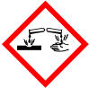

<!-- pagina: 1 -->

## FICHA DE DATOS DE SEGURIDAD

EPOXY ESTRUCTURAS GRIS PARTE A

## Sección 1. Identificación

- **Identificador SGA del producto:** EPOXY ESTRUCTURAS GRIS PARTE A  
- **SDS code:** UEA550

## Usos pertinentes identificados de la sustancia o de la mezcla y usos desaconsejados

Uso industrial

Todos los demás usos Usos identificados Usos contraindicados

Uso del producto

: Únicamente para uso profesional.

## Datos sobre el proveedor

Compañía Global de Pinturas S.A.S. Autopista Medellín Bogotá Km 37. Vía Belén Rionegro Km 1. 054040 Rionegro - Antioquia - Colombia 01 8000 111 247 Medellín 604 325 2523

Dirección de e-mail de la persona responsable de esta FDS Teléfono de emergencias (con horas de funcionamiento)

: PSRA.southamerica@akzonobel.com

:

CISTEMA SURA Colombia al 018000 51 14 14, fuera de Colombia (0574) 4444578 24 horas

## Sección 2. Identificación de los peligros

Clasificación de la sustancia o de la mezcla IRRITACIÓN CUTÁNEA - Categoría 2

LESIÓN OCULAR GRAVE - Categoría 1

## Elementos de las etiquetas del SGA

Pictogramas de peligro

:

Palabra de advertencia

Peligro  
- **Indicaciones de peligro:** H315 - Provoca irritación cutánea.  
- **Consejos de prudencia:**  
- **Prevención H318 - Provoca lesiones oculares graves.:** P280 - Llevar guantes de protección. Llevar gafas o máscara de protección.  
- **Fecha de emisión/Fecha de revisión P264 - Lavarse las manos concienzudamente tras la manipulación.:** 6-5-2024  
- **Fecha de la emisión anterior:** No hay validación anterior Versión : 1

<!-- pagina: 2 -->

## Sección 2. Identificación de los peligros

## Respuesta

P362 + P364 - Quitar las prendas contaminadas y lavarlas antes de volver a usarlas. P302 + P352 - EN CASO DE CONTACTO CON LA PIEL: Lavar con abundante  
agua.  
P305 + P351 + P338 + P310 - EN CASO DE CONTACTO CON LOS OJOS: Aclarar cuidadosamente con agua durante varios minutos. Quitar las lentes de contacto, si lleva y resulta fácil. Seguir aclarando. Llamar inmediatamente a un CENTRO DE INFORMACION TOXICOLOGICA o a un médico.  
- **Almacenamiento Eliminación:** No aplicable. No aplicable.  
- **Otros peligros que no conducen a una clasificación:** No se conoce ninguno.

## Sección 3. Composición/información sobre los componentes

## Otros medios de Sustancia/preparado

identificación

:

Mezcla

: No disponible.

| Nombre del ingrediente   | Número de CAS   | Concentración   |
|--------------------------|-----------------|-----------------|
| xileno                   | 1330-20-7       | ≥10 - ≤15       |
| 2-butoxietanol           | 111-76-2        | ≤10             |
| 2-metilpropan-1-ol       | 78-83-1         | ≤4              |
| etilbenceno              | 100-41-4        | ≤5              |

No hay ningún ingrediente adicional presente que, bajo el conocimiento actual del proveedor y en las concentraciones aplicables, sea clasificado como de riesgo para la salud o el medio ambiente y por lo tanto deban ser reportados en esta sección.

Los límites de exposición laboral, en caso de existir, figuran en la sección 8.

## Sección 4. Primeros auxilios

## Descripción de los primeros auxilios necesarios

## Contacto con los ojos

Por inhalación

:

:

Obtenga atención médica inmediatamente. Llamar a un centro de información toxicológica o a un médico. Enjuaguar los ojos inmediatamente con mucha agua, levantando de vez en cuando los párpados superior e inferior. Verificar si la víctima lleva lentes de contacto y en este caso, retirárselas. Continúe enjuagando por lo menos durante 10 minutos. Las quemaduras químicas se deben tratar inmediatamente por un médico.

Obtenga atención médica inmediatamente. Llamar a un centro de información toxicológica o a un médico. Transportar a la víctima al exterior y mantenerla en reposo en una posición confortable para respirar. Si se sospecha que los vapores continúan presentes, la persona encargada del rescate deberá usar una máscara adecuada o un aparato de respiración autónoma. Si no hay respiración, ésta es irregular u ocurre un paro respiratorio, el personal capacitado debe proporcionar respiración artificial u oxígeno. Puede ser peligroso para la persona que proporcione ayuda al dar respiración boca a boca. Si está inconsciente, coloque en posición de recuperación y consiga atención médica inmediatamente. Asegure una buena circulación de aire. Aflojar todo lo que pudiera estar apretado, como el cuello de una camisa, una corbata, un cinturón. En caso de inhalación de productos en descomposición en un incendio, los síntomas pueden aparecer posteriormente. Es posible que la persona expuesta tenga que estar bajo vigilancia médica por un período de 48 horas.

<!-- pagina: 3 -->

## Sección 4. Primeros auxilios

## Contacto con la piel

Ingestión

:

:

Obtenga atención médica inmediatamente. Llamar a un centro de información toxicológica o a un médico. Lave con agua abundante la piel contaminada. Quítese la ropa y calzado contaminados. Lave bien la ropa contaminada con agua antes de quitársela, o use guantes. Continúe enjuagando por lo menos durante 10 minutos. Las quemaduras químicas se deben tratar inmediatamente por un médico. Lavar la ropa antes de volver a usarla. Limpiar completamente el calzado antes de volver a usarlo.

Obtenga atención médica inmediatamente. Llamar a un centro de información toxicológica o a un médico. Lave la boca con agua. Retirar las prótesis dentales si es posible. Si se ha ingerido material y la persona expuesta está consciente, suminístrele pequeñas cantidades de agua para beber. Deje de proporcionarle agua si la persona expuesta se encuentra mal ya que los vómitos pueden ser peligrosos. No inducir al vómito a menos que lo indique expresamente el personal médico. Si vomita, mantener la cabeza baja de manera que el vómito no entre en los pulmones. Las quemaduras químicas se deben tratar inmediatamente por un médico. No suministrar nada por vía oral a una persona inconsciente. Si está inconsciente, coloque en posición de recuperación y consiga atención médica inmediatamente. Asegure una buena circulación de aire. Aflojar todo lo que pudiera estar apretado, como el cuello de una camisa, una corbata, un cinturón.

## Síntomas/efectos más importantes, agudos o retardados

## Efectos agudos potenciales para la salud

- **Contacto con los ojos:** Provoca lesiones oculares graves.  
- **Por inhalación:** No se conocen efectos significativos o riesgos críticos.  
- **Contacto con la piel:** Provoca irritación cutánea.  
- **Ingestión:** No se conocen efectos significativos o riesgos críticos.

## Signos/síntomas de sobreexposición

- **Contacto con los ojos:** Los síntomas adversos pueden incluir los siguientes:  
- **Por inhalación:**  
- **Contacto con la piel:** Los síntomas adversos pueden incluir los siguientes: dolor o irritación rojez puede provocar la formación de ampollas  
- **Ingestión dolor lagrimeo rojez Ningún dato específico.:** Los síntomas adversos pueden incluir los siguientes: dolores gástricos

## Indicación de la necesidad de recibir atención médica inmediata y, en su caso, de tratamiento especial

- **Notas para el médico:** En caso de inhalación de productos en descomposición en un incendio, los síntomas pueden aparecer posteriormente. Es posible que la persona expuesta tenga que estar bajo vigilancia médica por un período de 48 horas.  
- **Protección del personal de primeros auxilios Tratamientos específicos:** No hay un tratamiento específico. No se debe realizar ninguna acción que suponga un riesgo personal o sin formación adecuada. Si se sospecha que los vapores continúan presentes, la persona encargada del rescate deberá usar una máscara adecuada o un aparato de respiración autónoma. Puede ser peligroso para la persona que proporcione ayuda al dar respiración boca a boca. Lave bien la ropa contaminada con agua antes de quitársela, o use guantes.

## Vea la sección 11 para la Información Toxicológica

<!-- pagina: 4 -->

## Sección 5. Medidas de lucha contra incendios

## Medios de extinción

- **Medios de extinción apropiados Medios de extinción no apropiados:** Usar un agente de extinción adecuado para el incendio circundante. No se conoce ninguno.  
- **Peligros específicos del producto químico:** La presión puede aumentar y el contenedor puede explotar en caso de calentamiento o incendio.  
- **Productos de descomposición térmica peligrosos:** Los productos de descomposición pueden incluir los siguientes materiales: dióxido de carbono monóxido de carbono óxido de nitrógeno óxido/óxidos metálico/metálicos  
- **Medidas especiales que:** En caso de incendio, aislar rápidamente la zona, evacuando a todas las personas de las proximidades del lugar del incidente. No se debe realizar ninguna acción que suponga un riesgo personal o sin formación adecuada.  
- **Equipo de protección especial para el personal de lucha contra incendios deben tomar los equipos de lucha contra incendios:** Los bomberos deben llevar equipo de protección apropiado y un equipo de respiración autónomo con una máscara facial completa que opere en modo de presión positiva.

## Sección 6. Medidas en caso de vertido accidental

## Precauciones personales, equipo de protección y procedimientos de emergencia

- **Para el personal que no forma parte de los servicios de emergencia:** No se debe realizar ninguna acción que suponga un riesgo personal o sin formación adecuada. Evacuar los alrededores. No deje que entre el personal innecesario y sin protección. No toque o camine sobre el material derramado. No respire los vapores o nieblas. Proporcione ventilación adecuada. Llevar un aparato de respiración apropiado cuando el sistema de ventilación sea inadecuado. Llevar puesto un equipo de protección individual adecuado.  
- **Para el personal de emergencia:** Si se necesitan prendas especiales para gestionar el vertido, tomar en cuenta las informaciones recogidas en la Sección 8 en relación a los materiales adecuados y no adecuados. Consultar también la información mencionada en "Para el personal que no forma parte de los servicios de emergencia".  
- **Precauciones relativas al medio ambiente:** Evitar la dispersión del material derramado, su contacto con el suelo, las vias fluviales, las tuberías de desagüe y las alcantarillas. Informar a las autoridades pertinentes si el producto ha causado contaminación medioambiental (alcantarillas, vias fluviales, suelo o aire).

## Métodos y material de contención y de limpieza

- **Derrame pequeño:** Detener la fuga si esto no presenta ningún riesgo. Retire los envases del área del derrame. Diluir con agua y fregar si es soluble en agua. Alternativamente, o si es insoluble en agua, absorber con un material seco inerte y colocar en un contenedor de residuos adecuado. Elimine por medio de un contratista autorizado para la eliminación.  
- **Gran derrame:** Detener la fuga si esto no presenta ningún riesgo. Retire los envases del área del derrame. Aproximarse al vertido en el sentido del viento. Evite que se introduzca en alcantarillas, canales de agua, sótanos o áreas reducidas. Lave los vertidos hacia una planta de tratamiento de efluentes o proceda como se indica a continuación. Detener y recoger los derrames con materiales absorbentes no combustibles, como arena, tierra, vermiculita o tierra de diatomeas, y colocar el material en un envase para desecharlo de acuerdo con las normativas locales (ver Sección 13). Elimine por medio de un contratista autorizado para la eliminación. El material absorbente contaminado puede presentar el mismo riesgo que el producto derramado. Nota: Ver la Sección 1 para información sobre los contactos de emergencia y la Sección 13 para la eliminación de los residuos.

<!-- pagina: 5 -->

## Sección 7. Manipulación y almacenamiento

## Precauciones para una manipulación segura

## Medidas de protección

## Información relativa a higiene en el trabajo de forma general

## Condiciones de almacenamiento seguro, incluidas posibles incompatibilidades

:

:

:

Usar un equipo de proteccion personal adecuado (Consultar Sección 8). No introducir en ojos en la piel o en la ropa. No respire los vapores o nieblas. No ingerir. Si durante su uso normal el material presenta un peligro respiratorio, utilícese únicamente en condiciones de ventilación adecuada o equipado con un respirador adecuado. Consérvese en su envase original o en uno alternativo aprobado fabricado en un material compatible, manteniéndose bien cerrado cuando no esté en uso. Los envases vacíos retienen resíduos del producto y pueden ser peligrosos. No vuelva a usar el envase.

Deberá prohibirse comer, beber o fumar en los lugares donde se manipula, almacena o trata este producto. Los trabajadores deberan lavarse las manos y la cara antes de comer, beber o fumar. Retirar el equipo de protección y las ropas contaminadas antes de acceder a zonas donde se coma. Consultar también en la Sección 8 la información adicional sobre medidas higiénicas.

Almacenar conforme a las normativas locales. Almacenar en el contenedor original protegido de la luz directa del sol en un área seca, fresca y bien ventilada, separado de materiales incompatibles (ver Sección 10) y comida y bebida. Guardar bajo llave. Mantener el contenedor bien cerrado y sellado hasta el momento de usarlo. Los envases abiertos deben cerrarse perfectamente con cuidado y mantenerse en posición vertical para evitar derrames. No almacenar en contenedores sin etiquetar. Utilícese un envase de seguridad adecuado para evitar la contaminación del medio ambiente. Antes de manipularlo o utilizarlo vea en la sección 10 los materiales incompatibles.

## Sección 8. Controles de exposición/protección individual

## Parámetros de control

## Límites de exposición profesional

| Nombre del ingrediente   | Límites de exposición                                                                                                 |
|--------------------------|-----------------------------------------------------------------------------------------------------------------------|
| xileno                   | ACGIH TLV (Estados Unidos, 1/2022). [xylene] STEL: 651 mg/m³ 15 minutos. TWA: 434 mg/m³ 8 horas. TWA: 20 ppm 8 horas. |
| 2-butoxietanol           | ACGIH TLV (Estados Unidos, 1/2022). TWA: 20 ppm 8 horas.                                                              |
| 2-metilpropan-1-ol       | ACGIH TLV (Estados Unidos, 1/2022). TWA: 152 mg/m³ 8 horas. TWA: 50 ppm 8 horas.                                      |
| etilbenceno              | ACGIH TLV (Estados Unidos, 1/2022). Ototóxico. TWA: 20 ppm 8 horas.                                                   |

## Controles técnicos apropiados

## Controles de exposición medioambiental

: Si la operación genera polvo, humos, gas, vapor o llovizna, use cercamientos del proceso, ventilación local, u otros controles de ingeniería para mantener la exposición del obrero a los contaminantes aerotransportados por debajo de todos los límites recomendados o estatutarios.

: Se deben verificar las emisiones de los equipos de ventilación o de los procesos de trabajo para verificar que cumplen con los requisitos de la legislación de protección del medio ambiente. En algunos casos para reducir las emisiones hasta un nivel aceptable, será necesario usar depuradores de humo, filtros o modificar el diseño del equipo del proceso.

## Medidas de protección individual

<!-- pagina: 6 -->

## Sección 8. Controles de exposición/protección individual

| Medidas higiénicas :              | Lave las manos, antebrazos y cara completamente después de manejar productos químicos, antes de comer, fumar y usar el lavabo y al final del período de trabajo. Usar las técnicas apropiadas para eliminar ropa contaminada. Lavar las ropas contaminadas antes de volver a usarlas. Verifique que las estaciones de lavado de ojos y duchas de seguridad se encuentren cerca de las estaciones de trabajo.                                                                                                                                                                                                                                                                                                  |
|-----------------------------------|---------------------------------------------------------------------------------------------------------------------------------------------------------------------------------------------------------------------------------------------------------------------------------------------------------------------------------------------------------------------------------------------------------------------------------------------------------------------------------------------------------------------------------------------------------------------------------------------------------------------------------------------------------------------------------------------------------------|
| Protección de los ojos/la cara :  | Se debe usar un equipo protector ocular que cumpla con las normas aprobadas cuando una evaluación del riesgo indique que es necesario, a fin de evitar toda exposición a salpicaduras del líquido, lloviznas, gases o polvos. Si es posible el contacto, se debe utilizar la siguiente protección, salvo que la valoración indique un grado de protección más alto: gafas contra salpicaduras químicas y/o pantalla facial. Si existe riesgo de inhalación, puede ser necesario utilizar en su lugar un respirador con careta completa.                                                                                                                                                                       |
| Protección de la piel             |                                                                                                                                                                                                                                                                                                                                                                                                                                                                                                                                                                                                                                                                                                               |
| Protección de las manos :         | Si una evaluación del riesgo indica que es necesario, se deben usar guantes químico-resistentes e impenetrables que cumplan con las normas aprobadas siempre que se manejen productos químicos. Tomando en consideración los parámetros especificados por el fabricante de los guantes, comprobar durante el uso que los guantes siguen conservando sus propiedades protectoras. Hay que observar que el tiempo de paso de cualquier material utilizado con guantes puede ser diferente para distintos fabricantes de guantes. En el caso de mezclas, consistentes en varias sustancias, no es posible estimar de manera exacta, el tiempo de protección que ofrecen los guantes.                             |
| Protección corporal :             | Antes de utilizar este producto se debe seleccionar equipo protector personal para el cuerpo basándose en la tarea a ejecutar y los riesgos involucrados y debe ser aprobado por un especialista.                                                                                                                                                                                                                                                                                                                                                                                                                                                                                                             |
| Otro tipo de protección cutánea : | Se deben elegir el calzado adecuado y cualquier otra medida de protección cutánea necesaria dependiendo de la tarea que se lleve a cabo y de los riesgos implicados. Tales medidas deben ser aprobadas por un especialista antes de proceder a la manipulación de este producto.                                                                                                                                                                                                                                                                                                                                                                                                                              |
| Protección respiratoria :         | Basándose en la evaluación de los riesgos y la exposición, seleccionar un respirador que satisfaga los estándares o certificaciones apropiados. Los respiradores deben usarse de conformidad con un programa de protección respiratoria para asegurar su adecuación, formación y otros aspectos del buen uso. Llevar un respirador conforme a la norma EN140 con filtro de tipo A/P2 o mejor. El lijado en seco, el cortado con llama y/o el soldado de películas secas de pintura producirá polvo y/o humos nocivos. Un lijado o matizado húmedos son preferibles si es posible. Si no puede evitarse la exposición por la ventilación de extracción debe usarse adecuado equipo de protección respiratoria. |

## Sección 9. Propiedades físicas y químicas y características de seguridad

Las condiciones de medición de todas las propiedades son a temperatura y presión estándar a menos que se indique lo contrario.

## Aspecto

- **Estado físico:** Líquido.  
- **Color:** Gris.  
- **Olor:** Característico.  
- **Umbral olfativo:** No disponible.  
- **pH:** No aplicable.  
- **Punto de fusión/punto de congelación:** No disponible.  
- **Punto de ebullición, punto de ebullición inicial e intervalo de ebullición:** 139°C (282.2°F)  
- **Punto de inflamación:** Vaso cerrado: 125°C (257°F)  
- **Tasa de evaporación:** No disponible.

<!-- pagina: 7 -->

## Sección 9. Propiedades físicas y químicas y características de seguridad

- **Inflamabilidad Límite superior e inferior de explosividad:** No disponible. 20 - 70 g/m3  
- **Presión de vapor:**

| Nombre del ingrediente   | Presión de vapor a 20 ºC - mm Hg   | Presión de vapor a 20 ºC - kPa   | Presión de vapor a 20 ºC - Método   |
|--------------------------|------------------------------------|----------------------------------|-------------------------------------|
| 2-metilpropan-1-ol       | <12                                | <1.6                             | DIN EN 13016-2                      |
| etilbenceno              | 9.3                                | 1.2                              |                                     |
| xileno                   | 6.7                                | 0.89                             |                                     |

- **Densidad de vapor relativa:** No disponible.  
- **Solubilidad(es) Densidad:** 1.522 g/cm³

| Soporte   | Resultado                  |
|-----------|----------------------------|
| agua fría | No soluble [OECD (TG 105)] |

- **Coeficiente de reparto:** noctanol/agua No aplicable.  
- **Temperatura de autoinflamación:**

| Nombre del ingrediente   |   °C |    °F |
|--------------------------|------|-------|
| 2-butoxietanol           |  230 |   446 |
| 2-metilpropan-1-ol       |  415 |   779 |
| xileno                   |  432 | 809.6 |

- **Temperatura de descomposición:** No disponible.  
- **Viscosidad:** Cinemática (temperatura ambiente): 26281 mm 2 /s (26281 cSt) Cinemática (40°C (104°F)): 201 mm 2 /s (201 cSt)

## Características de las partículas

Tamaño de partícula medio : No aplicable.

Porcentaje de partículas con diámetro aerodinámico ≤ 10 μm

: 0

## Sección 10. Estabilidad y reactividad

- **Reactividad:** No hay datos de ensayo disponibles sobre la reactividad de este producto o sus componentes.  
- **Estabilidad química:** El producto es estable.  
- **Posibilidad de reacciones peligrosas:** En condiciones normales de almacenamiento y uso, no se producen reacciones peligrosas.  
- **Condiciones que deben evitarse:** Ningún dato específico.  
- **Materiales incompatibles:** Ningún dato específico.

<!-- pagina: 8 -->

## Sección 10. Estabilidad y reactividad

Productos de :

descomposición peligrosos En condiciones normales de almacenamiento y uso, no se deberían formar productos de descomposición peligrosos.

## Sección 11. Información toxicológica

## Información sobre los efectos toxicológicos

## Toxicidad aguda

| Nombre del producto o ingrediente            | Resultado                                                                                                                                                                                                                                                                                                                                                                                                          | Especies                                                                                                      | Dosis                                                                                                                                                                                             | Exposición                                                    |
|----------------------------------------------|--------------------------------------------------------------------------------------------------------------------------------------------------------------------------------------------------------------------------------------------------------------------------------------------------------------------------------------------------------------------------------------------------------------------|---------------------------------------------------------------------------------------------------------------|---------------------------------------------------------------------------------------------------------------------------------------------------------------------------------------------------|---------------------------------------------------------------|
| xileno 2-butoxietanol                        | DL50 Oral DL50 Subcutánea CL50 Por inhalación Gas. CL50 Por inhalación Gas. CL50 Por inhalación Vapor CL50 Por inhalación Vapor DL50 Cutánea DL50 Cutánea DL50 Intraperitoneal DL50 Intraperitoneal DL50 Intraperitoneal DL50 Intravenosa DL50 Intravenosa DL50 Intravenosa DL50 Oral DL50 Oral DL50 Oral DL50 Oral DL50 Oral DL50 Oral DL50 Oral DL50 Ruta de exposición sin informar DL50 Ruta de exposición sin | Rata Rata Ratón Rata Ratón Rata Cobaya Conejo Ratón Conejo Rata Ratón Conejo Rata Ratón Ratón Rata Rata Ratón | 4300 mg/kg 1700 mg/kg 700 ppm 450 ppm 3380 mg/m³ 2900 mg/m³ 230 uL/kg 220 mg/kg 536 mg/kg 220 mg/kg 220 mg/kg 1130 mg/kg 252 mg/kg 307 mg/kg 1200 mg/kg 1230 mg/kg 1167 mg/kg 300 mg/kg 320 mg/kg | - - 7 horas 4 horas 7 horas 7 horas - - - - - - - - - - - - - |
| 2-metilpropan-1-ol                           | informar CL50 Por inhalación Vapor CL50 Por inhalación Vapor CL50 Por inhalación Vapor CL50 Por inhalación Vapor DL50 Cutánea DL50 Intraperitoneal DL50 Intraperitoneal                                                                                                                                                                                                                                            | Cobaya Conejo Conejo Rata Cobaya Ratón Conejo Rata Conejo Ratón Ratón                                         | 917 mg/kg 250 mg/kg 1050 mg/kg 917 mg/kg 19900 mg/m³ 15500 mg/m³ 2630 mg/m³ 19200 mg/m³ 3400 mg/kg                                                                                                | - - - - 4 horas 2 horas 4 horas 4 horas - -                   |
| Urea, polímero con formaldehido, isobutilado | DL50 Intraperitoneal DL50 Intraperitoneal DL50 Intraperitoneal DL50 Intravenosa DL50 Intravenosa DL50 Oral DL50 Oral DL50 Oral CL50 Por inhalación Gas. CL50 Por inhalación Vapor CL50 Por inhalación Vapor DL50 Cutánea DL50 Cutánea DL50 Intraperitoneal DL50 Oral DL50 Oral DL50 Cutánea                                                                                                                        | Cobaya Conejo Rata Ratón Rata Ratón Conejo Rata Conejo Ratón Rata Conejo Conejo Ratón Rata Rata Conejo        | 1201 mg/kg 544 mg/kg 544 mg/kg 323 mg/kg 720 mg/kg 417 mg/kg 340 mg/kg 3500 mg/kg 74.1 mg/kg 2460 mg/kg 4000 ppm 35500 mg/m³ 55000 mg/m³ >5000 mg/kg 3500 mg/kg >5 g/kg                           | - - - - - - - - - 4 horas 2 horas 2 horas - - - - - -         |
| etilbenceno                                  | DL50 Oral                                                                                                                                                                                                                                                                                                                                                                                                          | Rata                                                                                                          | 17800 uL/kg 2624 uL/kg 3500 mg/kg >5 g/kg                                                                                                                                                         | -                                                             |

<!-- pagina: 9 -->

## Sección 11. Información toxicológica

## Irritación/Corrosión

| Nombre del producto o ingrediente   | Resultado                                                                                                            | Especies                                                     | Puntuación          | Exposición                                                                                               | Observación     |
|-------------------------------------|----------------------------------------------------------------------------------------------------------------------|--------------------------------------------------------------|---------------------|----------------------------------------------------------------------------------------------------------|-----------------|
| xileno                              | Ojos - Irritante leve Ojos - Muy irritante Piel - Irritante leve Piel - Irritante moderado Piel - Irritante moderado | Conejo Conejo Rata Conejo Conejo Conejo Conejo Conejo Conejo | - - - - - - - - - - | 87 mg 24 horas 5 mg 8 horas 60 Ul 100 % 24 horas 500 mg 24 horas 100 mg 100 mg 500 mg 500 mg 24 horas 15 | - - - - - - - - |
| 2-butoxietanol                      | Ojos - Irritante moderado                                                                                            |                                                              |                     |                                                                                                          |                 |
| etilbenceno                         | Ojos - Muy irritante Piel - Irritante leve Ojos - Muy irritante Piel - Irritante leve                                | Conejo                                                       |                     | mg                                                                                                       | - -             |
| Urea, polímero con                  | Ojos - Muy irritante                                                                                                 | Conejo                                                       | -                   | 24 horas Ul                                                                                              | -               |
| formaldehido, isobutilado           |                                                                                                                      |                                                              |                     | 100                                                                                                      |                 |

## Sensibilización

No disponible.

## Mutagénesis

No disponible.

## Carcinogenicidad

No disponible.

## Clasificación

| Nombre del producto o ingrediente   | IARC   |
|-------------------------------------|--------|
| xileno                              | 3      |
| 2-butoxietanol                      | 3      |
| etilbenceno                         | 2B     |

## Toxicidad para la reproducción

No disponible.

## Teratogenicidad

No disponible.

## Toxicidad específica en determinados órganos (STOT) - exposición única

| Nombre             | Categoría               | Vía de exposición   | Órganos destino                                         |
|--------------------|-------------------------|---------------------|---------------------------------------------------------|
| xileno             | Categoría 3             | -                   | Irritación de las vías respiratorias                    |
| 2-metilpropan-1-ol | Categoría 3 Categoría 3 | -                   | Irritación de las vías respiratorias Efectos narcóticos |

## Toxicidad específica en determinados órganos (STOT) - exposición repetida

| Nombre      | Categoría   | Vía de exposición   | Órganos destino   |
|-------------|-------------|---------------------|-------------------|
| etilbenceno | Categoría 2 | -                   | órganos auditivos |

## Peligro de aspiración

<!-- pagina: 10 -->

## Sección 11. Información toxicológica

| Nombre             | Resultado                                                                 |
|--------------------|---------------------------------------------------------------------------|
| xileno etilbenceno | PELIGRO POR ASPIRACIÓN - Categoría 1 PELIGRO POR ASPIRACIÓN - Categoría 1 |

Información sobre posibles vías de exposición

: No disponible.

## Efectos agudos potenciales para la salud

- **Contacto con los ojos:** Provoca lesiones oculares graves.  
- **Por inhalación:** No se conocen efectos significativos o riesgos críticos.  
- **Contacto con la piel:** Provoca irritación cutánea.  
- **Ingestión:** No se conocen efectos significativos o riesgos críticos.

## Síntomas relacionados con las características físicas, químicas y toxicológicas

- **Contacto con los ojos:** Los síntomas adversos pueden incluir los siguientes:  
- **Por inhalación:**  
- **Contacto con la piel:** Los síntomas adversos pueden incluir los siguientes: dolor o irritación rojez puede provocar la formación de ampollas  
- **Ingestión dolor lagrimeo rojez Ningún dato específico.:** Los síntomas adversos pueden incluir los siguientes: dolores gástricos

## Efectos retardados e inmediatos, así como efectos crónicos producidos por una exposición a corto y largo

## plazo

## Exposición a corto plazo

Posibles efectos

inmediatos

Posibles efectos retardados

## Exposición a largo plazo

No disponible.  
No disponible.  
- **Posibles efectos inmediatos:** No disponible.  
- **Posibles efectos retardados:** No disponible.

## Efectos crónicos potenciales para la salud

- **No disponible.:**  
- **General:**  
- **Carcinogenicidad:** No se conocen efectos significativos o riesgos críticos.  
- **Mutagénesis:** No se conocen efectos significativos o riesgos críticos.  
- **Toxicidad para la reproducción No se conocen efectos significativos o riesgos críticos.:** No se conocen efectos significativos o riesgos críticos.

## Medidas numéricas de toxicidad

## Estimaciones de toxicidad aguda

<!-- pagina: 11 -->

## Sección 11. Información toxicológica

| Nombre del producto o ingrediente                                  | Oral (mg/ kg)        | Cutánea (mg/kg)   | Inhalación (gases) (ppm)   | Inhalación (vapores) (mg/l)   | Inhalación (polvos y nieblas) (mg/l)   |
|--------------------------------------------------------------------|----------------------|-------------------|----------------------------|-------------------------------|----------------------------------------|
| Producto tal y como suministrado xileno 2-butoxietanol etilbenceno | 19521.7 N/A 1200 N/A | 8173 1100 N/A N/A | N/A N/A N/A N/A            | 48.3 11 11 11                 | N/A N/A N/A N/A                        |

## Sección 12. Información ecológica

## Toxicidad

| Nombre del producto o ingrediente   | Resultado                                                                                                                                                              | Especies                                                                                                                                                                             | Exposición                                                                                                                                                                                                                              |
|-------------------------------------|------------------------------------------------------------------------------------------------------------------------------------------------------------------------|--------------------------------------------------------------------------------------------------------------------------------------------------------------------------------------|-----------------------------------------------------------------------------------------------------------------------------------------------------------------------------------------------------------------------------------------|
| xileno                              | Agudo EC50 90 mg/l Agua fresca Agudo CL50 8.5 ppm Agua marina Agudo CL50 1430000 µg/l Agua fresca Agudo CL50 1510000 µg/l Agua fresca Crónico NOEC 20 mg/l Agua fresca | Crustáceos - Cypris subglobosa Crustáceos - Palaemonetes pugio - Adulto Crustáceos - Palaemonetes Pescado - Pimephales promelas Pescado - Pimephales promelas Dafnia - Daphnia magna | 48 horas 48 horas 48 horas 96 horas 96 horas 96 horas 96 horas 96 horas 48 horas 48 horas 96 horas 96 horas 48 horas 48 horas 48 horas 48 horas 96 horas 48 horas 48 horas 48 horas 96 horas 96 horas 96 horas 96 horas 21 días 21 días |
|                                     | Agudo CL50 8500 µg/l Agua marina                                                                                                                                       | pugio                                                                                                                                                                                |                                                                                                                                                                                                                                         |
|                                     | Agudo CL50 16940 µg/l Agua fresca                                                                                                                                      | Pescado - Carassius auratus Pescado - Lepomis macrochirus                                                                                                                            |                                                                                                                                                                                                                                         |
|                                     | Agudo CL50 15700 µg/l Agua fresca                                                                                                                                      | - Juvenil (Nuevo, Cría, Destetado) Pescado - Lepomis macrochirus                                                                                                                     |                                                                                                                                                                                                                                         |
|                                     | Agudo CL50 20870 µg/l Agua fresca Agudo CL50 19000 µg/l Agua fresca                                                                                                    |                                                                                                                                                                                      |                                                                                                                                                                                                                                         |
|                                     |                                                                                                                                                                        | Pescado - Lepomis macrochirus                                                                                                                                                        |                                                                                                                                                                                                                                         |
|                                     | Agudo CL50 13400 µg/l Agua fresca                                                                                                                                      | Pescado - Pimephales promelas                                                                                                                                                        |                                                                                                                                                                                                                                         |
| 2-butoxietanol                      | Agudo EC50 >1000 mg/l Agua fresca                                                                                                                                      | Dafnia - Daphnia magna                                                                                                                                                               |                                                                                                                                                                                                                                         |
|                                     | Agudo CL50 800000 µg/l Agua marina                                                                                                                                     | Crustáceos - Crangon crangon                                                                                                                                                         |                                                                                                                                                                                                                                         |
|                                     | Agudo CL50 1490000 µg/l Agua fresca                                                                                                                                    | Pescado - Lepomis macrochirus                                                                                                                                                        |                                                                                                                                                                                                                                         |
|                                     | Agudo CL50 1250000 µg/l Agua marina                                                                                                                                    | Pescado - Menidia beryllina                                                                                                                                                          |                                                                                                                                                                                                                                         |
| 2-metilpropan-1-ol                  | Agudo EC50 1200000 µg/l Agua fresca                                                                                                                                    | Crustáceos - Ceriodaphnia reticulata - Larva                                                                                                                                         |                                                                                                                                                                                                                                         |
|                                     | Agudo EC50 1439 mg/l Agua fresca Agudo EC50 1300000 µg/l Agua fresca                                                                                                   | Dafnia - Daphnia magna                                                                                                                                                               |                                                                                                                                                                                                                                         |
|                                     | Agudo EC50 1100000 µg/l Agua fresca                                                                                                                                    | Dafnia - Daphnia magna - Larva Dafnia - Daphnia pulex - Larva                                                                                                                        |                                                                                                                                                                                                                                         |
|                                     | Agudo EC50 1460 mg/l Agua fresca                                                                                                                                       | Pescado - Pimephales promelas                                                                                                                                                        |                                                                                                                                                                                                                                         |
|                                     | Agudo CL50 600 mg/l Agua marina                                                                                                                                        | Crustáceos - Artemia salina                                                                                                                                                          |                                                                                                                                                                                                                                         |
|                                     | Agudo CL50 1190000 µg/l Agua fresca                                                                                                                                    | Dafnia - Daphnia magna -                                                                                                                                                             |                                                                                                                                                                                                                                         |
|                                     |                                                                                                                                                                        | Neonato Dafnia - Daphnia magna -                                                                                                                                                     |                                                                                                                                                                                                                                         |
|                                     | Agudo CL50 1030000 µg/l Agua fresca                                                                                                                                    | Neonato                                                                                                                                                                              |                                                                                                                                                                                                                                         |
|                                     | Agudo CL50 1460000 µg/l Agua fresca Agudo CL50 1330000 µg/l Agua fresca                                                                                                | Pescado - Ictalurus punctatus Pescado - Oncorhynchus mykiss                                                                                                                          |                                                                                                                                                                                                                                         |
| etilbenceno                         | Crónico NOEC 4000 µg/l Agua fresca Agudo EC50 4600 µg/l Agua fresca                                                                                                    | Dafnia - Daphnia magna Algas - Pseudokirchneriella subcapitata                                                                                                                       | 72 horas                                                                                                                                                                                                                                |
|                                     | Agudo EC50 5400 µg/l Agua fresca                                                                                                                                       | Algas - Pseudokirchneriella subcapitata                                                                                                                                              | 72 horas                                                                                                                                                                                                                                |
|                                     | Agudo EC50 3600 µg/l Agua                                                                                                                                              | Algas - Pseudokirchneriella                                                                                                                                                          | 96 horas                                                                                                                                                                                                                                |
|                                     | fresca                                                                                                                                                                 | subcapitata                                                                                                                                                                          |                                                                                                                                                                                                                                         |
|                                     | Agudo EC50 4900 µg/l Agua marina Agudo EC50 7700 µg/l Agua marina Agudo EC50 6.53 mg/l Agua marina                                                                     | Algas - Skeletonema costatum Algas - Skeletonema costatum Crustáceos - Artemia sp. -                                                                                                 | 72 horas 96 horas 48 horas                                                                                                                                                                                                              |
|                                     | EC50 13.3 mg/l Agua                                                                                                                                                    | Nauplio Crustáceos - Artemia sp. -                                                                                                                                                   | 48 horas                                                                                                                                                                                                                                |
|                                     | Agudo marina                                                                                                                                                           |                                                                                                                                                                                      |                                                                                                                                                                                                                                         |

: 6-5-2024

<!-- pagina: 12 -->

## Sección 12. Información ecológica

| Agudo EC50 2.97 mg/l Agua fresca Agudo EC50 2.93 mg/l Agua fresca Agudo CL50 8.78 mg/l Agua marina Agudo CL50 13.3 mg/l Agua marina Agudo CL50 40000 µg/l Agua marina Agudo CL50 18.4 mg/l Agua fresca Agudo CL50 13.9 mg/l Agua fresca Agudo CL50 75000 µg/l Agua fresca Agudo CL50 5100 µg/l Agua marina Agudo CL50 4.3 ul/L Agua marina Agudo CL50 4200 µg/l Agua fresca Agudo CL50 9090 µg/l Agua fresca Agudo CL50 9100 µg/l Agua fresca   | Nauplio Dafnia - Daphnia magna - Neonato Dafnia - Daphnia magna - Neonato Crustáceos - Artemia sp. - Nauplio Crustáceos - Artemia sp. - Nauplio Crustáceos - Cancer magister - Zoea Dafnia - Daphnia magna - Neonato Dafnia - Daphnia magna - Neonato Dafnia - Daphnia magna Pescado - Menidia menidia Pescado - Morone saxatilis - Juvenil (Nuevo, Cría, Destetado) Pescado - Oncorhynchus mykiss Pescado - Pimephales promelas Pescado - Pimephales promelas   | 48 horas 48 horas 48 horas 48 horas 48 horas 48 horas 48 horas 48 horas 96 horas 96 horas 96 horas 96 horas 96 horas   |
|-------------------------------------------------------------------------------------------------------------------------------------------------------------------------------------------------------------------------------------------------------------------------------------------------------------------------------------------------------------------------------------------------------------------------------------------------|------------------------------------------------------------------------------------------------------------------------------------------------------------------------------------------------------------------------------------------------------------------------------------------------------------------------------------------------------------------------------------------------------------------------------------------------------------------|------------------------------------------------------------------------------------------------------------------------|

## Persistencia/degradabilidad

No disponible.

## Potencial de bioacumulación

| Nombre del producto o ingrediente   |   LogPow | FBC        | Potencial   |
|-------------------------------------|----------|------------|-------------|
| xileno                              |     3.12 | 8.1 a 25.9 | bajo        |
| 2-butoxietanol                      |     0.81 | -          | bajo        |
| 2-metilpropan-1-ol                  |        1 | -          | bajo        |
| etilbenceno                         |      3.6 | -          | bajo        |

## Movilidad en el suelo

- **Coeficiente de partición tierra/agua (KOC):** No disponible.  
- **Otros efectos adversos:** No se conocen efectos significativos o riesgos críticos.

## Sección 13. Consideraciones relativas a la eliminación

## Métodos de eliminación

:

Evitar o minimizar la generación de residuos cuando sea posible. La eliminación de este producto, sus soluciones y cualquier derivado deben cumplir siempre con los requisitos de la legislación de protección del medio ambiente y eliminación de desechos y todos los requisitos de las autoridades locales. Desechar los sobrantes y productos no reciclables por medio de un constratista autorizado a su eliminación. Los residuos no se deben tirar por la alcantarilla sin tratar a menos que sean compatibles con los requisitos de todas las autoridades con jurisdicción. Los envases residuales deben reciclarse. Sólo se deben contemplar la incineración o el enterramiento cuando el reciclaje no sea factible. Elimínense los residuos del producto y sus recipientes con todas las precauciones posibles. Deben tomarse precauciones cuando se manipulen recipientes vaciados que no hayan sido limpiados o enjuagados. Los envases vacíos o los revestimentos pueden retener residuos del producto. Evitar la dispersión del material derramado, su contacto con el suelo, las vias fluviales, las tuberías de desagüe y las alcantarillas.

<!-- pagina: 13 -->

## Sección 14. Información relativa al transporte

|                                     | Carretera - UN   | Marítimo - IMDG   | Aéreo - IATA                |
|-------------------------------------|------------------|-------------------|-----------------------------|
| Número ONU No regulado.             | No regulado.     | Not regulated.    |                             |
| - oficial de transporte de las      | -                | -                 | Designación                 |
| - Naciones Unidas transporte        | -                | -                 | Clase(s) de peligro para el |
| -                                   | -                | -                 | Grupo de embalaje           |
| Peligros para el medio ambiente No. |                  | No.               | No.                         |

- **Precauciones particulares para los usuarios:** Transporte dentro de las premisas de usuarios: siempre transporte en recipientes cerrados que estén verticales y seguros. Asegurar que las personas que transportan el producto conocen qué hacer en caso de un accidente o derrame.  
- **Transporte a granel según los instrumentos de la IMO:** No disponible.

## Sección 15. Información reglamentaria

## Lista de inventario

- **Australia:** No determinado.  
- **Canadá:** No determinado.  
- **China:** No determinado.  
- **Unión Económica Euroasiática:** Inventario de la Federación Rusa: No determinado.  
- **Japón:** Inventario de Sustancias de Japón (CSCL): No determinado. Inventario de Sustancias de Japón (ISHL): No determinado.  
- **Nueva Zelandia:** No determinado.  
- **Filipinas:** No determinado.  
- **República de Corea:** No determinado.  
- **Taiwán:** No determinado.  
- **Tailandia:** No determinado.  
- **Turquía:** No determinado.  
- **Estados Unidos:** No determinado.  
- **Vietnam:** No determinado.

Regulaciones Nacionales: El receptor debería verificar la posible existencia de regulaciones locales aplicables al producto químico.

Decreto 1496 del 2018 Por el cual se adopta el Sistema Globalmente Armonizado de Clasificación y Etiquetado de Productos Químicos y se dictan otras disposiciones en materia de seguridad química.

Decreto 0773 del 2021 Por la cual se definen las acciones que deben desarrollar los empleadores para la aplicación del Sistema Globalmente Armonizado (SGA) de Clasificación y Etiquetado de Productos Químicos en los lugares de trabajo y se dictan otras disposiciones en materia de seguridad química.

<!-- pagina: 14 -->

## Sección 16. Otra información

## Historial

- **Fecha de impresión:** 6-5-2024  
- **Fecha de emisión/ Fecha de revisión:** 6-5-2024  
- **Fecha de la emisión anterior:** No hay validación anterior  
- **Versión:** 1  
- **Unique ID:** 7E46AA28D30B1EEF82FB465C1A4A5168  
- **Clave para las:** ETA = Estimación de Toxicidad Aguda  
- **abreviaciones:** FBC = Factor de Bioconcentración SGA - Sistema Globalmente Armonizado de clasificación y etiquetado de productos químicos IATA = Asociación de Transporte Aéreo Internacional IBC = Contenedor Intermedio para Productos a Granel IMDG = Código Marítimo Internacional de Mercancías Peligrosas Log Kow = logaritmo del coeficiente de reparto octanol/agua MARPOL = Convenio Internacional para Prevenir la Contaminación por los Buques, 1973 con el Protocolo de 1978. ("Marpol" = polución marina) N/A = No disponible SGG = Grupo de segregación ONU = Organización de las Naciones Unidas

## Procedimiento utilizado para obtener la clasificación

| Clasificación                                                      | Justificación                       |
|--------------------------------------------------------------------|-------------------------------------|
| IRRITACIÓN CUTÁNEA - Categoría 2 LESIÓN OCULAR GRAVE - Categoría 1 | Método de cálculo Método de cálculo |

Indica la información que ha cambiado desde la edición de la versión anterior.

## Aviso al lector

## PARA USO PROFESIONAL SOLAMENTE

NOTA IMPORTANTE: La información en esta hoja de datos no pretende ser exhaustiva y está basada en el estado actual de nuestro conocimiento y en las leyes vigentes : cualquier persona usando el producto para cualquier otro propósito que el especificamente recomendado en la hoja técnica de datos, sin primero obtener nuestra confirmación escrita de la idoneidad para el propósito pretendido, lo hará bajo su propia cuenta y riesgo. Es siempre responsabilidad del usuario seguir todos los pasos necesarios para cumplir toda la serie de demandas de las leyes locales y la legislación. Siempre lea la hoja de datos de seguridad y la hoja técnica de datos para este producto, si están disponibles. Todo consejo que demos o cualquier declaración hecha por nosotros acerca del producto (tanto en esta hoja técnica o en otro lugar distinto) es correcto según nuestro mejor conocimiento pero nosotros no tenemos control sobre la calidad o el estado del substrato ni de los muchos factores que afectan al uso y aplicación del producto. Por consiguiente, a menos que especificamente lo acordemos por escrito de otro modo, no aceptamos ninguna responsabilidad en todo lo que sea relacionado con las prestaciones técnicas del producto o por cualquier pérdida o daño emanado del uso del producto. Todos los productos suministrados y los consejos técnicos dados están sujetos a nuestros plazos de tiempo normales y condiciones de venta. Debería solicitar una copia de este documento y revisarlo cuidadosamente. La información contenida en esta hoja técnica está sujeta a modificación de cuando en cuando a las luces de la experencia y de nuestra política de continuo desarrollo. Es responsabilidad del usuario verificar que esta hoja técnica es la actual antes de usar el producto.

Las marcas de fábrica mencionadas en esta hoja técnica son marcas registradas o licenciatarias de Akzo Nobel.

<!-- encabezados y pies de pagina -->

## Encabezados y pies de página

*Texto del margen superior o inferior de las páginas, que Docling separa del cuerpo. Se lista una sola vez, con las páginas donde aparece.*

- [p. 2-14] EPOXY ESTRUCTURAS GRIS PARTE A
- [p. 2-7, 9-10, 12, 14] Fecha de emisión/Fecha de revisión Fecha de la emisión anterior
- [p. 2-10, 12-14] : 6-5-2024
- [p. 2-14] Versión : 1
- [p. 2-14] : No hay validación anterior
- [p. 8, 11, 13] Fecha de emisión/Fecha de revisión
- [p. 8, 11, 13] Fecha de la emisión anterior
