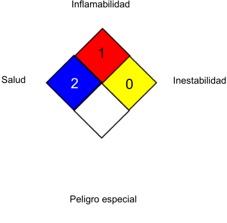
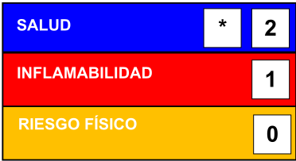

<!-- pagina: 1 -->

## FICHA DE DATOS DE SEGURIDAD

## Sikafloor®-510 Part A

*Texto OCR de la imagen (puede contener errores): Sika | R*

Versión 2.3

Número de HDS: 000000611764

Fecha de revisión: 2024/09/23

## SECCIÓN 1. IDENTIFICACION DEL PRODUCTO

Nombre del producto

: Sikafloor®-510 Part A

## Informaciones sobre el fabricante o el proveedor

- **Compañía:** Sika Colombia S.A.S. Tocancipá, Cundinamarca Colombia  
- **Teléfono:** (57-1) 8786333  
- **Teléfono de emergencia:** CISPROQUIM Bogotá: 2886012 / 2886355 Resto del país: 01 8000 916012  
- **Dirección de correo electróni- co:** controlcalidad.lab@co.sika.com  
- **Fax Vereda Canavita km 20,5 Autopista Norte:** (57-1) 8786660

## Uso recomendado del producto químico y restricciones de uso

Uso del producto

: Revestimiento de poliuretano

## SECCIÓN 2. IDENTIFICACIÓN DEL PELIGRO O PELIGROS

## Clasificación según SGA (GHS)

Corrosión/irritación cutáneas : Categoría 3

Sensibilización cutánea

: Categoría 1

Toxicidad a la reproducción : Categoría 2

- **Peligro a corto plazo (agudo) para el medio ambiente acuático:** Categoría 3  
- **Peligro a largo plazo (crónico) para el medio ambiente acuático:** Categoría 3

## Etiqueta SGA (GHS)

Pictogramas de peligro :

<!-- pagina: 2 -->

## FICHA DE DATOS DE SEGURIDAD

## Sikafloor®-510 Part A

*Texto OCR de la imagen (puede contener errores): Sika | R*

- **Versión 2.3:** Número de HDS: 000000611764 Fecha de revisión: 2024/09/23  
- **Palabra de advertencia:** Atención  
- **Indicaciones de peligro:** H316 Provoca una leve irritación cutánea. H361f Susceptible de perjudicar la fertilidad. H412 Nocivo para los organismos acuáticos, con efectos nocivos duraderos.  
- **Consejos de prudencia H317 Puede provocar una reacción cutánea alérgica.:** Prevención: P201 Procurarse las instrucciones antes del uso. P202 No manipular antes de haber leído y comprendido todas las precauciones de seguridad. P261 Evitar respirar nieblas o vapores. P272 La ropa de trabajo contaminada no debe salir del lugar de trabajo. P273 No dispersar en el medio ambiente. P280 Usar guantes/ ropa de protección/ equipo de protección para los ojos/ la cara.

## Intervención:

P302 + P352 EN CASO DE CONTACTO CON LA PIEL: Lavar con abundante agua.

P308 + P313 EN CASO DE exposición demostrada o supuesta: consultar a un médico.

P333 + P313 En caso de irritación cutánea o sarpullido: consultar a un médico.

P362 + P364 Quitar la ropa contaminada y lavarla antes de volverla a usar.

## Almacenamiento:

P405 Guardar bajo llave.

## Eliminación:

P501 Eliminar el contenido/ recipiente en una planta de eliminación de residuos aprobada.

## Otros peligros no clasificables

Ninguno conocido.

## SECCIÓN 3. COMPOSICIÓN/INFORMACION SOBRE LOS COMPONENTES

Sustancia / mezcla

: Mezcla

## Componentes

| Nombre químico                                                      | CAS No.     | Concentración (% w/w)   |
|---------------------------------------------------------------------|-------------|-------------------------|
| Bis(4-(1,2-bis(etoxicarbonil)etilamino)-3- metilciclohexil)metano   | 136210-32-7 | >= 30 - < 50            |
| N,N'-(metilendiciclohexano-4,1-diil)bis-DL- aspartato de tetraetilo | 136210-30-5 | >= 30 - < 50            |
| acetato de 2-metoxi-1-metiletilo                                    | 108-65-6    | >= 5 - < 10             |
| fumarato de dietilo                                                 | 623-91-6    | >= 2,5 - < 5            |
| sebacato de bis(1,2,2,6,6-pentametil-4- piperidilo)                 | 41556-26-7  | >= 0,25 - < 1           |
| sebacato de metilo y 1,2,2,6,6-pentametil-4- piperidilo             | 82919-37-7  | >= 0,1 - < 0,25         |

<!-- pagina: 3 -->

## Sikafloor®-510 Part A

*Texto OCR de la imagen (puede contener errores): Sika | R*

Versión 2.3

Fecha de revisión: 2024/09/23

Número de HDS: 000000611764

## SECCIÓN 4. PRIMEROS AUXILIOS

- **Consejos generales:** Retire a la persona de la zona peligrosa. Consulte a un médico. cio.  
- **En caso de inhalación Muéstrele esta hoja de seguridad al doctor que esté de servi-:** Salga al aire libre.  
- **En caso de contacto con la piel:** Quítese inmediatamente la ropa y zapatos contaminados. Elimínelo lavando con jabón y mucha agua. Si persisten los síntomas, llame a un médico.  
- **En caso de contacto con los ojos:** Quítese los lentes de contacto. Manténgase el ojo bien abierto mientras se lava. Si persiste la irritación de los ojos, consulte a un especialista.  
- **En caso de ingestión Consultar a un médico después de una exposición importante.:** Lávese la boca con agua y después beba agua abundante. Nunca debe administrarse nada por la boca a una persona inconsciente. Consulte al médico.  
- **Síntomas y efectos más importante, agudos y retardados:** efectos sensibilizantes Reacciones alérgicas Vea la Sección 11 para obtener información detallada sobre la salud y los síntomas. Provoca una leve irritación cutánea. Puede provocar una reacción cutánea alérgica. Susceptible de perjudicar la fertilidad.  
- **Notas especiales para un medico tratante No dé leche ni bebidas alcohólicas.:** Trate sintomáticamente.

## SECCIÓN 5. MEDIDAS DE LUCHA CONTRA INCENDIOS

- **Medios de extinción apropia- dos:** Use medidas de extinción que sean apropiadas a las circunstancias locales y de sus alrededores.  
- **Productos de combustión peligrosos:** No se conocen productos de combustión peligrosos  
- **Métodos específicos de ex- tinción:** Procedimiento estándar para incendios químicos.  
- **Equipo de protección espe- cial para los bomberos:** En caso de incendio, utilice un equipo respiratorio autónomo.

## SECCIÓN 6. MEDIDAS QUE DEBEN TOMARSE EN CASO DE VERTIDO ACCIDENTAL

Precauciones personales,

equipo de protección y pro-

cedimientos de emergencia

: Utilice equipo de protección personal.

Negar el acceso a personas sin protección.

<!-- pagina: 4 -->

## FICHA DE DATOS DE SEGURIDAD

## Sikafloor®-510 Part A

*Texto OCR de la imagen (puede contener errores): Sika | R*

| Versión 2.3                                   |    | Número de HDS: 000000611764 Fecha de revisión:                                                                                                                                                         |
|-----------------------------------------------|----|--------------------------------------------------------------------------------------------------------------------------------------------------------------------------------------------------------|
| Precauciones relativas al medio ambiente      | :  | No lo vierta en el agua superficial o el sistema de alcantarilla- do sanitario. Si el producto contamina los ríos, lagos o alcantarillados, in- formar a las autoridades respectivas.                  |
| Métodos y materiales de contención y limpieza | :  | Recójalo con un producto absorbente inerte (por ejemplo, arena, silicagel, aglutinante de ácidos, aglutinante universal, aserrín). Guarde en contenedores apropiados y cerrados para su eli- minación. |

## SECCIÓN 7. MANIPULACIÓN Y ALMACENAMIENTO

| Sugerencias para la protec- ción contra incendios y ex- plosiones   | :   | Medidas normales preventivas para la protección contra in- cendios.                                                                                                                                                                                                                                                                                                                                                                                                                                                                                                                |
|---------------------------------------------------------------------|-----|------------------------------------------------------------------------------------------------------------------------------------------------------------------------------------------------------------------------------------------------------------------------------------------------------------------------------------------------------------------------------------------------------------------------------------------------------------------------------------------------------------------------------------------------------------------------------------|
| Consejos para una manipu- lación segura                             | :   | Evitar sobrepasar los límites dados de exposición profesional (ver sección 8). Evitar todo contacto con los ojos, la piel o la ropa. Ver sección 8 para el equipo de protección personal. Las personas que hayan tenido problemas de sensibilisación de la piel, asma, alergías, enfermedades respiratorias cróni- cas o recurrentes, no deben ser empleadas en ninguna parte del proceso en la cual esté utilizada esta preparación. Fumar, comer y beber debe prohibirse en el área de aplica- ción. Cuando se manejen productos químicos, siga las medidas estándar de higiene. |
| Condiciones para el almace- namiento seguro                         | :   | Conserve el envase herméticamente cerrado en un lugar seco y bien ventilado. Los contenedores que se abren deben ser cuidadosamente resellados y mantenerlos en posición vertical para evitar fu- gas. Almacenar en conformidad con la reglamentación local.                                                                                                                                                                                                                                                                                                                       |

## SECCIÓN 8. CONTROLES DE EXPOSICIÓN/PROTECCIÓN PERSONAL

## Componentes con parámetros de control en el área de trabajo

No contiene sustancias con valores límite de exposición laboral.

## Protección personal

| Protección respiratoria   | :   | Utilice protección respiratoria a menos que exista una venti- lación de escape adecuada o que la evaluación de la exposi- ción indique que el nivel de exposición está dentro de las pautas recomendadas. La clase de filtro para el respirador debe ser adecuada para la concentración máxima prevista del contaminante (gas/vapor/aerosol/partículas) que puede presentarse al ma- nejar el producto. Si se excede esta concentración, se debe utilizar un aparato respiratorio autónomo.   |
|---------------------------|-----|-----------------------------------------------------------------------------------------------------------------------------------------------------------------------------------------------------------------------------------------------------------------------------------------------------------------------------------------------------------------------------------------------------------------------------------------------------------------------------------------------|

<!-- pagina: 5 -->

## FICHA DE DATOS DE SEGURIDAD

## Sikafloor®-510 Part A

*Texto OCR de la imagen (puede contener errores): Sika | R*

Versión 2.3

Número de HDS: 000000611764

Fecha de revisión: 2024/09/23

| Protección de las manos            | :   | Guantes químico-resistentes e impermeables que cumplan con estándares aprobados deben ser utilizados cuando se manejen productos químicos y la evaluación del riesgo indica que es necesario.                                                                       |
|------------------------------------|-----|---------------------------------------------------------------------------------------------------------------------------------------------------------------------------------------------------------------------------------------------------------------------|
| Protección de los ojos             | :   | Equipo de protección ocular que cumpla con estándares aprobados debe ser utilizado cuando la evaluación del riesgo indica que es necesario.                                                                                                                         |
| Protección de la piel y del cuerpo | :   | Elegir la protección para el cuerpo según sus caraterísticas, la concentración y la cantidad de sustancias peligrosas, y el lugar específico de trabajo.                                                                                                            |
| Medidas de higiene                 | :   | Manipúlelo con las precauciones de higiene industrial ade- cuadas, y respete las prácticas de seguridad. No coma ni beba durante su utilización. No fume durante su utilización. Lavarse las manos antes de los descansos y después de terminar la jornada laboral. |

## SECCIÓN 9. PROPIEDADES FÍSICAS Y QUÍMICAS

- **Aspecto:**  
- **Color líquido:** varios  
- **Olor:** Sin datos disponibles  
- **Umbral de olor:** Sin datos disponibles  
- **pH:** No aplicable  
- **Punto de fusión/ rango / Pun- to de congelación:**

Punto / intervalo de ebullición : Sin datos disponibles

Sin datos disponibles  
- **Punto de inflamación:** no se inflama  
- **Tasa de evaporación:** Sin datos disponibles  
- **Inflamabilidad (sólido, gas):** Sin datos disponibles  
- **Límite superior de explosividad / Límite de inflamabilidad superior:** Sin datos disponibles  
- **Límite inferior de explosividad / Límite de inflamabilidad infe- rior:** Sin datos disponibles  
- **Presión de vapor:** 3,1 hPa  
- **Densidad relativa de vapor:** Sin datos disponibles  
- **Densidad:** 1,4 g/cm3 (20 °C (20 °C))

<!-- pagina: 6 -->

## FICHA DE DATOS DE SEGURIDAD

## Sikafloor®-510 Part A

Número de HDS: 000000611764

*Texto OCR de la imagen (puede contener errores): Sika | R*

Versión 2.3

Fecha de revisión: 2024/09/23

## Solubilidad

- **Hidrosolubilidad:** insoluble  
- **Solubilidad en otros disol- ventes:** Sin datos disponibles  
- **Coeficiente de reparto noctanol/agua:** Sin datos disponibles  
- **Temperatura de ignición es- pontánea:** Sin datos disponibles  
- **Temperatura de descomposi- ción Viscosidad:** Sin datos disponibles  
- **Viscosidad, dinámica:** Sin datos disponibles  
- **Viscosidad, cinemática:** > 7 mm2/s ( 40 °C (40 °C))  
- **Propiedades explosivas:** Sin datos disponibles  
- **Propiedades comburentes:** Sin datos disponibles

## SECCIÓN 10. ESTABILIDAD Y REACTIVIDAD

- **Reactividad:** No se conoce ninguna reacción peligrosa bajo condiciones de uso normal.  
- **Estabilidad química:** El producto es químicamente estable.  
- **Posibilidad de reacciones peligrosas:** Sin riesgos a mencionar especialmente.  
- **Condiciones que deben evi- tarse:** Sin datos disponibles  
- **Materiales incompatibles:** Sin datos disponibles  
- **Productos de descomposición peligrosos:** No se conocen productos de descomposición peligrosos.

## SECCIÓN 11. INFORMACIÓN TOXICOLÓGICA

## Toxicidad aguda

No se clasifica debido a la falta de datos.

## Componentes:

## acetato de 2-metoxi-1-metiletilo:

- **Toxicidad oral aguda:** DL50 Oral (Rata): > 5.000 mg/kg  
- **Toxicidad dérmica aguda:** LD50 Dermico (Conejo): > 5.000 mg/kg  
- **fumarato de dietilo:**  
- **Toxicidad oral aguda:** DL50 Oral (Rata): 1.367 mg/kg

<!-- pagina: 7 -->

## FICHA DE DATOS DE SEGURIDAD

## Sikafloor®-510 Part A

Versión 2.3

Número de HDS: 000000611764

*Texto OCR de la imagen (puede contener errores): Sika | R*

Fecha de revisión: 2024/09/23

## Corrosión o irritación cutáneas

Provoca una leve irritación cutánea.

## Lesiones oculares graves/irritación ocular

No se clasifica debido a la falta de datos.

## Sensibilización respiratoria o cutánea

## Sensibilización cutánea

Puede provocar una reacción cutánea alérgica.

## Sensibilización respiratoria

No se clasifica debido a la falta de datos.

## Mutagenicidad en células germinales

No se clasifica debido a la falta de datos.

Carcinogenicidad

No se clasifica debido a la falta de datos.

## Toxicidad para la reproducción

Susceptible de perjudicar la fertilidad.

## Toxicidad sistémica específica de órganos blanco - exposición única

No se clasifica debido a la falta de datos.

## Toxicidad sistémica específica de órganos blanco - exposiciones repetidas

No se clasifica debido a la falta de datos.

## Toxicidad por aspiración

No se clasifica debido a la falta de datos.

## SECCIÓN 12. INFORMACIÓN ECOTOXICOLOGICA

## Ecotoxicidad

## Componentes:

## fumarato de dietilo:

Toxicidad para peces

: CL50 (Pez): 2,4 mg/l

Tiempo de exposición: 72 h

## Persistencia y degradabilidad

Sin datos disponibles

## Potencial de bioacumulación

Sin datos disponibles

## Movilidad en el suelo

Sin datos disponibles

## Otros efectos adversos

## Producto:

Información ecológica com-

plementaria

: No se puede excluir un peligro para el medio ambiente en el caso de una manipulación o eliminación no profesional. Nocivo para los organismos acuáticos, con efectos nocivos duraderos.

<!-- pagina: 8 -->

## FICHA DE DATOS DE SEGURIDAD

## Sikafloor®-510 Part A

Versión 2.3

Número de HDS: 000000611764

*Texto OCR de la imagen (puede contener errores): Sika | R*

Fecha de revisión: 2024/09/23

## SECCIÓN 13. INFORMACIÓN RELATIVA A LA ELIMINACIÓN DE LOS PRODUCTOS

## Métodos de eliminación

- **Residuos:** Envíese a una compañía autorizada para la gestión de residuos. Evite que el producto penetre en los desagües, tuberías, o la tierra (suelos). No contamine los estanques, cursos de agua o zanjas con el producto químico o el contendor utilizado.  
- **Envases contaminados:** Vacíe el contenido restante. Eliminar como producto no usado. No reutilice los recipientes vacíos.

## SECCIÓN 14. INFORMACIÓN RELATIVA AL TRANSPORTE

## Regulaciones internacionales

## UNRTDG

No regulado como mercancía peligrosa

## IATA-DGR

No regulado como mercancía peligrosa

## Código-IMDG

No regulado como mercancía peligrosa

## Transporte a granel de acuerdo a instrumentos IMO

No aplicable para el producto tal y como se proveyó.

## Precauciones especiales para los usuarios

No aplicable

## SECCIÓN 15. INFORMACIÓN SOBRE LA REGLAMENTACION

## Reglamentación medioambiental, seguridad y salud específica para la sustancia o mezcla

- **Convención Internacional sobre las Armas Químicas (CWC) Programas sobre los Productos Químicos Tó- xicos y los Precursores (Louisiana Administrative Co- de, Title 33,Part V Section 10101 et. seq.):** No aplicable  
- **Sustancias y productos químicos controlados por el Ministerio de Justicia:** No aplicable  
- **Listado de Sustancias incluídas como Sustancias de Control Especial y Sometidas a Fiscalización por el Ministerio de Salud y Protección Social:** No aplicable  
- **Resolución 2715 de 2014 Por la cual se establecen las sustancias que deben ser objeto de registro de control de venta al menudeo, con base en los criterios de clasificación que se definen.:** No aplicable

<!-- pagina: 9 -->

## Sikafloor®-510 Part A

Versión 2.3

Número de HDS: 000000611764

*Texto OCR de la imagen (puede contener errores): Sika | R*

Fecha de revisión: 2024/09/23

## SECCIÓN 16. OTRAS INFORMACIONES

- **Fecha de revisión:** 2024/09/23  
- **formato de fecha:** aaaa/mm/dd

## Información adicional

## NFPA:

## HMIS® IV:

*Texto del PDF en el área de la imagen (capa de texto, no OCR): Inflamabilidad | Inestabilidad | Salud | 2 | 0 | 1 | Peligro especial*

## Texto completo de otras abreviaturas

- **ADR:** Accord européen relatif au transport international des marchandises Dangereuses par Route  
- **CAS:** Chemical Abstracts Service  
- **DNEL:** Derived no-effect level  
- **EC50:** Half maximal effective concentration  
- **GHS:** Globally Harmonized System  
- **IATA:** International Air Transport Association  
- **IMDG:** International Maritime Code for Dangerous Goods  
- **LD50:** Median lethal dosis (the amount of a material, given all at once, which causes the death of 50% (one half) of a group of test animals)  
- **LC50:** Median lethal concentration (concentrations of the chemical in air that kills 50% of the test animals during the observation period)  
- **MARPOL:** International Convention for the Prevention of Pollution from Ships, 1973 as modified by the Protocol of 1978  
- **OEL:** Occupational Exposure Limit  
- **PBT:** Persistent, bioaccumulative and toxic  
- **PNEC:** Predicted no effect concentration  
- **REACH:** Regulation (EC) No 1907/2006 of the European Parliament and of the Council of 18 December 2006 concerning the Registration, Evaluation, Authorisation and Restriction of Chemicals (REACH), establishing a European Chemicals Agency  
- **SVHC:** Substances of Very High Concern  
- **vPvB:** Very persistent and very bioaccumulative

*Texto del PDF en el área de la imagen (capa de texto, no OCR): 2 | 0 | 1 | * | RIESGO FÍSICO | INFLAMABILIDAD | SALUD*

Las clasificaciones HMIS® se basan en una escala del 0 al 4 en la que 0 significa riesgos o peligros mínimos y 4 significa riesgos o peligros serios. El "*" representa un peligro crónico, mientras que la "/" representa la ausencia de un peligro crónico.

<!-- pagina: 10 -->

## FICHA DE DATOS DE SEGURIDAD

## Sikafloor®-510 Part A

Versión 2.3

Número de HDS: 000000611764

*Texto OCR de la imagen (puede contener errores): Sika | R*

Fecha de revisión: 2024/09/23

La informacion contenida en este ficha de datos de seguridad corresponde a nuestro nivel de conocimiento en el momento de su publicacion. Quedan excluidas todas las garantias. Se aplicaran nuestras condiciones generales de venta en vigor. Por favor, consulte la Hoja de Datos del Producto antes de su uso y procesamiento. CO / 1X
<!-- encabezados y pies de pagina -->

## Encabezados y pies de página

*Texto del margen superior o inferior de las páginas, que Docling separa del cuerpo. Se lista una sola vez, con las páginas donde aparece.*

- [p. 3, 9] FICHA DE DATOS DE SEGURIDAD
