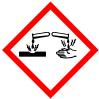
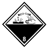
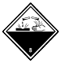
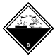

<!-- pagina: 1 -->

## FICHA DE DATOS DE SEGURIDAD

SEALER F100 PARTE B

## Sección 1. Identificación

Identificador SGA del producto SDS code

:

SEALER F100 PARTE B

: UFA551

## Usos pertinentes identificados de la sustancia o de la mezcla y usos desaconsejados

Uso industrial

Todos los demás usos Usos identificados Usos contraindicados

## Uso del producto

: Recubrimiento de dos componentes base disolvente para uso exterior.

## Datos sobre el proveedor

Compañía Global de Pinturas S.A.S. Autopista Medellín Bogotá Km 37 Vía Belén Rionegro Km 1 054040 Rionegro - Antioquia - Colombia 01 8000 111 247

- **Medellín 604 325 2523:**  
- **Dirección de e-mail de la persona responsable de esta FDS:** PSRA.southamerica@akzonobel.com  
- **Teléfono de emergencias (con horas de funcionamiento):** CISTEMA SURA Colombia al 018000 51 14 14, fuera de Colombia (0574) 4444578 24 horas

## Sección 2. Identificación de los peligros

Clasificación de la sustancia o de la mezcla

:

LÍQUIDOS INFLAMABLES - Categoría 4 TOXICIDAD AGUDA (oral) - Categoría 4 TOXICIDAD AGUDA (dérmica) - Categoría 5 CORROSIÓN CUTÁNEA - Categoría 1B LESIÓN OCULAR GRAVE - Categoría 1 SENSIBILIZACIÓN CUTÁNEA - Categoría 1

MUTAGENICIDAD EN CÉLULAS GERMINALES - Categoría 2

## Elementos de las etiquetas del SGA

Pictogramas de peligro

:

Palabra de advertencia

: Peligro

- **Fecha de emisión/Fecha de revisión:** 21-3-2025  
- **Fecha de la emisión anterior:** No hay validación anterior Versión : 1

<!-- pagina: 2 -->

## Sección 2. Identificación de los peligros

## Indicaciones de peligro

: H227 - Líquido combustible.

## Consejos de prudencia

## Prevención

H302 - Nocivo en caso de ingestión.

H313 - Puede ser nocivo en contacto con la piel.

H314 - Provoca quemaduras graves en la piel y lesiones oculares graves.

H317 - Puede provocar una reacción alérgica en la piel.

H341 - Se sospecha que provoca defectos genéticos.

: P201 - Solicitar instrucciones especiales antes del uso.

## Respuesta

## Almacenamiento

P280 - Usar guantes de protección, ropa de protección e equipo de protección para la cara o los ojos.  
P210 - Mantener alejado del calor, de superficies calientes, de chispas, de llamas abiertas y de cualquier otra fuente de ignición. No fumar.  
P261 - Evitar respirar los vapores.  
P270 - No comer, beber ni fumar durante su utilización.  
P264 - Lavarse las manos concienzudamente tras la manipulación.  
P308 + P313 - EN CASO DE exposición manifiesta o presunta: Consultar a un médico.  
P304 + P310 - EN CASO DE INHALACIÓN: Llamar inmediatamente a un CENTRO DE INFORMACION TOXICOLOGICA o a un médico.  
P301 + P310 + P330 + P331 - EN CASO DE INGESTIÓN: Llamar inmediatamente a un CENTRO DE INFORMACION TOXICOLOGICA o a un médico. Enjuagarse la boca. NO provocar el vómito.  
P303 + P361 + P353 + P310 - EN CASO DE CONTACTO CON LA PIEL (o el pelo): Quitar inmediatamente todas las prendas contaminadas. Enjuagar la piel con agua. Llamar inmediatamente a un CENTRO DE INFORMACION TOXICOLOGICA o a un médico.  
P363 - Lavar las prendas contaminadas antes de volver a usarlas.  
P302 + P312 + P352 - EN CASO DE CONTACTO CON LA PIEL: Llamar a un  
CENTRO DE INFORMACIÓN TOXICOLÓGICA o a un médico si la persona se encuentra mal. Lavar con abundante agua.  
P333 + P313 - En caso de irritación o erupción cutánea: Consultar a un médico. P305 + P351 + P338 + P310 - EN CASO DE CONTACTO CON LOS OJOS: Aclarar cuidadosamente con agua durante varios minutos. Quitar las lentes de contacto, si lleva y resulta fácil. Seguir aclarando. Llamar inmediatamente a un CENTRO DE INFORMACION TOXICOLOGICA o a un médico.  
No aplicable.  
- **Eliminación:** P501 - Eliminar el contenido / el recipiente en conformidad con las reglamentaciones locales y nacionales.  
- **Otros peligros que no conducen a una clasificación:** No se conoce ninguno.

## Sección 3. Composición/información sobre los componentes

## Otros medios de identificación Sustancia/preparado

: Mezcla

: No disponible.

| Nombre del ingrediente             | %         | Número CAS   |
|------------------------------------|-----------|--------------|
| anacardo, licor de cáscara de nuez | ≥10 - ≤25 | 8007-24-7    |
| alcohol bencilico                  | ≤10       | 100-51-6     |
| 2,4,6-tris(dimetilaminometil)fenol | ≤5        | 90-72-2      |
| m-fenilenbis(metilamina)           | ≤5        | 1477-55-0    |
| fenol                              | ≤2.5      | 108-95-2     |
| 3-aminopropildimetilamina          | ≤3        | 109-55-7     |
| 2,4,6-tris(dimetilaminometil)fenol | ≤3        | 90-72-2      |

: 21-3-2025

: No hay validación anterior Versión : 1

<!-- pagina: 3 -->

## Sección 3. Composición/información sobre los componentes

No hay ningún ingrediente adicional presente que, bajo el conocimiento actual del proveedor y en las concentraciones aplicables, sea clasificado como de riesgo para la salud o el medio ambiente y por lo tanto deban ser reportados en esta sección.

Los límites de exposición laboral, en caso de existir, figuran en la sección 8.

## Sección 4. Primeros auxilios

## Descripción de los primeros auxilios necesarios

## Contacto con los ojos

## Por inhalación

## Contacto con la piel

## Ingestión

:

:

:

:

Obtenga atención médica inmediatamente. Llamar a un centro de información toxicológica o a un médico. Enjuaguar los ojos inmediatamente con mucha agua, levantando de vez en cuando los párpados superior e inferior. Verificar si la víctima lleva lentes de contacto y en este caso, retirárselas. Continúe enjuagando por lo menos durante 10 minutos. Las quemaduras químicas se deben tratar inmediatamente por un médico.

Obtenga atención médica inmediatamente. Llamar a un centro de información toxicológica o a un médico. Transportar a la víctima al exterior y mantenerla en reposo en una posición confortable para respirar. Si se sospecha que los vapores continúan presentes, la persona encargada del rescate deberá usar una máscara adecuada o un aparato de respiración autónoma. Si no hay respiración, ésta es irregular u ocurre un paro respiratorio, el personal capacitado debe proporcionar respiración artificial u oxígeno. Puede ser peligroso para la persona que proporcione ayuda al dar respiración boca a boca. Si está inconsciente, coloque en posición de recuperación y consiga atención médica inmediatamente. Asegure una buena circulación de aire. Aflojar todo lo que pudiera estar apretado, como el cuello de una camisa, una corbata, un cinturón. En caso de inhalación de productos en descomposición en un incendio, los síntomas pueden aparecer posteriormente. Es posible que la persona expuesta tenga que estar bajo vigilancia médica por un período de 48 horas.

Obtenga atención médica inmediatamente. Llamar a un centro de información toxicológica o a un médico. Lavar con agua y jabón abundantes. Quítese la ropa y calzado contaminados. Lave bien la ropa contaminada con agua antes de quitársela, o use guantes. Continúe enjuagando por lo menos durante 10 minutos. Las quemaduras químicas se deben tratar inmediatamente por un médico. En el caso de que existan molestias o síntomas, evite más exposición. Lavar la ropa antes de volver a usarla. Limpiar completamente el calzado antes de volver a usarlo.

Obtenga atención médica inmediatamente. Llamar a un centro de información toxicológica o a un médico. Lave la boca con agua. Retirar las prótesis dentales si es posible. Si se ha ingerido material y la persona expuesta está consciente, suminístrele pequeñas cantidades de agua para beber. Deje de proporcionarle agua si la persona expuesta se encuentra mal ya que los vómitos pueden ser peligrosos. No inducir al vómito a menos que lo indique expresamente el personal médico. Si vomita, mantener la cabeza baja de manera que el vómito no entre en los pulmones. Las quemaduras químicas se deben tratar inmediatamente por un médico. No suministrar nada por vía oral a una persona inconsciente. Si está inconsciente, coloque en posición de recuperación y consiga atención médica inmediatamente. Asegure una buena circulación de aire. Aflojar todo lo que pudiera estar apretado, como el cuello de una camisa, una corbata, un cinturón.

## Síntomas/efectos más importantes, agudos o retardados

## Efectos agudos potenciales para la salud

- **Contacto con los ojos:** Provoca lesiones oculares graves.  
- **Por inhalación:** No se conocen efectos significativos o riesgos críticos.  
- **Contacto con la piel:** Provoca quemaduras graves. Puede ser nocivo en contacto con la piel. Puede provocar una reacción alérgica en la piel.  
- **Ingestión:** Nocivo en caso de ingestión.

Signos/síntomas de sobreexposición

<!-- pagina: 4 -->

## Sección 4. Primeros auxilios

- **Contacto con los ojos:** Los síntomas adversos pueden incluir los siguientes:  
- **Por inhalación:**  
- **Contacto con la piel:** Los síntomas adversos pueden incluir los siguientes: dolor o irritación rojez Los síntomas adversos pueden incluir los siguientes: puede provocar la formación de ampollas  
- **Ingestión dolor lagrimeo rojez Ningún dato específico.:** dolores gástricos

## Indicación de la necesidad de recibir atención médica inmediata y, en su caso, de tratamiento especial

- **Notas para el médico:** En caso de inhalación de productos en descomposición en un incendio, los síntomas pueden aparecer posteriormente. Es posible que la persona expuesta tenga que estar bajo vigilancia médica por un período de 48 horas.  
- **Protección del personal de primeros auxilios Tratamientos específicos:** No hay un tratamiento específico. No se debe realizar ninguna acción que suponga un riesgo personal o sin formación adecuada. Si se sospecha que los vapores continúan presentes, la persona encargada del rescate deberá usar una máscara adecuada o un aparato de respiración autónoma. Puede ser peligroso para la persona que proporcione ayuda al dar respiración boca a boca. Lave bien la ropa contaminada con agua antes de quitársela, o use guantes.

Vea la sección 11 para la Información Toxicológica

## Sección 5. Medidas de lucha contra incendios

## Medios de extinción

- **Medios de extinción apropiados:** Utilizar polvos químicos secos, CO₂, agua pulverizada (niebla de agua) o espuma.  
- **Medios de extinción no apropiados:** No usar chorro de agua.  
- **Peligros específicos del producto químico:** Líquido combustible. Los residuos líquidos que se filtran en el alcantarillado pueden causar un riesgo de incendio o de explosión. La presión puede aumentar y el contenedor puede explotar en caso de calentamiento o incendio, con el riesgo de producirse una explosión.  
- **Productos de descomposición térmica peligrosos:** Los productos de descomposición pueden incluir los siguientes materiales: dióxido de carbono monóxido de carbono óxido de nitrógeno  
- **Medidas especiales que deben tomar los equipos de lucha contra incendios:** En caso de incendio, aislar rápidamente la zona, evacuando a todas las personas de las proximidades del lugar del incidente. No se debe realizar ninguna acción que suponga un riesgo personal o sin formación adecuada. Desplazar los contenedores lejos del incendio si puede hacerse sin peligro. Use agua pulverizada para refrigerar los envases expuestos al fuego.  
- **Equipo de protección especial para el personal de lucha contra incendios:** Los bomberos deben llevar equipo de protección apropiado y un equipo de respiración autónomo con una máscara facial completa que opere en modo de presión positiva.

<!-- pagina: 5 -->

## Sección 6. Medidas en caso de vertido accidental

## Precauciones personales, equipo de protección y procedimientos de emergencia

Para el personal que no forma parte de los servicios de emergencia

Para el personal de emergencia

## Precauciones relativas al medio ambiente

: No se debe realizar ninguna acción que suponga un riesgo personal o sin formación adecuada. Evacuar los alrededores. No deje que entre el personal innecesario y sin protección. No toque o camine sobre el material derramado. Apagar todas las fuentes de ignición. Ni bengalas, ni humo, ni llamas en en el área de riesgo. No respire los vapores o nieblas. Proporcione ventilación adecuada. Llevar un aparato de respiración apropiado cuando el sistema de ventilación sea inadecuado. Llevar puesto un equipo de protección individual adecuado.

: Si se necesitan prendas especiales para gestionar el vertido, tomar en cuenta las informaciones recogidas en la Sección 8 en relación a los materiales adecuados y no adecuados. Consultar también la información mencionada en "Para el personal que no forma parte de los servicios de emergencia".

:

Evitar la dispersión del material derramado, su contacto con el suelo, las vias fluviales, las tuberías de desagüe y las alcantarillas. Informar a las autoridades pertinentes si el producto ha causado contaminación medioambiental (alcantarillas, vias fluviales, suelo o aire).

## Métodos y material de contención y de limpieza

- **Derrame pequeño:** Detener la fuga si esto no presenta ningún riesgo. Retire los envases del área del derrame. Use herramientas a prueba de chispas y equipo a prueba de explosión. Diluir con agua y fregar si es soluble en agua. Alternativamente, o si es insoluble en agua, absorber con un material seco inerte y colocar en un contenedor de residuos adecuado. Elimine por medio de un contratista autorizado para la eliminación.  
- **Gran derrame:** Detener la fuga si esto no presenta ningún riesgo. Retire los envases del área del derrame. Use herramientas a prueba de chispas y equipo a prueba de explosión. Aproximarse al vertido en el sentido del viento. Evite que se introduzca en alcantarillas, canales de agua, sótanos o áreas reducidas. Lave los vertidos hacia una planta de tratamiento de efluentes o proceda como se indica a continuación. Detener y recoger los derrames con materiales absorbentes no combustibles, como arena, tierra, vermiculita o tierra de diatomeas, y colocar el material en un envase para desecharlo de acuerdo con las normativas locales (ver Sección 13). Elimine por medio de un contratista autorizado para la eliminación. El material absorbente contaminado puede presentar el mismo riesgo que el producto derramado. Nota: Ver la Sección 1 para información sobre los contactos de emergencia y la Sección 13 para la eliminación de los residuos.

## Sección 7. Manipulación y almacenamiento

## Precauciones para una manipulación segura

Medidas de protección

:

Usar un equipo de proteccion personal adecuado (Consultar Sección 8). Las personas con antecedentes de sensibilización cutánea no deben trabajar en ningún proceso en el que se utilice este producto. Evítese la exposición - recábense instrucciones especiales antes del uso. No manipular la sustancia antes de haber leído y comprendido todas las instrucciones de seguridad. No introducir en ojos en la piel o en la ropa. No respire los vapores o nieblas. No ingerir. Use sólo con ventilación adecuada. Llevar un aparato de respiración apropiado cuando el sistema de ventilación sea inadecuado. No entre en áreas de almacenamiento y espacios cerrados a menos que estén ventilados adecuadamente. Consérvese en su envase original o en uno alternativo aprobado fabricado en un material compatible, manteniéndose bien cerrado cuando no esté en uso. Mantener alejado del calor, chispas, llamas al descubierto, o de cualquier otra fuente de ignición. Use equipo eléctrico (de ventilación, iluminación y manipulación de materiales) a prueba de explosiones. Utilizar únicamente herramientas que no produzcan chispas. Los envases vacíos retienen resíduos del producto y pueden ser peligrosos. No vuelva a usar el envase.

<!-- pagina: 6 -->

## Sección 7. Manipulación y almacenamiento

## Información relativa a higiene en el trabajo de forma general

## Condiciones de almacenamiento seguro, incluidas posibles incompatibilidades

:

:

Deberá prohibirse comer, beber o fumar en los lugares donde se manipula, almacena o trata este producto. Los trabajadores deberan lavarse las manos y la cara antes de comer, beber o fumar. Retirar el equipo de protección y las ropas contaminadas antes de acceder a zonas donde se coma. Consultar también en la Sección 8 la información adicional sobre medidas higiénicas.

Almacenar conforme a las normativas locales. Almacenar en un área separada y homologada. Almacenar en el contenedor original protegido de la luz directa del sol en un área seca, fresca y bien ventilada, separado de materiales incompatibles (ver Sección 10) y comida y bebida. Guardar bajo llave. Eliminar todas las fuentes de ignición. Manténgase alejado de los materiales oxidantes. Mantener el contenedor bien cerrado y sellado hasta el momento de usarlo. Los envases abiertos deben cerrarse perfectamente con cuidado y mantenerse en posición vertical para evitar derrames. No almacenar en contenedores sin etiquetar. Utilícese un envase de seguridad adecuado para evitar la contaminación del medio ambiente. Antes de manipularlo o utilizarlo vea en la sección 10 los materiales incompatibles.

## Sección 8. Controles de exposición/protección individual

## Parámetros de control Límites de exposición profesional

| Nombre del ingrediente | Límites de exposición |
|---|---|
| m-fenilenbis(metilamina) | ACGIH TLV (Estados Unidos, 1/2023). Absorbido a través de la piel. C: 0.018 ppm |
| fenol | ACGIH TLV (Estados Unidos, 1/2023). Absorbido a través de la piel. TWA: 19 mg/m³ 8 horas. TWA: 5 ppm 8 horas. |

*Tabla reconstruida por posición de renglones: Docling había fusionado sus filas (ver data/metadata/tablas_reconstruidas.csv).*

## Controles técnicos apropiados

## Controles de exposición medioambiental

: Use sólo con ventilación adecuada. Utilizar aislamientos de áreas de producción, sistemas de ventilación locales, u otros procedimientos de ingeniería para mantener la exposición del obrero a los contaminantes aerotransportados por debajo de todos los límites recomendados o estatutarios. Los controles de ingeniería también deben mantener el gas, vapor o polvo por debajo del menor límite de explosión. Utilizar equipo de ventilación anti-explosión.

: Se deben verificar las emisiones de los equipos de ventilación o de los procesos de trabajo para verificar que cumplen con los requisitos de la legislación de protección del medio ambiente. En algunos casos para reducir las emisiones hasta un nivel aceptable, será necesario usar depuradores de humo, filtros o modificar el diseño del equipo del proceso.

## Medidas de protección individual

## Medidas higiénicas

:

## Protección de los ojos/la cara

## Protección de la piel

:

Lave las manos, antebrazos y cara completamente después de manejar productos químicos, antes de comer, fumar y usar el lavabo y al final del período de trabajo. Usar las técnicas apropiadas para eliminar ropa contaminada. Las prendas de trabajo contaminadas no podrán sacarse del lugar de trabajo. Lavar las ropas contaminadas antes de volver a usarlas. Verifique que las estaciones de lavado de ojos y duchas de seguridad se encuentren cerca de las estaciones de trabajo.

Se debe usar un equipo protector ocular que cumpla con las normas aprobadas cuando una evaluación del riesgo indique que es necesario, a fin de evitar toda exposición a salpicaduras del líquido, lloviznas, gases o polvos. Si es posible el contacto, se debe utilizar la siguiente protección, salvo que la valoración indique un grado de protección más alto: gafas contra salpicaduras químicas y/o pantalla facial. Si existe riesgo de inhalación, puede ser necesario utilizar en su lugar un respirador con careta completa.

<!-- pagina: 7 -->

## Sección 8. Controles de exposición/protección individual

- **Protección de las manos:** Si una evaluación del riesgo indica que es necesario, se deben usar guantes químico-resistentes e impenetrables que cumplan con las normas aprobadas siempre que se manejen productos químicos. Tomando en consideración los parámetros especificados por el fabricante de los guantes, comprobar durante el uso que los guantes siguen conservando sus propiedades protectoras. Hay que observar que el tiempo de paso de cualquier material utilizado con guantes puede ser diferente para distintos fabricantes de guantes. En el caso de mezclas, consistentes en varias sustancias, no es posible estimar de manera exacta, el tiempo de protección que ofrecen los guantes.  
- **Protección corporal:** Antes de utilizar este producto se debe seleccionar equipo protector personal para el cuerpo basándose en la tarea a ejecutar y los riesgos involucrados y debe ser aprobado por un especialista.  
- **Otro tipo de protección cutánea:** Se deben elegir el calzado adecuado y cualquier otra medida de protección cutánea necesaria dependiendo de la tarea que se lleve a cabo y de los riesgos implicados. Tales medidas deben ser aprobadas por un especialista antes de proceder a la manipulación de este producto.  
- **Protección respiratoria:** Basándose en la evaluación de los riesgos y la exposición, seleccionar un respirador que satisfaga los estándares o certificaciones apropiados. Los respiradores deben usarse de conformidad con un programa de protección respiratoria para asegurar su adecuación, formación y otros aspectos del buen uso. Llevar un respirador conforme a la norma EN140 con filtro de tipo A/P2 o mejor. El lijado en seco, el cortado con llama y/o el soldado de películas secas de pintura producirá polvo y/o humos nocivos. Un lijado o matizado húmedos son preferibles si es posible. Si no puede evitarse la exposición por la ventilación de extracción debe usarse adecuado equipo de protección respiratoria.

## Sección 9. Propiedades físicas y químicas y características de seguridad

Las condiciones de medición de todas las propiedades son a temperatura y presión estándar a menos que se indique lo contrario.

## Aspecto

- **Estado físico:** Líquido.  
- **Color:** Incoloro.  
- **Olor:** Característico.  
- **Umbral olfativo:** No disponible.  
- **pH:** No aplicable.  
- **Punto de fusión/punto de congelación:** No disponible.  
- **Punto de ebullición, punto de ebullición inicial e intervalo de ebullición:** 205°C (401°F)  
- **Punto de inflamación:** Vaso cerrado: 70°C (158°F)  
- **Tasa de evaporación:** No disponible.  
- **Inflamabilidad Límite superior e inferior de explosividad:** No disponible. 20 - 70 g/m3  
- **Presión de vapor:**

| ASTM D 5191 - Nombre del ingrediente   |   Presión de vapor a 20 ºC - mm Hg |   Presión de vapor a 20 ºC - kPa |
|----------------------------------------|------------------------------------|----------------------------------|
| 3-aminopropildimetilamina              |                            4.42538 |                             0.59 |
| fenol                                  |                            0.15001 |                             0.02 |
| 2,4,6-tris(dimetilaminometil)fenol     |                              0.056 |                           0.0075 |

: 21-3-2025

: No hay validación anterior

<!-- pagina: 8 -->

## Sección 9. Propiedades físicas y químicas y características de seguridad

Densidad de vapor relativa Solubilidad(es) Densidad

:

No disponible.

: 1.001 g/cm³

:

| Soporte   | Resultado                  |
|-----------|----------------------------|
| agua fría | No soluble [OECD (TG 105)] |

Coeficiente de reparto: noctanol/agua

Temperatura de autoinflamación

:

:

| Nombre del ingrediente             |   °C |    °F |
|------------------------------------|------|-------|
| 3-aminopropildimetilamina          |  215 |   419 |
| 2,4,6-tris(dimetilaminometil)fenol |  382 | 719.6 |
| 2,4,6-tris(dimetilaminometil)fenol |  382 | 719.6 |

Viscosidad Temperatura de descomposición

: No disponible.

:

Cinemática (temperatura ambiente): 803 mm 2 /s (803 cSt)

Cinemática (40°C (104°F)): 201 mm 2 /s (201 cSt)

Características de las partículas

Tamaño de partícula medio : No aplicable.

Porcentaje de partículas con diámetro aerodinámico ≤ 10 μm

: 0

## Sección 10. Estabilidad y reactividad

- **Reactividad:** No hay datos de ensayo disponibles sobre la reactividad de este producto o sus componentes.  
- **Estabilidad química:** El producto es estable.  
- **Posibilidad de reacciones peligrosas:** En condiciones normales de almacenamiento y uso, no se producen reacciones peligrosas.  
- **Condiciones que deben evitarse:** Evitar todas las fuentes posibles de ignición (chispa o llama). No someta a presión, corte, suelde, suelde con latón, taladre, esmerile o exponga los envases al calor o fuentes térmicas.  
- **Materiales incompatibles:** Reactivo o incompatible con los siguientes materiales: materiales oxidantes  
- **Productos de descomposición peligrosos:** En condiciones normales de almacenamiento y uso, no se deberían formar productos de descomposición peligrosos.

## Sección 11. Información toxicológica

## Información sobre los efectos toxicológicos

Toxicidad aguda

No aplicable.

<!-- pagina: 9 -->

## Sección 11. Información toxicológica

| Nombre del producto o ingrediente                            | Resultado                                                                                                                                                                                                                                                                                                                                                                                                                                                                                              | Especies                                                                                                                                                                 | Dosis                                                                                                                                                                                                                                                                                                                                                                | Exposición                                                            |
|--------------------------------------------------------------|--------------------------------------------------------------------------------------------------------------------------------------------------------------------------------------------------------------------------------------------------------------------------------------------------------------------------------------------------------------------------------------------------------------------------------------------------------------------------------------------------------|--------------------------------------------------------------------------------------------------------------------------------------------------------------------------|----------------------------------------------------------------------------------------------------------------------------------------------------------------------------------------------------------------------------------------------------------------------------------------------------------------------------------------------------------------------|-----------------------------------------------------------------------|
| alcohol bencilico fenol 2,4,6-tris(dimetilaminometil) fenol  | DL50 Cutánea DL50 Intraarterial DL50 Intraperitoneal DL50 Intraperitoneal DL50 Intravenosa DL50 Intravenosa DL50 Oral DL50 Oral DL50 Oral DL50 Cutánea DL50 Oral DL50 Oral DL50 Oral CL50 Por inhalación Gas. DL50 Cutánea DL50 Oral CL50 Por inhalación Vapor CL50 Por inhalación Vapor DL50 Cutánea DL50 Cutánea DL50 Cutánea DL50 Intraperitoneal DL50 Intraperitoneal DL50 Intravenosa DL50 Oral DL50 Oral DL50 Oral DL50 Subcutánea DL50 Subcutánea DL50 Cutánea DL50 Oral DL50 Cutánea DL50 Oral | Conejo Rata Ratón Rata Ratón Rata Rata Rata Rata Rata Rata Rata Rata Rata Rata Ratón Rata Rata Rata Ratón Rata Ratón Ratón Rata Rata Ratón Rata Rata Rata Rata Rata Rata | 2000 mg/kg 441 mg/kg 650 mg/kg 400 mg/kg 324 mg/kg 53 mg/kg 1.5 mL/kg 1660 mg/kg 1230 mg/kg 1280 mg/kg 1200 mg/kg 1673 mg/kg 2169 mg/kg 700 ppm 2 g/kg 930 mg/kg 177 mg/m³ 316 mg/m³ 630 mg/kg 669 mg/kg 1500 mg/kg 180 mg/kg 127 mg/kg 112 mg/kg 270 mg/kg 317 mg/kg 512 mg/kg 344 mg/kg 300 mg/kg 600 uL/kg 1870 mg/kg 1280 mg/kg 1200 mg/kg 1673 mg/kg 2169 mg/kg | - - - - - - - - - - - - - 1 - - 4 4 - - - - - - - - - - - - - - - - - |
| 2,4,6-tris(dimetilaminometil) fenol m-fenilenbis(metilamina) |                                                                                                                                                                                                                                                                                                                                                                                                                                                                                                        | Conejo Conejo                                                                                                                                                            |                                                                                                                                                                                                                                                                                                                                                                      | horas horas horas                                                     |
| 3-aminopropildimetilamina                                    |                                                                                                                                                                                                                                                                                                                                                                                                                                                                                                        | Conejo                                                                                                                                                                   |                                                                                                                                                                                                                                                                                                                                                                      |                                                                       |
|                                                              | DL50 Oral DL50 Oral                                                                                                                                                                                                                                                                                                                                                                                                                                                                                    |                                                                                                                                                                          |                                                                                                                                                                                                                                                                                                                                                                      |                                                                       |

## Irritación/Corrosión

| Nombre del producto o ingrediente   | Resultado                                 | Especies    | Puntuación   | Exposición             | Observación   |
|-------------------------------------|-------------------------------------------|-------------|--------------|------------------------|---------------|
| alcohol bencilico                   | Piel - Irritante moderado                 | Conejo      | -            | 24 horas 100 mg        | -             |
| 2,4,6-tris(dimetilaminometil) fenol | Ojos - Muy irritante                      | Conejo      | -            | 24 horas 50 ug         | -             |
|                                     | Piel - Irritante leve                     | Rata        | -            | 0.025 Ml               | -             |
|                                     | Piel - Muy irritante                      | Conejo      | -            | 24 horas 2 mg          | -             |
|                                     | Piel - Muy irritante                      | Conejo      | -            | 24 horas 500 Ul        | -             |
| m-fenilenbis(metilamina)            | Piel - Muy irritante Ojos - Muy irritante | Rata Conejo | - -          | 0.25 Ml 24 horas 50 ug | - -           |
|                                     | Piel - Muy irritante                      | Conejo      | -            | 24 horas 750 ug        | -             |
| fenol                               | Ojos - Irritante leve                     | Conejo      | -            | 0.5 minutos 5 mg       | -             |
|                                     | Ojos - Muy irritante                      | Conejo      | -            | 5 mg                   | -             |
|                                     | Piel - Irritante leve                     | Conejo      | -            | 100 mg                 | -             |

: 21-3-2025

<!-- pagina: 10 -->

## Sección 11. Información toxicológica

|                                     | Piel - Muy irritante      | Conejo   | -   | 535 mg          | -   |
|-------------------------------------|---------------------------|----------|-----|-----------------|-----|
| 3-aminopropildimetilamina           | Ojos - Irritante moderado | Conejo   | -   | 5 mg            | -   |
| 2,4,6-tris(dimetilaminometil) fenol | Ojos - Muy irritante      | Conejo   | -   | 24 horas 50 ug  | -   |
|                                     | Piel - Irritante leve     | Rata     | -   | 0.025 Ml        | -   |
|                                     | Piel - Muy irritante      | Conejo   | -   | 24 horas 2 mg   | -   |
|                                     | Piel - Muy irritante      | Conejo   | -   | 24 horas 500 Ul | -   |
|                                     | Piel - Muy irritante      | Rata     | -   | 0.25 Ml         | -   |

## Sensibilización

No disponible.

## Mutagénesis

No disponible.

## Carcinogenicidad

No disponible.

## Clasificación

| Nombre del producto o ingrediente   |   IARC |
|-------------------------------------|--------|
| fenol                               |      3 |

## Toxicidad para la reproducción

No disponible.

## Teratogenicidad

No disponible.

## Toxicidad específica en determinados órganos (STOT) - exposición única

| Nombre                    | Categoría   | Vía de exposición   | Órganos destino                      |
|---------------------------|-------------|---------------------|--------------------------------------|
| 3-aminopropildimetilamina | Categoría 3 | -                   | Irritación de las vías respiratorias |

## Toxicidad específica en determinados órganos (STOT) - exposición repetida

| Nombre   | Categoría   | Vía de exposición   | Órganos destino                         |
|----------|-------------|---------------------|-----------------------------------------|
| fenol    | Categoría 2 | -                   | riñones, hígado, sistema nervioso, piel |

## Peligro de aspiración

No disponible.

Información sobre posibles vías de exposición

: No disponible.

## Efectos agudos potenciales para la salud

- **Contacto con los ojos:** Provoca lesiones oculares graves.  
- **Por inhalación:** No se conocen efectos significativos o riesgos críticos.  
- **Contacto con la piel:** Provoca quemaduras graves. Puede ser nocivo en contacto con la piel. Puede provocar una reacción alérgica en la piel.  
- **Ingestión:** Nocivo en caso de ingestión.

## Síntomas relacionados con las características físicas, químicas y toxicológicas

| Fecha de emisión/Fecha de revisión   | : 21-3-2025                  | Versión   | : 1   |
|--------------------------------------|------------------------------|-----------|-------|
| Fecha de la emisión anterior         | : No hay validación anterior | 10/16     |       |

*Imagen asociada a la tabla #/tables/11: imagen contenida en el área de la tabla en la página 10 (100% de su área).*

<!-- pagina: 11 -->

## Sección 11. Información toxicológica

- **Contacto con los ojos:** Los síntomas adversos pueden incluir los siguientes:  
- **Contacto con la piel Por inhalación:** Los síntomas adversos pueden incluir los siguientes: dolor o irritación rojez puede provocar la formación de ampollas  
- **Ingestión dolor lagrimeo rojez Ningún dato específico.:** Los síntomas adversos pueden incluir los siguientes: dolores gástricos

## Efectos retardados e inmediatos, así como efectos crónicos producidos por una exposición a corto y largo

plazo

## Exposición a corto plazo

Posibles efectos

inmediatos

Posibles efectos

retardados

## Exposición a largo plazo

No disponible.  
No disponible.  
- **Posibles efectos inmediatos:** No disponible.  
- **Posibles efectos retardados:** No disponible.

## Efectos crónicos potenciales para la salud

No disponible.

## General

- **Carcinogenicidad:** No se conocen efectos significativos o riesgos críticos.  
- **Mutagénesis:** Se sospecha que provoca defectos genéticos.  
- **Toxicidad para la reproducción Una vez producida la sensibilización, podría observarse una reacción alérgica grave al exponerse posteriormente a niveles muy bajos.:** No se conocen efectos significativos o riesgos críticos.

## Medidas numéricas de toxicidad

## Estimaciones de toxicidad aguda

| Nombre del producto o ingrediente                                                                                                                                                                                    | Oral (mg/ kg)                       | Cutánea (mg/kg)                    | Inhalación (gases) (ppm)        | Inhalación (vapores) (mg/l)     | Inhalación (polvos y nieblas) (mg/l)   |
|----------------------------------------------------------------------------------------------------------------------------------------------------------------------------------------------------------------------|-------------------------------------|------------------------------------|---------------------------------|---------------------------------|----------------------------------------|
| Producto tal y como suministrado anacardo, licor de cáscara de nuez alcohol bencilico 2,4,6-tris(dimetilaminometil)fenol m-fenilenbis(metilamina) fenol 3-aminopropildimetilamina 2,4,6-tris(dimetilaminometil)fenol | 1291.7 500 1660 500 500 100 500 500 | 4259 1100 N/A N/A N/A 300 1100 N/A | N/A N/A N/A N/A N/A N/A N/A N/A | N/A N/A N/A N/A N/A N/A N/A N/A | 8.5 N/A 1.5 N/A 1.5 0.5 N/A N/A        |

<!-- pagina: 12 -->

## Sección 12. Información ecológica

## Toxicidad

| Nombre del producto o ingrediente   | Resultado                                                                                              | Especies                                                                                                        | Exposición                 |
|-------------------------------------|--------------------------------------------------------------------------------------------------------|-----------------------------------------------------------------------------------------------------------------|----------------------------|
| alcohol bencilico                   | Agudo CL50 10000 µg/l Agua fresca Agudo CL50 15000 µg/l Agua marina Agudo CL50 460000 µg/l Agua fresca | Pescado - Lepomis macrochirus Pescado - Menidia beryllina Pescado - Pimephales promelas - Juvenil (Nuevo, Cría, | 96 horas 96 horas 96 horas |
| fenol                               | Agudo EC50 36 mg/l Agua marina                                                                         | Destetado) Algas - Hormosira banksii - Gameto                                                                   | 72 horas                   |
|                                     | Agudo EC50 10 ppm Agua marina                                                                          | Algas - Macrocystis pyrifera - Joven                                                                            | 4 días                     |
|                                     | Agudo EC50 46420 µg/l Agua fresca                                                                      | Algas - Pseudokirchneriella subcapitata                                                                         | 96 horas                   |
|                                     | Agudo EC50 61.1 µg/l Agua fresca                                                                       | Algas - Pseudokirchneriella subcapitata                                                                         | 96 horas                   |
|                                     | Agudo EC50 63.1 µg/l Agua fresca                                                                       | Algas - Pseudokirchneriella subcapitata                                                                         | 96 horas                   |
|                                     | Agudo EC50 160 mg/l Agua fresca                                                                        | Plantas acuáticas - Lemna aequinoctialis                                                                        | 96 horas                   |
|                                     | Agudo EC50 94 mg/l Agua fresca                                                                         | Plantas acuáticas - Lemna aequinoctialis                                                                        | 96 horas                   |
|                                     | Agudo EC50 140 mg/l Agua fresca                                                                        | Plantas acuáticas - Lemna aequinoctialis                                                                        | 96 horas                   |
|                                     | Agudo EC50 130 mg/l Agua fresca                                                                        | Plantas acuáticas - Lemna aequinoctialis                                                                        | 96 horas                   |
|                                     | Agudo EC50 6600 µg/l Agua fresca                                                                       | Dafnia - Daphnia magna - Recién nacido                                                                          | 48 horas                   |
|                                     | Agudo EC50 4200 µg/l Agua fresca Agudo EC50 5550 µg/l Agua fresca Agudo EC50 5.5 mg/l Agua fresca      | Dafnia - Daphnia magna Dafnia - Daphnia magna - Dafnia - Daphnia obtusa - Neonato                               | 48 horas 48 horas          |
|                                     | Agudo CL50 800 µg/l Agua marina                                                                        | Larva Crustáceos - Archaeomysis                                                                                 | 48 horas 48 horas          |
|                                     | Agudo CL50 1450 µg/l Agua marina                                                                       | kokuboi - Juvenil (Nuevo, Cría, Destetado) Crustáceos - Archaeomysis kokuboi - Juvenil (Nuevo, Cría,            | 48 horas                   |
|                                     | Agudo CL50 3.29 mg/l Agua fresca                                                                       | Destetado) Crustáceos - Ceriodaphnia dubia - Neonato                                                            | 48 horas                   |
|                                     | Agudo CL50 3100 µg/l Agua fresca                                                                       | Crustáceos - Ceriodaphnia dubia - Neonato                                                                       | 48 horas                   |
|                                     | Agudo CL50 3000 µg/l Agua fresca Agudo CL50 8300 µg/l Agua fresca                                      | Crustáceos - Ceriodaphnia dubia Dafnia - Daphnia magna -                                                        | 48 horas 48 horas          |
|                                     | Agudo CL50 1555 µg/l Agua fresca                                                                       | Neonato Pescado - Cirrhinus mrigala - Larva                                                                     | 96 horas                   |
|                                     | Agudo CL50 1.75 µg/l Agua fresca                                                                       | Pescado - Cyprinus carpio -                                                                                     | 96 horas                   |
|                                     | Agudo CL50 2480 µg/l Agua fresca                                                                       | Larva Pescado - Notopterus                                                                                      | 96 horas                   |
|                                     | Agudo CL50 3.73 ppm Agua marina                                                                        | Pescado - Oncorhynchus gorbuscha - Alevín                                                                       | 96 horas                   |
|                                     |                                                                                                        | notopterus                                                                                                      |                            |
|                                     | Agudo CL50 5020 µg/l Agua fresca                                                                       | Pescado - Oncorhynchus mykiss - Juvenil (Nuevo, Cría, Destetado)                                                | 96 horas                   |
|                                     | Crónico NOEC 11000 µg/l Agua marina Crónico NOEC 16 µg/l Agua marina                                   | Algas - Gracilaria tenuistipitata Algas - Hormosira banksii - Gameto                                            | 4 días 72 horas            |
|                                     | Crónico NOEC 1.5 mg/l Agua fresca                                                                      | Dafnia - Daphnia magna                                                                                          | 21 días                    |

Versión : 1

<!-- pagina: 13 -->

## Sección 12. Información ecológica

| Crónico NOEC 1.5 mg/l Agua fresca Crónico NOEC 4.13 mg/l Agua fresca Crónico NOEC 0.63 mg/l Agua fresca Crónico NOEC 118 µg/l Agua fresca Crónico NOEC 20.2 mg/l Agua fresca   | Dafnia - Daphnia magna Dafnia - Daphnia magna - Joven Pescado - Notopterus notopterus Pescado - Oncorhynchus mykiss Pescado - Pimephales promelas - Embrión   | 21 días 21 días 30 días 90 días 32 días   |
|--------------------------------------------------------------------------------------------------------------------------------------------------------------------------------|---------------------------------------------------------------------------------------------------------------------------------------------------------------|-------------------------------------------|

## Persistencia/degradabilidad

No disponible.

## Potencial de bioacumulación

| Nombre del producto o ingrediente                                                                                                                                                     | LogPow                                  | FBC                | Potencial                          |
|---------------------------------------------------------------------------------------------------------------------------------------------------------------------------------------|-----------------------------------------|--------------------|------------------------------------|
| anacardo, licor de cáscara de nuez alcohol bencilico 2,4,6-tris(dimetilaminometil) fenol m-fenilenbis(metilamina) fenol 3-aminopropildimetilamina 2,4,6-tris(dimetilaminometil) fenol | >4.78 0.87 0.219 0.18 1.47 -0.352 0.219 | - - - 2.69 647 - - | alta bajo bajo bajo alta bajo bajo |

## Movilidad en el suelo

- **Coeficiente de partición tierra/agua (KOC):** No disponible.  
- **Otros efectos adversos:** No se conocen efectos significativos o riesgos críticos.

## Sección 13. Consideraciones relativas a la eliminación

## Métodos de eliminación

:

Evitar o minimizar la generación de residuos cuando sea posible. La eliminación de este producto, sus soluciones y cualquier derivado deben cumplir siempre con los requisitos de la legislación de protección del medio ambiente y eliminación de desechos y todos los requisitos de las autoridades locales. Desechar los sobrantes y productos no reciclables por medio de un constratista autorizado a su eliminación. Los residuos no se deben tirar por la alcantarilla sin tratar a menos que sean compatibles con los requisitos de todas las autoridades con jurisdicción. Los envases residuales deben reciclarse. Sólo se deben contemplar la incineración o el enterramiento cuando el reciclaje no sea factible. Elimínense los residuos del producto y sus recipientes con todas las precauciones posibles. Deben tomarse precauciones cuando se manipulen recipientes vaciados que no hayan sido limpiados o enjuagados. Los envases vacíos o los revestimentos pueden retener residuos del producto. El vapor procedente de residuos del producto puede crear una atmósfera altamente inflamable o explosiva en el interior del recipiente. No cortar, soldar ni esmerilar recipientes usados salvo que se hayan limpiado a fondo por dentro. Evitar la dispersión del material derramado, su contacto con el suelo, las vias fluviales, las tuberías de desagüe y las alcantarillas.

<!-- pagina: 14 -->

## Sección 14. Información relativa al transporte

*Imagen asociada a la tabla #/tables/16: imagen contenida en el área de la tabla en la página 14 (100% de su área).*

|                                                          | Carretera - NTC 1692   | Marítimo - IMDG   | Aéreo - IATA   |
|----------------------------------------------------------|------------------------|-------------------|----------------|
| Número ONU UN3066                                        | UN3066                 |                   | UN3066         |
| Designación oficial de transporte de las Naciones Unidas | PINTURAS               | PINTURAS          | PAINT          |
| Clase(s) de peligro para el transporte                   | 8                      | 8                 | 8              |
| II Grupo de embalaje                                     |                        | II                | II             |
| Peligros para el medio ambiente                          | No.                    | No.               | No.            |

## Información adicional

IMDG IATA

Precauciones particulares para los usuarios

Transporte a granel según los instrumentos de la IMO

:

:

:

## Programas de emergencia F-A, S-B

The environmentally hazardous substance mark may appear if required by other transportation regulations.

Transporte dentro de las premisas de usuarios: siempre transporte en recipientes cerrados que estén verticales y seguros. Asegurar que las personas que transportan el producto conocen qué hacer en caso de un accidente o derrame.

: No disponible.

## Sección 15. Información reglamentaria

## Lista de inventario

- **Australia:** No determinado.  
- **Canadá:** No determinado.  
- **China:** No determinado.  
- **Unión Económica Euroasiática:** Inventario de la Federación Rusa: No determinado.  
- **Japón:** Inventario de Sustancias de Japón (CSCL): No determinado. Inventario de Sustancias de Japón (ISHL): No determinado.  
- **Nueva Zelandia:** No determinado.  
- **Filipinas:** No determinado.  
- **República de Corea:** No determinado.  
- **Taiwán:** No determinado.  
- **Tailandia:** No determinado.  
- **Turquía:** No determinado.  
- **Estados Unidos:** No determinado.  
- **Vietnam:** No determinado.

*Imagen asociada a la tabla #/tables/16: imagen contenida en el área de la tabla en la página 14 (100% de su área).*

*Imagen asociada a la tabla #/tables/16: imagen contenida en el área de la tabla en la página 14 (100% de su área).*

<!-- pagina: 15 -->

## Sección 15. Información reglamentaria

Regulaciones Nacionales: El receptor debería verificar la posible existencia de regulaciones locales aplicables al producto químico.

Decreto 1496 del 2018 Por el cual se adopta el Sistema Globalmente Armonizado de Clasificación y Etiquetado de Productos Químicos y se dictan otras disposiciones en materia de seguridad química.

Decreto 0773 del 2021 Por la cual se definen las acciones que deben desarrollar los empleadores para la aplicación del Sistema Globalmente Armonizado (SGA) de Clasificación y Etiquetado de Productos Químicos en los lugares de trabajo y se dictan otras disposiciones en materia de seguridad química.

## Sección 16. Otra información

## Historial

- **Fecha de impresión:** 21-3-2025  
- **Fecha de emisión/ Fecha de revisión:** 21-3-2025  
- **Fecha de la emisión anterior:** No hay validación anterior  
- **Versión:** 1  
- **Unique ID:** C9158E3CECB71FD081CE16DE228C7291  
- **Clave para las abreviaciones:** ETA = Estimación de Toxicidad Aguda FBC = Factor de Bioconcentración SGA - Sistema Globalmente Armonizado de clasificación y etiquetado de productos químicos IATA = Asociación de Transporte Aéreo Internacional IBC = Contenedor Intermedio para Productos a Granel IMDG = Código Marítimo Internacional de Mercancías Peligrosas Log Kow = logaritmo del coeficiente de reparto octanol/agua MARPOL = Convenio Internacional para Prevenir la Contaminación por los Buques, 1973 con el Protocolo de 1978. ("Marpol" = polución marina) N/A = No disponible SGG = Grupo de segregación ONU = Organización de las Naciones Unidas

## Procedimiento utilizado para obtener la clasificación

| Clasificación                                                                                                                                                                                                                                                              | Justificación                                                                                                                          |
|----------------------------------------------------------------------------------------------------------------------------------------------------------------------------------------------------------------------------------------------------------------------------|----------------------------------------------------------------------------------------------------------------------------------------|
| LÍQUIDOS INFLAMABLES - Categoría 4 TOXICIDAD AGUDA (oral) - Categoría 4 TOXICIDAD AGUDA (dérmica) - Categoría 5 CORROSIÓN CUTÁNEA - Categoría 1B LESIÓN OCULAR GRAVE - Categoría 1 SENSIBILIZACIÓN CUTÁNEA - Categoría 1 MUTAGENICIDAD EN CÉLULAS GERMINALES - Categoría 2 | En base a datos de ensayos Método de cálculo Método de cálculo Método de cálculo Método de cálculo Método de cálculo Método de cálculo |

Indica la información que ha cambiado desde la edición de la versión anterior.

## Aviso al lector

## PARA USO PROFESIONAL SOLAMENTE

NOTA IMPORTANTE: La información en esta hoja de datos no pretende ser exhaustiva y está basada en el estado actual de nuestro conocimiento y en las leyes vigentes : cualquier persona usando el producto para cualquier otro propósito que el especificamente recomendado en la hoja técnica de datos, sin primero obtener nuestra confirmación escrita de la idoneidad para el propósito pretendido, lo hará bajo su propia cuenta y riesgo. Es siempre responsabilidad del usuario seguir todos los pasos necesarios para cumplir toda la serie de demandas de las leyes locales y la legislación. Siempre lea la hoja de datos de seguridad y la hoja técnica de datos para este producto, si están disponibles. Todo consejo que demos o cualquier declaración hecha por nosotros acerca del producto (tanto en esta hoja técnica o en otro lugar distinto) es correcto según nuestro mejor conocimiento pero nosotros no tenemos control sobre la calidad o el estado del substrato ni de los muchos factores que afectan al uso y aplicación del producto. Por consiguiente, a menos que especificamente lo acordemos por escrito de otro modo, no aceptamos ninguna responsabilidad en todo lo que sea relacionado con las prestaciones técnicas del producto o por cualquier pérdida o daño emanado del uso del producto. Todos los productos suministrados y los consejos técnicos dados están sujetos a nuestros plazos de tiempo normales y condiciones de venta. Debería solicitar una copia de este documento y revisarlo cuidadosamente. La información contenida en esta hoja técnica está sujeta a modificación de cuando en

<!-- pagina: 16 -->

## Sección 16. Otra información

cuando a las luces de la experencia y de nuestra política de continuo desarrollo. Es responsabilidad del usuario verificar que esta hoja técnica es la actual antes de usar el producto.

Las marcas de fábrica mencionadas en esta hoja técnica son marcas registradas o licenciatarias de Akzo Nobel.

<!-- encabezados y pies de pagina -->

## Encabezados y pies de página

*Texto del margen superior o inferior de las páginas, que Docling separa del cuerpo. Se lista una sola vez, con las páginas donde aparece.*

- [p. 2-16] SEALER F100 PARTE B
- [p. 2, 9, 12, 15] Fecha de emisión/Fecha de revisión
- [p. 2, 9, 12, 15] Fecha de la emisión anterior
- [p. 3-8, 11, 13-14, 16] Fecha de emisión/Fecha de revisión Fecha de la emisión anterior
- [p. 3-6, 8, 11-16] : 21-3-2025
- [p. 3-9, 11, 13-15] Versión : 1
- [p. 3-6, 8-9, 11-16] : No hay validación anterior
- [p. 16] Versión : 1 16/16
