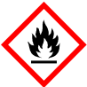
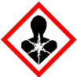
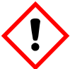
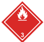
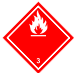
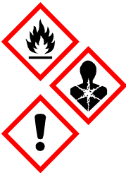
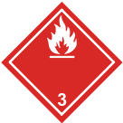

<!-- pagina: 1 -->

## FICHA DE DATOS DE SEGURIDAD

MADETEC POLIURETANO LACA SEMIMATE INCOLORO P-402

## Sección 1. Identificación

Nombre del producto

: MADETEC POLIURETANO LACA SEMIMATE INCOLORO P-402

## Uso recomendado de la sustancia química peligrosa o mezcla, y restricciones de uso

Uso profesional

Uso industrial

Uso por parte del consumidor

Uso del producto :

Datos del proveedor o fabricante :

Dirección de e-mail de la persona responsable de esta FDS :

Número de teléfono en caso de emergencia :

Usos identificados

## Usos contraindicados

- Recubrimiento base disolvente para uso interior y exterior.

Autopista Medellín Bogotá Km 37 Vía Belén Rionegro Km 1 054040 Rionegro - Antioquia - Colombia 01 8000 111 247 Medellín 604 325 2523

[PSRA.southamerica@akzonobel.com](mailto:PSRA.southamerica@akzonobel.com)

018000111247

## Sección 2. Identificación de los peligros

## INEN 2266:2013:

La clasificación de este producto ha sido realizada según la NORMA TÉCNICA ECUATORIANA NTE INEN 2266: 2013.

Clasificación de la sustancia química peligrosa o mezcla :

Ingredientes de toxicidad :

desconocida

Ingredientes de

ecotoxicidad desconocida

: 0%

LÍQUIDOS INFLAMABLES - Categoría 3 TOXICIDAD AGUDA (dérmica) - Categoría 5 IRRITACIÓN CUTÁNEA - Categoría 2 IRRITACIÓN OCULAR - Categoría 2A MUTAGENICIDAD EN CÉLULAS GERMINALES - Categoría 1B CARCINOGENICIDAD - Categoría 1B TOXICIDAD ESPECÍFICA DE ÓRGANOS BLANCO (EXPOSICIÓN ÚNICA)

(Irritación de las vías respiratorias) - Categoría 3

0%

## Elementos de las etiquetas del SGA

Pictogramas de peligro :

<!-- pagina: 2 -->

## Sección 2. Identificación de los peligros

Palabra de advertencia

:

Indicaciones de peligro :

## Consejos de prudencia

## Prevención

Peligro  
H226 - Líquido y vapores inflamables.  
H313 - Puede ser nocivo en contacto con la piel.  
H315 - Provoca irritación cutánea.  
H319 - Provoca irritación ocular grave.  
H335 - Puede irritar las vías respiratorias.  
H340 - Puede provocar defectos genéticos.  
H350 - Puede provocar cáncer.  
P201 - Procurarse las instrucciones antes del uso.  
P280 - Usar guantes de protección, ropa de protección e equipo de protección para la cara o los ojos.  
P210 - Mantener alejado del calor, chispas, llamas al descubierto, superficies calientes y otras fuentes de ignición. No fumar.  
P261 - Evitar respirar vapor.  
P264 - Lavarse cuidadosamente las manos después de la manipulación.  
P308 + P313 - En caso de exposición demostrada o supuesta: Consultar a un médico.  
- **Intervención/Respuesta:** P304 + P312 - En caso de inhalación: Llamar a un centro de toxicología o a un médico si la persona se siente mal. P362 + P364 - Quitar la ropa contaminada y lavarla antes de volverla a usar. P302 + P312 + P352 - En caso de contacto con la piel: Llamar a un centro de toxicología o a un médico si la persona se siente mal. Lavar con abundante agua. P305 + P351 + P338 - En caso de contacto con los ojos: Enjuagar con agua cuidadosamente durante varios minutos. Quitar los lentes de contacto, cuando estén presentes y pueda hacerse con facilidad. Proseguir con el lavado. P337 + P313 - Si la irritación ocular persiste: Consultar a un médico.  
- **Almacenamiento:** P403 + P233 - Almacenar en un lugar bien ventilado. Mantener el recipiente herméticamente cerrado. P403 + P235 - Mantener fresco. P501 - Eliminar el contenido y el recipiente en conformidad con las reglamentaciones locales, regionales, nacionales e internacionales.  
- **Eliminación:** No se conoce ninguno.  
- **Otros peligros que no contribuyen en la clasificación:**

## Sección 3. Composición / información sobre los componentes

- **Sustancia/mezcla:** Mezcla  
- **Otros medios de identificación:** No disponible.

| Nombre de ingrediente                                                                                                                           | %         | Número CAS   |
|-------------------------------------------------------------------------------------------------------------------------------------------------|-----------|--------------|
| Xilenos, mezcla isómeros Etilbenceno Acetato de n-butilo Acetato de isobutilo Acetato de 1-metil-2-metoxietilo Tolueno sebacato de Nafta VM y P | ≥25 - ≤40 | 1330-20-7    |
|                                                                                                                                                 | <10       | 100-41-4     |
|                                                                                                                                                 | ≤10       | 123-86-4     |
|                                                                                                                                                 | ≤3        | 110-19-0     |
|                                                                                                                                                 | ≤3        | 108-65-6     |
|                                                                                                                                                 | ≤0.3      | 108-88-3     |
| bis(1,2,2,6,6-pentametil-4-piperidilo)                                                                                                          | <0.25     | 41556-26-7   |
|                                                                                                                                                 | ≤0.3      | 8032-32-4    |

No hay ningún ingrediente adicional presente que, bajo el conocimiento actual del proveedor y en las concentraciones aplicables, sea clasificado como de riesgo para la salud o el medio ambiente y por lo tanto deban ser reportados en esta sección.

Los límites de exposición laboral, en caso de existir, figuran en la sección 8.

<!-- pagina: 3 -->

## Sección 4. Primeros auxilios

## Descripción de los primeros auxilios

| Contacto con los ojos   | : Lave abundantemente con agua por lo menos 15 minutos, levantando los párpados superior e inferior de vez en cuando. Verificar si la víctima lleva lentes de contacto y en este caso, retirárselas. Procurar atención médica.                                                                                                                                                                                                                                                                                                                                                                                                                                                                                                                                                                                                                                                                                                                      |
|-------------------------|-----------------------------------------------------------------------------------------------------------------------------------------------------------------------------------------------------------------------------------------------------------------------------------------------------------------------------------------------------------------------------------------------------------------------------------------------------------------------------------------------------------------------------------------------------------------------------------------------------------------------------------------------------------------------------------------------------------------------------------------------------------------------------------------------------------------------------------------------------------------------------------------------------------------------------------------------------|
| Por inhalación          | : Procurar atención médica. Si es necesario, llame a un Centro de Control de Envenenamiento o a un médico. Transportar la víctima al aire libre y mantenerla en reposo en una posición que le facilite la respiración. Si se sospecha que los vapores continúan presentes, la persona encargada del rescate deberá usar una máscara adecuada o un aparato de respiración autónoma. Si no hay respiración, ésta es irregular u ocurre un paro respiratorio, el personal capacitado debe proporcionar respiración artificial u oxígeno. Puede ser peligroso para la persona que proporcione ayuda dar respiración boca a boca. Si está inconsciente, coloque en posición de recuperación y obtenga atención médica inmediatamente. Asegure una buena circulación de aire. Aflojar todo lo que pudiera estar apretado, como el cuello de una camisa, una corbata, un cinturón.                                                                         |
| Contacto con la piel    | : Procurar atención médica. Llamar a un Centro de Control de Envenenamiento o a un médico. Lave la piel contaminada con suficiente agua. Quítese la ropa y calzado contaminados. Lave bien la ropa contaminada con agua antes de quitársela, o use guantes. Continúe enjuagando por lo menos por 10 minutos. Las quemaduras químicas se deben tratar inmediatamente por un médico. Lavar la ropa antes de volver a usarla. Limpiar el calzado completamente antes de volver a usarlo. Obtenga atención médica si se produce irritación.                                                                                                                                                                                                                                                                                                                                                                                                             |
| Ingestión               | : Procurar atención médica. Llamar a un Centro de Control de Envenenamiento o a un médico. Lave la boca con agua. Retirar las prótesis dentales si es posible. Si se ha ingerido el material y la persona expuesta está consciente, proporcione cantidades pequeñas de agua para beber. Deténgase si la persona expuesta se siente descompuesta porque vomitar sería peligroso. No inducir al vómito a menos que lo indique expresamente el personal médico. En caso de vómito, se debe mantener la cabeza baja de manera que el vómito no entre en los pulmones. Las quemaduras químicas se deben tratar inmediatamente por un médico. No suministrar nada por vía oral a una persona inconsciente. Si está inconsciente, coloque en posición de recuperación y obtenga atención médica inmediatamente. Asegure una buena circulación de aire. Aflojar todo lo que pudiera estar apretado, como el cuello de una camisa, una corbata, un cinturón. |

## Síntomas y efectos más importantes, agudos o crónicos

## Efectos agudos potenciales en la salud

- **Contacto con los ojos:** Provoca irritación ocular grave.  
- **Por inhalación:** Puede irritar las vías respiratorias.  
- **Contacto con la piel:** Puede ser nocivo en contacto con la piel. Provoca irritación cutánea.  
- **Ingestión:** No se conocen efectos significativos o riesgos críticos.

## Signos/síntomas de sobreexposición

Contacto con los ojos

Por inhalación :

: Los síntomas adversos pueden incluir los siguientes:

dolor o irritación

lagrimeo

enrojecimiento

Los síntomas adversos pueden incluir los siguientes:

Contacto con la piel :

Ingestión :

irritación del tracto respiratorio

tos

Los síntomas adversos pueden incluir los siguientes:

irritación enrojecimiento

Ningún dato específico.

## Indicación de la necesidad de recibir atención médica inmediata y, en su caso, de tratamiento especial

Notas para el médico

: Tratar sintomáticamente. Contactar un especialista en tratamientos de envenenamientos inmediatamente si se ha ingerido o inhalado una gran cantidad.

<!-- pagina: 4 -->

## Sección 4. Primeros auxilios

## Tratamientos específicos

Protección del personal de primeros auxilios

:

:

No hay un tratamiento específico.

No se tomará ninguna medida que implique algún riesgo personal o que no contemple el entrenamiento adecuado. Si se sospecha que los vapores continúan presentes, la persona encargada del rescate deberá usar una máscara adecuada o un aparato de respiración autónoma. Puede ser peligroso para la persona que proporcione ayuda dar respiración boca a boca. Lave bien la ropa contaminada con agua antes de quitársela, o use guantes.

Vea la sección 11 para la Información Toxicológica

## Sección 5. Medidas contra incendios

## Medios de extinción

- **Medios de extinción apropiados:** Utilizar polvo químico seco, CO₂, agua pulverizada o espuma (neblina).  
- **Medios no apropiados de extinción:** No usar chorro de agua.  
- **Peligros específicos de la sustancia química peligrosa o mezcla:** Líquido y vapores inflamables. Los residuos líquidos que se filtran en el alcantarillado pueden causar un riesgo de incendio o de explosión. En caso de incendio o calentamiento, ocurrirá un aumento de presión y el recipiente estallará, con el riesgo de que ocurra una explosión.  
- **Productos de descomposición térmica peligrosos:** Los productos de descomposición pueden incluir los siguientes materiales: dióxido de carbono monóxido de carbono óxido/óxidos metálico/metálicos  
- **Medidas especiales que deberán seguir los grupos de combate contra incendio:** En caso de incendio, aísle rápidamente la zona evacuando a todas las personas de las proximidades del lugar del incidente. No se tomará ninguna medida que implique algún riesgo personal o que no contemple el entrenamiento adecuado. Desplazar los contenedores lejos del incendio si esto puede hacerse sin riesgo. Use agua pulverizada para refrigerar los envases expuestos al fuego.  
- **Equipo de protección especial para los bomberos:** Los bomberos deben llevar equipo de protección apropiado y un equipo de respiración autónomo con una máscara facial completa que opere en modo de presión positiva.

## Sección 6. Medidas que deben tomarse en caso de derrame o fuga accidental

## Precauciones personales, equipo de protección y procedimiento de emergencia

## Para personal de no emergencia

No se tomará ninguna medida que implique algún riesgo personal o que no contemple el entrenamiento adecuado. Evacuar los alrededores. No deje que entre el personal innecesario y sin protección. No toque o camine sobre el material derramado. Apagar todas las fuentes de ignición. No permitir el uso de bengalas, fumar, o el encendido de llamas en el área de peligro. Evite respirar vapor o neblina. Proporcione ventilación adecuada. Llevar un aparato de respiración apropiado cuando el sistema de ventilación sea inadecuado. Llevar puestos equipos de protección personal adecuados.  
- **Para el personal de respuesta a emergencias:** Si fuera necesario usar ropa especial para hacer frente al derrame, se tomará en cuenta la información de la Sección 8 sobre los materiales adecuados y no adecuados. Consultar también la información bajo "Para personal de no emergencia".  
- **Precauciones relativas al medio ambiente:** Evite la dispersión del material derramado, su contacto con el suelo, el medio acuático, los desagües y las alcantarillas. Informe a las autoridades pertinentes si el producto ha causado polución medioambiental (alcantarillas, canales, tierra o aire).

<!-- pagina: 5 -->

## Sección 6. Medidas que deben tomarse en caso de derrame o fuga accidental

## Métodos y materiales para la contención y limpieza de derrames o fugas

| Derrame pequeño   | :   | Detener la fuga si esto no presenta ningún riesgo. Retire los envases del área del derrame. Use herramientas a prueba de chispas y equipo a prueba de explosión. Diluir con agua y fregar si es soluble en agua. Alternativamente, o si es insoluble en agua, absorber con un material seco inerte y colocar en un contenedor de residuos adecuado. Disponga por medio de un contratista autorizado para la disposición.                                                                                                                                                                                                                                                                                                                                                                                                                                                                                                                               |
|-------------------|-----|--------------------------------------------------------------------------------------------------------------------------------------------------------------------------------------------------------------------------------------------------------------------------------------------------------------------------------------------------------------------------------------------------------------------------------------------------------------------------------------------------------------------------------------------------------------------------------------------------------------------------------------------------------------------------------------------------------------------------------------------------------------------------------------------------------------------------------------------------------------------------------------------------------------------------------------------------------|
| Gran derrame      | :   | Detener la fuga si esto no presenta ningún riesgo. Retire los envases del área del derrame. Use herramientas a prueba de chispas y equipo a prueba de explosión. Aproximarse al vertido en el sentido del viento. Evite la entrada en alcantarillas, canales de agua, sótanos o áreas reducidas. Trate los derrames en una planta de tratamiento de aguas residuales o proceda tal como se indica a continuación. Detener y recoger los derrames con materiales absorbentes no combustibles, como arena, tierra, vermiculita o tierra de diatomeas, y colocar el material en un envase para desecharlo de acuerdo con las normativas locales (ver la Sección 13). Disponga por medio de un contratista autorizado para la disposición. El material absorbente contaminado puede presentar el mismo riesgo que el producto derramado. Nota: Véase la Sección 1 para información de contacto de emergencia y la Sección 13 para eliminación de desechos. |

## Sección 7. Manejo y almacenamiento

## Precauciones que se deben tomar para garantizar un manejo seguro

| Medidas de protección                                                     | :   | Use el equipo de protección personal adecuado (vea la Sección 8). Evítese la exposición - recábense instrucciones especiales antes del uso. No manipular antes de haber leído y comprendido todas las precauciones de seguridad. No introducir en ojos o en la piel o ropa. No ingerir. Evite respirar vapor o neblina. Use sólo con ventilación adecuada. Llevar un aparato de respiración apropiado cuando el sistema de ventilación sea inadecuado. No entre en áreas de almacenamiento y espacios cerrados a menos que estén ventilados adecuadamente. Mantener en el recipiente original o en uno alternativo autorizado hecho de material compatible, conservar herméticamente cerrado cuando no esté en uso. Mantener alejado del calor, chispas, llamas al descubierto, o de cualquier otra fuente de ignición. Use equipo eléctrico (de ventilación, iluminación y manipulación de materiales) a prueba de explosiones. No utilizar herramientas que produzcan chispas. Evitar la acumulación de cargas electrostáticas. Los envases vacíos retienen resíduos del producto y pueden ser peligrosos. No vuelva a usar el envase.   |
|---------------------------------------------------------------------------|-----|--------------------------------------------------------------------------------------------------------------------------------------------------------------------------------------------------------------------------------------------------------------------------------------------------------------------------------------------------------------------------------------------------------------------------------------------------------------------------------------------------------------------------------------------------------------------------------------------------------------------------------------------------------------------------------------------------------------------------------------------------------------------------------------------------------------------------------------------------------------------------------------------------------------------------------------------------------------------------------------------------------------------------------------------------------------------------------------------------------------------------------------------|
| Orientaciones sobre higiene ocupacional general                           | :   | Está prohibido comer, beber o fumar en los lugares donde se manipula, almacena o trata este producto. Las personas que trabajan con este producto deberán lavarse las manos y la cara antes comer, beber o fumar. Quitar la ropa contaminada y el equipo de protección antes de entrar a las áreas de comedor. Véase también la Sección 8 acerca de la información adicional sobre las medidas higiénicas.                                                                                                                                                                                                                                                                                                                                                                                                                                                                                                                                                                                                                                                                                                                                 |
| Condiciones de almacenamiento seguro, incluida cualquier incompatibilidad | :   | Conservar de acuerdo con las normas locales. Almacenar en un área separada y homologada. Almacenar en el contenedor original protegido de la luz directa del sol en un área seca, fresca y bien ventilada, separado de materiales incompatibles (ver Sección 10) y comida y bebida. Guardar bajo llave. Eliminar todas las fuentes de ignición. Mantener separado de materiales oxidantes. Mantener el contenedor bien cerrado y sellado hasta el momento de usarlo. Los envases que han sido abiertos deben cerrarse cuidadosamente y mantenerse en posición vertical para evitar derrames. No almacenar en contenedores sin etiquetar. Utilícese un envase de seguridad adecuado para evitar la contaminación del medio ambiente. Consulte la Sección 10 para obtener información acerca de los materiales no compatibles previo al manejo o uso.                                                                                                                                                                                                                                                                                        |

<!-- pagina: 6 -->

## Sección 8. Controles de exposición / protección personal

## Parámetros de control

## Límites de exposición laboral

| Nombre de ingrediente    | Número de CAS   | Límites de exposición                                                                                                |
|--------------------------|-----------------|----------------------------------------------------------------------------------------------------------------------|
| Xilenos, mezcla isómeros | 1330-20-7       | (Estados Unidos, 1/2023). [p-xylene and ntaining p-xylene] Ototoxicante. m 8 horas. ACGIH TLV mixtures co TWA: 20 pp |
| Etilbenceno              | 100-41-4        | (Estados Unidos, 1/2023). Ototoxicante. m 8 horas. ACGIH TLV TWA: 20 pp                                              |
| Acetato de n-butilo      | 123-86-4        | (Estados Unidos, 1/2023). [Butyl acetates] ppm 15 minutos. m 8 horas. ACGIH TLV STEL: 150 TWA: 50 pp                 |
| Acetato de isobutilo     | 110-19-0        | (Estados Unidos, 1/2023). [Butyl acetates] ppm 15 minutos. m 8 horas. ACGIH TLV STEL: 150 TWA: 50 pp                 |
| Tolueno                  | 108-88-3        | (Estados Unidos, 1/2023). Ototoxicante. m 8 horas. ACGIH TLV TWA: 20 pp                                              |
| Nafta VM y P             | 8032-32-4       | (Estados Unidos). pm 8 horas. ACGIH TLV TWA: 300 p                                                                   |

## Controles técnicos apropiados

## Control de la exposición medioambiental

- : Use sólo con ventilación adecuada. Utilizar recintos de proceso, sistemas de ventilación locales, u otros procedimientos de ingeniería para mantener la exposición del obrero a los contaminantes aerotransportados por debajo de todos los límites recomendados o estatutarios. Los controles de ingeniería también deben mantener el gas, vapor o polvo por debajo del menor límite de explosión. Utilizar equipo de ventilación anti-explosión.
- : Emisiones de los equipos de ventilación o de procesos de trabajo deben ser evaluados para verificar que cumplen con los requisitos de la legislación de protección del medio ambiente. En algunos casos será necesario el uso de eliminadores de humo, filtros o modificaciones del diseño del equipo del proceso para reducir las emisiones a un nivel aceptable.

## Medidas de protección individual

## Medidas higiénicas

## Protección de los ojos y la cara

## Protección de la piel

- Protección de las manos Guantes impermeables y resistentes a productos químicos que cumplan con las normas aprobadas deben ser usados siempre que se manejen productos químicos si una evaluación del riesgo indica que es necesario. Teniendo en cuenta los parámetros especificados por el fabricante de los guantes, se debe verificar durante el uso si aún mantienen sus propiedades protectoras. Es preciso tener presente que el tiempo de penetración para el material de los guantes puede ser diferente en cada fabricante. En el caso de mezclas formadas por varias sustancias no se puede estimar con exactitud el periodo de tiempo de protección de los guantes. :
- : Lave las manos, antebrazos y cara completamente después de manejar productos químicos, antes de comer, fumar y usar el lavabo y al final del período de trabajo. Usar las técnicas apropiadas para remover ropa contaminada. Lavar las ropas contaminadas antes de volver a usarlas. Verifique que las estaciones de lavado de ojos y duchas de seguridad se encuentren cerca de las estaciones de trabajo.
- : Equipo protector ocular que cumpla con las normas aprobadas debe ser usado cuando una evaluación del riesgo indique que es necesario para evitar toda exposición a salpicaduras del líquido, lloviznas, gases o polvos. Si existe la posibilidad de contacto con el producto se debe usar el siguiente equipo de protección, a menos que la evaluación del riesgo exija un grado superior de protección: gafas protectoras contra salpicaduras químicas.

<!-- pagina: 7 -->

## Sección 8. Controles de exposición / protección personal

| Protección del cuerpo                | Antes de utilizar este producto se debe seleccionar equipo protector personal para el cuerpo basándose en la tarea a ejecutar y los riesgos involucrados y debe ser aprobado por un especialista. Cuando existe riesgo de ignición debido a la electricidad estática, se requiere el uso de ropa antiestática de protección. Para obtener el máximo nivel de protección contra descargas electrostáticas es preciso usar overoles, botas y guantes antiestáticos. :                                                                                                                                                                                                                                    |
|--------------------------------------|--------------------------------------------------------------------------------------------------------------------------------------------------------------------------------------------------------------------------------------------------------------------------------------------------------------------------------------------------------------------------------------------------------------------------------------------------------------------------------------------------------------------------------------------------------------------------------------------------------------------------------------------------------------------------------------------------------|
| Otro tipo de protección para la piel | : Antes de manipular este producto se debe elegir el calzado apropiado y cualquier otra medida adicional de protección de la piel basadas en la tarea que se realice y los riesgos asociados, para lo cual se contará con la aprobación de un especialista.                                                                                                                                                                                                                                                                                                                                                                                                                                            |
| Protección de las vías respiratorias | : Con base en el riesgo y el potencial de la exposición, seleccione un respirador que cumpla la norma o la certificación apropiada. Los respiradores se deben usar de acuerdo con un programa de protección respiratoria para asegurar el ajuste adecuado, la capacitación y otros aspectos importantes de uso. Wear a respirator conforming to EN140 with type A/P2 filter or better. El lijado en seco, el cortado con llama y/o el soldado de películas secas de pintura producirá polvo y/o humos nocivos. Un lijado o matizado húmedos son preferibles si es posible. Si no puede evitarse la exposición por la ventilación de extracción debe usarse adecuado equipo de protección respiratoria. |

## Sección 9. Propiedades físicas y químicas y características de seguridad

Las condiciones de la medición de todas las propiedades son a temperatura y presión estándares, a menos que se indique lo contrario.

## Apariencia

- **Estado físico:**  
- **Color:** Incoloro.  
- **Olor:** Característico.  
- **Umbral del olor:** No disponible.  
- **pH:** No disponible.  
- **Punto de fusión/punto de congelación:** No disponible.  
- **Punto de ebullición, punto:** 126°C (258.8°F)  
- **de ebullición inicial e intervalo de ebullición:**  
- **Punto de inflamación:** Vaso cerrado: 24°C (75.2°F)  
- **Velocidad de evaporación:** No disponible.  
- **Inflamabilidad:** No disponible.  
- **Límite superior e inferior de explosión:** Rango máximo conocido: Punto mínimo: 2.4% Punto maximo: 10.5% (Acetato de isobutilo)  
- **Presión de:**  
- **vapor Líquido.:**

*Imagen asociada a la tabla #/tables/6: imagen contenida en el área de la tabla en la página 7 (100% de su área).*

| ASTM D 5191 - Nombre de ingrediente   |   Presión del vapor a 20 ˚C - mm Hg |   Presión del vapor a 20 ˚C - kPa |
|---------------------------------------|-------------------------------------|-----------------------------------|
| Acetato de isobutilo                  |                            15.75134 |                               2.1 |
| Acetato de n-butilo                   |                            11.25096 |                               1.5 |
| Etilbenceno                           |                             9.30076 |                               1.2 |

- **Densidad de vapor relativa:** No disponible.  
- **Densidad:** 1.008 g/cm³  
- **Solubilidad(es):**

| Medio     | Resultado                  |
|-----------|----------------------------|
| agua fría | No soluble [OECD (TG 105)] |

<!-- pagina: 8 -->

## Sección 9. Propiedades físicas y químicas y características de seguridad

Coeficiente de partición: noctanol/agua :

Temperatura de ignición espontánea :

| Nombre de ingrediente            |   °C |    °F |
|----------------------------------|------|-------|
| Acetato de 1-metil-2-metoxietilo |  333 | 631.4 |
| Acetato de n-butilo              |  415 |   779 |
| Acetato de isobutilo             |      |       |

430  
- **Temperatura de descomposición No aplicable. Viscosidad:** No disponible.

Características de las partículas

806  
Cinemática (temperatura ambiente): 440 mm 2 /s (440 cSt) Cinemática (40°C (104°F)): 134 mm 2 /s (134 cSt)  
- **Tamaño mediano de partículas:** No aplicable.  
- **Porcentaje de partículas con diámetro aerodinámico ≤10 μm:** 0

## Sección 10. Estabilidad y reactividad

Reactividad

- : No existen resultados específicos de ensayos respecto a la reactividad del este producto o sus ingredientes.

- **Estabilidad química:** El producto es estable.  
- **Posibilidad de reacciones peligrosas:** En condiciones normales de almacenamiento y uso, no ocurre reacción peligrosa.  
- **Condiciones que deberán evitarse:** Evitar todas las fuentes posibles de ignición (chispa o llama). No someta a presión, corte, suelde, suelde con latón, taladre, esmerile o exponga los envases al calor o fuentes térmicas.  
- **Materiales incompatibles:** Reactivo o incompatible con los siguientes materiales: materiales oxidantes  
- **Productos de descomposición peligrosos:** Bajo condiciones normales de almacenamiento y uso, no se deben producir productos de descomposición peligrosos.

## Sección 11. Información toxicológica

## Información sobre efectos toxicológicos

## Toxicidad aguda

| Nombre de producto o ingrediente | Resultado | Especies | Dosis | Exposición |
|---|---|---|---|---|
| Xilenos, mezcla isómeros | DL50 Oral DL50 Subcutánea CL50 Por inhalación Gas. | Rata Rata Conejo | 4300 mg/kg 1700 mg/kg 4000 ppm | - - 4 horas |
| Etilbenceno | CL50 Por inhalación Vapor CL50 Por inhalación Vapor DL50 Cutánea DL50 Cutánea DL50 Intraperitoneal DL50 Oral | Ratón Rata Conejo Conejo Ratón Rata | 35500 mg/m³ 55000 mg/m³ >5000 mg/kg 17800 uL/kg 2624 uL/kg 3500 mg/kg | 2 horas 2 horas - - - - |

*Tabla reconstruida por posición de renglones: Docling había fusionado sus filas (ver data/metadata/tablas_reconstruidas.csv).*

Versión : 2

: 28-8-2025 Fecha de la edición anterior : 17-1-2025

<!-- pagina: 9 -->

## Sección 11. Información toxicológica

| Acetato de n-butilo Acetato de isobutilo Tolueno Nafta VM y P   | DL50 Oral DL50 Oral DL50 Cutánea DL50 Oral DL50 Oral CL50 Por inhalación Vapor DL50 Cutánea DL50 Intraperitoneal DL50 Intravenosa DL50 Oral DL50 Subcutánea CL50 Por inhalación Gas. DL50 Intravenosa   | Rata Rata Conejo Conejo Rata Rata Conejo Rata Rata Rata Ratón Rata Ratón   | 3500 mg/kg 10768 mg/kg >17400 mg/kg 4763 mg/kg 13400 mg/kg 49 g/m³ 14100 uL/kg 1332 mg/kg 1960 mg/kg 636 mg/kg 2250 mg/kg 3400 ppm 40 mg/kg   | - - - - - 4 horas - - - - - 4 horas -   |
|-----------------------------------------------------------------|---------------------------------------------------------------------------------------------------------------------------------------------------------------------------------------------------------|----------------------------------------------------------------------------|-----------------------------------------------------------------------------------------------------------------------------------------------|-----------------------------------------|

## Irritación/Corrosión

| Nombre de producto o ingrediente   | Resultado                                                                                                                                       | Especies                                                                                                                    | Puntuación                          | Exposición                                                                                                                                                                                                | Observación                         |
|------------------------------------|-------------------------------------------------------------------------------------------------------------------------------------------------|-----------------------------------------------------------------------------------------------------------------------------|-------------------------------------|-----------------------------------------------------------------------------------------------------------------------------------------------------------------------------------------------------------|-------------------------------------|
| Xilenos, mezcla isómeros           | Ojos - Irritante leve Ojos - Irritante fuerte Piel - Irritante leve Piel - Irritante moderado Piel - Irritante moderado Ojos - Irritante fuerte | Conejo Conejo Rata Conejo Conejo Conejo Conejo Conejo Conejo Conejo Conejo Conejo Conejo Conejo Conejo Conejo Conejo Conejo | - - - - - - - - - - - - - - - - - - | 87 mg 24 horas 5 mg 8 horas 60 Ul 100 % 24 horas 500 mg 500 mg 24 horas 15 mg 100 mg 24 horas 500 mg 24 horas 500 mg 500 mg 24 horas 500 mg 0.5 minutos 100 mg 870 ug 24 horas 2 mg 435 mg 24 horas 20 mg | - - - - - - - - - - - - - - - - - - |
| Etilbenceno                        | Piel - Irritante leve                                                                                                                           |                                                                                                                             |                                     |                                                                                                                                                                                                           |                                     |
| Acetato de n-butilo                | Ojos - Irritante moderado Piel - Irritante moderado                                                                                             |                                                                                                                             |                                     |                                                                                                                                                                                                           |                                     |
| Acetato de isobutilo               | Ojos - Irritante moderado Piel - Irritante leve Piel - Irritante moderado                                                                       |                                                                                                                             |                                     |                                                                                                                                                                                                           |                                     |
| Tolueno                            | Ojos - Irritante leve Ojos - Irritante leve Ojos - Irritante fuerte Piel - Irritante leve Piel - Irritante moderado Piel - Irritante moderado   |                                                                                                                             |                                     | 500 mg                                                                                                                                                                                                    |                                     |

## Sensibilización cutánea o respiratoria

No disponible.

## Mutagenicidad

No disponible.

## Carcinogenicidad

No disponible.

## Toxicidad reproductiva

| Nombre de producto o ingrediente   | Toxicidad materna   | Fertilidad   | Tóxico para el desarrollo   | Especies   | Dosis                       | Exposición   |
|------------------------------------|---------------------|--------------|-----------------------------|------------|-----------------------------|--------------|
| Tolueno                            | -                   | -            | Positivo                    | Rata       | Por inhalación: 2261 mg/ m³ | -            |

## Teratogenicidad

<!-- pagina: 10 -->

## Sección 11. Información toxicológica

No disponible.

## Toxicidad específica de órganos blanco (exposición única)

| Nombre                           | Categoría   | Ruta de exposición   | Órganos vitales                      |
|----------------------------------|-------------|----------------------|--------------------------------------|
| Xilenos, mezcla isómeros         | Categoría 3 | -                    | Irritación de las vías respiratorias |
| Acetato de n-butilo              | Categoría 3 | -                    | Efecto narcótico                     |
| Acetato de isobutilo             | Categoría 3 | -                    | Efecto narcótico                     |
| Acetato de 1-metil-2-metoxietilo | Categoría 3 | -                    | Efecto narcótico                     |
| Tolueno                          | Categoría 3 | -                    | Efecto narcótico                     |

## Toxicidad específica de órganos blanco (exposiciones repetidas)

| Nombre              | Categoría               | Ruta de exposición   | Órganos vitales                           |
|---------------------|-------------------------|----------------------|-------------------------------------------|
| Etilbenceno Tolueno | Categoría 2 Categoría 2 | - inhalación         | órganos auditivos cerebral nervous system |

## Peligro de aspiración

| Nombre                                                    | Resultado                                                                                                                                           |
|-----------------------------------------------------------|-----------------------------------------------------------------------------------------------------------------------------------------------------|
| Xilenos, mezcla isómeros Etilbenceno Tolueno Nafta VM y P | PELIGRO POR ASPIRACIÓN - Categoría 1 PELIGRO POR ASPIRACIÓN - Categoría 1 PELIGRO POR ASPIRACIÓN - Categoría 1 PELIGRO POR ASPIRACIÓN - Categoría 1 |

Información sobre las posibles vías de ingreso

: No disponible.

## Efectos agudos potenciales en la salud

- **Contacto con los ojos:** Provoca irritación ocular grave.  
- **Por inhalación:** Puede irritar las vías respiratorias.  
- **Contacto con la piel:** Puede ser nocivo en contacto con la piel. Provoca irritación cutánea.  
- **Ingestión:** No se conocen efectos significativos o riesgos críticos.

## Síntomas relacionados con las características físicas, químicas y toxicológicas

- **Contacto con los ojos:** Los síntomas adversos pueden incluir los siguientes: dolor o irritación lagrimeo enrojecimiento  
- **Por inhalación:** Los síntomas adversos pueden incluir los siguientes:  
- **Contacto con la piel:**  
- **Ingestión irritación del tracto respiratorio tos Los síntomas adversos pueden incluir los siguientes:** irritación enrojecimiento Ningún dato específico.

## Efectos inmediatos y retardados, así como efectos crónicos producidos por una exposición a corto y largo plazo

## Exposición a corto plazo

- **Efectos potenciales inmediatos:** No disponible.  
- **Efectos potenciales retardados:** No disponible.

## Exposición a largo plazo

<!-- pagina: 11 -->

## Sección 11. Información toxicológica

- **Efectos potenciales inmediatos:** No disponible.  
- **Efectos potenciales retardados:** No disponible.

## Efectos crónicos potenciales en la salud

- **No disponible.:**  
- **Generales:** No se conocen efectos significativos o riesgos críticos.  
- **Carcinogenicidad:** Puede provocar cáncer. El riesgo de cáncer depende de la duración y el grado de exposición.  
- **Mutagenicidad:** Puede provocar defectos genéticos.  
- **Toxicidad reproductiva:** No se conocen efectos significativos o riesgos críticos.

## Medidas numéricas de toxicidad (tales como estimaciones de toxicidad aguda)

## Estimaciones de toxicidad aguda

| Nombre de producto o ingrediente   | Oral (mg/ kg)   | Cutánea (mg/kg)   | Inhalación (gases) (ppm)   |   Inhalación (vapores) (mg/l) | Inhalación (polvos y nieblas) (mg/l)   |
|------------------------------------|-----------------|-------------------|----------------------------|-------------------------------|----------------------------------------|
| Producto tal y como suministrado   | N/A             | 3107.5            | N/A                        |                          25.2 | N/A                                    |
| Xilenos, mezcla isómeros           | N/A             | 1100              | N/A                        |                            11 | N/A                                    |
| Etilbenceno                        | N/A             | N/A               | N/A                        |                            11 | N/A                                    |

## Sección 12. Información ecotoxicológica

## Toxicidad

| Nombre de producto o ingrediente | Resultado | Especies | Exposición |
|---|---|---|---|
| Xilenos, mezcla isómeros | Agudo EC50 90 mg/l Agua fresca Agudo CL50 8.5 ppm Agua de mar Agudo CL50 8500 µg/l Agua de mar Agudo CL50 16940 µg/l Agua fresca Agudo CL50 15700 µg/l Agua fresca Agudo CL50 20870 µg/l Agua fresca Agudo CL50 19000 µg/l Agua fresca Agudo CL50 13400 µg/l Agua fresca | Crustáceos - Cypris subglobosa Crustáceos - Palaemonetes pugio - Adulto Crustáceos - Palaemonetes pugio Pez - Carassius auratus Pez - Lepomis macrochirus - Juvenil (Nuevo, Cría, Destetado) Pez - Lepomis macrochirus Pez - Lepomis macrochirus Pez - Pimephales promelas | 48 horas 48 horas 48 horas 96 horas 96 horas 96 horas 96 horas 96 horas |
| Etilbenceno | Agudo EC50 4600 µg/l Agua fresca Agudo EC50 5400 µg/l Agua fresca Agudo EC50 3600 µg/l Agua fresca Agudo EC50 4900 µg/l Agua de mar Agudo EC50 7700 µg/l Agua de mar Agudo EC50 6.53 mg/l Agua de mar Agudo EC50 13.3 mg/l Agua de mar Agudo EC50 2.97 mg/l Agua fresca Agudo EC50 2.93 mg/l Agua fresca Agudo CL50 8.78 mg/l Agua de mar | Algas - Pseudokirchneriella subcapitata Algas - Pseudokirchneriella subcapitata Algas - Pseudokirchneriella subcapitata Algas - Skeletonema costatum Algas - Skeletonema costatum Crustáceos - Artemia sp. - Nauplio Crustáceos - Artemia sp. - Nauplio Dafnia - Daphnia magna - Neonato Dafnia - Daphnia magna - Neonato Crustáceos - Artemia sp. - | 72 horas 72 horas 96 horas 72 horas 96 horas 48 horas 48 horas 48 horas 48 horas 48 horas |

*Tabla reconstruida por posición de renglones: Docling había fusionado sus filas (ver data/metadata/tablas_reconstruidas.csv).*

<!-- pagina: 12 -->

| Sección 12. Información ecotoxicológica |  |  |  |
|---|---|---|---|
| Acetato de n-butilo | Agudo CL50 13.3 mg/l Agua de mar Agudo CL50 40000 µg/l Agua de mar Agudo CL50 18.4 mg/l Agua fresca Agudo CL50 13.9 mg/l Agua fresca Agudo CL50 75000 µg/l Agua fresca Agudo CL50 5100 µg/l Agua de mar Agudo CL50 4.3 ul/L Agua de mar Agudo CL50 4200 µg/l Agua fresca Agudo CL50 9090 µg/l Agua fresca Agudo CL50 9100 µg/l Agua fresca Agudo CL50 32 mg/l Agua de mar Agudo CL50 62000 µg/l Agua fresca | Nauplio Crustáceos - Artemia sp. - Nauplio Crustáceos - Cancer magister - Zoea Dafnia - Daphnia magna - Neonato Dafnia - Daphnia magna - Neonato Dafnia - Daphnia magna Pez - Menidia menidia Pez - Morone saxatilis - Juvenil (Nuevo, Cría, Destetado) Pez - Oncorhynchus mykiss Pez - Pimephales promelas Pez - Pimephales promelas Crustáceos - Artemia salina Pez - Danio rerio | 48 horas 48 horas 48 horas 48 horas 48 horas 96 horas 96 horas 96 horas 96 horas 96 horas 48 horas 96 horas |
| Tolueno | Agudo EC50 12500 µg/l Agua fresca Agudo EC50 16500 µg/l Agua fresca Agudo EC50 11600 µg/l Agua fresca Agudo EC50 6.88 mg/l Agua fresca Agudo EC50 6.56 mg/l Agua fresca Agudo EC50 19600 µg/l Agua fresca Agudo EC50 6000 µg/l Agua fresca Agudo EC50 6780 µg/l Agua fresca Agudo CL50 56.3 ppm Agua de mar Agudo CL50 15.5 ppm Agua de mar Agudo CL50 15500 µg/l Agua de mar Agudo CL50 86.3 mg/l Agua fresca Agudo CL50 6410 µg/l Agua de mar Agudo CL50 5500 µg/l Agua fresca Agudo CL50 5800 µg/l Agua fresca Agudo CL50 6780 µg/l Agua fresca Crónico NOEC 2 mg/l Agua fresca Crónico NOEC 1000 µg/l Agua fresca | Algas - Pseudokirchneriella subcapitata Crustáceos - Gammarus pseudolimnaeus - Adulto Crustáceos - Gammarus pseudolimnaeus - Adulto Dafnia - Daphnia magna - Neonato Dafnia - Daphnia magna - Neonato Dafnia - Daphnia magna - Larva Dafnia - Daphnia magna - Juvenil (Nuevo, Cría, Destetado) Pez - Oncorhynchus mykiss - Juvenil (Nuevo, Cría, Destetado) Crustáceos - Americamysis bahia Crustáceos - Palaemonetes pugio - Adulto Crustáceos - Palaemonetes pugio Dafnia - Daphnia magna - Neonato Pez - Oncorhynchus gorbuscha - Alevín Pez - Oncorhynchus kisutch - Alevín Pez - Oncorhynchus mykiss Pez - Oncorhynchus mykiss - Juvenil (Nuevo, Cría, Destetado) Dafnia - Daphnia magna Dafnia - Daphnia magna | 72 horas 48 horas 48 horas 48 horas 48 horas 48 horas 48 horas 96 horas 48 horas 48 horas 48 horas 48 horas 96 horas 96 horas 96 horas 96 horas 21 días 21 días |

*Tabla reconstruida por posición de renglones: Docling había fusionado sus filas (ver data/metadata/tablas_reconstruidas.csv).*

## Persistencia y degradabilidad

No disponible.

## Potencial de bioacumulación

<!-- pagina: 13 -->

## Sección 12. Información ecotoxicológica

| Nombre de producto o ingrediente                                                                                                     | LogPow                      | FBC                             | Potencial                          |
|--------------------------------------------------------------------------------------------------------------------------------------|-----------------------------|---------------------------------|------------------------------------|
| Xilenos, mezcla isómeros Etilbenceno Acetato de n-butilo Acetato de isobutilo Acetato de 1-metil- 2-metoxietilo Tolueno Nafta VM y P | 3.12 3.6 2.3 2.3 1.2 2.73 - | 8.1 a 25.9 - - - - 90 10 a 2500 | bajo bajo bajo bajo bajo bajo alta |

## Movilidad en el suelo

- **Coeficiente de partición tierra/agua (KOC):** No disponible.  
- **Otros efectos adversos:** No se conocen efectos significativos o riesgos críticos.

## Sección 13. Información relativa a la eliminación de los productos

Métodos de eliminación

- Se debe evitar o minimizar la generación de desechos cuando sea posible. La eliminación de este producto, sus soluciones y cualquier derivado deben cumplir siempre con los requisitos de la legislación de protección del medio ambiente y eliminación de desechos y todos los requisitos de las autoridades locales. Disponga del sobrante y productos no reciclables por medio de un contratista autorizado para la disposición. Los residuos no se deben tirar por la alcantarilla sin tratar a menos que sean compatibles con los requisitos de todas las autoridades con jurisdicción. Los envases desechados se deben reciclar. Sólo se deben contemplar la incineración o el enterramiento cuando el reciclaje no sea factible. Elimínense los residuos del producto y sus recipientes con todas las precauciones posibles. Se tendrá cuidado cuando se manipulen recipientes vacíos que no se hayan limpiado o enjuagado. Los envases vacíos o los revestimentos pueden retener residuos del producto. El vapor de los residuos del producto puede crear un ambiente altamente inflamable o explosivo dentro del recipiente. No recortar, soldar o triturar los recipientes usados a menos que se hayan limpiado a fondo en su interior. Evite la dispersión del material derramado, su contacto con el suelo, el medio acuático, los desagües y las alcantarillas. :

## Sección 14. Información relativa al transporte

*Texto OCR de la imagen (puede contener errores): 3*

*Imagen asociada a la tabla #/tables/20: imagen contenida en el área de la tabla en la página 13 (100% de su área).*

|                                   |         | Marítimo - IMDG   |
|-----------------------------------|---------|-------------------|
| Número ONU                        | UN1263  | UN1263            |
| Designación oficial de transporte | PINTURA | PINTURA           |
| Clase(s) relativas al transporte  | 3       | 3                 |
| Grupo de embalaje                 | III     | III               |
| Riesgos ambientales               | No.     | No.               |

## Información adicional

IMDG

Risk number 30

: Programas de emergencia F-E, _S-E_

*Texto OCR de la imagen (puede contener errores): 3*

*Imagen asociada a la tabla #/tables/20: imagen contenida en el área de la tabla en la página 13 (100% de su área).*

<!-- pagina: 14 -->

## Sección 14. Información relativa al transporte

Exención de líquido viscoso Este líquido viscoso Clase 3 no está sujeto a reglamentaciones en empaques de hasta 450 l según 2.3.2.5.  
- **Precauciones especiales para el usuario:** Transporte dentro de las instalaciones de usuarios: siempre transporte en recipientes cerrados que estén verticales y seguros. Asegurar que las personas que transportan el producto conocen qué hacer en caso de un accidente o derrame.  
- **Transporte a granel de acuerdo con instrumentos IMO:** No disponible.

## Sección 15. Información Reglamentaria

NTE INEN 2266: Norma Técnica Ecuatoriana - Transporte, Almacenamiento y Manejo de Materiales Peligrosos - Requisitos.

## Lista de inventario

- **Australia:** No determinado.  
- **Canadá:** No determinado.  
- **China:** No determinado.  
- **Unión Económica:** Inventario de la Federación Rusa: No determinado.  
- **Euroasiática:**  
- **Japón:** Inventario de Sustancias de Japón (CSCL): No determinado.  
- **Nueva Zelandia:** No determinado.  
- **Filipinas:** No determinado.  
- **República de Corea:** No determinado.  
- **Taiwán:** No determinado.  
- **Tailandia:** No determinado.  
- **Turquía:** No determinado.  
- **Estados Unidos:** No determinado.  
- **Vietnam Inventario de Sustancias de Japón (ISHL):** No determinado. No determinado.

Regulaciones Nacionales: El receptor debería verificar la posible existencia de regulaciones locales aplicables al producto químico.

NTE INEN 2266: Norma Técnica Ecuatoriana - Transporte, Almacenamiento y Manejo de Materiales Peligrosos - Requisitos.

## Sección 16. Otra informaciones

## Historial

- **Fecha de impresión:** 28-8-2025  
- **Fecha de emisión/ Fecha:** 28-8-2025  
- **de revisión:**  
- **Fecha de la edición:** 17-1-2025  
- **anterior:**  
- **Versión:** 2  
- **Unique ID:**  
- **Explicación de Abreviaturas:** ETA = Estimación de Toxicidad Aguda FBC = Factor de Bioconcentración SGA = Sistema Globalmente Armonizado IATA = Asociación de Transporte Aéreo Internacional IBC = Contenedor Intermedio para Productos a Granel IMDG = Código Marítimo Internacional de Mercancías Peligrosas Log Kow = logaritmo del coeficiente de reparto octanol/agua MARPOL = Convenio Internacional para Prevenir la Contaminación por los Buques,

<!-- pagina: 15 -->

## Sección 16. Otra informaciones

1973 con el Protocolo de 1978. ("Marpol" = polución marina) N/A = No disponible SGG = Grupo de segregación ONU = Organización de las Naciones Unidas

## Procedimiento utilizado para obtener la clasificación

| Clasificación                                                                                                                                                                                                                                                                                                                                  | Justificación                                                                                                                          |
|------------------------------------------------------------------------------------------------------------------------------------------------------------------------------------------------------------------------------------------------------------------------------------------------------------------------------------------------|----------------------------------------------------------------------------------------------------------------------------------------|
| LÍQUIDOS INFLAMABLES - Categoría 3 TOXICIDAD AGUDA (dérmica) - Categoría 5 IRRITACIÓN CUTÁNEA - Categoría 2 IRRITACIÓN OCULAR - Categoría 2A MUTAGENICIDAD EN CÉLULAS GERMINALES - Categoría 1B CARCINOGENICIDAD - Categoría 1B TOXICIDAD ESPECÍFICA DE ÓRGANOS BLANCO (EXPOSICIÓN ÚNICA) (Irritación de las vías respiratorias) - Categoría 3 | En base a datos de ensayos Método de cálculo Método de cálculo Método de cálculo Método de cálculo Método de cálculo Método de cálculo |

## Indica la información que ha cambiado desde la edición de la versión anterior. Aviso al lector

## PARA USO PROFESIONAL SOLAMENTE

NOTA IMPORTANTE: La información en esta hoja de datos no pretende ser exhaustiva y está basada en el estado actual de nuestro conocimiento y en las leyes vigentes : cualquier persona usando el producto para cualquier otro propósito que el especificamente recomendado en la hoja técnica de datos, sin primero obtener nuestra confirmación escrita de la idoneidad para el propósito pretendido, lo hará bajo su propia cuenta y riesgo. Es siempre responsabilidad del usuario seguir todos los pasos necesarios para cumplir toda la serie de demandas de las leyes locales y la legislación. Siempre lea la hoja de datos de seguridad y la hoja técnica de datos para este producto, si están disponibles. Todo consejo que demos o cualquier declaración hecha por nosotros acerca del producto (tanto en esta hoja técnica o en otro lugar distinto) es correcto según nuestro mejor conocimiento pero nosotros no tenemos control sobre la calidad o el estado del substrato ni de los muchos factores que afectan al uso y aplicación del producto. Por consiguiente, a menos que especificamente lo acordemos por escrito de otro modo, no aceptamos ninguna responsabilidad en todo lo que sea relacionado con las prestaciones técnicas del producto o por cualquier pérdida o daño emanado del uso del producto. Todos los productos suministrados y los consejos técnicos dados están sujetos a nuestros plazos de tiempo normales y condiciones de venta. Debería solicitar una copia de este documento y revisarlo cuidadosamente. La información contenida en esta hoja técnica está sujeta a modificación de cuando en cuando a las luces de la experencia y de nuestra política de continuo desarrollo. Es responsabilidad del usuario verificar que esta hoja técnica es la actual antes de usar el producto.

Las marcas de fábrica mencionadas en esta hoja técnica son marcas registradas o licenciatarias de Akzo Nobel.

<!-- pagina: 16 -->

*Texto del PDF en el área de la imagen (capa de texto, no OCR): Peligro*

Líquido y vapores inflamables. Puede ser nocivo en contacto con la piel. Provoca irritación cutánea. Provoca irritación ocular grave. Puede irritar las vías respiratorias. Puede provocar defectos genéticos. Puede provocar cáncer.

Procurarse las instrucciones antes del uso. Usar guantes de protección, ropa de protección e equipo de protección para la cara o los ojos. Mantener alejado del calor, chispas, llamas al descubierto, superficies calientes y otras fuentes de ignición. No fumar. Evitar respirar vapor. En caso de exposición demostrada o supuesta: Consultar a un médico. Almacenar en un lugar bien ventilado. Mantener fresco.

## Uso profesional Uso industrial

Código del producto SAMPLE_N2320018 00P-402-A-4

## Fabricante:

Autopista Medellín Bogotá Km 37 Vía Belén Rionegro Km 1 054040 Rionegro - Antioquia - Colombia

01 8000 111 247 Medellín 604 325 2523

[PSRA.southamerica@akzonobel. com](mailto:PSRA.southamerica@akzonobel.com)

Teléfono de emergencia: 018000111247

*Texto OCR de la imagen (puede contener errores): 3*

## Nombre químico

Xilenos, mezcla isómeros

Etilbenceno Acetato de n-butilo Acetato de isobutilo Acetato de 1-metil-2-metoxietilo

Tolueno

sebacato de bis(1,2,2,6,6-pentametil-4-piperidilo) Nafta VM y P

## Número de CAS

## Conc.

1330-20-7 100-41-4 123-86-4 110-19-0 108-65-6 108-88-3 41556-26-7

8032-32-4

UN1263 MADETEC POLIURETANO LACA SEMIMATE

≥25 - ≤40

<10 ≤10 ≤3 ≤3 ≤0.3 <0.25

≤0.3

INCOLORO P-402

<!-- pagina: 17 -->

<!-- encabezados y pies de pagina -->

## Encabezados y pies de página

*Texto del margen superior o inferior de las páginas, que Docling separa del cuerpo. Se lista una sola vez, con las páginas donde aparece.*

- [p. 1-7, 9-16] Versión : 2
- [p. 1-16] Fecha de emisión/Fecha de revisión
- [p. 1-7, 9-11, 13-16] : 28-8-2025 Fecha de la edición anterior : 17-1-2025
- [p. 2-16] MADETEC POLIURETANO LACA SEMIMATE INCOLORO P-402
- [p. 12] : 28-8-2025 Fecha de la edición anterior
- [p. 12] : 17-1-2025
