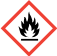
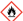
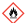
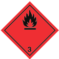
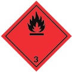

<!-- pagina: 1 -->

*Texto OCR de la imagen (puede contener errores): BLER | PINTURAS*

## Ficha de datos de seguridad

según Decreto 1496 de 2018 y Resolución 773 de 2021

## BARNIZ SOLAR

Emisión: 31/08/2020

Revisión: 23/09/2025

Versión: 3 (sustituye a 2)

## SECCIÓN 1: IDENTIFICACIÓN DEL PRODUCTO

- 1.1 Identificador SGA del producto:

BARNIZ SOLAR

Otros medios de identificación:

No relevante

## 1.2 Uso recomendado del producto químico y restricciones:

Usos pertinentes (Uso por el consumidor): Pintura

Usos pertinentes (Usuario profesional): Pintura

Usos pertinentes (Usuario industrial): Pintura

Usos desaconsejados: Todo aquel uso no especificado en este epígrafe ni en el epígrafe 7.3

## 1.3 Datos sobre el proveedor:

*Texto OCR de la imagen (puede contener errores): A*

COPIA CONTROLADA Pintubler de Colombia S.A. Kilómetro 1.8 Autopista Medellín. 250010 Bogotá - Cundinamarca - Colombia Tfno.: (+57) 601 6922626 Ext: 145 - Fax: (+57) 601 6922626 fichasdeseguridad@pinturasbler.com http://www.pinturasbler.com 1.4 Número de teléfono para emergencias: CISPROQUIM (57601) 2886012

SECCIÓN 2: IDENTIFICACIÓN DEL PELIGRO O PELIGROS

2.1 Clasificación de la sustancia o de la mezcla: SGA: La clasificación del producto se ha realizado conforme con al decreto 1496 de 2018 y la Resolución 773 de 2021, por el cual se adopta el Sistema Globalmente Armonizado de Clasificación y Etiquetado de Productos Químicos y se dictan otras disposiciones en materia de seguridad química. Acuático agudo. 3: Peligrosidad aguda para el medio ambiente acuático, Categoría 3, H402 Acuático crónico. 3: Peligrosidad crónica para el medio ambiente acuático, Categoría 3, H412 Carc. 1B: Carcinogenicidad, Categoría 1B, H350 Irrit. Cut. 2: Irritación cutánea, categoría 2, H315 Les. Oc. 1: Lesiones oculares graves, Categoría 1, H318 Liq. Infl. 3: Líquidos inflamables, Categoría 3, H226 Muta. 1B: Mutagenicidad en células germinales, Categoría 1B, H340 Repr. 1B: Tóxico para la reproducción, Categoría 1B, H360 Sens. Cut. 1A: Sensibilización cutánea, Categoría 1A, H317 Sens. Resp.1: Sensibilización respiratoria, Categoría 1, H334 STOT única 3: Toxicidad específica con efectos de somnolencia y vértigo (exposición única), Categoría 3, H336 Tox. Asp. 2: Peligro por aspiración, Categoría 2, H305 2.2 Elementos de las etiquetas del SGA, incluidos los consejos de prudencia: SGA: Peligro Indicaciones de peligro:

Acuático crónico. 3: H412 - Nocivo para los organismos acuáticos, con efectos nocivos duraderos.

Carc. 1B: H350 - Puede provocar cáncer.

Irrit. Cut. 2: H315 - Provoca irritación cutánea.

Les. Oc. 1: H318 - Provoca lesiones oculares graves.

Liq. Infl. 3: H226 - Líquido y vapores inflamables.

Muta. 1B: H340 - Puede provocar defectos genéticos.

Repr. 1B: H360 - Puede perjudicar la fertilidad o dañar al feto.

Sens. Cut. 1A: H317 - Puede provocar una reacción cutánea alérgica.

Sens. Resp.1: H334 - Puede provocar síntomas de alergia o asma o dificultades respiratorias si se inhala.

STOT única 3: H336 - Puede provocar somnolencia o vértigo.

Tox. Asp. 2: H305 - Puede ser nocivo en caso de ingestión y de penetración en las vías respiratorias.

Consejos de prudencia:

<!-- pagina: 2 -->

*Texto OCR de la imagen (puede contener errores): BLER | PINTURAS*

## Ficha de datos de seguridad

según Decreto 1496 de 2018 y Resolución 773 de 2021

## BARNIZ SOLAR

Emisión: 31/08/2020

Revisión: 23/09/2025

Versión: 3 (sustituye a 2)

## SECCIÓN 2: IDENTIFICACIÓN DEL PELIGRO O PELIGROS (continúa)

- P101: Si se necesita consultar a un médico, tener a mano el recipiente o la etiqueta del producto.
- P102: Mantener fuera del alcance de los niños.
- P210: Mantener alejado del calor, superficies calientes, chispas llamas al descubierto y otras fuentes de ignición. No fumar.
- P280: Usar guantes de protección/equipo de protección para la cara/ropa de protección/protección respiratoria/calzado de protección.

P305+P351+P338: EN CASO DE CONTACTO CON LOS OJOS: Enjuagar con agua cuidadosamente durante varios minutos.

Quitar las lentes de contacto cuando estén presentes y pueda hacerse con facilidad. Proseguir con el lavado.

- P501: Eliminar el contenido/recipiente mediante el sistema de recogida selectiva habilitado en su municipio.

## Sustancias que contribuyen a la clasificación

Nafta disolvente (petróleo), fracción alifática intermedia; Anhídrido ftálico; Bis(2-etilhexanoato) de cobalto; Ligroína

## 2.3 Otros peligros que no conducen a una clasificación:

No relevante

## SECCIÓN 3: COMPOSICIÓN/INFORMACIÓN SOBRE LOS COMPONENTES

## 3.1 Sustancias:

No relevante

## 3.2 Mezclas:

Descripción química: Mezcla de sustancias

Componentes:

De acuerdo al Decreto 1496 de 2018 y la Resolución 773 de 2021, el producto presenta:

| Identificación   | Identificación   | Nombre químico/clasificación                                                                                                                                                        | Concentración   |
|------------------|------------------|-------------------------------------------------------------------------------------------------------------------------------------------------------------------------------------|-----------------|
| CAS:             | 64742-88-7       | Nafta disolvente (petróleo), fracción alifática intermedia Acuático agudo. 3: H402; Acuático crónico. 4: H413; Liq. Infl. 3: H226; STOT única 3: H336; Tox. Asp. 2: H305 - Atención | 25 - <50 %      |
| CAS:             | 85-44-9          | Anhídrido ftálico Irrit. Cut. 2: H315; Les. Oc. 1: H318; Sens. Cut. 1: H317; Sens. Resp.1: H334; STOT única 3: H335; Tox. Agud. 4: H302 - Peligro                                   | 10 - <25 %      |
| CAS:             | 136-52-7         | Bis(2-etilhexanoato) de cobalto Acuático agudo. 1: H400; Acuático crónico. 3: H412; Carc. 2: H351; Irrit. oc. 2: H319; Repr. 1B: H360; Sens. Cut. 1A: H317 - Peligro                | <2,5 %          |
| CAS:             | 8032-32-4        | Ligroína Carc. 1B: H350; Liq. Infl. 3: H226; Muta. 1B: H340; Tox. Asp. 1: H304 - Peligro                                                                                            | <2,5 %          |
| CAS:             | 41556-26-7       | Sebacato de bis(1,2,2,6,6-pentametil-4-piperidilo) Acuático agudo. 1: H400; Acuático crónico. 1: H410; Sens. Cut. 1A: H317 - Atención                                               | <2,5 %          |
| CAS:             | 104810-47-1      | Acuático crónico. 2: H411; Sens. Cut. 1A: H317 - Atención                                                                                                                           | <2,5 %          |
| CAS:             | 104810-48-2      | Derivado del hidroxifenil-benzotriazol Acuático crónico. 2: H411; Sens. Cut. 1A: H317 - Atención                                                                                    | <2,5 %          |
| CAS:             | 96-29-7          | COPIA Derivado del hidroxifenil-benzotriazol Oxima de 2-butanona Carc. 2: H351; Les. Oc. 1: H318; Sens. Cut. 1: H317; Tox. Agud. 4: H312 - Peligro                                  | <2,5 %          |
| CAS:             | 82919-37-7       | Sebacato de metilo y 1,2,2,6,6-pentametil-4-piperidilo Acuático agudo. 1: H400; Acuático crónico. 1: H410; Sens. Cut. 1: H317 - Atención                                            | <2,5 %          |
| CAS:             | 108-31-6         | Anhídrido maleico Corr. Cut. 1B: H314; Les. Oc. 1: H318; Sens. Cut. 1A: H317; Sens. Resp.1: H334; STOT repe. 1: H372; Tox. Agud. 4: H302 - Peligro                                  | <2,5 %          |

COPIA CONTROLADA

*Imagen asociada a la tabla #/tables/0: imagen contenida en el área de la tabla en la página 2 (100% de su área).*

*Imagen asociada a la tabla #/tables/0: imagen contenida en el área de la tabla en la página 2 (100% de su área).*

*Imagen asociada a la tabla #/tables/0: imagen contenida en el área de la tabla en la página 2 (100% de su área).*

*Imagen asociada a la tabla #/tables/0: imagen contenida en el área de la tabla en la página 2 (100% de su área).*

*Imagen asociada a la tabla #/tables/0: imagen contenida en el área de la tabla en la página 2 (100% de su área).*

*Imagen asociada a la tabla #/tables/0: imagen contenida en el área de la tabla en la página 2 (100% de su área).*

*Imagen asociada a la tabla #/tables/0: imagen contenida en el área de la tabla en la página 2 (100% de su área).*

*Imagen asociada a la tabla #/tables/0: imagen contenida en el área de la tabla en la página 2 (100% de su área).*

*Imagen asociada a la tabla #/tables/0: imagen contenida en el área de la tabla en la página 2 (100% de su área).*

*Imagen asociada a la tabla #/tables/0: imagen contenida en el área de la tabla en la página 2 (100% de su área).*

*Imagen asociada a la tabla #/tables/0: imagen contenida en el área de la tabla en la página 2 (100% de su área).*

*Imagen asociada a la tabla #/tables/0: imagen contenida en el área de la tabla en la página 2 (100% de su área).*

*Imagen asociada a la tabla #/tables/0: imagen contenida en el área de la tabla en la página 2 (100% de su área).*

*Imagen asociada a la tabla #/tables/0: imagen contenida en el área de la tabla en la página 2 (100% de su área).*

*Imagen asociada a la tabla #/tables/0: imagen contenida en el área de la tabla en la página 2 (100% de su área).*

*Imagen asociada a la tabla #/tables/0: imagen contenida en el área de la tabla en la página 2 (100% de su área).*

Para ampliar información sobre la peligrosidad de las sustancias consultar las secciones 11, 12 y 16. La clasificación respecto Carcinogenicidad de las sustancias se ha establecido en función de las monografías de la IARC adecuándola al sistema de clasificación SGA, para información sobre la clasificación IARC consulte la sección 11.

## SECCIÓN 4: PRIMEROS AUXILIOS

## 4.1 Descripción de los primeros auxilios necesarios:

Los síntomas como consecuencia de una intoxicación pueden presentarse con posterioridad a la exposición, por lo que, en caso de duda, exposición directa al producto químico o persistencia del malestar solicitar atención médica, mostrándole la FDS de este producto.

*Imagen asociada a la tabla #/tables/0: imagen contenida en el área de la tabla en la página 2 (100% de su área).*

*Imagen asociada a la tabla #/tables/0: imagen contenida en el área de la tabla en la página 2 (100% de su área).*

*Imagen asociada a la tabla #/tables/0: imagen contenida en el área de la tabla en la página 2 (100% de su área).*

<!-- pagina: 3 -->

*Texto OCR de la imagen (puede contener errores): BLER | PINTURAS*

Ficha de datos de seguridad

según Decreto 1496 de 2018 y Resolución 773 de 2021

## BARNIZ SOLAR

Emisión: 31/08/2020

Revisión: 23/09/2025

Versión: 3 (sustituye a 2)

## SECCIÓN 4: PRIMEROS AUXILIOS (continúa)

## Por inhalación:

Sacar al afectado del lugar de exposición, suministrarle aire limpio y mantenerlo en reposo. En casos graves como parada cardiorespiratoria, se aplicarán técnicas de respiración artificial si se tiene la formación adecuada (masaje cardíaco, suministro de oxígeno, etc.) requiriendo asistencia médica inmediata.

## Por contacto con la piel:

Quitar la ropa y los zapatos contaminados, aclarar la piel o duchar al afectado si procede con abundante agua fría y jabón neutro. En caso de afección importante acudir al médico. Si el producto produce quemaduras o congelación, no se debe quitar la ropa debido a que podría empeorar la lesión producida si esta se encuentra pegada a la piel. En el caso de formarse ampollas en la piel, éstas nunca deben reventarse ya que aumentaría el riesgo de infección.

## Por contacto con los ojos:

COPIA CONTROLADA Enjuagar los ojos con abundante agua a temperatura ambiente al menos durante 15 minutos. Evitar que el afectado se frote o cierre los ojos. En el caso de que el accidentado use lentes de contacto, éstas deben retirarse siempre que no estén pegadas a los ojos, de otro modo podría producirse un daño adicional. En todos los casos, después del lavado, se debe acudir al médico lo más rápidamente posible con la FDS del producto. Por ingestión/aspiración: Requerir asistencia médica inmediata, mostrándole la FDS de este producto. No inducir al vómito, en el caso de que se produzca mantener inclinada la cabeza hacia delante para evitar la aspiración. En el caso de pérdida de consciencia no administrar nada por vía oral hasta la supervisión del médico. Enjuagar la boca y la garganta, ya que existe la posibilidad de que hayan sido afectadas en la ingestión. Mantener al afectado en reposo. 4.2 Síntomas/efectos más importantes, agudos o retardados: Los efectos agudos y retardados son los indicados en las secciones 2 y 11 de la FDS. 4.3 Indicación de la necesidad de recibir atención médica inmediata y, en su caso, de tratamiento especial: No relevante

SECCIÓN 5: MEDIDAS DE LUCHA CONTRA INCENDIOS

5.1 Medios de extinción apropiados: Medios de extinción apropiados: Extintor de espuma (AB), Extintor de Polvo Químico Seco (ABC), Extintor de dióxido de carbono (BC) Medios de extinción no apropiados: Agua a chorro 5.2 Peligros específicos del producto químico: Como consecuencia de la combustión o descomposición térmica se generan subproductos de reacción que pueden resultar altamente tóxicos y, consecuentemente, pueden presentar un riesgo elevado para la salud. 5.3 Medidas especiales que deben tomar los equipos de lucha contra incendios: En función de la magnitud del incendio puede hacerse necesario el uso de ropa protectora completa y equipo de respiración autónomo. Disponer de un mínimo de instalaciones de emergencia o elementos de actuación (mantas ignífugas, botiquín portátil,...). Disposiciones adicionales:

Actuar conforme el Plan de Emergencia Interior y las Fichas Informativas sobre actuación ante accidentes y otras emergencias. Suprimir cualquier fuente de ignición. En caso de incendio, refrigerar los recipientes y tanques de almacenamiento de productos susceptibles a inflamación, explosión o BLEVE como consecuencia de elevadas temperaturas. Evitar el vertido de los productos empleados en la extinción del incendio al medio acuático.

## SECCIÓN 6: MEDIDAS QUE DEBEN TOMARSE EN CASO DE VERTIDO ACCIDENTAL

## 6.1 Precauciones personales, equipo protector y procedimiento de emergencia:

## Para el personal que no forma parte de los servicios de emergencia:

Aislar las fugas siempre y cuando no suponga un riesgo adicional para las personas que desempeñen esta función. Evacuar la zona y mantener a las personas sin protección alejadas. Ante el contacto potencial con el producto derramado se hace obligatorio el uso de elementos de protección personal (ver sección 8 de la FDS). Evitar de manera prioritaria la formación de mezclas vapor-aire inflamables, ya sea mediante ventilación o el uso de un agente inertizante. Suprimir cualquier fuente de ignición. Eliminar las cargas electroestáticas mediante la interconexión de todas las superficies conductoras sobre las que se puede formar electricidad estática, y estando a su vez el conjunto conectado a tierra.

## Para el personal de emergencia:

<!-- pagina: 4 -->

*Texto OCR de la imagen (puede contener errores): BLER | PINTURAS*

Ficha de datos de seguridad

según Decreto 1496 de 2018 y Resolución 773 de 2021

## BARNIZ SOLAR

Emisión: 31/08/2020

Revisión: 23/09/2025

Versión: 3 (sustituye a 2)

## SECCIÓN 6: MEDIDAS QUE DEBEN TOMARSE EN CASO DE VERTIDO ACCIDENTAL (continúa)

Llevar puesto equipo de protección. Mantener alejadas las personas sin protección. Ver sección 8 de la FDS.

## 6.2 Precauciones relativas al medio ambiente:

Evitar a toda costa cualquier tipo de vertido al medio acuático. Contener adecuadamente el producto absorbido/recogido en recipientes herméticamente precintables. Notificar a la autoridad competente en el caso de exposición al público en general o al medioambiente.

## 6.3 Métodos y materiales para la contención y limpieza de vertidos:

Se recomienda:

Evitar la entrada del producto en desagües, alcantarillados o corrientes de agua. Absorber el vertido mediante arena o absorbente inerte y trasladarlo a un lugar seguro. No absorber en serrín u otros absorbentes combustibles. Recoger el producto en recipientes adecuados y gestionarlo de acuerdo a legislación vigente.

Vertidos en agua o mar:

lavarse las manos después de cada utilización, y despojarse de prendas de vestir y equipos de protección contaminados antes de entrar en las zonas para comer.

COPIA CONTROLADA Pequeños vertidos: Contener el derrame con barreras o equipos similares. Utilice absorbentes adecuados para su recogida y trate el residuo de acuerdo a la legislación vigente. Grandes vertidos: Si es posible, contenga el vertido en aguas abiertas mediante barreras u otros equipos similares. Si no es posible, procure controlar su extensión y recoja el producto con medios mecánicos adecuados. Consulte siempre a expertos antes de utilizar dispersantes y asegúrese de que dispone de las autorizaciones necesarias si se van a utilizar. Trate el residuo de acuerdo a la legislación vigente. 6.4 Referencias a otras secciones: Ver secciones 8 y 13.

SECCIÓN 7: MANIPULACIÓN Y ALMACENAMIENTO

7.1 Precauciones que se deben tomar para garantizar una manipulación segura: A.- Precauciones generales Cumplir con la legislación vigente en materia de prevención de riesgos laborales. Mantener los recipientes herméticamente cerrados. Controlar los derrames y residuos, eliminándolos con métodos seguros (sección 6 de la FDS). Evitar el vertido libre desde el recipiente. Mantener orden y limpieza donde se manipulen productos peligrosos. B.- Recomendaciones técnicas para la prevención de incendios y explosiones. Trasvasar en lugares bien ventilados, preferentemente mediante extracción localizada. Controlar totalmente los focos de ignición (teléfonos móviles, chispas,…) y ventilar en las operaciones de limpieza. Evitar la existencia de atmósferas peligrosas en el interior de recipientes, aplicando en lo posible sistemas de inertización. Trasvasar a velocidades lentas para evitar la generación de cargas electroestáticas. Ante la posibilidad de existencia de cargas electroestáticas: asegurar una perfecta conexión equipotencial, utilizar siempre tomas de tierras, no emplear ropa de trabajo de fibras acrílicas, empleando preferiblemente ropa de algodón y calzado conductor. Cumplir con los requisitos esenciales de seguridad para equipos y con las disposiciones mínimas para la protección de la seguridad y salud de los trabajadores. Consultar la sección 10 de la FDS sobre condiciones y materias que deben evitarse. C.- Recomendaciones técnicas para prevenir riesgos ergonómicos y toxicológicos. LAS MUJERES EMBARAZADAS NO DEBEN EXPONERSE A ESTE PRODUCTO. Manipular en lugares fijos que reúnan las debidas condiciones de seguridad (duchas de emergencia y lavaojos en las proximidades), empleando equipos de protección personal, en especial de cara y manos (ver sección 8 de la FDS). Limitar los trasvases manuales a recipientes de pequeñas cantidad. No comer, beber ni fumar en las zonas de trabajo

- D.- Recomendaciones técnicas para prevenir riesgos medioambientales

Debido a la peligrosidad de este producto para el medio ambiente se recomienda manipularlo dentro de un área que disponga de barreras de control de la contaminación en caso de vertido, así como disponer de material absorbente en las proximidades del mismo

## 7.2 Condiciones de almacenamiento seguro, incluidas cualesquiera incompatibilidades:

- A.- Requisitos de almacenamiento específicos
- B.- Condiciones generales de almacenamiento.

Temperatura mínima: 4 ºC

Temperatura máxima: 35 ºC

Tiempo máximo:

12 meses

Evitar fuentes de calor, radiación, electricidad estática y el contacto con alimentos. Para información adicional ver epígrafe 10.5

<!-- pagina: 5 -->

*Texto OCR de la imagen (puede contener errores): BLER | PINTURAS*

## Ficha de datos de seguridad

según Decreto 1496 de 2018 y Resolución 773 de 2021

## BARNIZ SOLAR

Emisión: 31/08/2020

Revisión: 23/09/2025

Versión: 3 (sustituye a 2)

## SECCIÓN 7: MANIPULACIÓN Y ALMACENAMIENTO (continúa)

## 7.3 Usos específicos finales:

Salvo las indicaciones ya especificadas no es preciso realizar ninguna recomendación especial en cuanto a los usos de este producto.

## SECCIÓN 8: CONTROLES DE EXPOSICIÓN/PROTECCIÓN PERSONAL

## 8.1 Parámetros de control:

Sustancias cuyos valores límite de exposición profesional han de controlarse en el ambiente de trabajo:

## OSHA (Tablas Z):

| Identificación - Anhídrido ftálico - CAS: 85-44-9 - Anhídrido maleico - CAS: 108-31-6   | Valores límite ambientales - 8-hour TWA PEL - Ceiling Values - TWA PEL - 8-hour TWA PEL - Ceiling Values - TWA - PEL   | Valores límite ambientales - 2 ppm - 0,25 ppm   | Valores límite ambientales - 12 mg/m³ - 1 mg/m³   |
|-----------------------------------------------------------------------------------------|------------------------------------------------------------------------------------------------------------------------|-------------------------------------------------|---------------------------------------------------|

| Identificación                  | Valores límite ambientales   |
|---------------------------------|------------------------------|
| Anhídrido ftálico               | TLV-TWA 1 ppm                |
| CAS: 85-44-9                    | TLV-STEL                     |
| Anhídrido maleico CAS: 108-31-6 | TLV-TWA 0,1 ppm TLV-STEL     |

| Pictograma                                       | EPP                                                         | Observaciones                                                                                                                                                                                                                                                                      |
|--------------------------------------------------|-------------------------------------------------------------|------------------------------------------------------------------------------------------------------------------------------------------------------------------------------------------------------------------------------------------------------------------------------------|
| Protección obligatoria de las vías respiratorias | Máscara autofiltrante para gases y vapores (Filtro tipo: A) | NOMATIVIDAD APLICABLE: NTC 1584, NTC 1589, NTC 3851 y NTC 1728. Reemplazar cuando se detecte olor o sabor del contaminante en el interior de la máscara o adaptador facial. Cuando el contaminante no tiene buenas propiedades de aviso se recomienda el uso de equipos aislantes. |

COPIA CONTROLADA ACGIH (2022): 8.2 Controles técnicos apropiados: A.- Medidas de protección individual, como equipo de protección personal (EPP) Realizar la identificación de los peligros y la valoración de los riesgos de acuerdo a la Guia técnica colombiana GTC 45. Como medida de prevención se recomienda la utilización de equipos de protección individual básicos. Para más información sobre los equipos de protección individual (almacenamiento, uso, limpieza, mantenimiento, clase de protección,…) consultar el folleto informativo facilitado por el fabricante del EPP. Las indicaciones contenidas en este punto se refieren al producto puro. Las medidas de protección para el producto diluido podrán variar en función de su grado de dilución, uso, método de aplicación, etc. Para determinar la obligación de instalación de duchas de emergencia y/o lavaojos en los almacenes se tendrá en cuenta la normativa referente al almacenamiento de productos químicos aplicable en cada caso. Para más información ver epígrafes 7.1 y 7.2 de la FDS. Toda la información aquí incluida es una recomendación siendo necesario su concreción por parte de los servicios de prevención de riesgos laborales al desconocer las medidas de prevención adicionales que la empresa pudiese disponer. B.- Protección respiratoria. C.- Protección específica de las manos.

| Pictograma                          | EPP                                                                                                   | Observaciones                                                                                                 |
|-------------------------------------|-------------------------------------------------------------------------------------------------------|---------------------------------------------------------------------------------------------------------------|
| Protección obligatoria de las manos | Guantes de protección química (Material: Nitrilo, Tiempo de penetración: > 480 min, Espesor: 0,11 mm) | NORMATIVIDAD APLICABLE: NTC 3398, EN 374 y EN420. Reemplazar los guantes ante cualquier indicio de deterioro. |

Dado que el producto es una mezcla de diferentes materiales, la resistencia del material de los guantes no se puede calcular de antemano con total fiabilidad y por lo tanto tiene que ser controlados antes de su aplicación.

- D.- Protección ocular y facial

<!-- pagina: 6 -->

*Texto OCR de la imagen (puede contener errores): BLER | PINTURAS*

## Ficha de datos de seguridad

según Decreto 1496 de 2018 y Resolución 773 de 2021

## BARNIZ SOLAR

Emisión: 31/08/2020

Revisión: 23/09/2025

Versión: 3 (sustituye a 2)

## SECCIÓN 8: CONTROLES DE EXPOSICIÓN/PROTECCIÓN PERSONAL (continúa)

| Pictograma                        | EPP             | Observaciones                                                                                                                                                                                                 |
|-----------------------------------|-----------------|---------------------------------------------------------------------------------------------------------------------------------------------------------------------------------------------------------------|
| Protección obligatoria de la cara | Pantalla facial | NORMATIVIDAD APLICABLE: NTC 1825, NTC 1826 y ANSI Z87.1. Limpiar a diario y desinfectar periódicamente de acuerdo a las instrucciones del fabricante. Se recomienda su uso en caso de riesgo de salpicaduras. |

## E.- Protección corporal

*Texto del PDF en el área de la imagen (capa de texto, no OCR): Protección | obligatoria de los | pies*

*Imagen asociada a la tabla #/tables/6: imagen contenida en el área de la tabla en la página 6 (100% de su área).*

| Pictograma                         | EPP                                                                                              | Observaciones                                                                                                                                       |
|------------------------------------|--------------------------------------------------------------------------------------------------|-----------------------------------------------------------------------------------------------------------------------------------------------------|
| Protección obligatoria del cuerpo  | Prenda de protección frente a riesgos químicos, antiestática e ignífuga                          | NORMATIVIDAD APLICABLE: EN ISO 13688 y EN 14605. Uso exclusivo en el trabajo. Limpiar periódicamente de acuerdo a las instrucciones del fabricante. |
| Protección obligatoria de los pies | Calzado de seguridad contra riesgo químico, con propiedades antiestáticas y resistencia al calor | NORMATIVIDAD APLICABLE: NTC-ISO 20345, NTC-ISO 20344 y NTC 2257. Reemplazar las botas ante cualquier indicio de deterioro.                          |

## F.- Medidas complementarias de emergencia

Se recomienda implementar equipos de emergencia adicionales en lugares de trabajo que estén particularmente expuestos al producto o en situaciones donde las evaluaciones de riesgos destaquen la necesidad de dicho equipos.

*Imagen asociada a la tabla #/tables/7: imagen contenida en el área de la tabla en la página 6 (100% de su área).*

| Medida de emergencia   | Normas                                       | Medida de emergencia   | Normas                                      |
|------------------------|----------------------------------------------|------------------------|---------------------------------------------|
| Ducha de emergencia    | ANSI Z358-1 ISO 3864-1:2011, ISO 3864-4:2011 | Lavaojos               | DIN 12 899 ISO 3864-1:2011, ISO 3864-4:2011 |

## Controles de la exposición del medio ambiente:

Se recomienda evitar el vertido tanto del producto como de su envase al medio ambiente. Para información adicional ver epígrafe 7.1.D de la FDS.

NTC 6018- Etiquetas ambientales tipo I. Sello ambiental colombiano. Criterios ambientales para pinturas y materiales de recubrimiento (determinados teóricamente conforme al ASTM D6886):

Compuestos orgánicos volátiles: 46,54 % peso

Concentración C.O.V. a 25 ºC: No relevante

## SECCIÓN 9: PROPIEDADES FÍSICAS Y QUÍMICAS Y CARACTERÍSTICAS DE SEGURIDAD

## 9.1 Información de propiedades físicas y químicas básicas:

Para completar la información ver la ficha técnica/hoja de especificaciones del producto.

- **Aspecto físico:**  
- **Estado físico a 20 ºC:**  
- **Aspecto:** No relevante *  
- **Color:** No relevante *  
- **Olor:** Característico  
- **Umbral olfativo:** No relevante *

## Volatilidad:

- **Temperatura de ebullición a presión atmosférica:** 143 ºC  
- **Presión de vapor a 25 ºC:** 615 Pa  
- **Presión de vapor a 50 ºC:** 2954,48 Pa (2,95 kPa)  
- **Tasa de evaporación a 25 ºC:** No relevante *

## Caracterización del producto:

COPIA CONTROLADA Líquido

*No relevante debido a la naturaleza del producto, no aportando información característica de su peligrosidad.

*Texto OCR de la imagen (puede contener errores): T*

*Imagen asociada a la tabla #/tables/7: imagen contenida en el área de la tabla en la página 6 (100% de su área).*

<!-- pagina: 7 -->

*Texto OCR de la imagen (puede contener errores): BLER | PINTURAS*

## Ficha de datos de seguridad

según Decreto 1496 de 2018 y Resolución 773 de 2021

## BARNIZ SOLAR

Emisión: 31/08/2020

Revisión: 23/09/2025

Versión: 3 (sustituye a 2)

## SECCIÓN 9: PROPIEDADES FÍSICAS Y QUÍMICAS Y CARACTERÍSTICAS DE SEGURIDAD (continúa)

- **Densidad a 25 ºC:** No relevante *  
- **Densidad relativa a 25 ºC:** No relevante *  
- **Viscosidad dinámica a 25 ºC:** No relevante *  
- **Viscosidad cinemática a 25 ºC:** No relevante *  
- **Viscosidad cinemática a 40 ºC:** <20,5 mm²/s  
- **Concentración:** No relevante *  
- **pH:** No relevante *  
- **Densidad de vapor a 25 ºC:** No relevante *  
- **Coeficiente de reparto n-octanol/agua a 25 ºC:** No relevante *  
- **Solubilidad en agua a 25 ºC:** No relevante *  
- **Propiedad de solubilidad:** No relevante *  
- **Temperatura de descomposición:** No relevante *  
- **Punto de fusión/punto de congelación:** No relevante *

## Inflamabilidad:

- **Punto de inflamación:** 41 ºC  
- **Inflamabilidad (sólido, gas):** No relevante *  
- **Temperatura de auto-inflamación:**  
- **Límite de inflamabilidad inferior:** No relevante *  
- **Límite de inflamabilidad superior:** No relevante *

## Características de las partículas:

Diámetro medio equivalente:

## 9.2 Información adicional:

## Información relativa a las clases de peligro físico:

Propiedades explosivas:

Propiedades comburentes:

Corrosivos para los metales:

Calor de combustión:

Aerosoles-porcentaje total (en masa) de componentes inflamables:

## Otras características de seguridad:

Tensión superficial a 25 ºC:

Índice de refracción:

No relevante *

*No relevante debido a la naturaleza del producto, no aportando información característica de su peligrosidad.

## SECCIÓN 10: ESTABILIDAD Y REACTIVIDAD

## 10.1 Reactividad:

No se esperan reacciones peligrosas si se cumplen las instrucciones técnicas de almacenamiento de productos químicos. Ver sección 7 de la FDS para mayor información.

## 10.2 Estabilidad química:

Estable químicamente bajo las condiciones indicadas de almacenamiento, manipulación y uso.

## 10.3 Posibilidad de reacciones peligrosas:

Bajo las condiciones indicadas no se esperan reacciones peligrosas ni polimerización peligrosa que puedan producir una presión o temperaturas excesivas.

## 10.4 Condiciones que deben evitarse:

Aplicables para manipulación y almacenamiento a temperatura ambiente:

| Choque y fricción   | Contacto con el aire   | Calentamiento         | Luz Solar                 | Humedad      |
|---------------------|------------------------|-----------------------|---------------------------|--------------|
| No aplicable        | No aplicable           | Riesgo de inflamación | Evitar incidencia directa | No aplicable |

COPIA CONTROLADA 230 ºC No relevante * No relevante * No relevante * No relevante * No relevante * No relevante * No relevante *

<!-- pagina: 8 -->

*Texto OCR de la imagen (puede contener errores): BLER | PINTURAS*

## Ficha de datos de seguridad

según Decreto 1496 de 2018 y Resolución 773 de 2021

## BARNIZ SOLAR

Emisión: 31/08/2020

Revisión: 23/09/2025

Versión: 3 (sustituye a 2)

## SECCIÓN 10: ESTABILIDAD Y REACTIVIDAD (continúa)

## 10.5 Materiales incompatibles:

| Ácidos                | Agua         | Materias comburentes   | Materias combustibles   | Otros                          |
|-----------------------|--------------|------------------------|-------------------------|--------------------------------|
| Evitar ácidos fuertes | No aplicable | Evitar                 | No aplicable            | Evitar álcalis o bases fuertes |

## 10.6 Productos de descomposición peligrosos:

Ver epígrafe 10.3, 10.4 y 10.5 de la FDS para conocer los productos de descomposición específicamente. En dependencia de las condiciones de descomposición, como consecuencia de la misma pueden liberarse mezclas complejas de sustancias químicas: dióxido de carbono (CO₂), monóxido de carbono y otros compuestos orgánicos.

COPIA CONTROLADA

SECCIÓN 11: INFORMACIÓN TOXICOLÓGICA

11.1 Información sobre las posibles vías de exposición: No se dispone de datos experimentales del producto en sí mismo relativos a las propiedades toxicológicas Efectos peligrosos para la salud: En caso de exposición repetitiva, prolongada o a concentraciones superiores a las establecidas por los límites de exposición profesionales, pueden producirse efectos adversos para la salud en función de la vía de exposición: A- Ingestión (efecto agudo): - Toxicidad aguda: A la vista de los datos disponibles, no se cumplen los criterios de clasificación, sin embargo, presenta sustancias clasificadas como peligrosas por ingestión. Para más información ver sección 3 de la FDS. - Corrosividad/Irritabilidad: La ingesta de una dosis considerable puede originar irritación de garganta, dolor abdominal, náuseas y vómitos. B- Inhalación (efecto agudo): - Toxicidad aguda: A la vista de los datos disponibles, no se cumplen los criterios de clasificación, no presentando sustancias clasificadas como peligrosas por inhalación. Para más información ver sección 3 de la FDS. - Corrosividad/Irritabilidad: En caso de inhalación prolongada el producto es destructivo para los tejidos de las membranas mucosas y las vías respiratorias superiores C- Contacto con la piel y los ojos (efecto agudo): - Contacto con la piel: Produce inflamación cutánea. - Contacto con los ojos: Produce lesiones oculares importantes tras contacto. D- Efectos CMR (carcinogenicidad, mutagenicidad y toxicidad para la reproducción): - Carcinogenicidad: La exposición a este producto puede causar cáncer. Para más información sobre posibles efectos específicos sobre la salud ver sección 2 de la FDS. IARC: Nafta disolvente (petróleo), fracción alifática intermedia (3); Ligroína (3); Bis(2-etilhexanoato) de cobalto (2B) - Mutagenicidad: La exposición a este producto puede causar alteraciones genéticas. Para más información sobre posibles efectos específicos sobre la salud ver sección 2 de la FDS. - Toxicidad para la reproducción: Puede perjudicar la fertilidad o dañar al feto E- Efectos de sensibilización: - Respiratoria: La exposicion prolongada puede derivar en hipersensibilidad respiratoria específica. - Cutánea: El contacto prolongado con la piel puede derivar en EPPsodios de dermatitis alérgicas de contacto. F- Toxicidad específica en determinados órganos (STOT)-exposición única:

Una exposición a altas concentraciones pueden motivar depresión del sistema nervioso central ocasionando dolor de cabeza, mareos, vértigos, nauseas, vómitos, confusión y en caso de afección grave, pérdida de conciencia.

- G- Toxicidad específica en determinados órganos (STOT)-exposición repetida:
- Toxicidad específica en determinados órganos (STOT)-exposición repetida: A la vista de los datos disponibles, no se cumplen los criterios de clasificación, sin embargo, presenta sustancias clasificadas como peligrosas por inhalación. Para más información ver sección 3 de la FDS.
- Piel: A la vista de los datos disponibles, no se cumplen los criterios de clasificación, no presentando sustancias clasificadas como peligrosas por este efecto. Para más información ver sección 3 de la FDS.
- H- Peligro por aspiración:

Puede ser mortal en caso de ingestión y penetración en las vías respiratorias.

## Información adicional:

<!-- pagina: 9 -->

*Texto OCR de la imagen (puede contener errores): BLER | PINTURAS*

## Ficha de datos de seguridad

según Decreto 1496 de 2018 y Resolución 773 de 2021

## BARNIZ SOLAR

Emisión: 31/08/2020

Revisión: 23/09/2025

Versión: 3 (sustituye a 2)

## SECCIÓN 11: INFORMACIÓN TOXICOLÓGICA (continúa)

No relevante

Información toxicológica específica de las sustancias:

| Identificación                                                             | Toxicidad aguda         | Toxicidad aguda   | Género   |
|----------------------------------------------------------------------------|-------------------------|-------------------|----------|
| Nafta disolvente (petróleo), fracción alifática intermedia CAS: 64742-88-7 | DL50 oral               | >5000 mg/kg       | Rata     |
|                                                                            | DL50 cutánea            |                   |          |
|                                                                            | CL50 inhalación         |                   |          |
|                                                                            | CL50 inhalación vapores |                   |          |
| Oxima de 2-butanona CAS: 96-29-7                                           | DL50 oral               | 100 mg/kg         |          |
|                                                                            | DL50 cutánea            | 1100 mg/kg        |          |
|                                                                            | CL50 inhalación         |                   |          |
|                                                                            | CL50 inhalación vapores |                   |          |
| Anhídrido ftálico CAS: 85-44-9                                             | DL50 oral               | 1530 mg/kg        | Rata     |
|                                                                            | DL50 cutánea            |                   |          |
|                                                                            | CL50 inhalación         |                   |          |
|                                                                            | CL50 Inhalación polvos  |                   |          |
| Sebacato de bis(1,2,2,6,6-pentametil-4-piperidilo) CAS: 41556-26-7         | DL50 oral               | 2615 mg/kg        | Rata     |
|                                                                            | DL50 cutánea            |                   |          |
|                                                                            | CL50 inhalación         |                   |          |
|                                                                            | CL50 inhalación vapores |                   |          |
| Anhídrido maleico CAS: 108-31-6                                            | DL50 oral               | 1090 mg/kg        | Rata     |
|                                                                            | DL50 cutánea            |                   |          |
|                                                                            | CL50 inhalación         |                   |          |
|                                                                            | CL50 Inhalación polvos  |                   |          |

## SECCIÓN 12: INFORMACIÓN ECOTOXICOLÓGICA

No se disponen de datos experimentales de la mezcla en sí misma relativos a las propiedades ecotoxicológicas. Nocivo para los organismos acuáticos, con efectos nocivos duraderos.

## 12.1 Toxicidad:

## Toxicidad aguda:

| Identificación                                                           | Concentración   | Concentración        | Especie                         | Género    |
|--------------------------------------------------------------------------|-----------------|----------------------|---------------------------------|-----------|
| Anhídrido ftálico CAS: 85-44-9                                           | CL50            | No relevante         |                                 |           |
| Anhídrido ftálico CAS: 85-44-9                                           | CE50            | No relevante         |                                 |           |
| Anhídrido ftálico CAS: 85-44-9                                           | CE50            | 60 mg/L (96 h)       | Pseudokirchneriella subcapitata | Alga      |
| Bis(2-etilhexanoato) de cobalto CAS: 136-52-7                            | CL50            | No relevante         |                                 |           |
|                                                                          | CE50            | No relevante         |                                 |           |
|                                                                          | CE50            | 0,144 mg/L (72 h)    | Pseudokirchneriella subcapitata | Alga      |
| COPIA Sebacato de bis(1,2,2,6,6-pentametil-4-piperidilo) CAS: 41556-26-7 | CL50            | 0,97 mg/L (96 h)     | Lepomis macrochirus             | Pez       |
|                                                                          | CE50            | 20 mg/L (24 h)       | Daphnia magna                   | Crustáceo |
|                                                                          | CE50            | No relevante         |                                 |           |
| Derivado del hidroxifenil-benzotriazol                                   | CL50            | >1 - 10 mg/L (96 h)  |                                 | Pez       |
| CAS: 104810-48-2                                                         | CE50            | >1 - 10 mg/L (48 h)  |                                 | Crustáceo |
| CAS: 104810-48-2                                                         | CE50            | >1 - 10 mg/L (72 h)  |                                 | Alga      |
| Oxima de 2-butanona CAS: 96-29-7                                         | CL50            | 843 mg/L (96 h)      | Pimephales promelas             | Pez       |
|                                                                          | CE50            | 750 mg/L (48 h)      | Daphnia magna                   | Crustáceo |
|                                                                          | CE50            | 83 mg/L (72 h)       | Scenedesmus subspicatus         | Alga      |
| Sebacato de metilo y 1,2,2,6,6-pentametil-4-piperidilo CAS: 82919-37-7   | CL50            | >0,1 - 1 mg/L (96 h) |                                 | Pez       |
|                                                                          | CE50            | >0,1 - 1 mg/L (48 h) |                                 | Crustáceo |
|                                                                          | CE50            | >0,1 - 1 mg/L (72 h) |                                 | Alga      |

COPIA CONTROLADA

Toxicidad a largo plazo:

<!-- pagina: 10 -->

*Texto OCR de la imagen (puede contener errores): BLER | PINTURAS*

## Ficha de datos de seguridad

según Decreto 1496 de 2018 y Resolución 773 de 2021

## BARNIZ SOLAR

Emisión: 31/08/2020

Revisión: 23/09/2025

Versión: 3 (sustituye a 2)

## SECCIÓN 12: INFORMACIÓN ECOTOXICOLÓGICA (continúa)

| Identificación                                         | Concentración   | Concentración   | Especie             | Género    |
|--------------------------------------------------------|-----------------|-----------------|---------------------|-----------|
| Anhídrido ftálico                                      | NOEC            | 10 mg/L         | Oncorhynchus mykiss | Pez       |
| CAS: 85-44-9                                           | NOEC            | 16 mg/L         | Daphnia magna       | Crustáceo |
| Oxima de 2-butanona                                    | NOEC            | 50 mg/L         | Oryzias latipes     | Pez       |
| CAS: 96-29-7                                           | NOEC            | 100 mg/L        | Daphnia magna       | Crustáceo |
| Sebacato de metilo y 1,2,2,6,6-pentametil-4-piperidilo | NOEC            | No relevante    |                     |           |
| CAS: 82919-37-7                                        | NOEC            | 1 mg/L          | Daphnia magna       | Crustáceo |

## 12.2 Persistencia y degradabilidad:

Información específica de las sustancias:

| Identificación - Anhídrido ftálico   | Degradabilidad - DBO5   | Degradabilidad - No relevante   | Biodegradabilidad - Concentración   | Biodegradabilidad - 100 mg/L   |
|--------------------------------------|-------------------------|---------------------------------|-------------------------------------|--------------------------------|
| CAS: 85-44-9                         | DQO                     | No relevante                    | Periodo                             | 14 días                        |
|                                      | DBO5/DQO                | No relevante                    | % Biodegradado                      | 85,2 %                         |
| Bis(2-etilhexanoato) de cobalto      | DBO5                    | No relevante                    | Concentración                       | 10 mg/L                        |
| CAS: 136-52-7                        | DQO                     | No relevante                    | Periodo                             | 10 días                        |
|                                      | DBO5/DQO                | No relevante                    | % Biodegradado                      | 60 %                           |
| Oxima de 2-butanona                  | DBO5                    | No relevante                    | Concentración                       | 100 mg/L                       |
| CAS: 96-29-7                         | DQO                     | No relevante                    | Periodo                             | 28 días                        |
|                                      | DBO5/DQO                | No relevante                    | % Biodegradado                      | 24 %                           |
| Anhídrido maleico                    | DBO5                    | No relevante                    | Concentración                       | 33,33 mg/L                     |
| CAS: 108-31-6                        | DQO                     | No relevante                    | Periodo                             | 29 días                        |
|                                      | DBO5/DQO                | No relevante                    | % Biodegradado                      | 98,19 %                        |

## 12.3 Potencial de bioacumulación:

Información específica de las sustancias:

| Identificación                                | Potencial de bioacumulación   | Potencial de bioacumulación   |
|-----------------------------------------------|-------------------------------|-------------------------------|
| Bis(2-etilhexanoato) de cobalto CAS: 136-52-7 | BCF                           | 23                            |
|                                               | Log POW                       |                               |
|                                               | Potencial                     | Bajo                          |
| Oxima de 2-butanona                           | BCF                           | 5                             |
| CAS: 96-29-7                                  | Log POW                       | 0,59                          |
| CAS: 96-29-7                                  | Potencial                     | Bajo                          |
| Anhídrido maleico CAS: 108-31-6               | BCF                           |                               |
|                                               | Log POW                       | -2,61                         |
|                                               | Potencial                     |                               |

## 12.4 Movilidad en el suelo:

| Identificación      | Absorción/Desorción   | Absorción/Desorción      | Volatilidad   | Volatilidad    |
|---------------------|-----------------------|--------------------------|---------------|----------------|
| Anhídrido ftálico   | Koc                   | 36                       | Henry         | No relevante   |
| CAS: 85-44-9        | Conclusión            | Muy Alto                 | Suelo seco    | No relevante   |
|                     | Tensión superficial   | 1,531E-2 N/m (324,43 ºC) | Suelo húmedo  | No relevante   |
| Oxima de 2-butanona | Koc                   | 3                        | Henry         | No relevante   |
| CAS: 96-29-7        | Conclusión            | Muy Alto                 | Suelo seco    | No relevante   |
|                     | Tensión superficial   | 2,57E-2 N/m (25 ºC)      | Suelo húmedo  | No relevante   |
| Anhídrido maleico   | Koc                   | 42                       | Henry         | 0E+0 Pa·m³/mol |
| CAS: 108-31-6       | Conclusión            | Muy Alto                 | Suelo seco    | No relevante   |
|                     | Tensión superficial   | 1,673E-2 N/m (250,21 ºC) | Suelo húmedo  | No relevante   |

COPIA CONTROLADA

## 12.5 Resultados de la valoración PBT y mPmB:

No relevante

## 12.6 Otros efectos adversos:

No descritos

<!-- pagina: 11 -->

*Texto OCR de la imagen (puede contener errores): BLER | PINTURAS*

## Ficha de datos de seguridad

según Decreto 1496 de 2018 y Resolución 773 de 2021

## BARNIZ SOLAR

Emisión: 31/08/2020

Revisión: 23/09/2025

Versión: 3 (sustituye a 2)

## SECCIÓN 13: INFORMACIÓN RELATIVA A LA ELIMINACIÓN DE LOS PRODUCTOS

## 13.1 Métodos de eliminación:

## Gestión del residuo (eliminación y valorización):

Consultar al gestor de residuos autorizado las operaciones de valorización y eliminación. En el caso de que el envase haya estado en contacto directo con el producto se gestionará del mismo modo que el propio producto, en caso contrario se gestionará como residuo no peligroso. Se desaconseja su vertido a cursos de agua. Ver epígrafe 6.2.

## Disposiciones legislativas relacionadas con la gestión de residuos:

Legislación relacionada con la gestión de residuos:

Decreto 1076 de 2015 (Decreto único reglamentario del Sector Ambiente y Desarrollo Sostenible)

## SECCIÓN 14: INFORMACIÓN RELATIVA AL TRANSPORTE

## Transporte terrestre de mercancías peligrosas:

En aplicación a la norma técnica colombiana 1692:

*Texto OCR de la imagen (puede contener errores): 3*

14.3 Clase(s) relativas al

transporte:

Etiquetas:

si se aplica:

No relevante

## Transporte marítimo de mercancías peligrosas:

En aplicación al IMDG 41-22:

*Texto OCR de la imagen (puede contener errores): 3*

Disposiciones especiales: Códigos FEm: F-E, S-E Propiedades físico-químicas: Ver sección 9 Cantidades limitadas: 5 L Grupo de segregación: No relevante

- 14.7 Transporte a granel con arreglo al anexo II de MARPOL 73/78 y al Código IBC:

Transporte aéreo de mercancías peligrosas:

En aplicación al IATA/OACI 2025:

No relevante

COPIA CONTROLADA 14.1 Número ONU: UN1263 14.2 Designación oficial de transporte de las Naciones Unidas: PINTURA 3 3 14.4 Grupo de embalaje/envasado III 14.5 Riesgos ambientales: No 14.6 Precauciones especiales para el usuario Propiedades físico-químicas: Ver sección 9 14.7 Transporte a granel con arreglo al anexo II de MARPOL 73/78 y al Código IBC: 14.1 Número ONU: UN1263 14.2 Designación oficial de transporte de las Naciones Unidas: PINTURA 14.3 Clase(s) relativas al transporte: 3 Etiquetas: 3 14.4 Grupo de embalaje/envasado si se aplica: III 14.5 Contaminante marino: No Precauciones especiales para el usuario 14.6 223, 955, 163, 367

<!-- pagina: 12 -->

*Texto OCR de la imagen (puede contener errores): BLER | PINTURAS*

## Ficha de datos de seguridad

según Decreto 1496 de 2018 y Resolución 773 de 2021

## BARNIZ SOLAR

Emisión: 31/08/2020

Revisión: 23/09/2025

Versión: 3 (sustituye a 2)

## SECCIÓN 14: INFORMACIÓN RELATIVA AL TRANSPORTE (continúa)

*Texto OCR de la imagen (puede contener errores): 3*

COPIA CONTROLADA Propiedades físico-químicas: Ver sección 9 14.7 Transporte a granel con arreglo al anexo II de MARPOL 73/78 y al Código IBC: No relevante

SECCIÓN 15: INFORMACIÓN SOBRE LA REGLAMENTACIÓN

15.1 Disposiciones específicas sobre seguridad, salud y medio ambiente para el producto de que se trate: - NTP (National Toxicology Program): Nafta disolvente (petróleo), fracción alifática intermedia (64742-88-7) ; Bis(2-etilhexanoato) de cobalto (136-52-7) ; Ligroína (8032-32-4) Disposiciones particulares en materia de protección de las personas o el medio ambiente: Se recomienda emplear la información recopilada en esta hoja de datos de seguridad de materiales como datos de entrada en una evaluación de riesgos de las circunstancias locales con el objeto de establecer las medidas necesarias de prevención de riesgos para el manejo, utilización, almacenamiento y eliminación de este producto. Otras legislaciones: Resolución 0312 de 2019 - Nuevos estándares mínimos del SG-SST CONPES 3868 - Política de gestión del riesgo asociado al uso de sustancias químicas. Decreto 1079 de 2015 - Decreto único reglamentario del sector transporte NTC 1692 -Transporte de mercancías peligrosas. Definiciones, clasificación, marcado, etiquetado y rotulado NTC 4532- Transporte de mercancías peligrosas. Tarjetas de emergencia para transporte de materiales. Elaboración Decreto número 4741 de 2005 Decreto 321 de 1999 - Adopta el Plan Nacional de Contingencia contra derrames de hidrocarburos, derivados y sustancias nocivas. NTC 4702 - 1 -Embalaje y Envases para Transporte de Mercancías Peligrosas Clase 1. Explosivos NTC 4702 - 2 - Embalaje y Envases para Transporte de Mercancías Peligrosas Clase 2. Gases NTC 4702 - 3 - Embalaje y Envases para Transporte de Mercancías Peligrosas Clase 3. Líquidos Inflamables NTC 4702 - 4 - Embalaje y Envases para Transporte de Mercancías Peligrosas Clase 4. Sólidos Inflamables, Sustancias que presentan riesgo de combustión espontánea, sustancias que en contacto con el agua desprenden gases inflamables. NTC 4702 - 5 - Embalaje y Envases para Transporte de Mercancías Peligrosas Clase 5. Sustancias Comburentes y Peróxidos Orgánicos NTC 4702 - 6 - Embalaje y Envases para Transporte de Mercancías Peligrosas Clase 6. Sustancias Tóxicas e Infecciosas NTC 4702 - 8 - Embalaje y Envases para Transporte de Mercancías Peligrosas Clase 8. Sustancias Corrosivas NTC 4702 - 9 - Embalaje y Envases para Transporte de Mercancías Peligrosas Clase 9. Sustancias Peligrosas varias

- 14.1 Número ONU:
- 14.2 Designación oficial de transporte de las Naciones Unidas:

14.3 Clase(s) relativas al

UN1263  
PINTURA  
3  
- **transporte:**  
- **Etiquetas:** 3  
- **14.4 Grupo de embalaje/envasado si se aplica:** III  
- **14.5 Riesgos ambientales:** No

- 14.6 Precauciones especiales para el usuario

*Texto OCR de la imagen (puede contener errores): DA*

Decreto 1299 de 2008 -Reglamenta departamento de gestión ambiental de empresas a nivel industrial estado

Ley 2041 de 2020 - Por medio de la cual se garantiza el derecho de las personas a desarrollarse física e intelectualmente en un ambiente libre de plomo, fijando límites para su contenido en productos comercializados en el país.

## SECCIÓN 16: OTRAS INFORMACIONES

## Legislación aplicable a fichas de datos de seguridad:

Esta ficha de datos de seguridad se ha desarrollado de conformidad al Decreto 1496 de 2018 y a la Resolución 773 de 2021, contando con los elementos definidos en el ANEXO 4 - Guía para la elaboración de fichas de datos de seguridad (FDS) del Sistema Globalmente Armonizado de clasificación y etiquetado de productos químicos (SGA), sexta edición revisada (2015).

Textos de las frases legislativas contempladas en la sección 2:

<!-- pagina: 13 -->

*Texto OCR de la imagen (puede contener errores): BI | LER | PINTURAS*

## BARNIZ SOLAR

Emisión: 31/08/2020 Revisión: 23/09/2025 Versión: 3 (sustituye a 2)

## SECCIÓN 16: OTRAS INFORMACIONES (continúa)

H336: Puede provocar somnolencia o vértigo. H412: Nocivo para los organismos acuáticos, con efectos nocivos duraderos. H402: Nocivo para los organismos acuáticos. H340: Puede provocar defectos genéticos. H350: Puede provocar cáncer. H318: Provoca lesiones oculares graves. H360: Puede perjudicar la fertilidad o dañar al feto. H317: Puede provocar una reacción cutánea alérgica. H315: Provoca irritación cutánea. H334: Puede provocar síntomas de alergia o asma o dificultades respiratorias si se inhala. H305: Puede ser nocivo en caso de ingestión y de penetración en las vías respiratorias. H226: Líquido y vapores inflamables.

STOT SE 3: Método de cálculo (SGA Rev. 6) Aquatic Chronic 3: Método de cálculo (SGA Rev. 6) Muta. 1B: Método de cálculo (SGA Rev. 6) Carc. 1B: Método de cálculo (SGA Rev. 6) Eye Dam. 1: Método de cálculo (SGA Rev. 6) Repr. 1B: Método de cálculo (SGA Rev. 6) Skin Sens. 1A: Método de cálculo (SGA Rev. 6) Skin Irrit. 2: Método de cálculo (SGA Rev. 6) Resp. Sens. 1: Método de cálculo (SGA Rev. 6) Flam. Liq. 3: Método de cálculo (2.6.4.3.) (SGA Rev.6)

COPIA CONTROLADA Textos de las frases legislativas contempladas en la sección 3: Las frases indicadas no se refieren al producto en sí, son sólo a título informativo y hacen referencia a los componentes individuales que aparecen en la sección 3 SGA: Acuático agudo. 1: H400 - Muy tóxico para los organismos acuáticos. Acuático agudo. 3: H402 - Nocivo para los organismos acuáticos. Acuático crónico. 1: H410 - Muy tóxico para los organismos acuáticos, con efectos nocivos duraderos. Acuático crónico. 2: H411 - Tóxico para los organismos acuáticos, con efectos nocivos duraderos. Acuático crónico. 3: H412 - Nocivo para los organismos acuáticos, con efectos nocivos duraderos. Acuático crónico. 4: H413 - Puede ser nocivo para los organismos acuáticos, con efectos nocivos duraderos. Carc. 1B: H350 - Puede provocar cáncer. Carc. 2: H351 - Susceptible de provocar cáncer. Corr. Cut. 1B: H314 - Provoca graves quemaduras en la piel y lesiones oculares. Irrit. Cut. 2: H315 - Provoca irritación cutánea. Irrit. oc. 2: H319 - Provoca irritación ocular grave. Les. Oc. 1: H318 - Provoca lesiones oculares graves. Liq. Infl. 3: H226 - Líquido y vapores inflamables. Muta. 1B: H340 - Puede provocar defectos genéticos. Repr. 1B: H360 - Puede perjudicar la fertilidad o dañar al feto. Sens. Cut. 1: H317 - Puede provocar una reacción cutánea alérgica. Sens. Cut. 1A: H317 - Puede provocar una reacción cutánea alérgica. Sens. Resp.1: H334 - Puede provocar síntomas de alergia o asma o dificultades respiratorias si se inhala. STOT repe. 1: H372 - Provoca daños en los órganos tras exposiciones prolongadas o repetidas (Inhalación). STOT única 3: H335 - Puede irritar las vías respiratorias. STOT única 3: H336 - Puede provocar somnolencia o vértigo. Tox. Agud. 4: H302 - Nocivo en caso de ingestión. Tox. Agud. 4: H312 - Nocivo en contacto con la piel. Tox. Asp. 1: H304 - Puede ser mortal en caso de ingestión y de penetración en las vías respiratorias. Tox. Asp. 2: H305 - Puede ser nocivo en caso de ingestión y de penetración en las vías respiratorias. Procedimiento de clasificación:

## Consejos relativos a la formación:

Se recomienda formación mínima en materia de prevención de riesgos laborales al personal que va a manipular este producto, con la finalidad de facilitar la comprensión e interpretación de esta hoja de datos de seguridad de materiales, así como del etiquetado del producto.

## Principales fuentes bibliográficas:

Ministerio de trabajo de la República de Colombia (https://www.mintrabajo.gov.co). Portal global de información sobre sustancias químicas - e-CHEM-PORTAL. Sistema de información sobre sustancias peligrosas-GESTIS. Agencia Internacional para la Investigación del Cáncer-IARC. Instituto Colombiano de Normas Técnicas y Certificación (ICONTEC).

## Abreviaturas y acrónimos:

<!-- pagina: 14 -->

*Texto OCR de la imagen (puede contener errores): BI | LER | PINTURAS*

## BARNIZ SOLAR

Emisión: 31/08/2020 Revisión: 23/09/2025 Versión: 3 (sustituye a 2)

| SECCIÓN 16: OTRAS INFORMACIONES (continúa)                                                                                                                                                                                                                                                                                                                                                                                                                                                                                                  |
|---------------------------------------------------------------------------------------------------------------------------------------------------------------------------------------------------------------------------------------------------------------------------------------------------------------------------------------------------------------------------------------------------------------------------------------------------------------------------------------------------------------------------------------------|
| IMDG: Código Marítimo Internacional de Mercancías Peligrosas IATA: Asociación Internacional de Transporte Aéreo OACI: Organización de Aviación Civil Internacional DQO: Demanda Química de Oxígeno DBO5: Demanda Biológica de Oxígeno a los 5 días BCF: Factor de bioconcentración DL50: Dosis Letal 50 CL50: Concentración Letal 50 EC50: Concentración Efectiva 50 Log POW: Logaritmo Coeficiente Partición Octanol-Agua Koc: Coeficiente de Partición del Carbono Orgánico IARC: Centro Internacional de Investigaciones sobre el Cáncer |

COPIA CONTROLADA
<!-- encabezados y pies de pagina -->

## Encabezados y pies de página

*Texto del margen superior o inferior de las páginas, que Docling separa del cuerpo. Se lista una sola vez, con las páginas donde aparece.*

- [p. 1-13] - CONTINÚA EN LA SIGUIENTE PÁGINA -
- [p. 1-12] Versión: 3 (sustituye a 2)
- [p. 1-12] Emisión: 31/08/2020
- [p. 1-12] Revisión: 23/09/2025
- [p. 13-14] Ficha de datos de seguridad
- [p. 13-14] según Decreto 1496 de 2018 y Resolución 773 de 2021
- [p. 13] Emisión: 31/08/2020 Revisión: 23/09/2025 Versión: 3 (sustituye a 2)
- [p. 14] La información contenida en esta Ficha de datos de seguridad está fundamentada en fuentes, conocimientos técnicos y legislación vigente COLOMBIANA, no pudiendo garantizar la exactitud de la misma. Esta información no es posible considerarla como una garantía de las propiedades del producto, se trata simplemente de una descripción en cuanto a los requerimientos en materia de seguridad. La metodología y condiciones de trabajo de los usuarios de este producto se encuentran fuera de nuestro conocimiento y control, siendo siempre responsabilidad última del usuario tomar las medidas necesarias para adecuarse a las exigencias legislativas en cuanto a manipulación, almacenamiento, uso y eliminación de productos químicos. La información de esta ficha de seguridad únicamente se refiere a este producto, el cual no debe emplearse con fines distintos a los que se especifican.
- [p. 14] FIN DE LA FICHA DE DATOS DE SEGURIDAD
- [p. 14] Emisión: 31/08/2020 Revisión: 23/09/2025 Versión: 3 (sustituye a 2) Página 14/14
