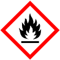
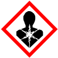
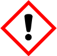

<!-- pagina: 1 -->

## HOJA DE DATOS DE SEGURIDAD

Fecha de emisión 14 Agosto 2025 Versión 7

*Texto OCR de la imagen (puede contener errores): PPG*

## Sección 1. Identificación del producto y la compañía

- **Nombre del producto:** AMERCOAT 370 RESIN OXIDE RED  
- **Código del producto:**

: 00280673

- **Otros medios de:** No disponible.  
- **identificación:**  
- **Tipo del producto:** Líquido.

Uso recomendado de la sustancia química peligrosa o mezcla, y restricciones de uso

## Usos identificados

Revestimiento. Pinturas. Materiales relacionados con las pinturas.

| Restricciones de uso   | Motivo   |
|------------------------|----------|
| No aplicable.          |          |

## Datos del proveedor o fabricante:

- **Proveedor:** PPG Industries Colombia Ltda Calle 51 # 40-13 Municipio de Itagüí Antioquia, Colombia (57) (4) 3787400 (Porteria)  
- **Dirección de Email:** : HazComLatam@ppg.com  
- **Número de teléfono en caso de emergencia:** Colombia: 01 8000 916012 (CISPROQUIM) + 571 288 6012 (CISPROQUIM) Ecuador: 1800-59-3005 (CISPROQUIM) Peru: 080-050-847 (CISPROQUIM)

## Sección 2. Identificación de los peligros

Clasificación de la sustancia química peligrosa o mezcla

:

LÍQUIDOS INFLAMABLES - Categoría 2 TOXICIDAD AGUDA (dérmica) - Categoría 5 TOXICIDAD AGUDA (inhalación) - Categoría 4 IRRITACIÓN CUTÁNEA - Categoría 2 IRRITACIÓN OCULAR - Categoría 2A SENSIBILIZACIÓN CUTÁNEA - Categoría 1 CARCINOGENICIDAD - Categoría 1A TOXICIDAD ESPECÍFICA DE ÓRGANOS BLANCO (EXPOSICIONES REPETIDAS) - Categoría 2 PELIGRO (AGUDO) PARA EL MEDIO AMBIENTE ACUÁTICO - Categoría 3

PELIGRO (A LARGO PLAZO) PARA EL MEDIO AMBIENTE ACUÁTICO -

<!-- pagina: 2 -->

## Sección 2. Identificación de los peligros

## Órganos vitales

## Categoría 3

- : Contiene material dañino para los siguientes órganos: hígado, bazo, cerebro, médula ósea, sistema nervioso central (SNC).

Contiene material que puede causar daño a los órganos siguientes: la sangre, riñones, pulmones, el sistema nervioso, tracto respiratorio superior, sistema inmunológico, piel, oídos, ojo, cristalino o córnea.

Porcentaje de la mezcla que consiste en ingredientes de toxicidad dérmica aguda desconocida: 34.4 %

Porcentaje de la mezcla que consiste en ingredientes de toxicidad por inhalación aguda desconocida: 75.4 %

Porcentaje de la mezcla consistente de ingrediente(s) con peligros desconocidos para el medio ambiente acuático: 72.8 %

## Elementos de las etiquetas del SGA

## Pictogramas de peligro :

*Texto OCR de la imagen (puede contener errores): !*

## Palabra de advertencia Indicaciones de peligro

: Peligro

: Líquido y vapores muy inflamables.

Puede ser nocivo en contacto con la piel.

Provoca irritación cutánea.

Puede provocar una reacción cutánea alérgica.

Provoca irritación ocular grave.

Nocivo si se inhala.

Puede provocar cáncer.

Puede provocar daños en los órganos tras exposiciones prolongadas o repetidas.

Nocivo para los organismos acuáticos, con efectos nocivos duraderos.

## Consejos de prudencia Prevención

- : No manipular antes de haber leído y comprendido todas las precauciones de seguridad. Usar guantes de protección, y ropa de prot eccin y equipo de protección para la cara o los ojos. Mantener alejado del calor, chispas, llamas al descubierto, superficies calientes y otras fuentes de ignición. No fumar. No dispersar en el medio ambiente. No respirar vapor. Lavarse cuidadosamente después de la manipulación.
- Intervención/Respuesta : En caso de exposición demostrada o supuesta: Consultar a un médico. En caso de inhalación: Llamar a un centro de toxicología o a un médico si la persona se siente mal. En caso de contacto con la piel: Llamar a un centro de toxicología o a un médico si la persona se siente mal. Lavar con abundante agua. En caso de irritación cutánea o sarpullido: Consultar a un médico. Quitar la ropa contaminada y lavarla antes de volverla a usar. En caso de contacto con los ojos: Enjuagar con agua cuidadosamente durante varios minutos. Quitar los lentes de contacto, cuando estén presentes y pueda hacerse con facilidad. Proseguir con el lavado. Si la irritación ocular persiste: Consultar a un médico.

## Almacenamiento Eliminación

: No aplicable.

- : Eliminar el contenido y recipiente conforme a todas las reglamentaciones locales, regionales, nacionales e internacionales.

<!-- pagina: 3 -->

## Sección 2. Identificación de los peligros

Otros peligros que no contribuyen en la clasificación

: El contacto prolongado o repetido puede resecar la piel y causar irritación.

## Sección 3. Composición / información sobre los componentes

Sustancia/mezcla :

Otros medios de identificación Mezcla

: No disponible.

## Número CAS/otros identificadores

Número CAS

: No aplicable.

| Nombre de ingrediente                                                             | %                                                                            | Número CAS                                                                                                      |
|-----------------------------------------------------------------------------------|------------------------------------------------------------------------------|-----------------------------------------------------------------------------------------------------------------|
| Sulfato de bario                                                                  | 30 - <60 20 - <30 7 - <10 7 - <10 7 - <10 3 - <5 3 - <5 2 - <3 1 - <2 1 - <2 | 7727-43-7 14808-60-7 108-10-1 25036-25-3 1330-20-7 1309-37-1 14808-60-7 1675-54-3 68515-49-1 100-41-4 2210-79-9 |
| sílice cristalina, polvo no respirable (>10 micras)                               |                                                                              |                                                                                                                 |
| Metilisobutilcetona                                                               |                                                                              |                                                                                                                 |
| RESINA EPOXI (700<MW<=1100)                                                       |                                                                              |                                                                                                                 |
| Xilenos, mezcla isómeros                                                          |                                                                              |                                                                                                                 |
| Oxido de hierro (Fe2O3)                                                           |                                                                              |                                                                                                                 |
| sílice cristalina, polvo respirable (<10 micras)                                  |                                                                              |                                                                                                                 |
| 2,2'-[(1-metiletiliden)bis(4,1-fenilenoximetilen)]bisoxirano                      |                                                                              |                                                                                                                 |
| ácido 1,2-bencenodicarboxílico, di-C9-11-alquil ésteres ramificados, ricos en C10 |                                                                              |                                                                                                                 |
| Etilbenceno                                                                       |                                                                              |                                                                                                                 |
| 2,3-epoxipropil o-tolil éter                                                      | 0.2 - <0.5                                                                   |                                                                                                                 |

No hay ningún ingrediente adicional presente que, bajo el conocimiento actual del proveedor y en las concentraciones aplicables, sea clasificado como de riesgo para la salud o el medio ambiente y por lo tanto deban ser reportados en esta sección.

Los límites de exposición laboral, en caso de existir, figuran en la sección 8.

Código SUB indica substancias sin número CAS registrados.

## Sección 4. Primeros auxilios

## Descripción de los primeros auxilios

| Contacto con los ojos   | :   | Quítese los lentes de contacto, lavar inmediatamente con abundante agua fresca y limpia, manteniendo los párpados separados durante al menos 10 minutos y busque atención médica inmediata.                            |
|-------------------------|-----|------------------------------------------------------------------------------------------------------------------------------------------------------------------------------------------------------------------------|
| Por inhalación          | :   | Traslade al aire libre. Mantenga a la persona caliente y en reposo. Si no hay respiración, ésta es irregular u ocurre un paro respiratorio, el personal capacitado debe proporcionar respiración artificial u oxígeno. |
| Contacto con la piel    | :   | Quítese la ropa y calzado contaminados. Lavar perfectamente la piel con agua y jabón, o con un limpiador cutáneo reconocido. NO utilizar disolventes ni diluyentes.                                                    |
| Ingestión               | :   | En caso de ingestión, acúdase inmediatamente al médico y muéstrele la etiqueta o el envase. Mantenga a la persona caliente y en reposo. No provocar el vómito.                                                         |

## Indicación de la necesidad de recibir atención médica inmediata y, en su caso, de tratamiento especial

- **Notas para el médico:** Tratar sintomáticamente. Contactar un especialista en tratamientos de  
- **Tratamientos específicos:** envenenamientos inmediatamente si se ha ingerido o inhalado una gran cantidad. No hay un tratamiento específico.

<!-- pagina: 4 -->

## Sección 4. Primeros auxilios

Protección del personal de primeros auxilios

:

No se tomará ninguna medida que implique algún riesgo personal o que no contemple el entrenamiento adecuado. Si se sospecha que los vapores continúan presentes, la persona encargada del rescate deberá usar una máscara adecuada o un aparato de respiración autónoma. Puede ser peligroso para la persona que proporcione ayuda dar respiración boca a boca. Lave bien la ropa contaminada con agua antes de quitársela, o use guantes.

## Efectos agudos potenciales en la salud

- **Contacto con los ojos:** Provoca irritación ocular grave.  
- **Por inhalación:** Nocivo si se inhala.  
- **Contacto con la piel:** Puede ser nocivo en contacto con la piel. Provoca irritación cutánea. Desengrasante de la piel. Puede provocar una reacción cutánea alérgica.  
- **Ingestión:** No se conocen efectos significativos o riesgos críticos.

Vea la sección 11 para la Información Toxicológica

## Sección 5. Medidas contra incendios

| Medios de extinción Medios de extinción                                     | :   | Utilizar polvo químico seco, CO₂, agua pulverizada o espuma (neblina).                                                                                                                                                                                                                                                                                                                                                                                                                                         |
|-----------------------------------------------------------------------------|-----|----------------------------------------------------------------------------------------------------------------------------------------------------------------------------------------------------------------------------------------------------------------------------------------------------------------------------------------------------------------------------------------------------------------------------------------------------------------------------------------------------------------|
| apropiados Medios no apropiados de extinción                                | :   | No usar chorro de agua.                                                                                                                                                                                                                                                                                                                                                                                                                                                                                        |
| Peligros específicos de la sustancia química peligrosa o mezcla             | :   | Líquido y vapores muy inflamables. Los residuos líquidos que se filtran en el alcantarillado pueden causar un riesgo de incendio o de explosión. En caso de incendio o calentamiento, ocurrirá un aumento de presión y el recipiente estallará, con el riesgo de que ocurra una explosión. Este material es nocivo para la vida acuática con efectos de larga duración. Se debe impedir que el agua de extinción de incendios contaminada con este material entre en vías de agua, drenajes o alcantarillados. |
| Productos de descomposición térmica peligrosos                              | :   | Los productos de descomposición pueden incluir los siguientes materiales: óxidos de carbono óxidos de azufre óxido/óxidos metálico/metálicos                                                                                                                                                                                                                                                                                                                                                                   |
| Medidas especiales que deberán seguir los grupos de combate contra incendio | :   | En caso de incendio, aísle rápidamente la zona evacuando a todas las personas de las proximidades del lugar del incidente. No se tomará ninguna medida que implique algún riesgo personal o que no contemple el entrenamiento adecuado. Desplazar los contenedores lejos del incendio si esto puede hacerse sin riesgo. Use agua pulverizada para refrigerar los envases expuestos al fuego.                                                                                                                   |
| Equipo de protección especial para los bomberos                             | :   | Los bomberos deben llevar equipo de protección apropiado y un equipo de respiración autónomo con una máscara facial completa que opere en modo de presión positiva.                                                                                                                                                                                                                                                                                                                                            |

## Sección 6. Medidas que deben tomarse en caso de derrame o fuga accidental

Precauciones personales, equipo de protección y procedimiento de emergencia

<!-- pagina: 5 -->

## Sección 6. Medidas que deben tomarse en caso de derrame o fuga accidental

| Para personal de no emergencia              | :   | No se tomará ninguna medida que implique algún riesgo personal o que no contemple el entrenamiento adecuado. Evacuar los alrededores. No deje que entre el personal innecesario y sin protección. No toque o camine sobre el material derramado. Apagar todas las fuentes de ignición. No permitir el uso de bengalas, fumar, o el encendido de llamas en el área de peligro. Evite respirar vapor o neblina. Proporcione ventilación adecuada. Llevar un aparato de respiración apropiado cuando el sistema de ventilación sea inadecuado. Llevar puestos equipos de protección personal adecuados.   |
|---------------------------------------------|-----|--------------------------------------------------------------------------------------------------------------------------------------------------------------------------------------------------------------------------------------------------------------------------------------------------------------------------------------------------------------------------------------------------------------------------------------------------------------------------------------------------------------------------------------------------------------------------------------------------------|
| Para el personal de respuesta a emergencias | :   | Si fuera necesario usar ropa especial para hacer frente al derrame, se tomará en cuenta la información de la Sección 8 sobre los materiales adecuados y no adecuados. Consultar también la información bajo "Para personal de no emergencia".                                                                                                                                                                                                                                                                                                                                                          |
| Precauciones relativas al medio ambiente    | :   | Evite la dispersión del material derramado, su contacto con el suelo, el medio acuático, los desagües y las alcantarillas. Informe a las autoridades pertinentes si el producto ha causado polución medioambiental (alcantarillas, canales, tierra o aire). Material contaminante del agua. Puede ser dañino para el medio ambiente si es liberado en cantidades grandes.                                                                                                                                                                                                                              |

## Métodos y materiales para la contención y limpieza de derrames o fugas

| Derrame pequeño   | :   | Detener la fuga si esto no presenta ningún riesgo. Retire los envases del área del derrame. Use herramientas a prueba de chispas y equipo a prueba de explosión. Diluir con agua y fregar si es soluble en agua. Alternativamente, o si es insoluble en agua, absorber con un material seco inerte y colocar en un contenedor de residuos adecuado. Disponga por medio de un contratista autorizado para la disposición.                                                                                                                                                                                                                                                                                                                                                                                                                                                                                                                               |
|-------------------|-----|--------------------------------------------------------------------------------------------------------------------------------------------------------------------------------------------------------------------------------------------------------------------------------------------------------------------------------------------------------------------------------------------------------------------------------------------------------------------------------------------------------------------------------------------------------------------------------------------------------------------------------------------------------------------------------------------------------------------------------------------------------------------------------------------------------------------------------------------------------------------------------------------------------------------------------------------------------|
| Gran derrame      | :   | Detener la fuga si esto no presenta ningún riesgo. Retire los envases del área del derrame. Use herramientas a prueba de chispas y equipo a prueba de explosión. Aproximarse al vertido en el sentido del viento. Evite la entrada en alcantarillas, canales de agua, sótanos o áreas reducidas. Trate los derrames en una planta de tratamiento de aguas residuales o proceda tal como se indica a continuación. Detener y recoger los derrames con materiales absorbentes no combustibles, como arena, tierra, vermiculita o tierra de diatomeas, y colocar el material en un envase para desecharlo de acuerdo con las normativas locales (ver la Sección 13). Disponga por medio de un contratista autorizado para la disposición. El material absorbente contaminado puede presentar el mismo riesgo que el producto derramado. Nota: Véase la Sección 1 para información de contacto de emergencia y la Sección 13 para eliminación de desechos. |

## Sección 7. Manejo y almacenamiento

## Precauciones que se deben tomar para garantizar un manejo seguro

: Use el equipo de protección personal adecuado (vea la Sección 8). Las personas con antecedentes de sensibilización cutánea no deben trabajar en ningún proceso en el que se utilice este producto. Evítese la exposición - recábense instrucciones especiales antes del uso. No manipular antes de haber leído y comprendido todas las precauciones de seguridad. No introducir en ojos o en la piel o ropa. No respire los vapores o nieblas. No ingerir. No dispersar en el medio ambiente. Use sólo con ventilación adecuada. Llevar un aparato de respiración apropiado cuando el sistema de ventilación sea inadecuado. No entre en áreas de almacenamiento y espacios cerrados a menos que estén ventilados adecuadamente. Mantener en el

<!-- pagina: 6 -->

## Sección 7. Manejo y almacenamiento

## Condiciones de almacenamiento seguro, incluida cualquier incompatibilidad

recipiente original o en uno alternativo autorizado hecho de material compatible, conservar herméticamente cerrado cuando no esté en uso. Mantener alejado del calor, chispas, llamas al descubierto, o de cualquier otra fuente de ignición. Use equipo eléctrico (de ventilación, iluminación y manipulación de materiales) a prueba de explosiones. No utilizar herramientas que produzcan chispas. Evitar la acumulación de cargas electrostáticas. Los envases vacíos retienen resíduos del producto y pueden ser peligrosos. No vuelva a usar el envase.

- Almacénese en el siguiente rango de temperatura: 0 a 35°C (32 a 95°F). Conservar de acuerdo con las normas locales. Almacenar en un área separada y homologada. Almacenar en el contenedor original protegido de la luz directa del sol en un área seca, fresca y bien ventilada, separado de materiales incompatibles (ver Sección 10) y comida y bebida. Guardar bajo llave. Eliminar todas las fuentes de ignición. Mantener separado de materiales oxidantes. Mantener el contenedor bien cerrado y sellado hasta el momento de usarlo. Los envases que han sido abiertos deben cerrarse cuidadosamente y mantenerse en posición vertical para evitar derrames. No almacenar en contenedores sin etiquetar. Utilícese un envase de seguridad adecuado para evitar la contaminación del medio ambiente. Consulte la Sección 10 para obtener información acerca de los materiales no compatibles previo al manejo o uso. :

## Sección 8. Controles de exposición / protección personal

## Parámetros de control

Límites de exposición laboral

| Nombre de ingrediente | Límites de exposición |
|---|---|
| Sulfato de bario | ACGIH TLV (Estados Unidos, 1/2024) TWA 8 horas: 5 mg/m³. Estado: Fracción inhalable. |
| sílice cristalina, polvo no respirable (>10 micras) | ACGIH TLV (Estados Unidos, 1/2024) [Silica, crystalline] TWA 8 horas: 0.025 mg/m³. Estado: Fracción respirable. |
| Metilisobutilcetona | ACGIH TLV (Estados Unidos, 1/2024) TWA 8 horas: 20 ppm. STEL 15 minutos: 75 ppm. |
| Xilenos, mezcla isómeros | ACGIH TLV (Estados Unidos, 1/2024) [p￾xylene and mixtures containing p-xylene] Ototoxicante. TWA 8 horas: 20 ppm. |
| Oxido de hierro (Fe2O3) | ACGIH TLV (Estados Unidos, 1/2024) TWA 8 horas: 5 mg/m³. Estado: Fracción respirable. |
| sílice cristalina, polvo respirable (<10 micras) | ACGIH TLV (Estados Unidos, 1/2024) [Silica, crystalline] TWA 8 horas: 0.025 mg/m³. Estado: Fracción respirable. |
| Etilbenceno | ACGIH TLV (Estados Unidos, 1/2024) Ototoxicante. TWA 8 horas: 20 ppm. |

*Tabla reconstruida por posición de renglones: Docling había fusionado sus filas (ver data/metadata/tablas_reconstruidas.csv).*

<!-- pagina: 7 -->

## Sección 8. Controles de exposición / protección personal

| Procedimientos de control recomendados       | :                                | Se debe hacer referencia a las normas adecuadas de monitoreo. También se requiere hacer referencia a los documentos guía nacionales sobre los métodos para la determinación de sustancias peligrosas.                                                                                                                                                                                                                                                                                                                                                                                                                                                   |
|----------------------------------------------|----------------------------------|---------------------------------------------------------------------------------------------------------------------------------------------------------------------------------------------------------------------------------------------------------------------------------------------------------------------------------------------------------------------------------------------------------------------------------------------------------------------------------------------------------------------------------------------------------------------------------------------------------------------------------------------------------|
| Controles técnicos apropiados                | :                                | Use sólo con ventilación adecuada. Utilizar recintos de proceso, sistemas de ventilación locales, u otros procedimientos de ingeniería para mantener la exposición del obrero a los contaminantes aerotransportados por debajo de todos los límites recomendados o estatutarios. Los controles de ingeniería también deben mantener el gas, vapor o polvo por debajo del menor límite de explosión. Utilizar equipo de ventilación anti-explosión.                                                                                                                                                                                                      |
| Control de la exposición medioambiental      | :                                | Emisiones de los equipos de ventilación o de procesos de trabajo deben ser evaluados para verificar que cumplen con los requisitos de la legislación de protección del medio ambiente. En algunos casos será necesario el uso de eliminadores de humo, filtros o modificaciones del diseño del equipo del proceso para reducir las emisiones a un nivel aceptable.                                                                                                                                                                                                                                                                                      |
| Medidas de protección individual             | Medidas de protección individual | Medidas de protección individual                                                                                                                                                                                                                                                                                                                                                                                                                                                                                                                                                                                                                        |
| Medidas higiénicas                           | :                                | Lave las manos, antebrazos y cara completamente después de manejar productos químicos, antes de comer, fumar y usar el lavabo y al final del período de trabajo. Usar las técnicas apropiadas para remover ropa contaminada. La ropa de trabajo contaminada no debe salir del lugar de trabajo. Lavar las ropas contaminadas antes de volver a usarlas. Verifique que las estaciones de lavado de ojos y duchas de seguridad se encuentren cerca de las estaciones de trabajo.                                                                                                                                                                          |
| Protección de los ojos Protección de la piel | :                                | Gafas protectoras contra salpicaduras químicas.                                                                                                                                                                                                                                                                                                                                                                                                                                                                                                                                                                                                         |
| Protección de las manos                      | :                                | Guantes impermeables y resistentes a productos químicos que cumplan con las normas aprobadas deben ser usados siempre que se manejen productos químicos si una evaluación del riesgo indica que es necesario. Teniendo en cuenta los parámetros especificados por el fabricante de los guantes, se debe verificar durante el uso si aún mantienen sus propiedades protectoras. Es preciso tener presente que el tiempo de penetración para el material de los guantes puede ser diferente en cada fabricante. En el caso de mezclas formadas por varias sustancias no se puede estimar con exactitud el periodo de tiempo de protección de los guantes. |
| Guantes                                      | :                                | caucho butílico                                                                                                                                                                                                                                                                                                                                                                                                                                                                                                                                                                                                                                         |
| Protección del cuerpo                        | :                                | Antes de utilizar este producto se debe seleccionar equipo protector personal para el cuerpo basándose en la tarea a ejecutar y los riesgos involucrados y debe ser aprobado por un especialista. Cuando existe riesgo de ignición debido a la electricidad estática, se requiere el uso de ropa antiestática de protección. Para obtener el máximo nivel de protección contra descargas electrostáticas es preciso usar overoles, botas y guantes antiestáticos.                                                                                                                                                                                       |
| Otro tipo de protección para la piel         | :                                | Antes de manipular este producto se debe elegir el calzado apropiado y cualquier otra medida adicional de protección de la piel basadas en la tarea que se realice y los riesgos asociados, para lo cual se contará con la aprobación de un especialista.                                                                                                                                                                                                                                                                                                                                                                                               |
| Protección de las vías respiratorias         | :                                | La selección del respirador se debe basar en el conocimiento previo de los niveles, los riesgos de producto y los límites de trabajo de seguridad del respirador seleccionado. Si los trabajadores están expuestos a concentraciones superiores al límite de exposición, deben utilizar respiradores certificados adecuados. Use un respirador purificador de aire o con suministro de aire, que esté ajustado apropiadamente y que cumpla con las normas aprobadas si una evaluación de riesgo indica que es necesario.                                                                                                                                |

<!-- pagina: 8 -->

## Sección 9. Propiedades físicas y químicas

## Apariencia

- **Estado físico:**  
- **Color:** Rojo.  
- **Olor:** Característico.  
- **pH:** No aplicable.  
- **Punto de fusión:** No disponible.  
- **Punto de ebullición Líquido.:** >37.78°C (>100°F)  
- **Punto de inflamación:** Vaso cerrado: 17°C (62.6°F)  
- **Velocidad de evaporación:** No disponible.

Inflamabilidad (sólido o gas) : No disponible.

- **Límites máximo y mínimo de explosión (inflamabilidad):** No disponible.  
- **Presión de vapor:**  
- **Densidad de vapor:**  
- **Densidad relativa:**

: Solubilidad(es)

No disponible.  
No disponible.  
1.83  
Medio  
- **Coeficiente de partición:** noctanol/agua :  
- **Temperatura de ignición:**  
- **espontánea:**  
- **Temperatura de descomposición:** No disponible.  
- **Viscosidad:** Dinámico (temperatura ambiente): No disponible. Cinemática (temperatura ambiente): No disponible. Cinemática (40°C (104°F)): >21 mm 2 /s (>21 cSt)

## Resultado

agua fría No soluble

No aplicable.

No disponible.

## Sección 10. Estabilidad y reactividad

## Reactividad

## Estabilidad química

- : No existen resultados específicos de ensayos respecto a la reactividad del este producto o sus ingredientes.

:

## Posibilidad de reacciones peligrosas

## Condiciones que deberán evitarse

## Materiales incompatibles

- El producto es estable.

: En condiciones normales de almacenamiento y uso, no ocurre reacción peligrosa.

:

:

## Productos de descomposición peligrosos

:

Si es expuesto a altas temperaturas puede producir productos de descomposición peligrosos.

- Mantener siempre alejado de los materiales siguientes para evitar reacciones exotérmicas violentas: agentes oxidantes, bases fuertes, ácidos fuertes.
- Dependiendo de las condiciones, los productos de descomposición pueden incluir los siguientes materiales: óxidos de carbono óxidos de azufre óxido/óxidos metálico/ metálicos

<!-- pagina: 9 -->

## Sección 11. Información toxicológica

## Información sobre efectos toxicológicos

## Toxicidad aguda

| Sulfato de bario Metilisobutilcetona RESINA EPOXI (700<MW <=1100) Xilenos, mezcla isómeros Oxido de hierro (Fe2O3) 2,2'-[(1-metiletiliden)bis (4,1-fenilenoximetilen)] bisoxirano ácido 1,2-bencenodicarboxílico, di- C9-11-alquil ésteres ramificados, ricos en C10 Etilbenceno 2,3-epoxipropil o-tolil éter Nombre de producto o ingrediente   | DL50 Cutánea DL50 Oral CL50 Por inhalación Vapor DL50 Cutánea DL50 Oral DL50 Cutánea DL50 Oral DL50 Cutánea DL50 Oral CL50 Por inhalación Polvo y nieblas DL50 Oral DL50 Cutánea DL50 Oral DL50 Cutánea DL50 Oral CL50 Por inhalación Vapor DL50 Cutánea DL50 Oral CL50 Por inhalación Polvo y nieblas CL50 Por inhalación Vapor DL50 Oral Resultado   | Rata Rata Rata Conejo Rata Rata Rata Conejo Rata Rata Rata Conejo Rata Conejo Rata Rata Conejo Rata Rata Rata Rata Especies   | >2000 mg/kg >5000 mg/kg 11 mg/l >5000 mg/kg 2.08 g/kg >2000 mg/kg >2000 mg/kg 1.7 g/kg 4.3 g/kg >5 mg/l 10 g/kg 23000 mg/kg 15000 mg/kg 16000 mg/kg >60000 mg/kg 17.8 mg/l 17.8 g/kg 3.5 g/kg 6090 mg/m³ 6090 mg/m³ 4 g/kg Dosis   | - - 4 horas - - - - - - 4 horas - - - - - 4 horas - - 4 horas 4 horas - Exposición   |
|--------------------------------------------------------------------------------------------------------------------------------------------------------------------------------------------------------------------------------------------------------------------------------------------------------------------------------------------------|--------------------------------------------------------------------------------------------------------------------------------------------------------------------------------------------------------------------------------------------------------------------------------------------------------------------------------------------------------|-------------------------------------------------------------------------------------------------------------------------------|------------------------------------------------------------------------------------------------------------------------------------------------------------------------------------------------------------------------------------|--------------------------------------------------------------------------------------|

## Conclusión/Sumario

- : No existen datos disponibles sobre la mezcla en sí.

## Irritación/Corrosión

| Nombre de producto o ingrediente                                                        | Resultado                                                                                                                                       | Especies                                  | Puntuación        | Exposición                                                | Observación   |
|-----------------------------------------------------------------------------------------|-------------------------------------------------------------------------------------------------------------------------------------------------|-------------------------------------------|-------------------|-----------------------------------------------------------|---------------|
| Xilenos, mezcla isómeros 2,2'-[(1-metiletiliden)bis (4,1-fenilenoximetilen)] bisoxirano | Piel - Irritante moderado Ojos - Irritante leve Ojos - Enrojecimiento de la conjuntiva Piel - Edema Piel - Eritema/Escama Piel - Irritante leve | Conejo Conejo Conejo Conejo Conejo Conejo | - - 0.4 0.5 0.8 - | 24 horas 500 mg 24 horas 24 horas 4 horas 4 horas 4 horas | - - - - - -   |

## Conclusión/Sumario

| Piel   | : No existen datos disponibles sobre la mezcla en sí.   |
|--------|---------------------------------------------------------|
| Ojos   | : No existen datos disponibles sobre la mezcla en sí.   |

<!-- pagina: 10 -->

| Código 00280673                                                                       | Fecha de emisión                                                                      | 14 Agosto 2025                                                                        | Versión                                                                               | 7                                                                                     |
|---------------------------------------------------------------------------------------|---------------------------------------------------------------------------------------|---------------------------------------------------------------------------------------|---------------------------------------------------------------------------------------|---------------------------------------------------------------------------------------|
| AMERCOAT 370 RESIN OXIDE RED Nombre del producto Sección 11. Información toxicológica | AMERCOAT 370 RESIN OXIDE RED Nombre del producto Sección 11. Información toxicológica | AMERCOAT 370 RESIN OXIDE RED Nombre del producto Sección 11. Información toxicológica | AMERCOAT 370 RESIN OXIDE RED Nombre del producto Sección 11. Información toxicológica | AMERCOAT 370 RESIN OXIDE RED Nombre del producto Sección 11. Información toxicológica |

## Respiratoria Sensibilización

:

No existen datos disponibles sobre la mezcla en sí.

| 2,2'-[(1-metiletiliden)bis (4,1-fenilenoximetilen)] bisoxirano Nombre de producto o ingrediente   | piel Ruta de exposición   | Ratón Especies   | Sensibilizante Resultado   |
|---------------------------------------------------------------------------------------------------|---------------------------|------------------|----------------------------|

## Conclusión/Sumario

- **Piel:**  
- **Respiratoria No existen datos disponibles sobre la mezcla en sí.:** No existen datos disponibles sobre la mezcla en sí.

## Mutagenicidad

No disponible.

Conclusión/Sumario :

## Carcinogenicidad

No disponible.

Conclusión/Sumario :

## Grado de riesgo

| Nombre de producto o ingrediente                               | OSHA   | IARC   | NTP                               |
|----------------------------------------------------------------|--------|--------|-----------------------------------|
| sílice cristalina, polvo no respirable (>10 micras)            | +      | 1      | Conocido como carcinógeno humano. |
| Metilisobutilcetona                                            | -      | 2B     | -                                 |
| Xilenos, mezcla isómeros                                       | -      | 3      | -                                 |
| Oxido de hierro (Fe2O3)                                        | -      | 3      | -                                 |
| sílice cristalina, polvo respirable (<10 micras)               | +      | 1      | Conocido como carcinógeno humano. |
| 2,2'-[(1-metiletiliden)bis (4,1-fenilenoximetilen)] bisoxirano | -      | 3      | -                                 |
| Etilbenceno                                                    | -      | 2B     | -                                 |

Carcinógeno Código de

clasificación:

IARC: 1, 2A, 2B, 3, 4

NTP: Conocido como carcinógeno humano; Se anticipa razonablemente que sea un carcinógeno humano

OSHA: +

No listado/No regulado: -

## Toxicidad reproductiva

No disponible.

Conclusión/Sumario :

## Teratogenicidad

No disponible.

Conclusión/Sumario :

No existen datos disponibles sobre la mezcla en sí.

No existen datos disponibles sobre la mezcla en sí.

Toxicidad específica de órganos blanco (exposición única)

Colombia

No existen datos disponibles sobre la mezcla en sí.

No existen datos disponibles sobre la mezcla en sí.

<!-- pagina: 11 -->

## Sección 11. Información toxicológica

| Nombre                                       | Categoría               | Ruta de exposición   | Órganos vitales                                       |
|----------------------------------------------|-------------------------|----------------------|-------------------------------------------------------|
| Metilisobutilcetona Xilenos, mezcla isómeros | Categoría 3 Categoría 3 | - -                  | Efecto narcótico Irritación de las vías respiratorias |

## Toxicidad específica de órganos blanco (exposiciones repetidas)

| Nombre                                                       | Categoría               | Ruta de exposición   | Órganos vitales     |
|--------------------------------------------------------------|-------------------------|----------------------|---------------------|
| sílice cristalina, polvo respirable (<10 micras) Etilbenceno | Categoría 1 Categoría 2 | inhalación -         | - órganos auditivos |

## Órganos vitales

## Peligro de aspiración

| Nombre                                                   | Resultado                                                                                                      |
|----------------------------------------------------------|----------------------------------------------------------------------------------------------------------------|
| Metilisobutilcetona Xilenos, mezcla isómeros Etilbenceno | PELIGRO POR ASPIRACIÓN - Categoría 2 PELIGRO POR ASPIRACIÓN - Categoría 1 PELIGRO POR ASPIRACIÓN - Categoría 1 |

Información sobre las posibles vías de ingreso

: No disponible.

## Efectos agudos potenciales en la salud

: Contacto con los ojos

- **Por inhalación Provoca irritación ocular grave.:** Nocivo si se inhala.  
- **Contacto con la piel:** Puede ser nocivo en contacto con la piel. Provoca irritación cutánea. Desengrasante de la piel. Puede provocar una reacción cutánea alérgica.  
- **Ingestión:** No se conocen efectos significativos o riesgos críticos. :

## Síntomas relacionados con las características físicas, químicas y toxicológicas

- **Contacto con los ojos:**  
- **:** Los síntomas adversos pueden incluir los siguientes: dolor o irritación lagrimeo enrojecimiento  
- **Por inhalación:** Ningún dato específico.  
- **Contacto con la piel:**

## Ingestión

Los síntomas adversos pueden incluir los siguientes:

irritación enrojecimiento sequedad agrietamiento

Ningún dato específico. :

: Contiene material dañino para los siguientes órganos: hígado, bazo, cerebro, médula ósea, sistema nervioso central (SNC).

Contiene material que puede causar daño a los órganos siguientes: la sangre, riñones, pulmones, el sistema nervioso, tracto respiratorio superior, sistema inmunológico, piel, oídos, ojo, cristalino o córnea.

<!-- pagina: 12 -->

## Sección 11. Información toxicológica

## Efectos inmediatos y retardados, así como efectos crónicos producidos por una exposición a corto y largo

plazo

Conclusión/Sumario

## Exposición a corto plazo

Efectos potenciales

inmediatos

Efectos potenciales

retardados

## Exposición a largo plazo

Efectos potenciales

inmediatos

Efectos potenciales

retardados

## Efectos crónicos potenciales en la salud

No disponible.

| Generales              | :   | Puede provocar daños en los órganos tras exposiciones prolongadas o repetidas. El contacto prolongado o repetido puede desengrasar la piel y conducir a irritación, agrietamiento y/o dermatitis. Una vez que la persona esté sensibilizada, puede ocurrir una reacción alérgica severa si posteriormente se expone incluso a muy bajos niveles.   |
|------------------------|-----|----------------------------------------------------------------------------------------------------------------------------------------------------------------------------------------------------------------------------------------------------------------------------------------------------------------------------------------------------|
| Carcinogenicidad       | :   | Puede provocar cáncer. El riesgo de cáncer depende de la duración y el grado de exposición.                                                                                                                                                                                                                                                        |
| Mutagenicidad          | :   | No se conocen efectos significativos o riesgos críticos.                                                                                                                                                                                                                                                                                           |
| Toxicidad reproductiva | :   | No se conocen efectos significativos o riesgos críticos.                                                                                                                                                                                                                                                                                           |

*Imagen asociada a la tabla #/tables/17: imagen contenida en el área de la tabla en la página 12 (91% de su área).*

## Medidas numéricas de toxicidad (tales como estimaciones de toxicidad aguda) Estimaciones de toxicidad aguda

:

:

:

:

:

No existen datos disponibles sobre la mezcla en sí. Este producto contiene sílice

cristalina, la cual puede causar cáncer de pulmón o silicosis. El riesgo de cáncer o

silicosis depende de la duración y del nivel de la exposición al polvo generado al

lijar superficies o a la niebla procedente de la aplicación por aspersión. La

exposición a concentraciones de vapores de disolventes superiores a los límites de

exposición ocupacional establecidos puede producir irritación de las mucosas y del

aparato respiratorio, y efectos adversos sobre los riñones, el hígado y el sistema

nervioso central. Los signos y síntomas pueden ser dolor de cabeza, mareo, fatiga,

debilidad muscular, somnolencia y en casos extremos, pérdida de consciencia. Los

disolventes pueden causar algunos de los efectos anteriores por absorción a través

de la piel. Hay evidencias de que la repetida sobreexposición a vapores de

solventes orgánicos y ruido fuerte constante pueden ocasionar una pérdida auditiva

mayor de la esperada que la exposición únicamente al ruido. El contacto del líquido

con los ojos puede causar irritación y lesiones reversibles. La ingestión puede

causar náuseas, diarrea y vómitos. De esta manera se toma en cuenta, cuando se

conocen, los efectos retardados e inmediatos, así como también los efectos

crónicos de los componentes provocados por la exposición a corto y largo plazo por

vía oral, por inhalación y a través de la piel y el contacto con los ojos.

No existen datos disponibles sobre la mezcla en sí.

No existen datos disponibles sobre la mezcla en sí.

No existen datos disponibles sobre la mezcla en sí.

No existen datos disponibles sobre la mezcla en sí.

<!-- pagina: 13 -->

## Sección 11. Información toxicológica

| Nombre de producto o ingrediente                                                                                                                                                                                                                                                                                                        | Oral (mg/ kg)                                       | Cutánea (mg/kg)                                     | Inhalación (gases) (ppm)                | Inhalación (vapores) (mg/l)              | Inhalación (polvos y nieblas) (mg/l)     |
|-----------------------------------------------------------------------------------------------------------------------------------------------------------------------------------------------------------------------------------------------------------------------------------------------------------------------------------------|-----------------------------------------------------|-----------------------------------------------------|-----------------------------------------|------------------------------------------|------------------------------------------|
| AMERCOAT 370 RESIN OXIDE RED Sulfato de bario Metilisobutilcetona RESINA EPOXI (700<MW<=1100) Xilenos, mezcla isómeros Oxido de hierro (Fe2O3) 2,2'-[(1-metiletiliden)bis(4,1-fenilenoximetilen)] bisoxirano ácido 1,2-bencenodicarboxílico, di-C9-11-alquil ésteres ramificados, ricos en C10 Etilbenceno 2,3-epoxipropil o-tolil éter | 7396.0 N/A 2080 2500 4300 10000 15000 N/A 3500 4000 | 3128.1 2500 N/A 2500 1700 N/A 23000 16000 17800 N/A | N/A N/A N/A N/A N/A N/A N/A N/A N/A N/A | 16.2 N/A 11 N/A 11 N/A N/A N/A 17.8 6.09 | 2.1 N/A 1.5 N/A 1.5 N/A N/A N/A 1.5 6.09 |

Otra información

: No disponible.

## Sección 12. Información ecotoxicológica

## Toxicidad

| Nombre de producto o ingrediente                                                                                       | Resultado                                                                                                                                                       | Especies                                                                    | Exposición                                    |
|------------------------------------------------------------------------------------------------------------------------|-----------------------------------------------------------------------------------------------------------------------------------------------------------------|-----------------------------------------------------------------------------|-----------------------------------------------|
| Metilisobutilcetona Oxido de hierro (Fe2O3) 2,2'-[(1-metiletiliden)bis (4,1-fenilenoximetilen)] bisoxirano Etilbenceno | Agudo CL50 >179 mg/l Agudo EC50 >100 mg/l Agudo CL50 1.8 mg/l Agua fresca Crónico NOEC 0.3 mg/l Agudo EC50 1.8 mg/l Agua fresca Crónico NOEC 1 mg/l Agua fresca | Pez Dafnia Dafnia - daphnia magna Dafnia Dafnia Dafnia - Ceriodaphnia dubia | 96 horas 48 horas 48 horas 21 días 48 horas - |

## Persistencia y degradabilidad

| Nombre de producto o ingrediente                                                                                        | Prueba           | Resultado                                     | Resultado                                     | Dosis     | Dosis                         | Inóculo           |
|-------------------------------------------------------------------------------------------------------------------------|------------------|-----------------------------------------------|-----------------------------------------------|-----------|-------------------------------|-------------------|
| Metilisobutilcetona Etilbenceno                                                                                         | OECD 301F -      | 83 % - Fácil - 28 días 79 % - Fácil - 10 días | 83 % - Fácil - 28 días 79 % - Fácil - 10 días | - -       | - -                           | - -               |
| Nombre de producto o ingrediente                                                                                        | Período acuático | Período acuático                              | Fotólisis                                     | Fotólisis | Biodegradabilidad             | Biodegradabilidad |
| Metilisobutilcetona Xilenos, mezcla isómeros 2,2'-[(1-metiletiliden)bis (4,1-fenilenoximetilen)] bisoxirano Etilbenceno | - - - -          | - - - -                                       | - - - -                                       | - - - -   | Fácil Fácil No inmediatamente | Fácil             |

## Potencial de bioacumulación

| Spanish (MX)   | Colombia   | 13/16   |
|----------------|------------|---------|

<!-- pagina: 14 -->

## Sección 12. Información ecotoxicológica

| Nombre de producto o ingrediente                                                                                                            | LogPow           | FBC                  | Potencial           |
|---------------------------------------------------------------------------------------------------------------------------------------------|------------------|----------------------|---------------------|
| Metilisobutilcetona Xilenos, mezcla isómeros ácido 1,2-bencenodicarboxílico, di- C9-11-alquil ésteres ramificados, ricos en C10 Etilbenceno | 1.9 3.12 8.8 3.6 | - 7.4 a 18.5 - 79.43 | Bajo Bajo Alta Bajo |

## Movilidad en el suelo

- **Coeficiente de partición tierra/agua:** No disponible.  
- **Otros efectos adversos:** No se conocen efectos significativos o riesgos críticos.

## Sección 13. Información relativa a la eliminación de los productos

## Métodos de eliminación

- :
- Se debe evitar o minimizar la generación de desechos cuando sea posible. La eliminación de este producto, sus soluciones y cualquier derivado deben cumplir siempre con los requisitos de la legislación de protección del medio ambiente y eliminación de desechos y todos los requisitos de las autoridades locales. Disponga del sobrante y productos no reciclables por medio de un contratista autorizado para la disposición. Los residuos no se deben tirar por la alcantarilla sin tratar a menos que sean compatibles con los requisitos de todas las autoridades con jurisdicción. Los envases desechados se deben reciclar. Sólo se deben contemplar la incineración o el enterramiento cuando el reciclaje no sea factible. Elimínense los residuos del producto y sus recipientes con todas las precauciones posibles. Se tendrá cuidado cuando se manipulen recipientes vacíos que no se hayan limpiado o enjuagado. Los envases vacíos o los revestimentos pueden retener residuos del producto. El vapor de los residuos del producto puede crear un ambiente altamente inflamable o explosivo dentro del recipiente. No recortar, soldar o triturar los recipientes usados a menos que se hayan limpiado a fondo en su interior. Evite la dispersión del material derramado, su contacto con el suelo, el medio acuático, los desagües y las alcantarillas.

## Sección 14. Información relativa al transporte

|                                   | UN      | Brasil (ANTT)   | IMDG   | IATA   |
|-----------------------------------|---------|-----------------|--------|--------|
| Número ONU                        | UN1263  | UN1263          | UN1263 | UN1263 |
| Designación oficial de transporte | PINTURA | PINTURA         | PAINT  | PAINT  |
| Clase(s) relativas al transporte  | 3       | 3               | 3      | 3      |
| Grupo de embalaje                 | II      | II              | II     | II     |
| Riesgos ambientales               | No.     | No.             | No.    | No.    |

Spanish (MX)

Colombia Nombre del producto

<!-- pagina: 15 -->

## Sección 14. Información relativa al transporte

Sustancias contaminantes marinas No aplicable.

No aplicable.

Not applicable.

Not applicable.

## Información adicional

UN :

Brasil :

Risk number :

IMDG :

IATA

Ninguno identificado.

Ninguno identificado.

33

None identified.

: Ninguno identificado.

Precauciones especiales para el usuario

Transporte a granel de acuerdo con instrumentos IMO

- Transporte dentro de las instalaciones de usuarios: siempre transporte en recipientes cerrados que estén verticales y seguros. Asegurar que las personas que transportan el producto conocen qué hacer en caso de un accidente o derrame. :

: No aplicable.

## Sección 15. Información Reglamentaria

Disposiciones específicas sobre seguridad, salud y medio ambiente para las sustancias químicas peligrosas o mezclas de que se trate

- : No hay reglamentos nacionales y/o regionales conocidos que se apliquen a este producto (incluyendo sus ingredientes).

## Sección 16. Otra informaciones

## Historial

- **Fecha de la edición:** 2/1/2020  
- **anterior:**  
- **Versión:** 7 EHS

Explicación de Abreviaturas : ADN = Acuerdo Europeo Relativo al Transporte Internacional de Mercancías

Peligrosas por Vía Navegable Interior

ADR = Acuerdo Europeo sobre el Transporte Internacional de Mercancias

Peligrosas por Carretera

ETA = Estimación de Toxicidad Aguda

FBC = Factor de Bioconcentración

SGA = Sistema Globalmente Armonizado

IATA = Asociación de Transporte Aéreo Internacional

IMDG = Código Marítimo Internacional de Mercancías Peligrosas

Log Kow = logaritmo del coeficiente de reparto octanol/agua

MARPOL = Convenio Internacional para Prevenir la Contaminación por los Buques,

1973 con el Protocolo de 1978. ("Marpol" = polución marina)

RID = Reglamento de Transporte Internacional de Mercancías Peligrosas por Ferrocarril

ONU = Organización de las Naciones Unidas

Colombia

<!-- pagina: 16 -->

## Sección 16. Otra informaciones

Referencias : ABNT NBR 14725: 2023 (Abril 2025) ANTT - National Land Transportation Agency

Indica la información que ha cambiado desde la edición de la versión anterior.

EXENCIÓN DE RESPONSABILIDAD

La información contenida en este documento, está basada en los conocimientos científicos y técnicos actuales. El propósito de esta información es llamar la atención en los aspectos de salud y seguridad respecto de los productos y para recomendar medidas preventivas para el almacenamiento y manejo de los productos. Nada en lo establecido en la presente Hoja de Seguridad será considerado como el otorgamiento de una garantía sobre las propiedades del producto. La falta de observancia de las medidas preventivas descritas en esta Hoja de Seguridad o uso indebido de los productos, será causa exención de responsabilidad por parte del Fabricante.
<!-- encabezados y pies de pagina -->

## Encabezados y pies de página

*Texto del margen superior o inferior de las páginas, que Docling separa del cuerpo. Se lista una sola vez, con las páginas donde aparece.*

- [p. 1-6, 8-9, 11] Colombia
- [p. 1-11, 15] Spanish (MX)
- [p. 2-6, 8-9, 11, 13-15] Código
- [p. 2-6, 8-9, 11, 13-15] Fecha de emisión
- [p. 2-6, 8-9, 11, 13-15] 14 Agosto 2025
- [p. 2-6, 8-9, 11, 13-15] Versión
- [p. 2-6, 8-9, 11, 13-14] Nombre del producto
- [p. 2-6, 8-9, 11, 13-15] AMERCOAT 370 RESIN OXIDE RED
- [p. 7, 12, 16] Código 00280673 Fecha de emisión 14 Agosto 2025 Versión 7 AMERCOAT 370 RESIN OXIDE RED Nombre del producto
- [p. 7] Colombia 7/16
- [p. 12] Spanish (MX) Colombia 12/16
- [p. 16] Spanish (MX) Colombia 16/16
