# Verificación de una tabla o bloque por ficha

Cada entrada muestra el recorte del PDF original y lo que quedó en el Markdown. Las métricas comparan las palabras de la capa de texto del PDF dentro del área del objeto con las del Markdown extraído.

## FDS001 — tabla, página 1, sección 3 (Composición / información sobre los componentes)

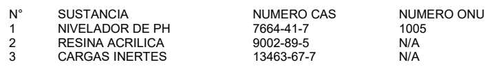

Cobertura 1.0 · precisión 1.0 · estado: **sin diferencias**

Markdown extraído:

|   N° | SUSTANCIA       | NUMERO CAS   | NUMERO ONU   |
|------|-----------------|--------------|--------------|
|    1 | NIVELADOR DE PH | 7664-41-7    | 1005         |
|    2 | RESINA ACRILICA | 9002-89-5    | N/A          |
|    3 | CARGAS INERTES  | 13463-67-7   | N/A          |

## FDS002 — bloque de texto (sin tablas útiles), página 2, sección 9 (Propiedades físicas y químicas)

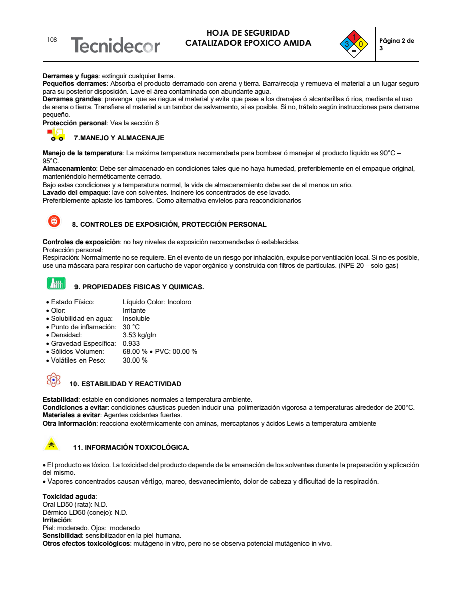

Cobertura  · precisión 1.0 · estado: **sin diferencias**

Markdown extraído:

## 9. PROPIEDADES FISICAS Y QUIMICAS.
- **Estado Físico:** Líquido Color: Incoloro  
- **Olor:** Irritante  
- **Solubilidad en agua:** Insoluble
- Punto de inflamación: 30 °C
- Densidad:
3.53 kg/gln
- Gravedad Específica: 0.933
- **Sólidos Volumen:** 68.00 % · PVC: 00.00 %  
- **Volátiles en Peso:** 30.00 %

## FDS003 — tabla, página 1, sección 3 (Composición / información sobre los componentes)

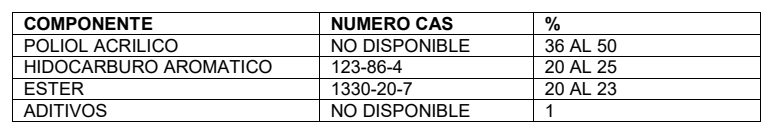

Cobertura 1.0 · precisión 1.0 · estado: **sin diferencias**

Markdown extraído:

| COMPONENTE            | NUMERO CAS    | %        |
|-----------------------|---------------|----------|
| POLIOL ACRILICO       | NO DISPONIBLE | 36 AL 50 |
| HIDOCARBURO AROMATICO | 123-86-4      | 20 AL 25 |
| ESTER                 | 1330-20-7     | 20 AL 23 |
| ADITIVOS              | NO DISPONIBLE | 1        |

## FDS004 — tabla, página 3, sección 9 (Propiedades físicas y químicas)

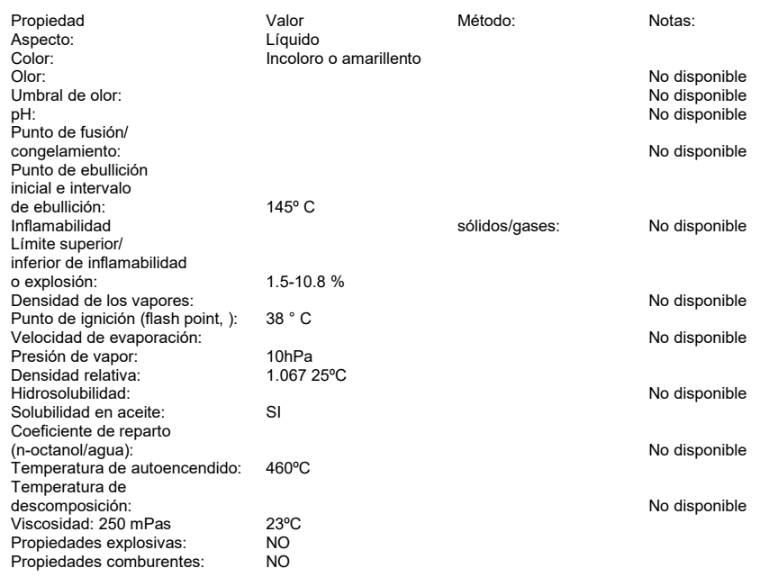

Cobertura 1.0 · precisión 1.0 · estado: **sin diferencias**

Markdown extraído:

| Propiedad                                                              | Valor                  | Método:        | Notas:        |
|------------------------------------------------------------------------|------------------------|----------------|---------------|
| Aspecto:                                                               | Líquido                |                |               |
| Color:                                                                 | Incoloro o amarillento |                |               |
| Olor:                                                                  |                        |                | No disponible |
| Umbral de olor:                                                        |                        |                | No disponible |
| pH:                                                                    |                        |                | No disponible |
| Punto de fusión/ congelamiento:                                        |                        |                | No disponible |
| Punto de ebullición inicial e intervalo                                |                        |                |               |
| de ebullición:                                                         | 145º C                 |                |               |
| Inflamabilidad                                                         |                        | sólidos/gases: | No disponible |
| Límite superior/ inferior de inflamabilidad                            |                        |                |               |
| o explosión:                                                           | 1.5-10.8 %             |                |               |
| Densidad de los vapores:                                               |                        |                |               |
|                                                                        |                        |                | No disponible |
| Punto de ignición (flash point, ):                                     | 38 ° C                 |                |               |
| Velocidad de evaporación:                                              |                        |                | No disponible |
| Presión de vapor:                                                      | 10hPa                  |                |               |
| Densidad relativa:                                                     | 1.067 25ºC             |                |               |
| Hidrosolubilidad:                                                      |                        |                | No disponible |
| Solubilidad en aceite:                                                 | SI                     |                |               |
| Coeficiente de reparto (n-octanol/agua): Temperatura de autoencendido: | 460ºC                  |                | No disponible |
| Temperatura de                                                         |                        |                |               |
| descomposición:                                                        |                        |                | No disponible |
| Viscosidad: 250 mPas                                                   | 23ºC                   |                |               |
| Propiedades explosivas:                                                | NO                     |                |               |
| Propiedades comburentes:                                               | NO                     |                |               |

## FDS005 — tabla, página 1, sección 3 (Composición / información sobre los componentes)

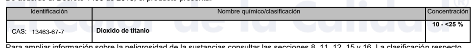

Cobertura 1.0 · precisión 1.0 · estado: **sin diferencias**

Markdown extraído:

| Identificación   | Nombre químico/clasificación   | Concentración   |
|------------------|--------------------------------|-----------------|
| CAS: 13463-67-7  | Dioxido de titanio             | 10 - <25 %      |

## FDS006 — tabla, página 2, sección 3 (Composición / información sobre los componentes)

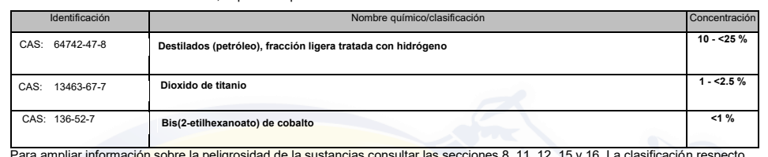

Cobertura 1.0 · precisión 1.0 · estado: **sin diferencias**

Markdown extraído:

| Identificación   | Nombre químico/clasificación                                 | Concentración   |
|------------------|--------------------------------------------------------------|-----------------|
| CAS: 64742-47-8  | Destilados (petróleo), fracción ligera tratada con hidrógeno | 10 - <25 %      |
| CAS: 13463-67-7  | Dioxido de titanio                                           | 1 - <2.5 %      |
| CAS: 136-52-7    | Bis(2-etilhexanoato) de cobalto                              | <1 %            |

## FDS007 — tabla, página 2, sección 3 (Composición / información sobre los componentes)

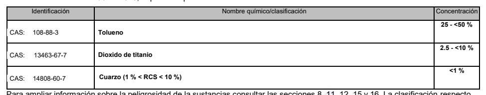

Cobertura 1.0 · precisión 1.0 · estado: **sin diferencias**

Markdown extraído:

| Identificación   | Identificación   | Nombre químico/clasificación   | Concentración   |
|------------------|------------------|--------------------------------|-----------------|
| CAS:             | 108-88-3         | Tolueno                        | 25 - <50 %      |
| CAS:             | 13463-67-7       | Dioxido de titanio             | 2.5 - <10 %     |
| CAS:             | 14808-60-7       | Cuarzo (1 % < RCS < 10 %)      | <1 %            |

## FDS008 — tabla, página 2, sección 3 (Composición / información sobre los componentes)

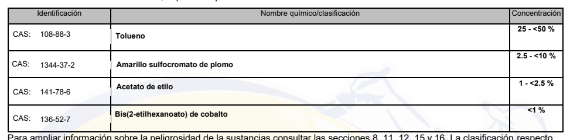

Cobertura 1.0 · precisión 1.0 · estado: **sin diferencias**

Markdown extraído:

| Identificación   | Identificación   | Nombre químico/clasificación    | Concentración   |
|------------------|------------------|---------------------------------|-----------------|
| CAS:             | 108-88-3         | Tolueno                         | 25 - <50 %      |
| CAS:             | 1344-37-2        | Amarillo sulfocromato de plomo  | 2.5 - <10 %     |
| CAS:             | 141-78-6         | Acetato de etilo                | 1 - <2.5 %      |
| CAS:             | 136-52-7         | Bis(2-etilhexanoato) de cobalto | <1 %            |

## FDS009 — tabla, página 1, sección 3 (Composición / información sobre los componentes)

Cobertura 1.0 · precisión 1.0 · estado: **sin diferencias**

Markdown extraído:

| COMPONENTE   | NUMERO CAS   |
|--------------|--------------|
| Xanthan gum  | 11138-66-2   |

## FDS010 — tabla, página 2, sección 3 (Composición / información sobre los componentes)

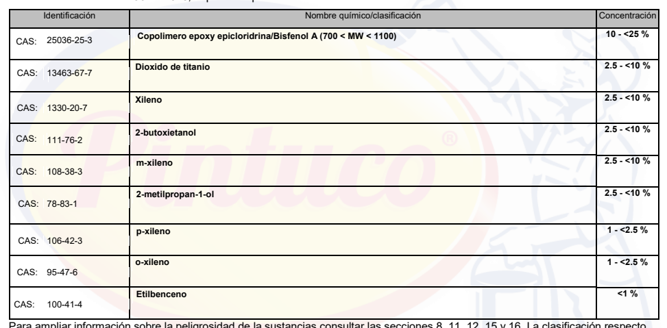

Cobertura 1.0 · precisión 1.0 · estado: **sin diferencias**

Markdown extraído:

| Identificación   | Identificación   | Nombre químico/clasificación                                | Concentración   |
|------------------|------------------|-------------------------------------------------------------|-----------------|
| CAS:             | 25036-25-3       | Copolimero epoxy epicloridrina/Bisfenol A (700 < MW < 1100) | 10 - <25 %      |
| CAS:             | 13463-67-7       | Dioxido de titanio                                          | 2.5 - <10 %     |
| CAS:             | 1330-20-7        | Xileno                                                      | 2.5 - <10 %     |
| CAS:             | 111-76-2         | 2-butoxietanol                                              | 2.5 - <10 %     |
| CAS:             | 108-38-3         | m-xileno                                                    | 2.5 - <10 %     |
| CAS:             | 78-83-1          | 2-metilpropan-1-ol                                          | 2.5 - <10 %     |
| CAS:             | 106-42-3         | p-xileno                                                    | 1 - <2.5 %      |
| CAS:             | 95-47-6          | o-xileno                                                    | 1 - <2.5 %      |
| CAS:             | 100-41-4         | Etilbenceno                                                 | <1 %            |

## FDS011 — tabla, página 1, sección 3 (Composición / información sobre los componentes)

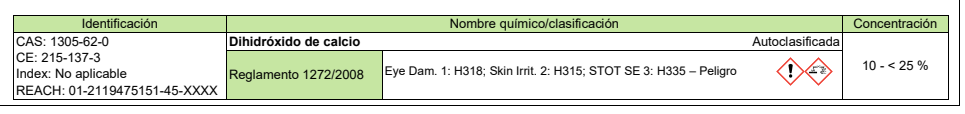

Cobertura 1.0 · precisión 1.0 · estado: **sin diferencias**

Markdown extraído:

| Identificación                                                 | Nombre químico/clasificación   | Nombre químico/clasificación                                     | Nombre químico/clasificación   | Concentración   |
|----------------------------------------------------------------|--------------------------------|------------------------------------------------------------------|--------------------------------|-----------------|
| CAS: 1305-62-0                                                 | Dihidróxido de calcio          | Dihidróxido de calcio                                            | Autoclasificada                |                 |
| CE: 215-137-3 Index: No aplicable REACH: 01-2119475151-45-XXXX | Reglamento 1272/2008           | Eye Dam. 1: H318; Skin Irrit. 2: H315; STOT SE 3: H335 - Peligro |                                | 10 - < 25 %     |

## FDS013 — tabla, página 1, sección 3 (Composición / información sobre los componentes)

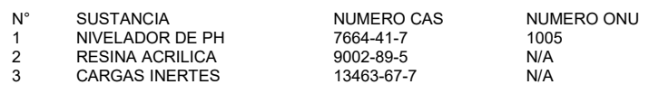

Cobertura 1.0 · precisión 1.0 · estado: **sin diferencias**

Markdown extraído:

|   N° | SUSTANCIA       | NUMERO CAS   | NUMERO ONU   |
|------|-----------------|--------------|--------------|
|    1 | NIVELADOR DE PH | 7664-41-7    | 1005         |
|    2 | RESINA ACRILICA | 9002-89-5    | N/A          |
|    3 | CARGAS INERTES  | 13463-67-7   | N/A          |

## FDS014 — tabla, página 1, sección 3 (Composición / información sobre los componentes)

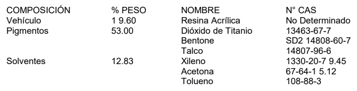

Cobertura 1.0 · precisión 1.0 · estado: **sin diferencias**

Markdown extraído:

| COMPOSICIÓN   | % PESO   | NOMBRE             | N° CAS         |
|---------------|----------|--------------------|----------------|
| Vehículo      | 1 9.60   | Resina Acrílica    | No Determinado |
| Pigmentos     | 53.00    | Dióxido de Titanio | 13463-67-7     |
|               |          | Bentone            | SD2 14808-60-7 |
|               |          | Talco              | 14807-96-6     |
| Solventes     | 12.83    | Xileno             | 1330-20-7 9.45 |
|               |          | Acetona            | 67-64-1 5.12   |
|               |          | Tolueno            | 108-88-3       |

## FDS015 — bloque de texto (sin tablas útiles), página 3, sección 9 (Propiedades físicas y químicas)

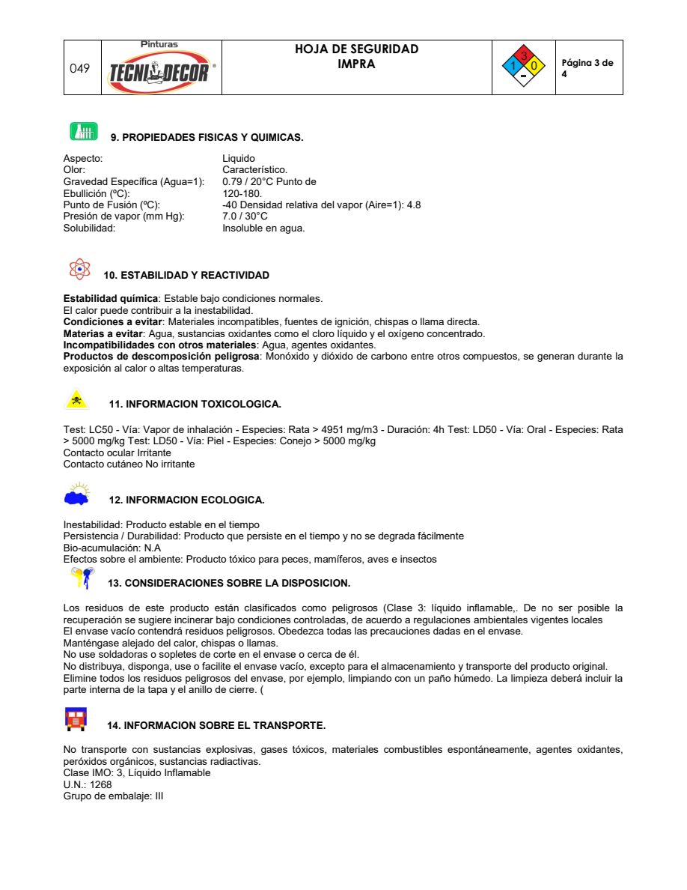

Cobertura  · precisión 1.0 · estado: **sin diferencias**

Markdown extraído:

9. PROPIEDADES FISICAS Y QUIMICAS.
Aspecto: Liquido Olor: Característico. Gravedad Específica (Agua=1): 0.79 / 20°C Punto de Ebullición (ºC): 120-180. Punto de Fusión (ºC): -40 Densidad relativa del vapor (Aire=1): 4.8 Presión de vapor (mm Hg): 7.0 / 30°C Solubilidad: Insoluble en agua.

## FDS016 — bloque de texto (sin tablas útiles), página 3, sección 9 (Propiedades físicas y químicas)

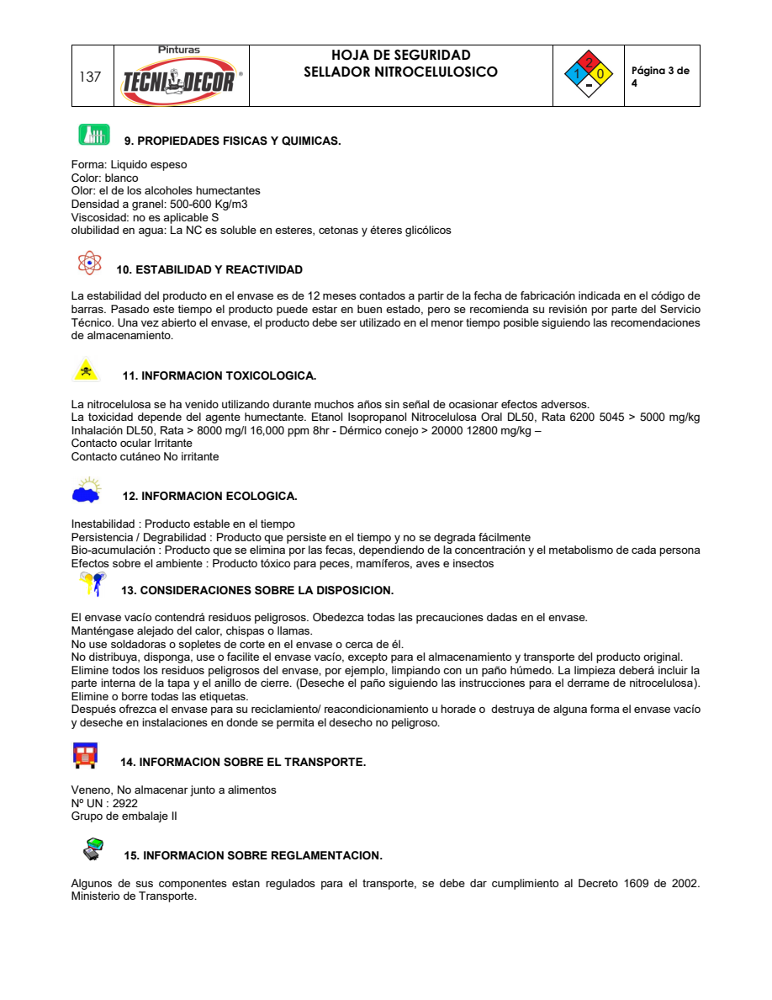

Cobertura  · precisión 1.0 · estado: **sin diferencias**

Markdown extraído:

## 9. PROPIEDADES FISICAS Y QUIMICAS.
Forma: Liquido espeso Color: blanco Olor: el de los alcoholes humectantes Densidad a granel: 500-600 Kg/m3 Viscosidad: no es aplicable S olubilidad en agua: La NC es soluble en esteres, cetonas y éteres glicólicos

## FDS017 — bloque de texto (sin tablas útiles), página 2, sección 9 (Propiedades físicas y químicas)

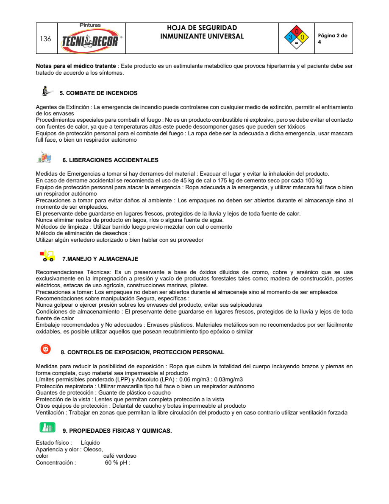

Cobertura  · precisión 1.0 · estado: **sin diferencias**

Markdown extraído:

9. PROPIEDADES FISICAS Y QUIMICAS.
Estado físico : Líquido Apariencia y olor : Oleoso, color café verdoso Concentración : 60 % pH :

## FDS018 — tabla, página 1, sección 3 (Composición / información sobre los componentes)

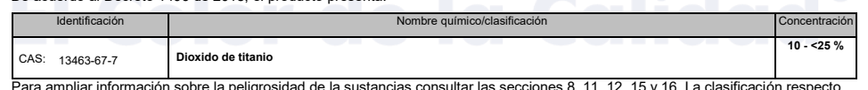

Cobertura 1.0 · precisión 1.0 · estado: **sin diferencias**

Markdown extraído:

| Identificación   | Nombre químico/clasificación   | Concentración   |
|------------------|--------------------------------|-----------------|
| CAS: 13463-67-7  | Dioxido de titanio             | 10 - <25 %      |

## FDS019 — tabla, página 1, sección 3 (Composición / información sobre los componentes)

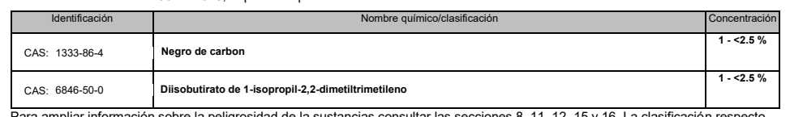

Cobertura 1.0 · precisión 1.0 · estado: **sin diferencias**

Markdown extraído:

| Identificación   | Nombre químico/clasificación                        | Concentración   |
|------------------|-----------------------------------------------------|-----------------|
| CAS: 1333-86-4   | Negro de carbon                                     | 1 - <2.5 %      |
| CAS: 6846-50-0   | Diisobutirato de 1-isopropil-2,2-dimetiltrimetileno | 1 - <2.5 %      |

## FDS020 — tabla, página 3, sección 3 (Composición / información sobre los componentes)

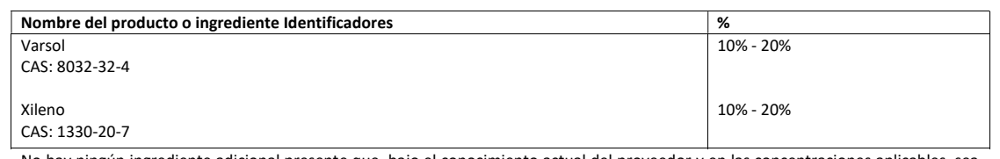

Cobertura 1.0 · precisión 1.0 · estado: **sin diferencias**

Markdown extraído:

| Nombre del producto o ingrediente Identificadores | % |
|---|---|
| Varsol CAS: 8032-32-4 | 10% - 20% |
| Xileno CAS: 1330-20-7 | 10% - 20% |

## FDS021 — tabla, página 2, sección 3 (Composición / información sobre los componentes)

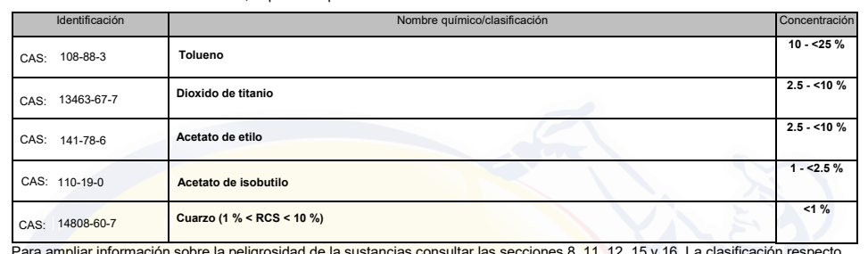

Cobertura 1.0 · precisión 1.0 · estado: **sin diferencias**

Markdown extraído:

| Identificación   | Identificación   | Nombre químico/clasificación   | Concentración   |
|------------------|------------------|--------------------------------|-----------------|
| CAS:             | 108-88-3         | Tolueno                        | 10 - <25 %      |
| CAS:             | 13463-67-7       | Dioxido de titanio             | 2.5 - <10 %     |
| CAS:             | 141-78-6         | Acetato de etilo               | 2.5 - <10 %     |
| CAS:             | 110-19-0         | Acetato de isobutilo           | 1 - <2.5 %      |
| CAS:             | 14808-60-7       | Cuarzo (1 % < RCS < 10 %)      | <1 %            |

## FDS022 — tabla, página 2, sección 3 (Composición / información sobre los componentes)

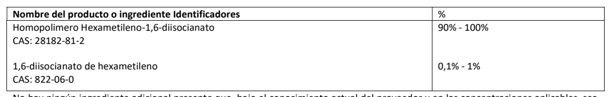

Cobertura 1.0 · precisión 1.0 · estado: **sin diferencias**

Markdown extraído:

| Nombre del producto o ingrediente Identificadores   | %          |
|-----------------------------------------------------|------------|
| Homopolimero Hexametileno-1,6-diisocianato          | 90% - 100% |
| CAS: 28182-81-2                                     |            |
| 1,6-diisocianato de hexametileno                    | 0,1% - 1%  |
| CAS: 822-06-0                                       |            |

## FDS023 — tabla, página 2, sección 3 (Composición / información sobre los componentes)

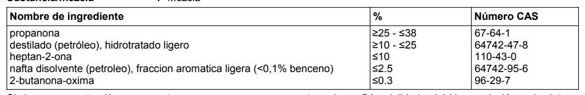

Cobertura 1.0 · precisión 1.0 · estado: **sin diferencias**

Markdown extraído:

| Nombre de ingrediente                                                  | %         | Número CAS   |
|------------------------------------------------------------------------|-----------|--------------|
| propanona                                                              | ≥25 - ≤38 | 67-64-1      |
| destilado (petróleo), hidrotratado ligero                              | ≥10 - ≤25 | 64742-47-8   |
| heptan-2-ona                                                           | ≤10       | 110-43-0     |
| nafta disolvente (petroleo), fraccion aromatica ligera (<0,1% benceno) | ≤2.5      | 64742-95-6   |
| 2-butanona-oxima                                                       | ≤0.3      | 96-29-7      |

Si alguna concentración se presenta como un rango, es para proteger la confidencialidad o debido a variación en los lotes.

## FDS024 — tabla, página 2, sección 3 (Composición / información sobre los componentes)

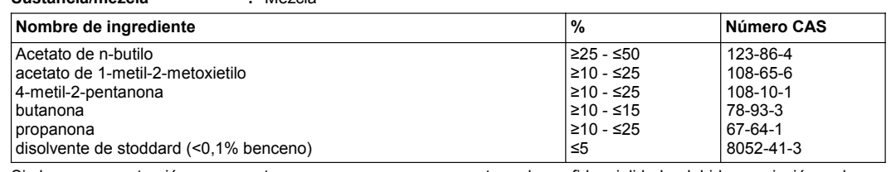

Cobertura 1.0 · precisión 1.0 · estado: **sin diferencias**

Markdown extraído:

| Nombre de ingrediente                  | %         | Número CAS   |
|----------------------------------------|-----------|--------------|
| Acetato de n-butilo                    | ≥25 - ≤50 | 123-86-4     |
| acetato de 1-metil-2-metoxietilo       | ≥10 - ≤25 | 108-65-6     |
| 4-metil-2-pentanona                    | ≥10 - ≤25 | 108-10-1     |
| butanona                               | ≥10 - ≤15 | 78-93-3      |
| propanona                              | ≥10 - ≤25 | 67-64-1      |
| disolvente de stoddard (<0,1% benceno) | ≤5        | 8052-41-3    |

Si alguna concentración se presenta como un rango, es para proteger la confidencialidad o debido a variación en los lotes.

## FDS025 — tabla, página 2, sección 3 (Composición / información sobre los componentes)

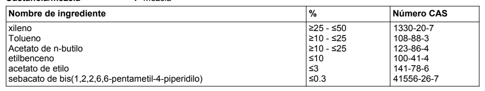

Cobertura 1.0 · precisión 1.0 · estado: **sin diferencias**

Markdown extraído:

| Nombre de ingrediente                              | %         | Número CAS   |
|----------------------------------------------------|-----------|--------------|
| xileno                                             | ≥25 - ≤50 | 1330-20-7    |
| Tolueno                                            | ≥10 - ≤25 | 108-88-3     |
| Acetato de n-butilo                                | ≥10 - ≤25 | 123-86-4     |
| etilbenceno                                        | ≤10       | 100-41-4     |
| acetato de etilo                                   | ≤3        | 141-78-6     |
| sebacato de bis(1,2,2,6,6-pentametil-4-piperidilo) | ≤0.3      | 41556-26-7   |

## FDS026 — tabla, página 2, sección 3 (Composición / información sobre los componentes)

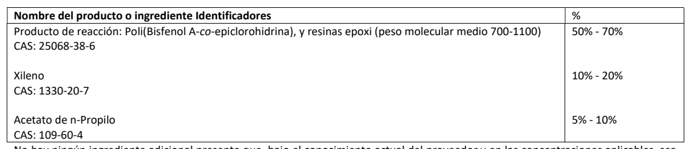

Cobertura 1.0 · precisión 1.0 · estado: **sin diferencias**

Markdown extraído:

| Nombre del producto o ingrediente Identificadores                                                                          | %         |
|----------------------------------------------------------------------------------------------------------------------------|-----------|
| Producto de reacción: Poli(Bisfenol A-co-epiclorohidrina), y resinas epoxi (peso molecular medio 700-1100) CAS: 25068-38-6 | 50% - 70% |
| Xileno                                                                                                                     | 10% - 20% |
| CAS: 1330-20-7 Acetato de n-Propilo                                                                                        | 5% - 10%  |
| CAS: 109-60-4                                                                                                              |           |

## FDS027 — tabla, página 2, sección 3 (Composición / información sobre los componentes)

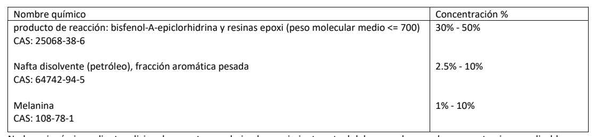

Cobertura 1.0 · precisión 1.0 · estado: **sin diferencias**

Markdown extraído:

| Nombre químico                                                                                                | Concentración %   |
|---------------------------------------------------------------------------------------------------------------|-------------------|
| producto de reacción: bisfenol-A-epiclorhidrina y resinas epoxi (peso molecular medio <= 700) CAS: 25068-38-6 | 30% - 50%         |
| Nafta disolvente (petróleo), fracción aromática pesada CAS: 64742-94-5                                        | 2.5% - 10%        |
| Melanina CAS: 108-78-1                                                                                        | 1% - 10%          |

## FDS028 — tabla, página 2, sección 3 (Composición / información sobre los componentes)

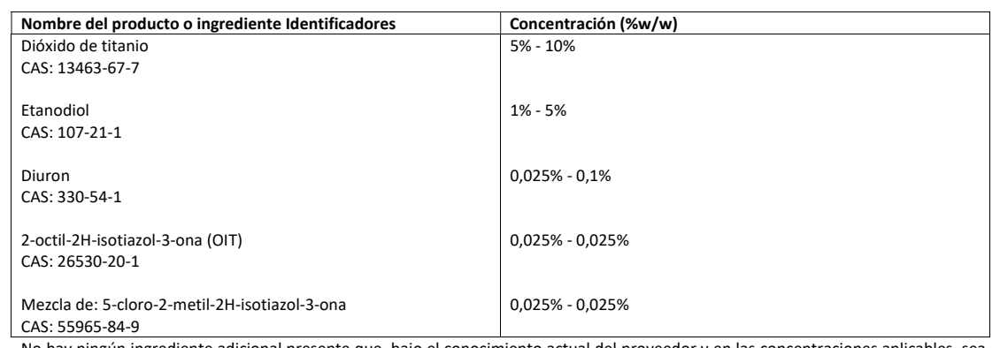

Cobertura 1.0 · precisión 1.0 · estado: **sin diferencias**

Markdown extraído:

| Nombre del producto o ingrediente Identificadores             | Concentración (%w/w)   |
|---------------------------------------------------------------|------------------------|
| Dióxido de titanio CAS: 13463-67-7                            | 5% - 10%               |
| Etanodiol CAS: 107-21-1                                       | 1% - 5%                |
| Diuron CAS: 330-54-1                                          | 0,025% - 0,1%          |
| 2-octil-2H-isotiazol-3-ona (OIT) CAS: 26530-20-1              | 0,025% - 0,025%        |
| Mezcla de: 5-cloro-2-metil-2H-isotiazol-3-ona CAS: 55965-84-9 | 0,025% - 0,025%        |

## FDS029 — tabla, página 2, sección 3 (Composición / información sobre los componentes)

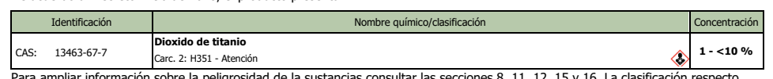

Cobertura 1.0 · precisión 1.0 · estado: **sin diferencias**

Markdown extraído:

| Identificación   | Identificación   | Nombre químico/clasificación                | Concentración   |
|------------------|------------------|---------------------------------------------|-----------------|
| CAS:             | 13463-67-7       | Dioxido de titanio Carc. 2: H351 - Atención | 1 - <10 %       |

## FDS030 — tabla, página 2, sección 3 (Composición / información sobre los componentes)

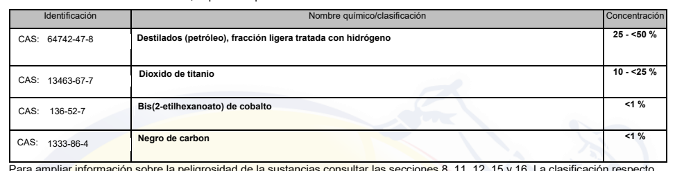

Cobertura 1.0 · precisión 1.0 · estado: **sin diferencias**

Markdown extraído:

| Identificación   | Nombre químico/clasificación                                 | Concentración   |
|------------------|--------------------------------------------------------------|-----------------|
| CAS: 64742-47-8  | Destilados (petróleo), fracción ligera tratada con hidrógeno | 25 - <50 %      |
| CAS: 13463-67-7  | Dioxido de titanio                                           | 10 - <25 %      |
| CAS: 136-52-7    | Bis(2-etilhexanoato) de cobalto                              | <1 %            |
| CAS: 1333-86-4   | Negro de carbon                                              | <1 %            |

## FDS031 — tabla, página 6, sección 9 (Propiedades físicas y químicas)

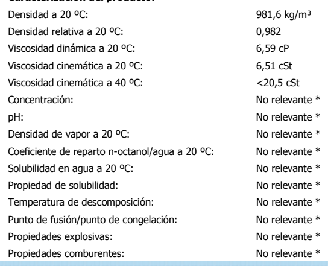

Cobertura 1.0 · precisión 1.0 · estado: **sin diferencias**

Markdown extraído:

| Densidad a 20 ºC:                              | 981,6 kg/m³    |
|------------------------------------------------|----------------|
| Densidad relativa a 20 ºC:                     | 0,982          |
| Viscosidad dinámica a 20 ºC:                   | 6,59 cP        |
| Viscosidad cinemática a 20 ºC:                 | 6,51 cSt       |
| Viscosidad cinemática a 40 ºC:                 | <20,5 cSt      |
| Concentración:                                 | No relevante * |
| pH:                                            | No relevante * |
| Densidad de vapor a 20 ºC:                     | No relevante * |
| Coeficiente de reparto n-octanol/agua a 20 ºC: | No relevante * |
| Solubilidad en agua a 20 ºC:                   | No relevante * |
| Propiedad de solubilidad:                      | No relevante * |
| Temperatura de descomposición:                 | No relevante * |
| Punto de fusión/punto de congelación:          | No relevante * |
| Propiedades explosivas:                        | No relevante * |
| Propiedades comburentes:                       | No relevante * |

## FDS032 — tabla, página 2, sección 3 (Composición / información sobre los componentes)

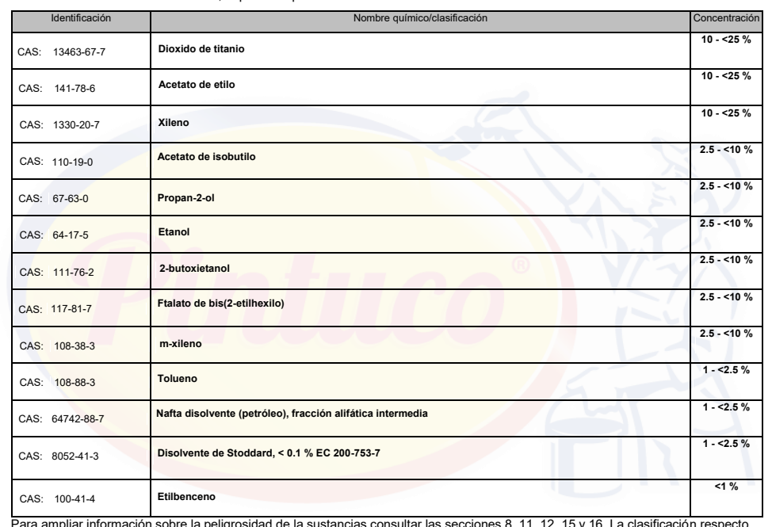

Cobertura 1.0 · precisión 1.0 · estado: **sin diferencias**

Markdown extraído:

|      | Identificación   | Nombre químico/clasificación                               | Concentración   |
|------|------------------|------------------------------------------------------------|-----------------|
| CAS: | 13463-67-7       | Dioxido de titanio                                         | 10 - <25 %      |
| CAS: | 141-78-6         | Acetato de etilo                                           | 10 - <25 %      |
| CAS: | 1330-20-7        | Xileno                                                     | 10 - <25 %      |
| CAS: | 110-19-0         | Acetato de isobutilo                                       | 2.5 - <10 %     |
| CAS: | 67-63-0          | Propan-2-ol                                                | 2.5 - <10 %     |
| CAS: | 64-17-5          | Etanol                                                     | 2.5 - <10 %     |
| CAS: | 111-76-2         | 2-butoxietanol                                             | 2.5 - <10 %     |
| CAS: | 117-81-7         | Ftalato de bis(2-etilhexilo)                               | 2.5 - <10 %     |
| CAS: | 108-38-3         | m-xileno                                                   | 2.5 - <10 %     |
| CAS: | 108-88-3         | Tolueno                                                    | 1 - <2.5 %      |
| CAS: | 64742-88-7       | Nafta disolvente (petróleo), fracción alifática intermedia | 1 - <2.5 %      |
| CAS: | 8052-41-3        | Disolvente de Stoddard, < 0.1 % EC 200-753-7               | 1 - <2.5 %      |
| CAS: | 100-41-4         | Etilbenceno                                                | <1 %            |

## FDS033 — tabla, página 2, sección 3 (Composición / información sobre los componentes)

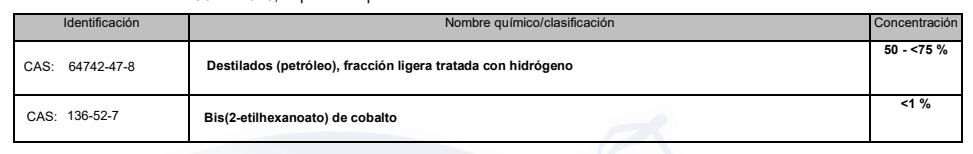

Cobertura 1.0 · precisión 1.0 · estado: **sin diferencias**

Markdown extraído:

| Identificación   | Nombre químico/clasificación                                 | Concentración   |
|------------------|--------------------------------------------------------------|-----------------|
| CAS: 64742-47-8  | Destilados (petróleo), fracción ligera tratada con hidrógeno | 50 - <75 %      |
| CAS: 136-52-7    | Bis(2-etilhexanoato) de cobalto                              | <1 %            |

## FDS034 — tabla, página 2, sección 3 (Composición / información sobre los componentes)

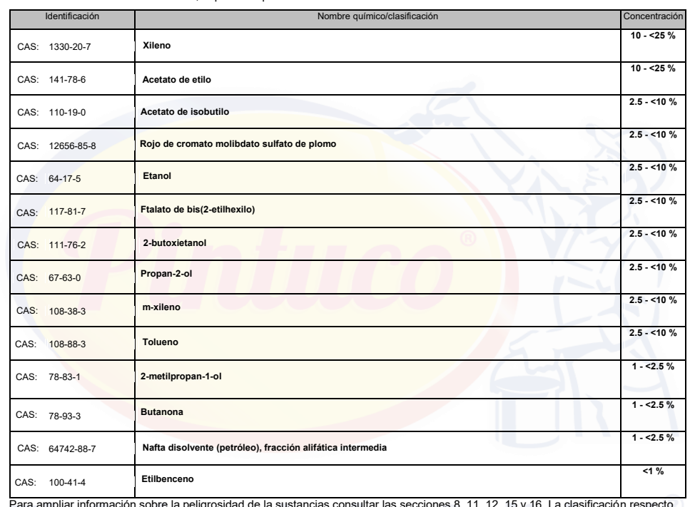

Cobertura 1.0 · precisión 1.0 · estado: **sin diferencias**

Markdown extraído:

| Identificación   | Nombre químico/clasificación                               | Concentración   |
|------------------|------------------------------------------------------------|-----------------|
| CAS: 1330-20-7   | Xileno                                                     | 10 - <25 %      |
| CAS: 141-78-6    | Acetato de etilo                                           | 10 - <25 %      |
| CAS: 110-19-0    | Acetato de isobutilo                                       | 2.5 - <10 %     |
| CAS: 12656-85-8  | Rojo de cromato molibdato sulfato de plomo                 | 2.5 - <10 %     |
| CAS: 64-17-5     | Etanol                                                     | 2.5 - <10 %     |
| CAS: 117-81-7    | Ftalato de bis(2-etilhexilo)                               | 2.5 - <10 %     |
| CAS: 111-76-2    | 2-butoxietanol                                             | 2.5 - <10 %     |
| CAS: 67-63-0     | Propan-2-ol                                                | 2.5 - <10 %     |
| CAS: 108-38-3    | m-xileno                                                   | 2.5 - <10 %     |
| CAS: 108-88-3    | Tolueno                                                    | 2.5 - <10 %     |
| CAS: 78-83-1     | 2-metilpropan-1-ol                                         | 1 - <2.5 %      |
| CAS: 78-93-3     | Butanona                                                   | 1 - <2.5 %      |
| CAS: 64742-88-7  | Nafta disolvente (petróleo), fracción alifática intermedia | 1 - <2.5 %      |
| CAS: 100-41-4    | Etilbenceno                                                | <1 %            |

## FDS035 — tabla, página 2, sección 3 (Composición / información sobre los componentes)

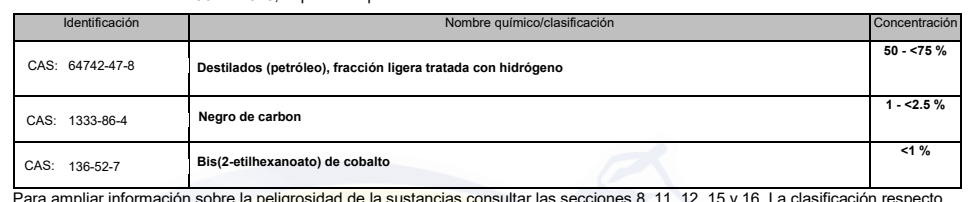

Cobertura 1.0 · precisión 1.0 · estado: **sin diferencias**

Markdown extraído:

| Identificación   | Nombre químico/clasificación                                 | Concentración   |
|------------------|--------------------------------------------------------------|-----------------|
| CAS: 64742-47-8  | Destilados (petróleo), fracción ligera tratada con hidrógeno | 50 - <75 %      |
| CAS: 1333-86-4   | Negro de carbon                                              | 1 - <2.5 %      |
| CAS: 136-52-7    | Bis(2-etilhexanoato) de cobalto                              | <1 %            |

## FDS036 — tabla, página 3, sección 3 (Composición / información sobre los componentes)

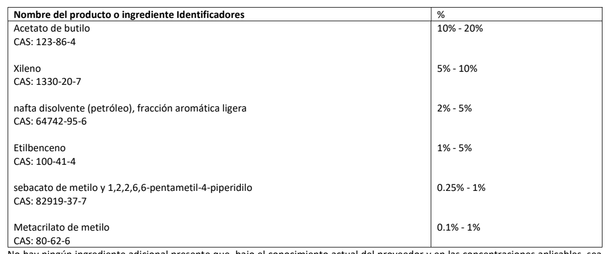

Cobertura 1.0 · precisión 1.0 · estado: **sin diferencias**

Markdown extraído:

| Nombre del producto o ingrediente Identificadores | % |
|---|---|
| Acetato de butilo CAS: 123-86-4 | 10% - 20% |
| Xileno CAS: 1330-20-7 | 5% - 10% |
| nafta disolvente (petróleo), fracción aromática ligera CAS: 64742-95-6 | 2% - 5% |
| Etilbenceno CAS: 100-41-4 | 1% - 5% |
| sebacato de metilo y 1,2,2,6,6-pentametil-4-piperidilo CAS: 82919-37-7 | 0.25% - 1% |
| Metacrilato de metilo CAS: 80-62-6 | 0.1% - 1% |

## FDS037 — tabla, página 2, sección 3 (Composición / información sobre los componentes)

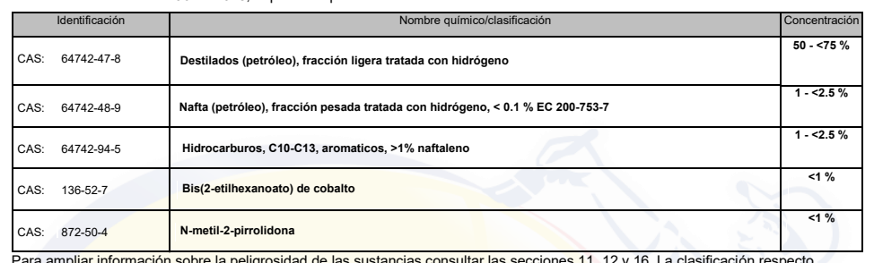

Cobertura 1.0 · precisión 1.0 · estado: **sin diferencias**

Markdown extraído:

| Identificación   | Identificación   | Nombre químico/clasificación                                                  | Concentración   |
|------------------|------------------|-------------------------------------------------------------------------------|-----------------|
| CAS:             | 64742-47-8       | Destilados (petróleo), fracción ligera tratada con hidrógeno                  | 50 - <75 %      |
| CAS:             | 64742-48-9       | Nafta (petróleo), fracción pesada tratada con hidrógeno, < 0.1 % EC 200-753-7 | 1 - <2.5 %      |
| CAS:             | 64742-94-5       | Hidrocarburos, C10-C13, aromaticos, >1% naftaleno                             | 1 - <2.5 %      |
| CAS:             | 136-52-7         | Bis(2-etilhexanoato) de cobalto                                               | <1 %            |
| CAS:             | 872-50-4         | N-metil-2-pirrolidona                                                         | <1 %            |

Para ampliar información sobre la peligrosidad de las sustancias consultar las secciones 11, 12 y 16. La clasificación respecto Carcinogenicidad de las sustancias se ha establecido en función de las monografías de la IARC adecuándola al sistema de clasificación SGA, para información sobre la clasificación IARC consulte la sección 11.

## FDS038 — tabla, página 2, sección 3 (Composición / información sobre los componentes)

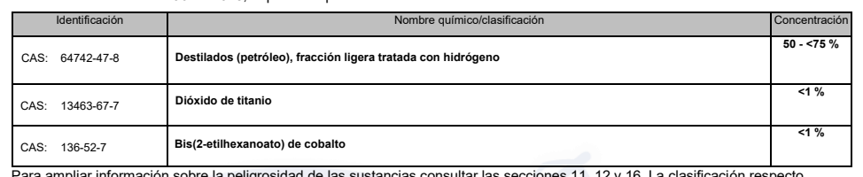

Cobertura 1.0 · precisión 1.0 · estado: **sin diferencias**

Markdown extraído:

| Identificación   | Identificación   | Nombre químico/clasificación                                 | Concentración   |
|------------------|------------------|--------------------------------------------------------------|-----------------|
| CAS:             | 64742-47-8       | Destilados (petróleo), fracción ligera tratada con hidrógeno | 50 - <75 %      |
| CAS:             | 13463-67-7       | Dióxido de titanio                                           | <1 %            |
| CAS:             | 136-52-7         | Bis(2-etilhexanoato) de cobalto                              | <1 %            |

## FDS039 — tabla, página 1, sección 3 (Composición / información sobre los componentes)

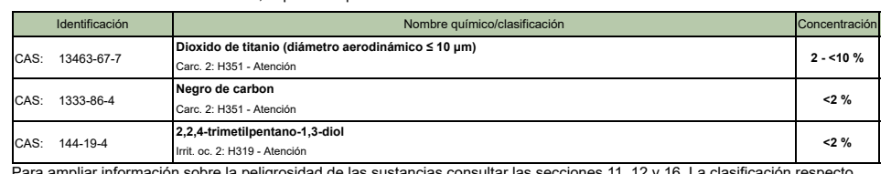

Cobertura 1.0 · precisión 1.0 · estado: **sin diferencias**

Markdown extraído:

|      | Identificación   | Nombre químico/clasificación                                                | Concentración   |
|------|------------------|-----------------------------------------------------------------------------|-----------------|
| CAS: | 13463-67-7       | Dioxido de titanio (diámetro aerodinámico ≤ 10 μm) Carc. 2: H351 - Atención | 2 - <10 %       |
| CAS: | 1333-86-4        | Negro de carbon Carc. 2: H351 - Atención                                    | <2 %            |
| CAS: | 144-19-4         | 2,2,4-trimetilpentano-1,3-diol Irrit. oc. 2: H319 - Atención                | <2 %            |

## FDS040 — tabla, página 1, sección 3 (Composición / información sobre los componentes)

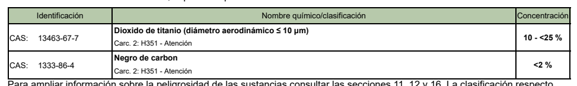

Cobertura 1.0 · precisión 1.0 · estado: **sin diferencias**

Markdown extraído:

| Identificación   | Identificación   | Nombre químico/clasificación                                                | Concentración   |
|------------------|------------------|-----------------------------------------------------------------------------|-----------------|
| CAS:             | 13463-67-7       | Dioxido de titanio (diámetro aerodinámico ≤ 10 μm) Carc. 2: H351 - Atención | 10 - <25 %      |
| CAS:             | 1333-86-4        | Negro de carbon Carc. 2: H351 - Atención                                    | <2 %            |

## FDS041 — tabla, página 1, sección 3 (Composición / información sobre los componentes)

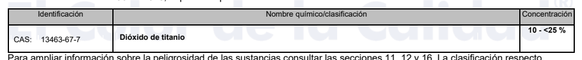

Cobertura 1.0 · precisión 1.0 · estado: **sin diferencias**

Markdown extraído:

| Identificación   | Identificación   | Nombre químico/clasificación   | Concentración   |
|------------------|------------------|--------------------------------|-----------------|
| CAS:             | 13463-67-7       | Dióxido de titanio             | 10 - <25 %      |

## FDS042 — tabla, página 2, sección 3 (Composición / información sobre los componentes)

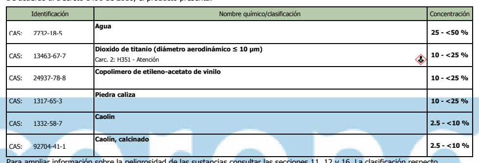

Cobertura 1.0 · precisión 1.0 · estado: **sin diferencias**

Markdown extraído:

| Identificación   | Identificación   | Nombre químico/clasificación                                                | Concentración   |
|------------------|------------------|-----------------------------------------------------------------------------|-----------------|
| CAS:             | 7732-18-5        | Agua                                                                        | 25 - <50 %      |
| CAS:             | 13463-67-7       | Dioxido de titanio (diámetro aerodinámico ≤ 10 μm) Carc. 2: H351 - Atención | 10 - <25 %      |
| CAS:             | 24937-78-8       | Copolimero de etileno-acetato de vinilo                                     | 10 - <25 %      |
| CAS:             | 1317-65-3        | Piedra caliza                                                               | 10 - <25 %      |
| CAS:             | 1332-58-7        | Caolin                                                                      | 2.5 - <10 %     |
| CAS:             | 92704-41-1       | Caolín, calcinado                                                           | 2.5 - <10 %     |

## FDS043 — tabla, página 2, sección 3 (Composición / información sobre los componentes)

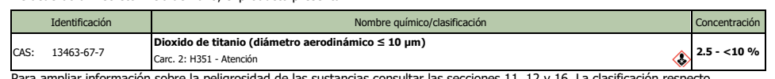

Cobertura 1.0 · precisión 1.0 · estado: **sin diferencias**

Markdown extraído:

| Identificación   | Identificación   | Nombre químico/clasificación                                                | Concentración   |
|------------------|------------------|-----------------------------------------------------------------------------|-----------------|
| CAS:             | 13463-67-7       | Dioxido de titanio (diámetro aerodinámico ≤ 10 μm) Carc. 2: H351 - Atención | 2.5 - <10 %     |

## FDS044 — tabla, página 2, sección 3 (Composición / información sobre los componentes)

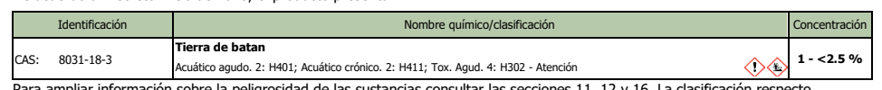

Cobertura 1.0 · precisión 1.0 · estado: **sin diferencias**

Markdown extraído:

| Identificación   | Identificación   | Nombre químico/clasificación                                                                      | Concentración   |
|------------------|------------------|---------------------------------------------------------------------------------------------------|-----------------|
| CAS:             | 8031-18-3        | Tierra de batan Acuático agudo. 2: H401; Acuático crónico. 2: H411; Tox. Agud. 4: H302 - Atención | 1 - <2.5 %      |

## FDS045 — tabla, página 2, sección 3 (Composición / información sobre los componentes)

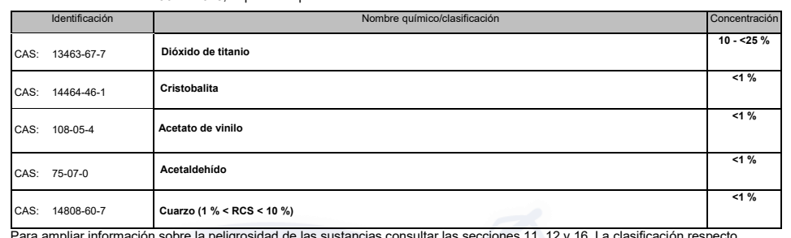

Cobertura 1.0 · precisión 1.0 · estado: **sin diferencias**

Markdown extraído:

| Identificación   | Identificación   | Nombre químico/clasificación   | Concentración   |
|------------------|------------------|--------------------------------|-----------------|
| CAS:             | 13463-67-7       | Dióxido de titanio             | 10 - <25 %      |
| CAS:             | 14464-46-1       | Cristobalita                   | <1 %            |
| CAS:             | 108-05-4         | Acetato de vinilo              | <1 %            |
| CAS:             | 75-07-0          | Acetaldehído                   | <1 %            |
| CAS:             | 14808-60-7       | Cuarzo (1 % < RCS < 10 %)      | <1 %            |

## FDS046 — tabla, página 1, sección 3 (Composición / información sobre los componentes)

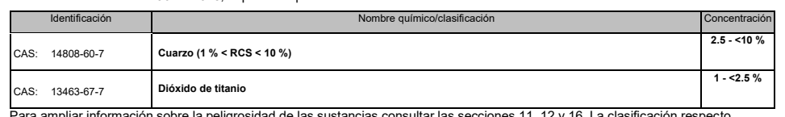

Cobertura 1.0 · precisión 1.0 · estado: **sin diferencias**

Markdown extraído:

| Identificación   | Identificación   | Nombre químico/clasificación   | Concentración   |
|------------------|------------------|--------------------------------|-----------------|
| CAS:             | 14808-60-7       | Cuarzo (1 % < RCS < 10 %)      | 2.5 - <10 %     |
| CAS:             | 13463-67-7       | Dióxido de titanio             | 1 - <2.5 %      |

## FDS047 — tabla, página 3, sección 3 (Composición / información sobre los componentes)

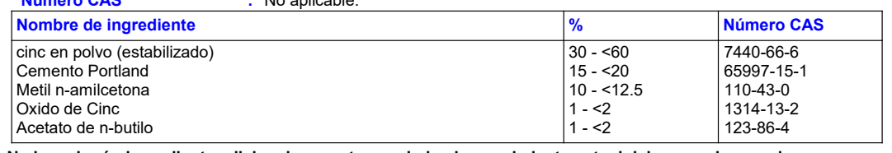

Cobertura 1.0 · precisión 1.0 · estado: **sin diferencias**

Markdown extraído:

| Nombre de ingrediente        | %          | Número CAS   |
|------------------------------|------------|--------------|
| cinc en polvo (estabilizado) | 30 - <60   | 7440-66-6    |
| Cemento Portland             | 15 - <20   | 65997-15-1   |
| Metil n-amilcetona           | 10 - <12.5 | 110-43-0     |
| Oxido de Cinc                | 1 - <2     | 1314-13-2    |
| Acetato de n-butilo          | 1 - <2     | 123-86-4     |

## FDS048 — tabla, página 3, sección 3 (Composición / información sobre los componentes)

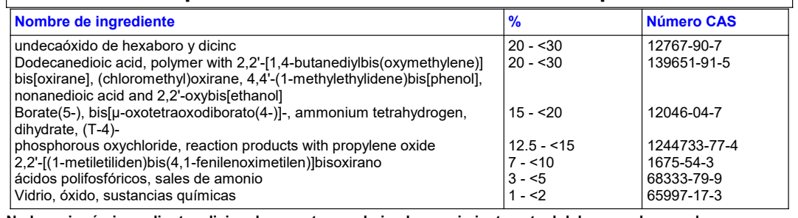

Cobertura 1.0 · precisión 1.0 · estado: **sin diferencias**

Markdown extraído:

| Nombre de ingrediente                                                                                                                                                                        | %          | Número CAS   |
|----------------------------------------------------------------------------------------------------------------------------------------------------------------------------------------------|------------|--------------|
| undecaóxido de hexaboro y dicinc                                                                                                                                                             | 20 - <30   | 12767-90-7   |
| Dodecanedioic acid, polymer with 2,2'-[1,4-butanediylbis(oxymethylene)] bis[oxirane], (chloromethyl)oxirane, 4,4'-(1-methylethylidene)bis[phenol], nonanedioic acid and 2,2'-oxybis[ethanol] | 20 - <30   | 139651-91-5  |
| Borate(5-), bis[μ-oxotetraoxodiborato(4-)]-, ammonium tetrahydrogen, dihydrate, (T-4)-                                                                                                       | 15 - <20   | 12046-04-7   |
| phosphorous oxychloride, reaction products with propylene oxide                                                                                                                              | 12.5 - <15 | 1244733-77-4 |
| 2,2'-[(1-metiletiliden)bis(4,1-fenilenoximetilen)]bisoxirano                                                                                                                                 | 7 - <10    | 1675-54-3    |
| ácidos polifosfóricos, sales de amonio                                                                                                                                                       | 3 - <5     | 68333-79-9   |
| Vidrio, óxido, sustancias químicas                                                                                                                                                           | 1 - <2     | 65997-17-3   |

## FDS049 — tabla, página 2, sección 3 (Composición / información sobre los componentes)

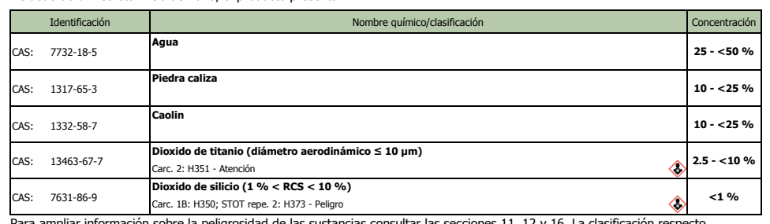

Cobertura 1.0 · precisión 1.0 · estado: **sin diferencias**

Markdown extraído:

| Identificación   | Identificación   | Nombre químico/clasificación                                                       | Concentración   |
|------------------|------------------|------------------------------------------------------------------------------------|-----------------|
| CAS:             | 7732-18-5        | Agua                                                                               | 25 - <50 %      |
| CAS:             | 1317-65-3        | Piedra caliza                                                                      | 10 - <25 %      |
| CAS:             | 1332-58-7        | Caolin                                                                             | 10 - <25 %      |
| CAS:             | 13463-67-7       | Dioxido de titanio (diámetro aerodinámico ≤ 10 μm) Carc. 2: H351 - Atención        | 2.5 - <10 %     |
| CAS:             | 7631-86-9        | Dioxido de silicio (1 % < RCS < 10 %) Carc. 1B: H350; STOT repe. 2: H373 - Peligro | <1 %            |

## FDS050 — tabla, página 2, sección 3 (Composición / información sobre los componentes)

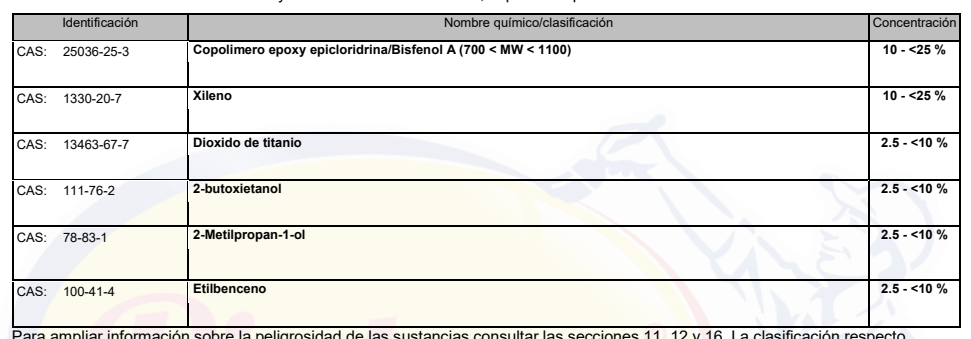

Cobertura 1.0 · precisión 1.0 · estado: **sin diferencias**

Markdown extraído:

|      | Identificación   | Nombre químico/clasificación                                | Concentración   |
|------|------------------|-------------------------------------------------------------|-----------------|
| CAS: | 25036-25-3       | Copolimero epoxy epicloridrina/Bisfenol A (700 < MW < 1100) | 10 - <25 %      |
| CAS: | 1330-20-7        | Xileno                                                      | 10 - <25 %      |
| CAS: | 13463-67-7       | Dioxido de titanio                                          | 2.5 - <10 %     |
| CAS: | 111-76-2         | 2-butoxietanol                                              | 2.5 - <10 %     |
| CAS: | 78-83-1          | 2-Metilpropan-1-ol                                          | 2.5 - <10 %     |
| CAS: | 100-41-4         | Etilbenceno                                                 | 2.5 - <10 %     |

## FDS051 — tabla, página 2, sección 3 (Composición / información sobre los componentes)

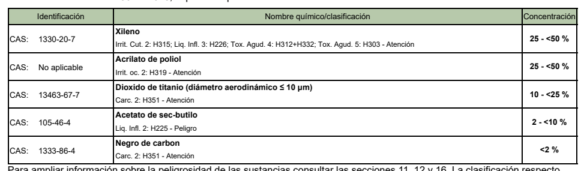

Cobertura 1.0 · precisión 1.0 · estado: **sin diferencias**

Markdown extraído:

| Identificación   | Identificación   | Nombre químico/clasificación                                                                           | Concentración   |
|------------------|------------------|--------------------------------------------------------------------------------------------------------|-----------------|
| CAS:             | 1330-20-7        | Xileno Irrit. Cut. 2: H315; Liq. Infl. 3: H226; Tox. Agud. 4: H312+H332; Tox. Agud. 5: H303 - Atención | 25 - <50 %      |
| CAS:             | No aplicable     | Acrilato de poliol Irrit. oc. 2: H319 - Atención                                                       | 25 - <50 %      |
| CAS:             | 13463-67-7       | Dioxido de titanio (diámetro aerodinámico ≤ 10 μm) Carc. 2: H351 - Atención                            | 10 - <25 %      |
| CAS:             | 105-46-4         | Acetato de sec-butilo Liq. Infl. 2: H225 - Peligro                                                     | 2 - <10 %       |
| CAS:             | 1333-86-4        | Negro de carbon Carc. 2: H351 - Atención                                                               | <2 %            |

## FDS052 — tabla, página 2, sección 3 (Composición / información sobre los componentes)

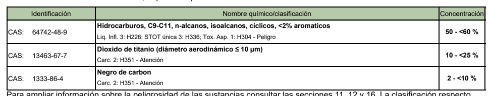

Cobertura 1.0 · precisión 1.0 · estado: **sin diferencias**

Markdown extraído:

| Identificación   | Identificación   | Nombre químico/clasificación                                                                                                               | Concentración   |
|------------------|------------------|--------------------------------------------------------------------------------------------------------------------------------------------|-----------------|
| CAS:             | 64742-48-9       | Hidrocarburos, C9-C11, n-alcanos, isoalcanos, ciclicos, <2% aromaticos Liq. Infl. 3: H226; STOT única 3: H336; Tox. Asp. 1: H304 - Peligro | 50 - <60 %      |
| CAS:             | 13463-67-7       | Dioxido de titanio (diámetro aerodinámico ≤ 10 μm) Carc. 2: H351 - Atención                                                                | 10 - <25 %      |
| CAS:             | 1333-86-4        | Negro de carbon Carc. 2: H351 - Atención                                                                                                   | 2 - <10 %       |

## FDS053 — tabla, página 2, sección 3 (Composición / información sobre los componentes)

Cobertura 1.0 · precisión 1.0 · estado: **sin diferencias**

Markdown extraído:

| Identificación   | Identificación   | Nombre químico/clasificación                                                                                                       | Concentración   |
|------------------|------------------|------------------------------------------------------------------------------------------------------------------------------------|-----------------|
| CAS:             | 123-86-4         | Acetato de n-butilo Liq. Infl. 3: H226; STOT única 3: H336 - Atención                                                              | 10 - <25 %      |
| CAS:             | 141-78-6         | Acetato de etilo Irrit. oc. 2: H319; Liq. Infl. 2: H225; STOT única 3: H336; Tox. Agud. 5: H303 - Peligro                          | 10 - <25 %      |
| CAS:             | 9003-01-4        | Acido poliacrilico Tox. Agud. 5: H303; Tox. Agud. 5: H313                                                                          | 10 - <25 %      |
| CAS:             | 13463-67-7       | Dioxido de titanio (diámetro aerodinámico ≤ 10 μm) Carc. 2: H351 - Atención                                                        | <2 %            |
| CAS:             | 111-76-2         | 2-butoxietanol Irrit. Cut. 2: H315; Irrit. oc. 2: H319; Liq. Infl. 4: H227; Tox. Agud. 4: H302+H332; Tox. Agud. 5: H313 - Atención | <2 %            |
| CAS:             | 1333-86-4        | Negro de carbon Carc. 2: H351 - Atención                                                                                           | <2 %            |

## FDS054 — tabla, página 1, sección 3 (Composición / información sobre los componentes)

Cobertura 1.0 · precisión 1.0 · estado: **sin diferencias**

Markdown extraído:

| Identificación   | Identificación   | Nombre químico/clasificación                                                                                                       | Concentración   |
|------------------|------------------|------------------------------------------------------------------------------------------------------------------------------------|-----------------|
| CAS:             | 13463-67-7       | Dioxido de titanio (diámetro aerodinámico ≤ 10 μm) Carc. 2: H351 - Atención                                                        | 10 - <25 %      |
| CAS:             | 111-76-2         | 2-butoxietanol Irrit. Cut. 2: H315; Irrit. oc. 2: H319; Liq. Infl. 4: H227; Tox. Agud. 4: H302+H332; Tox. Agud. 5: H313 - Atención | 2 - <10 %       |
| CAS:             | 1333-86-4        | Negro de carbon Carc. 2: H351 - Atención                                                                                           | <2 %            |

- CONTINÚA EN LA SIGUIENTE PÁGINA -

## FDS055 — tabla, página 2, sección 3 (Composición / información sobre los componentes)

Cobertura 1.0 · precisión 1.0 · estado: **sin diferencias**

Markdown extraído:

| Identificación   | Identificación   | Nombre químico/clasificación                                                                                                                                                                                                    | Concentración   |
|------------------|------------------|---------------------------------------------------------------------------------------------------------------------------------------------------------------------------------------------------------------------------------|-----------------|
| CAS:             | 8032-32-4        | Nafta de petróleo, solvente refinado. Irrit. Cut. 2: H315; Liq. Infl. 3: H226; Repr. 2: H361; STOT repe. 2: H373; STOT única 3: H335; Tox. Asp. 1: H304 - Peligro                                                               | 25 - <50 %      |
| CAS:             | 136-52-7         | Bis(2-etilhexanoato) de cobalto Acuático agudo. 1: H400; Acuático crónico. 3: H412; Carc. 2: H351; Irrit. oc. 2: H319; Repr. 1B: H360; Sens. Cut. 1A: H317 - Peligro                                                            | 0,2 - <2,5 %    |
| CAS:             | 100-41-4         | Etilbenceno Acuático agudo. 3: H402; Carc. 2: H351; Liq. Infl. 2: H225; Tox. Agud. 4: H332; Tox. Agud. 5: H303 - Peligro                                                                                                        | 0,2 - <2,5 %    |
| CAS:             | 8032-32-4        | Ligroína Carc. 1B: H350; Irrit. Cut. 2: H315; Irrit. oc. 2: H319; Liq. Infl. 4: H227; Muta. 1B: H340; Repr. 1B: H360; STOT repe. 2: H373; STOT única 3: H335; STOT única 3: H336; Tox. Asp. 1: H304 - Peligro                   | 0,2 - <2,5 %    |
| CAS:             | 96-29-7          | Oxima de 2-butanona Carc. 1B: H350; Irrit. Cut. 2: H315; Les. Oc. 1: H318; Liq. Infl. 4: H227; Sens. Cut. 1: H317; STOT repe. 2: H373; STOT única 1: H370; STOT única 3: H336; Tox. Agud. 3: H301; Tox. Agud. 4: H312 - Peligro | 0,2 - <2,5 %    |

## FDS056 — tabla, página 1, sección 3 (Composición / información sobre los componentes)

Cobertura 1.0 · precisión 1.0 · estado: **sin diferencias**

Markdown extraído:

| Identificación   | Identificación   | Nombre químico/clasificación                                                                                                                         | Concentración   |
|------------------|------------------|------------------------------------------------------------------------------------------------------------------------------------------------------|-----------------|
| CAS:             | 6846-50-0        | Diisobutirato de 1-isopropil-2,2-dimetiltrimetileno Acuático agudo. 3: H402; Acuático crónico. 3: H412; Repr. 2: H361; Tox. Agud. 5: H303 - Atención | 0,2 - <2,5 %    |
| CAS:             | 330-54-1         | Diurón (ISO) Acuático agudo. 1: H400; Acuático crónico. 1: H410; Carc. 2: H351; STOT repe. 2: H373; Tox. Agud. 4: H302 - Atención                    | <0,2 %          |

- CONTINÚA EN LA SIGUIENTE PÁGINA -

## FDS057 — tabla, página 2, sección 3 (Composición / información sobre los componentes)

Cobertura 1.0 · precisión 1.0 · estado: **sin diferencias**

Markdown extraído:

| Identificación   | Identificación   | Nombre químico/clasificación   | Concentración   |
|------------------|------------------|--------------------------------|-----------------|
| CAS:             | 100-42-5         | Estireno                       | <1 %            |

## FDS058 — tabla, página 2, sección 3 (Composición / información sobre los componentes)

Cobertura 1.0 · precisión 1.0 · estado: **sin diferencias**

Markdown extraído:

| Identificación   | Identificación   | Nombre químico/clasificación                                                                                                                                                                                                          | Concentración   |
|------------------|------------------|---------------------------------------------------------------------------------------------------------------------------------------------------------------------------------------------------------------------------------------|-----------------|
| CAS:             | 8032-32-4        | Ligroína Carc. 1B: H350; Irrit. Cut. 2: H315; Irrit. oc. 2: H319; Liq. Infl. 4: H227; Muta. 1B: H340; Repr. 1B: H360; STOT repe. 2: H373; STOT única 3: H335; STOT única 3: H336; Tox. Asp. 1: H304 - Peligro                         | 25 - <50 %      |
| CAS:             | 8032-32-4        | Nafta de petróleo, solvente refinado. Carc. 1B: H350; Liq. Infl. 3: H226; Muta. 1B: H340; Tox. Asp. 1: H304 - Peligro                                                                                                                 | 25 - <50 %      |
| CAS:             | 22464-99-9       | Ácido 2-etilhexanoico, sal de circonio Repr. 2: H361; Tox. Agud. 5: H303 - Atención 0.2 -                                                                                                                                             | <2.5 %          |
| CAS:             | 136-52-7         | Bis(2-etilhexanoato) de cobalto Acuático agudo. 1: H400; Acuático crónico. 3: H412; Carc. 2: H351; Irrit. oc. 2: H319; Repr. 1B: H360; Sens. Cut. 1A: H317 - Peligro                                                                  | 0.2 - <2.5 %    |
| CAS:             | 100-41-4         | Etilbenceno Acuático agudo. 3: H402; Carc. 2: H351; Liq. Infl. 2: H225; Tox. Agud. 4: H332; Tox. Agud. 5: H303 - Peligro                                                                                                              | 0.2 - <2.5 %    |
| CAS:             | 64742-48-9       | Nafta (petróleo), fracción pesada tratada con hidrógeno Carc. 1B: H350; Muta. 1B: H340; Tox. Agud. 5: H313; Tox. Asp. 1: H304 - Peligro                                                                                               | 0.2 - <2.5 %    |
| CAS:             | 96-29-7          | Oxima de 2-butanona Carc. 1B: H350; Irrit. Cut. 2: H315; Les. Oc. 1: H318; Liq. Infl. 4: H227; Sens. Cut. 1: H317; STOT repe. 2: H373; STOT única 1: H370; STOT única 3: H336; Tox. Agud. 3: H301; Tox. Agud. 4: H312 - Peligro 0.2 - | <2.5 %          |
| CAS:             | 136-53-8         | Bis(2-etilhexanoato) de cinc Acuático agudo. 1: H400; Acuático crónico. 3: H412; Irrit. oc. 2: H319; Repr. 2: H361; Tox. Agud. 5: H303 - Atención                                                                                     | <0.2 %          |
| CAS:             | 108-88-3         | Tolueno Acuático agudo. 2: H401; Irrit. Cut. 2: H315; Liq. Infl. 2: H225; Repr. 2: H361; STOT repe. 2: H373; STOT única 3: H336; Tox. Asp. 1: H304 - Peligro                                                                          | <0.2 %          |
| CAS:             | 64742-95-6       | Nafta disolvente (petróleo), fracción aromática ligera Carc. 1B: H350; Muta. 1B: H340; Tox. Agud. 5: H303; Tox. Asp. 1: H304 - Peligro                                                                                                | <0.2 %          |

## FDS059 — tabla, página 2, sección 3 (Composición / información sobre los componentes)

Cobertura 1.0 · precisión 1.0 · estado: **sin diferencias**

Markdown extraído:

| Identificación   | Identificación   | Nombre químico/clasificación                                                                                                       | Concentración   |
|------------------|------------------|------------------------------------------------------------------------------------------------------------------------------------|-----------------|
| CAS:             | 14808-60-7       | Cuarzo (RCS > 10 %) Carc. 1B: H350; STOT repe. 1: H372 - Peligro                                                                   | 2.5 - <10 %     |
| CAS:             | 330-54-1         | Diurón (ISO) Acuático agudo. 1: H400; Acuático crónico. 1: H410; Carc. 2: H351; STOT repe. 2: H373; Tox. Agud. 4: H302 - Atención  | <0.2 %          |
| CAS:             | 10605-21-7       | Carbendazim (ISO) Acuático agudo. 1: H400; Acuático crónico. 1: H410; Muta. 1B: H340; Repr. 1B: H360; Sens. Cut. 1: H317 - Peligro | <0.2 %          |

## FDS060 — tabla, página 2, sección 3 (Composición / información sobre los componentes)

Cobertura 1.0 · precisión 1.0 · estado: **sin diferencias**

Markdown extraído:

| Identificación   | Identificación   | Nombre químico/clasificación                                                                                                                       | Concentración   |
|------------------|------------------|----------------------------------------------------------------------------------------------------------------------------------------------------|-----------------|
| CAS:             | 25036-25-3       | Copolimero epoxy epicloridrina/Bisfenol A (700 < MW < 1100) Irrit. Cut. 2: H315; Irrit. oc. 2: H319; Sens. Cut. 1: H317 - Atención                 | 10 - <25 %      |
| CAS:             | 25036-25-3       | 4,4´-Isopropilidendifenol, Polímero con 2,2-Bis(p-(2,3-Epoxipropoxi)Fenil)Propan Sens. Cut. 1: H317 - Atención                                     | 10 - <25 %      |
| CAS:             | 108-38-3         | m-xileno Irrit. Cut. 2: H315; Liq. Infl. 3: H226; Tox. Agud. 4: H312+H332 - Atención                                                               | 2.5 - <10 %     |
| CAS:             | 1330-20-7        | Xileno Irrit. Cut. 2: H315; Liq. Infl. 3: H226; Tox. Agud. 4: H312+H332; Tox. Agud. 5: H303 - Atención                                             | 2.5 - <10 %     |
| CAS:             | 100-41-4         | Etilbenceno Acuático agudo. 3: H402; Carc. 2: H351; Liq. Infl. 2: H225; Tox. Agud. 4: H332; Tox. Agud. 5: H303 - Peligro                           | 2.5 - <10 %     |
| CAS:             | 95-47-6          | o-xileno Irrit. Cut. 2: H315; Liq. Infl. 3: H226; Tox. Agud. 4: H312+H332 - Atención                                                               | 2.5 - <10 %     |
| CAS:             | 106-42-3         | p-xileno Irrit. Cut. 2: H315; Liq. Infl. 3: H226; Tox. Agud. 4: H312+H332 - Atención                                                               | 2.5 - <10 %     |
| CAS:             | 110-80-5         | 2-etoxietanol Liq. Infl. 3: H226; Repr. 1B: H360; Tox. Agud. 4: H302+H332 - Peligro                                                                | 2.5 - <10 %     |
| CAS:             | 108-65-6         | acetato de 2-metoxi-1-metiletilo Liq. Infl. 3: H226; STOT única 3: H336 - Atención                                                                 | 0.2 - <2.5 %    |
| CAS:             | 14808-60-7       | Cuarzo (1 % < RCS < 10 %) Carc. 1B: H350; STOT repe. 2: H373 - Peligro                                                                             | 0.2 - <2.5 %    |
| CAS:             | 64742-95-6       | Nafta disolvente (petróleo), fracción aromática ligera Carc. 1B: H350; Muta. 1B: H340; Tox. Agud. 5: H303; Tox. Asp. 1: H304 - Peligro             | 0.2 - <2.5 %    |
| CAS:             | 108-31-6         | Anhídrido maleico Corr. Cut. 1B: H314; Les. Oc. 1: H318; Sens. Cut. 1A: H317; Sens. Resp.1: H334; STOT repe. 1: H372; Tox. Agud. 4: H302 - Peligro | <0.2 %          |

## FDS061 — tabla, página 2, sección 3 (Composición / información sobre los componentes)

Cobertura 1.0 · precisión 1.0 · estado: **sin diferencias**

Markdown extraído:

| Identificación   | Identificación   | Nombre químico/clasificación                                                     | Concentración   |
|------------------|------------------|----------------------------------------------------------------------------------|-----------------|
| CAS:             | 7732-18-5        | Agua                                                                             | 25 - <50 %      |
| CAS:             | 1317-65-3        | Piedra caliza                                                                    | 25 - <50 %      |
| CAS:             | No aplicable     | Polimero acrilico                                                                | 10 - <25 %      |
| CAS:             | 13463-67-7       | Dioxido de titanio (diámetro aerodinámico ≤ 10 μm) Carc. 2: H351 - Atención      | 2.5 - <10 %     |
| CAS:             | 67-63-0          | Propan-2-ol Irrit. oc. 2: H319; Liq. Infl. 2: H225; STOT única 3: H336 - Peligro | 1 - <2.5 %      |

## FDS062 — tabla, página 1, sección 3 (Composición / información sobre los componentes)

Cobertura 1.0 · precisión 1.0 · estado: **sin diferencias**

Markdown extraído:

| Identificación   | Identificación   | Nombre químico/clasificación   | Concentración   |
|------------------|------------------|--------------------------------|-----------------|
| CAS:             | 13463-67-7       | Dioxido de titanio             | 10 - <25 %      |
| CAS:             | 111-77-3         | 2-(2-Metoxietoxi)etanol        | 0.1 - <2.5 %    |
| CAS:             | 13463-41-7       | Piritionato cincico            | 0.1 - <2.5 %    |

## FDS063 — tabla, página 2, sección 3 (Composición / información sobre los componentes)

Cobertura 1.0 · precisión 1.0 · estado: **sin diferencias**

Markdown extraído:

| Nombre de ingrediente        | %        | Número CAS   |
|------------------------------|----------|--------------|
| cinc en polvo (estabilizado) | 60 - 100 | 7440-66-6    |
| Oxido de Cinc                | 2 - <3   | 1314-13-2    |

## FDS064 — tabla, página 2, sección 3 (Composición / información sobre los componentes)

Cobertura 1.0 · precisión 1.0 · estado: **sin diferencias**

Markdown extraído:

| Nombre de ingrediente        | %        | Número CAS   |
|------------------------------|----------|--------------|
| cinc en polvo (estabilizado) | 60 - 100 | 7440-66-6    |
| Oxido de Cinc                | 2 - <3   | 1314-13-2    |

## FDS065 — tabla, página 3, sección 3 (Composición / información sobre los componentes)

Cobertura 1.0 · precisión 1.0 · estado: **sin diferencias**

Markdown extraído:

| Nombre de ingrediente                                      | %          | Número CAS                             |
|------------------------------------------------------------|------------|----------------------------------------|
| White spirit                                               | 10 - <12.5 | 64742-82-1 8052-41-3 7727-43-7 96-29-7 |
| Disolvente Stoddard                                        | 10 - <12.5 |                                        |
| Sulfato de bario                                           | 7 - <10    |                                        |
| Dióxido de titanio                                         | 7 - <10    | 13463-67-7                             |
| nafta disolvente (petróleo), fracción alifática intermedia | 7 - <10    | 64742-88-7                             |
| ácido 2-etilhexanoico, sal de circonio                     | 1 - <2     | 22464-99-9                             |
| nafta disolvente (petróleo), fracción aromática pesada     | 1 - <2     | 64742-94-5                             |
| butanona-oxima                                             | 0.1 - <0.2 |                                        |
| bis(2-etilhexanoato) de cobalto                            | 0.1 - <0.2 | 136-52-7                               |
| Etilbenceno                                                | 0.1 - <0.2 | 100-41-4                               |

## FDS066 — tabla, página 2, sección 3 (Composición / información sobre los componentes)

Cobertura 1.0 · precisión 1.0 · estado: **sin diferencias**

Markdown extraído:

| Identificación   | Identificación                                                      | Nombre químico/clasificación                                                                                                                                 | Concentración   |
|------------------|---------------------------------------------------------------------|--------------------------------------------------------------------------------------------------------------------------------------------------------------|-----------------|
| CAS:             | 108-88-3                                                            | Tolueno Acuático agudo. 2: H401; Irrit. Cut. 2: H315; Liq. Infl. 2: H225; Repr. 2: H361; STOT repe. 2: H373; STOT única 3: H336; Tox. Asp. 1: H304 - Peligro | 10 - <25 %      |
| CAS:             | 108-38-3 m-xileno Irrit. Cut. 2: H315;                              | Liq. Infl. 3: H226; Tox. Agud. 4: H312+H332 - Atención                                                                                                       | 10 - <25 %      |
| CAS:             | 67-56-1 Metanol Liq. Infl. 2: H225; STOT                            | única 1: H370; Tox. Agud. 3: H301+H311+H331 - Peligro                                                                                                        | 2,5 - <10 %     |
| CAS:             | 110-19-0 Acetato de isobutilo Liq. Infl. 2: H225; STOT              | única 3: H336 - Peligro                                                                                                                                      | 2,5 - <10 %     |
| CAS:             | 64-17-5 Etanol Irrit. oc. 2: H319; Liq.                             | Infl. 2: H225 - Peligro                                                                                                                                      | 2,5 - <10 %     |
| CAS:             | 78-83-1 2-Metilpropan-1-ol Irrit. Cut. 2: H315; 5: H303; Tox. Agud. | Les. Oc. 1: H318; Liq. Infl. 3: H226; STOT única 3: H335; STOT única 3: H336; Tox. Agud. 5: H313 - Peligro                                                   | 2,5 - <10 %     |
| CAS:             | 106-42-3 p-xileno Irrit. Cut. 2: H315;                              | Liq. Infl. 3: H226; Tox. Agud. 4: H312+H332 - Atención                                                                                                       | 2,5 - <10 %     |
| CAS:             | 95-47-6 o-xileno Irrit. Cut. 2: H315;                               | Liq. Infl. 3: H226; Tox. Agud. 4: H312+H332 - Atención                                                                                                       | 2,5 - <10 %     |
| CAS:             | 67-63-0 Propan-2-ol Irrit. oc. 2: H319; Liq.                        | Infl. 2: H225; STOT única 3: H336 - Peligro                                                                                                                  | 2,5 - <10 %     |
| CAS:             | 141-78-6 Acetato de etilo Irrit. oc. 2: H319; Liq.                  | Infl. 2: H225; STOT única 3: H336; Tox. Agud. 5: H303 - Peligro                                                                                              | 2,5 - <10 %     |
| CAS:             | 100-41-4 Etilbenceno Acuático agudo. 3:                             | H402; Carc. 2: H351; Liq. Infl. 2: H225; Tox. Agud. 4: H332; Tox. Agud. 5: H303 - Peligro                                                                    | 0,2 - <2,5 %    |
| CAS:             | 117-81-7 Ftalato de bis(2-etilhexilo) Carc. 2: H351; Repr.          | 1B: H360 - Peligro                                                                                                                                           | 0,2 - <2,5 %    |

## FDS067 — tabla, página 2, sección 3 (Composición / información sobre los componentes)

Cobertura 1.0 · precisión 1.0 · estado: **sin diferencias**

Markdown extraído:

| Identificación   | Identificación   | Nombre químico/clasificación                                                                                                                                                   | Concentración   |
|------------------|------------------|--------------------------------------------------------------------------------------------------------------------------------------------------------------------------------|-----------------|
| CAS:             | 7732-18-5        | Agua                                                                                                                                                                           | 30 - <50 %      |
| CAS:             | 13463-67-7       | Dioxido de titanio (diámetro aerodinámico ≤ 10 μm) Carc. 2: H351 - Atención                                                                                                    | 5 - <15 %       |
| CAS:             | 1332-58-7        | Caolin                                                                                                                                                                         | 5 - <15 %       |
| CAS:             | 13463-41-7       | Piritionato cincico Acuático agudo. 1: H400; Acuático crónico. 1: H410; Les. Oc. 1: H318; Repr. 1B: H360; STOT repe. 1: H372; Tox. Agud. 2: H330; Tox. Agud. 3: H301 - Peligro | <5 %            |

## FDS068 — tabla, página 2, sección 3 (Composición / información sobre los componentes)

Cobertura 1.0 · precisión 1.0 · estado: **sin diferencias**

Markdown extraído:

| Identificación   | Identificación   | Nombre químico/clasificación                                                                                                                                                   | Concentración   |
|------------------|------------------|--------------------------------------------------------------------------------------------------------------------------------------------------------------------------------|-----------------|
| CAS:             | 7732-18-5        | Agua                                                                                                                                                                           | 30 - <50 %      |
| CAS:             | 13463-67-7       | Dioxido de titanio (diámetro aerodinámico ≤ 10 μm) Carc. 2: H351 - Atención                                                                                                    | 5 - <15 %       |
| CAS:             | 14808-60-7       | Cuarzo (1 % < RCS < 10 %) Carc. 1B: H350; STOT repe. 2: H373 - Peligro                                                                                                         | <5 %            |
| CAS:             | 13463-41-7       | Piritionato cincico Acuático agudo. 1: H400; Acuático crónico. 1: H410; Les. Oc. 1: H318; Repr. 1B: H360; STOT repe. 1: H372; Tox. Agud. 2: H330; Tox. Agud. 3: H301 - Peligro | <5 %            |

## FDS069 — tabla, página 3, sección 3 (Composición / información sobre los componentes)

Cobertura 1.0 · precisión 1.0 · estado: **sin diferencias**

Markdown extraído:

| Nombre químico                                                                                                                                                                                                    | CAS No.     | Concentración (% w/w)   |
|-------------------------------------------------------------------------------------------------------------------------------------------------------------------------------------------------------------------|-------------|-------------------------|
| acetato de n-butilo                                                                                                                                                                                               | 123-86-4    | >= 10 - < 20            |
| Nafta disolvente (petróleo), fracción aromática ligera; nafta de bajo punto de ebullición, sin especificar                                                                                                        | 64742-95-6  | >= 5 - < 10             |
| acetato de 2-metoxi-1-metiletilo                                                                                                                                                                                  | 108-65-6    | >= 5 - < 10             |
| xileno                                                                                                                                                                                                            | 1330-20-7   | >= 2,5 - < 5            |
| acetato de propilo                                                                                                                                                                                                | 109-60-4    | >= 1 - < 5              |
| etilbenceno                                                                                                                                                                                                       | 100-41-4    | >= 1 - < 2,5            |
| sebacato de bis(1,2,2,6,6-pentametil-4- piperidilo)                                                                                                                                                               | 41556-26-7  | >= 0,25 - < 1           |
| Poly(oxy-1,2-ethanediyl), .alpha.-[3-[3-(2H- benzotriazol-2-yl)-5-(1,1-dimethylethyl)-4- hydroxyphenyl]-1-oxopropyl]-.omega.-[3-[3-(2H- benzotriazol-2-yl)-5-(1,1-dimethylethyl)-4- hydroxyphenyl]-1-oxopropoxy]- | 104810-47-1 | >= 0,25 - < 1           |
| Poly(oxy-1,2-ethanediyl), .alpha.-[3-[3-(2H- benzotriazol-2-yl)-5-(1,1-dimethylethyl)-4- hydroxyphenyl]-1-oxopropyl]-.omega.-hydroxy-                                                                             | 104810-48-2 | >= 0,25 - < 1           |
| sebacato de metilo y 1,2,2,6,6-pentametil-4- piperidilo                                                                                                                                                           | 82919-37-7  | >= 0,1 - < 0,25         |
| metacrilato de metilo                                                                                                                                                                                             | 80-62-6     | >= 0,1 - < 0,25         |

## FDS070 — tabla, página 3, sección 3 (Composición / información sobre los componentes)

Cobertura 1.0 · precisión 1.0 · estado: **sin diferencias**

Markdown extraído:

| Nombre químico                               | CAS No.    | Concentración (% w/w)   |
|----------------------------------------------|------------|-------------------------|
| Homopolímero de hexametilen-1,6-diisocianato | 28182-81-2 | >= 70 - < 90            |
| acetato de n-butilo                          | 123-86-4   | >= 10 - < 20            |
| xileno                                       | 1330-20-7  | >= 10 - < 20            |
| etilbenceno                                  | 100-41-4   | >= 2,5 - < 5            |
| Di-isocianato de hexametileno                | 822-06-0   | >= 0,1 - < 1            |

## FDS071 — tabla, página 3, sección 3 (Composición / información sobre los componentes)

Cobertura 1.0 · precisión 1.0 · estado: **sin diferencias**

Markdown extraído:

| Nombre químico     | CAS No.    | Concentración (% w/w)   |
|--------------------|------------|-------------------------|
| Epoxy resin, solid | 25036-25-3 | >= 30 - < 50            |
| xileno             | 1330-20-7  | >= 10 - < 20            |
| acetato de propilo | 109-60-4   | >= 1 - < 5              |
| 2-metilpropan-1-ol | 78-83-1    | >= 3 - < 5              |
| etilbenceno        | 100-41-4   | >= 1 - < 2,5            |
| 2-butoxietanol     | 111-76-2   | >= 1 - < 5              |
| tolueno            | 108-88-3   | >= 0,1 - < 1            |

## FDS072 — tabla, página 3, sección 3 (Composición / información sobre los componentes)

Cobertura 1.0 · precisión 1.0 · estado: **sin diferencias**

Markdown extraído:

| Nombre químico     | CAS No.     | Concentración (% w/w)   |
|--------------------|-------------|-------------------------|
| xileno             | 1330-20-7   | >= 50 - < 70            |
| Poliaminoamida     | No asignado | >= 10 - < 20            |
| etilbenceno        | 100-41-4    | >= 10 - < 20            |
| 2-metilpropan-1-ol | 78-83-1     | >= 5 - < 10             |

## FDS073 — tabla, página 2, sección 3 (Composición / información sobre los componentes)

Cobertura 1.0 · precisión 1.0 · estado: **sin diferencias**

Markdown extraído:

| Nombre químico                                                                     | CAS No.    | Concentración (% w/w)   |
|------------------------------------------------------------------------------------|------------|-------------------------|
| Producto de reacción: bisfenol-A- (epiclorhidrina); resina epoxídica (peso molecu- | 25068-38-6 | >= 30 - < 50            |

## FDS074 — tabla, página 3, sección 3 (Composición / información sobre los componentes)

Cobertura 1.0 · precisión 1.0 · estado: **sin diferencias**

Markdown extraído:

| Nombre químico                                                                                                | CAS No.    | Concentración (% w/w)   |
|---------------------------------------------------------------------------------------------------------------|------------|-------------------------|
| alcohol bencílico                                                                                             | 100-51-6   | >= 30 - < 50            |
| 3-aminometil-3,5,5-trimetilciclohexilamina                                                                    | 2855-13-2  | >= 10 - < 20            |
| m-fenilenbis(metilamina)                                                                                      | 1477-55-0  | >= 10 - < 20            |
| Producto de reacción: bisfenol-A- (epiclorhidrina); resina epoxídica (peso molecu- lar medio en número ≤ 700) | 25068-38-6 | >= 10 - < 20            |
| Nafta disolvente (petróleo), fracción aromática pesada; queroseno, sin especificar                            | 64742-94-5 | >= 5 - < 10             |
| nonilfenol                                                                                                    | 25154-52-3 | >= 3 - < 5              |
| 2,4,6-tris(dimetilaminometil)fenol                                                                            | 90-72-2    | >= 3 - < 5              |
| naftaleno                                                                                                     | 91-20-3    | >= 0,25 - < 1           |

## FDS075 — tabla, página 2, sección 3 (Composición / información sobre los componentes)

Cobertura 1.0 · precisión 1.0 · estado: **sin diferencias**

Markdown extraído:

| Identificación   | Identificación   | Nombre químico/clasificación                                                                                                                                                  | Concentración   |
|------------------|------------------|-------------------------------------------------------------------------------------------------------------------------------------------------------------------------------|-----------------|
| CAS:             | 7732-18-5        | Agua                                                                                                                                                                          | 30 - <50 %      |
| CAS:             | 1317-65-3        | Piedra caliza                                                                                                                                                                 | 15 - <30 %      |
| CAS:             | 1332-58-7        | Caolin                                                                                                                                                                        | 5 - <15 %       |
| CAS:             | 13463-67-7       | Dioxido de titanio (diámetro aerodinámico ≤ 10 μm) Carc. 2: H351 - Atención                                                                                                   | 5 - <15 %       |
| CAS:             | 55406-53-6       | Butilcarbamato de 3-iodo-2-propinilo Acuático agudo. 1: H400; Les. Oc. 1: H318; Sens. Cut. 1: H317; STOT única 3: H335; Tox. Agud. 4: H302+H332; Tox. Agud. 5: H313 - Peligro | <5 %            |

## FDS076 — tabla, página 2, sección 3 (Composición / información sobre los componentes)

Cobertura 1.0 · precisión 1.0 · estado: **sin diferencias**

Markdown extraído:

| Identificación   | Identificación   | Nombre químico/clasificación                                                                                                                                                  | Concentración   |
|------------------|------------------|-------------------------------------------------------------------------------------------------------------------------------------------------------------------------------|-----------------|
| CAS:             | 7732-18-5        | Agua                                                                                                                                                                          | 30 - <50 %      |
| CAS:             | 1317-65-3        | Piedra caliza                                                                                                                                                                 | 15 - <30 %      |
| CAS:             | 1332-58-7        | Caolin                                                                                                                                                                        | 5 - <15 %       |
| CAS:             | 13463-67-7       | Dioxido de titanio (diámetro aerodinámico ≤ 10 μm) Carc. 2: H351 - Atención                                                                                                   | 5 - <15 %       |
| CAS:             | 55406-53-6       | Butilcarbamato de 3-iodo-2-propinilo Acuático agudo. 1: H400; Les. Oc. 1: H318; Sens. Cut. 1: H317; STOT única 3: H335; Tox. Agud. 4: H302+H332; Tox. Agud. 5: H313 - Peligro | <5 %            |

## FDS077 — tabla, página 1, sección 3 (Composición / información sobre los componentes)

Cobertura 1.0 · precisión 1.0 · estado: **sin diferencias**

Markdown extraído:

| Identificación   | Identificación   | Nombre químico/clasificación                                                                                                      | Concentración   |
|------------------|------------------|-----------------------------------------------------------------------------------------------------------------------------------|-----------------|
| CAS:             | No aplicable     | Copolimero de estireno Irrit. oc. 2: H319 - Atención                                                                              | 0.2 - <2.5 %    |
| CAS:             | 107-21-1         | Etanodiol STOT repe. 2: H373; Tox. Agud. 4: H302 - Atención 0.2 - <2.5                                                            | %               |
| CAS:             | 330-54-1         | Diurón (ISO) Acuático agudo. 1: H400; Acuático crónico. 1: H410; Carc. 2: H351; STOT repe. 2: H373; Tox. Agud. 4: H302 - Atención | <0.2 %          |

- CONTINÚA EN LA SIGUIENTE PÁGINA -

## FDS078 — tabla, página 2, sección 3 (Composición / información sobre los componentes)

Cobertura 1.0 · precisión 1.0 · estado: **sin diferencias**

Markdown extraído:

| Identificación   | Identificación   | Nombre químico/clasificación                                                                                                                                                                                                    | Concentración   |
|------------------|------------------|---------------------------------------------------------------------------------------------------------------------------------------------------------------------------------------------------------------------------------|-----------------|
| CAS:             | 8032-32-4        | Nafta de petróleo, solvente refinado. Carc. 1B: H350; Liq. Infl. 3: H226; Muta. 1B: H340; Tox. Asp. 1: H304 - Peligro                                                                                                           | 25 - <50 %      |
| CAS:             | 100-41-4         | Etilbenceno Acuático agudo. 3: H402; Carc. 2: H351; Liq. Infl. 2: H225; Tox. Agud. 4: H332; Tox. Agud. 5: H303 - Peligro                                                                                                        | 0.2 - <2.5 %    |
| CAS:             | 7779-90-0        | Bis(ortofosfato) de tricinc Acuático agudo. 1: H400; Acuático crónico. 1: H410 - Atención                                                                                                                                       | 0.2 - <2.5 %    |
| CAS:             | 96-29-7          | Oxima de 2-butanona Carc. 1B: H350; Irrit. Cut. 2: H315; Les. Oc. 1: H318; Liq. Infl. 4: H227; Sens. Cut. 1: H317; STOT repe. 2: H373; STOT única 1: H370; STOT única 3: H336; Tox. Agud. 3: H301; Tox. Agud. 4: H312 - Peligro | 0.2 - <2.5 %    |
| CAS:             | 136-52-7         | Bis(2-etilhexanoato) de cobalto Acuático agudo. 1: H400; Acuático crónico. 3: H412; Carc. 2: H351; Irrit. oc. 2: H319; Repr. 1B: H360; Sens. Cut. 1A: H317 - Peligro                                                            | 0.2 - <2.5 %    |
| CAS:             | 1314-13-2        | Óxido de cinc Acuático agudo. 1: H400; Acuático crónico. 1: H410 - Atención                                                                                                                                                     | 0.2 - <2.5 %    |
| CAS:             | 108-88-3         | Tolueno Acuático agudo. 2: H401; Irrit. Cut. 2: H315; Liq. Infl. 2: H225; Repr. 2: H361; STOT repe. 2: H373; STOT única 3: H336; Tox. Asp. 1: H304 - Peligro                                                                    | <0.2 %          |

## FDS079 — tabla, página 3, sección 3 (Composición / información sobre los componentes)

Cobertura 1.0 · precisión 1.0 · estado: **sin diferencias**

Markdown extraído:

| Nombre del ingrediente          | Número de CAS   | Concentración   |
|---------------------------------|-----------------|-----------------|
| gasolina                        | 86290-81-5      | ≤5              |
| disolvente de Stoddard          | 8052-41-3       | ≤5              |
| ácidos grasos, aceite de resina | 61790-12-3      | ≤5              |
| anhídrido ftalico               | 85-44-9         | <3              |
| ligroína                        | 8032-32-4       | ≤1              |
| benceno                         | 71-43-2         | <1              |
| bis(2-etilhexanoato) de cobalto | 136-52-7        | <0.3            |
| tetraóxido de bario y diboro    | 13701-59-2      | <0.3            |

## FDS080 — tabla, página 3, sección 3 (Composición / información sobre los componentes)

Cobertura 1.0 · precisión 1.0 · estado: **sin diferencias**

Markdown extraído:

| Nombre del ingrediente          | Número de CAS   | Concentración   |
|---------------------------------|-----------------|-----------------|
| gasolina                        | 86290-81-5      | ≥10 - <20       |
| benceno                         | 71-43-2         | ≤3              |
| ligroína                        | 8032-32-4       | ≤1              |
| bis(2-etilhexanoato) de cobalto | 136-52-7        | <1              |

## FDS081 — tabla, página 3, sección 3 (Composición / información sobre los componentes)

Cobertura 1.0 · precisión 1.0 · estado: **sin diferencias**

Markdown extraído:

| Nombre del ingrediente          | Número de CAS   | Concentración   |
|---------------------------------|-----------------|-----------------|
| disolvente de Stoddard          | 8052-41-3       | ≥10 - <25       |
| ácidos grasos, aceite de resina | 61790-12-3      | ≥10 - ≤25       |
| anhídrido ftalico               | 85-44-9         | <10             |
| ligroína                        | 8032-32-4       | ≤3              |
| bis(2-etilhexanoato) de cobalto | 136-52-7        | <1              |

## FDS082 — tabla, página 8, sección 9 (Propiedades físicas y químicas)

Cobertura 1.0 · precisión 1.0 · estado: **sin diferencias**

Markdown extraído:

| Nombre del ingrediente   |   Presión de vapor a 20 ºC - mm Hg |   Presión de vapor a 20 ºC - kPa | Presión de vapor a 20 ºC - Método   |
|--------------------------|------------------------------------|----------------------------------|-------------------------------------|
| tolueno                  |                              23.17 |                              3.1 |                                     |
| etilbenceno              |                                9.3 |                              1.2 |                                     |
| p-xileno                 |                               6.75 |                              0.9 |                                     |

## FDS083 — tabla, página 2, sección 3 (Composición / información sobre los componentes)

Cobertura 1.0 · precisión 1.0 · estado: **sin diferencias**

Markdown extraído:

| Nombre del ingrediente       | %   | Número CAS   |
|------------------------------|-----|--------------|
| cinc en polvo (estabilizado) | ≥90 | 7440-66-6    |
| óxido de cinc                | ≤10 | 1314-13-2    |

## FDS084 — tabla, página 7, sección 9 (Propiedades físicas y químicas)

Cobertura 1.0 · precisión 1.0 · estado: **sin diferencias**

Markdown extraído:

| Nombre del ingrediente   |   Presión de vapor a 20 ºC - mm Hg |   Presión de vapor a 20 ºC - kPa | Presión de vapor a 20 ºC - Método   |
|--------------------------|------------------------------------|----------------------------------|-------------------------------------|
| propan-2-ol              |                                 33 |                              4.4 |                                     |
| tolueno                  |                              23.17 |                              3.1 |                                     |
| 1-metoxipropan-2-ol      |                                8.5 |                              1.1 |                                     |

## FDS085 — tabla, página 2, sección 3 (Composición / información sobre los componentes)

Cobertura 1.0 · precisión 1.0 · estado: **sin diferencias**

Markdown extraído:

| Nombre del ingrediente   | Número de CAS   | Concentración   |
|--------------------------|-----------------|-----------------|
| xileno                   | 1330-20-7       | ≥10 - ≤15       |
| 2-butoxietanol           | 111-76-2        | ≤10             |
| 2-metilpropan-1-ol       | 78-83-1         | ≤4              |
| etilbenceno              | 100-41-4        | ≤5              |

## FDS086 — tabla, página 2, sección 3 (Composición / información sobre los componentes)

Cobertura 1.0 · precisión 1.0 · estado: **sin diferencias**

Markdown extraído:

| Nombre químico                                                      | CAS No.     | Concentración (% w/w)   |
|---------------------------------------------------------------------|-------------|-------------------------|
| Bis(4-(1,2-bis(etoxicarbonil)etilamino)-3- metilciclohexil)metano   | 136210-32-7 | >= 30 - < 50            |
| N,N'-(metilendiciclohexano-4,1-diil)bis-DL- aspartato de tetraetilo | 136210-30-5 | >= 30 - < 50            |
| acetato de 2-metoxi-1-metiletilo                                    | 108-65-6    | >= 5 - < 10             |
| fumarato de dietilo                                                 | 623-91-6    | >= 2,5 - < 5            |
| sebacato de bis(1,2,2,6,6-pentametil-4- piperidilo)                 | 41556-26-7  | >= 0,25 - < 1           |
| sebacato de metilo y 1,2,2,6,6-pentametil-4- piperidilo             | 82919-37-7  | >= 0,1 - < 0,25         |

## FDS087 — tabla, página 3, sección 3 (Composición / información sobre los componentes)

Cobertura 1.0 · precisión 1.0 · estado: **sin diferencias**

Markdown extraído:

| Nombre químico                                                                                                | CAS No.    | Concentración (% w/w)   |
|---------------------------------------------------------------------------------------------------------------|------------|-------------------------|
| Producto de reacción: bisfenol-A- (epiclorhidrina); resina epoxídica (peso molecu- lar medio en número ≤ 700) | 25068-38-6 | >= 50 - < 70            |
| o-xileno                                                                                                      | 95-47-6    | >= 10 - < 20            |
| acetato de n-butilo                                                                                           | 123-86-4   | >= 5 - < 10             |
| xileno                                                                                                        | 1330-20-7  | >= 5 - < 10             |
| melamina                                                                                                      | 108-78-1   | >= 1 - < 5              |
| di-n-butilamina                                                                                               | 111-92-2   | >= 0,1 - < 1            |

## FDS088 — tabla, página 2, sección 3 (Composición / información sobre los componentes)

Cobertura 1.0 · precisión 1.0 · estado: **sin diferencias**

Markdown extraído:

| Identificación   | Identificación   | Nombre químico/clasificación                                                                                                                                                   | Concentración   |
|------------------|------------------|--------------------------------------------------------------------------------------------------------------------------------------------------------------------------------|-----------------|
| CAS:             | 13463-67-7       | Dioxido de titanio (diámetro aerodinámico ≤ 10 μm) Carc. 2: H351 - Atención                                                                                                    | 10 - <20 %      |
| CAS:             | 13463-41-7       | Piritionato cincico Acuático agudo. 1: H400; Acuático crónico. 1: H410; Les. Oc. 1: H318; Repr. 1B: H360; STOT repe. 1: H372; Tox. Agud. 2: H330; Tox. Agud. 3: H301 - Peligro | <5 %            |

## FDS089 — tabla, página 2, sección 3 (Composición / información sobre los componentes)

Cobertura 1.0 · precisión 1.0 · estado: **sin diferencias**

Markdown extraído:

| Identificación   | Identificación   | Nombre químico/clasificación                                                                                                                                                   | Concentración   |
|------------------|------------------|--------------------------------------------------------------------------------------------------------------------------------------------------------------------------------|-----------------|
| CAS:             | 13463-67-7       | Dioxido de titanio (diámetro aerodinámico ≤ 10 μm) Carc. 2: H351 - Atención                                                                                                    | 5 - <15 %       |
| CAS:             | 13463-41-7       | Piritionato cincico Acuático agudo. 1: H400; Acuático crónico. 1: H410; Les. Oc. 1: H318; Repr. 1B: H360; STOT repe. 1: H372; Tox. Agud. 2: H330; Tox. Agud. 3: H301 - Peligro | <5 %            |
| CAS:             | 2634-33-5        | 1,2-bencisotiazol-3(2H)-ona Acuático agudo. 1: H400; Irrit. Cut. 2: H315; Les. Oc. 1: H318; Sens. Cut. 1: H317; Tox. Agud. 4: H302 - Peligro                                   | <5 %            |

## FDS090 — tabla, página 1, sección 3 (Composición / información sobre los componentes)

Cobertura 1.0 · precisión 1.0 · estado: **sin diferencias**

Markdown extraído:

| Identificación   | Identificación   | Nombre químico/clasificación                                                                                                         | Concentración   |
|------------------|------------------|--------------------------------------------------------------------------------------------------------------------------------------|-----------------|
| CAS:             | 107-21-1         | Etanodiol STOT repe. 2: H373; Tox. Agud. 4: H302 - Atención                                                                          | 0.2 - <2.5 %    |
| CAS:             | 330-54-1         | Diurón (ISO) Acuático agudo. 1: H400; Acuático crónico. 1: H410; Carc. 2: H351; STOT repe. 2: H373; Tox. Agud. 4: H302 - Atención    | <0.2 %          |
| CAS:             | 52-51-7          | Bronopol (DCI) Acuático agudo. 1: H400; Irrit. Cut. 2: H315; Les. Oc. 1: H318; STOT única 3: H335; Tox. Agud. 4: H302+H312 - Peligro | <0.2 %          |

- CONTINÚA EN LA SIGUIENTE PÁGINA -

## FDS091 — tabla, página 2, sección 3 (Composición / información sobre los componentes)

Cobertura 1.0 · precisión 1.0 · estado: **sin diferencias**

Markdown extraído:

| Identificación   | Nombre químico/clasificación                                                                                                                                                   | Concentración   |
|------------------|--------------------------------------------------------------------------------------------------------------------------------------------------------------------------------|-----------------|
| CAS: 13463-67-7  | Dioxido de titanio (diámetro aerodinámico ≤ 10 μm) Carc. 2: H351 - Atención                                                                                                    | 10 - <20%       |
| CAS: 13463-41-7  | Piritionato cincico Acuático agudo. 1: H400; Acuático crónico. 1: H410; Les. Oc. 1: H318; Repr. 1B: H360; STOT repe. 1: H372; Tox. Agud. 2: H330; Tox. Agud. 3: H301 - Peligro | <5%             |

## FDS092 — tabla, página 2, sección 3 (Composición / información sobre los componentes)

Cobertura 1.0 · precisión 1.0 · estado: **sin diferencias**

Markdown extraído:

| Identificación   | Nombre químico/clasificación                                                                                                                                                   | Concentración   |
|------------------|--------------------------------------------------------------------------------------------------------------------------------------------------------------------------------|-----------------|
| CAS: 13463-67-7  | Dioxido de titanio (diámetro aerodinámico ≤ 10 μm) Carc. 2: H351 - Atención                                                                                                    | 20 - <30%       |
| CAS: 13463-41-7  | Piritionato cincico Acuático agudo. 1: H400; Acuático crónico. 1: H410; Les. Oc. 1: H318; Repr. 1B: H360; STOT repe. 1: H372; Tox. Agud. 2: H330; Tox. Agud. 3: H301 - Peligro | <5%             |
| CAS: 119-61-9    | Benzofenona Carc. 1B: H350 - Peligro                                                                                                                                           | <5%             |
| CAS: 2634-33-5   | 1,2-bencisotiazol-3(2H)-ona Acuático agudo. 1: H400; Irrit. Cut. 2: H315; Les. Oc. 1: H318; Sens. Cut. 1: H317; Tox. Agud. 4: H302 - Peligro                                   | <5%             |

## FDS093 — tabla, página 2, sección 3 (Composición / información sobre los componentes)

Cobertura 1.0 · precisión 1.0 · estado: **sin diferencias**

Markdown extraído:

| Identificación   | Nombre químico/clasificación                                                                                                                                                   | Concentración   |
|------------------|--------------------------------------------------------------------------------------------------------------------------------------------------------------------------------|-----------------|
| CAS: 13463-67-7  | Dioxido de titanio (diámetro aerodinámico ≤ 10 μm) Carc. 2: H351 - Atención                                                                                                    | 10 - <20%       |
| CAS: 14808-60-7  | Cuarzo (1 % < RCS < 10 %) Carc. 1B: H350; STOT repe. 2: H373 - Peligro                                                                                                         | <5%             |
| CAS: 13463-41-7  | Piritionato cincico Acuático agudo. 1: H400; Acuático crónico. 1: H410; Les. Oc. 1: H318; Repr. 1B: H360; STOT repe. 1: H372; Tox. Agud. 2: H330; Tox. Agud. 3: H301 - Peligro | <5%             |

## FDS094 — tabla, página 2, sección 3 (Composición / información sobre los componentes)

Cobertura 1.0 · precisión 1.0 · estado: **sin diferencias**

Markdown extraído:

| Identificación   | Identificación                                                                                                                                               | Nombre químico/clasificación                                                                                                                                                                              | Concentración   |
|------------------|--------------------------------------------------------------------------------------------------------------------------------------------------------------|-----------------------------------------------------------------------------------------------------------------------------------------------------------------------------------------------------------|-----------------|
| CAS:             | 64742-47-8 Destilados (petróleo), fracción ligera Liq. Infl. 4: H227; Tox. Asp. 1: H304 - Peligro                                                            | tratada con hidrógeno (60 ºC < fp < 93 ºC)                                                                                                                                                                | 10 - <20 %      |
| CAS:             | 64742-47-8                                                                                                                                                   | Destilados (petróleo), fracción ligera tratada con hidrógeno Acuático agudo. 2: H401; Acuático crónico. 2: H411; Irrit. Cut. 2: H315; Liq. Infl. 3: H226; STOT única 3: H336; Tox. Asp. 1: H304 - Peligro | 10 - <20 %      |
| CAS:             | 13463-67-7 Dioxido de titanio (diámetro aerodinámico Carc. 2: H351 - Atención                                                                                | ≤ 10 μm)                                                                                                                                                                                                  | 5 - <10 %       |
| CAS:             | 96-29-7 Oxima de 2-butanona Carc. 1B: H350; Irrit. Cut. 2: H315; Les. Oc. repe. 2: H373; STOT única 1: H370; STOT Peligro                                    | 1: H318; Liq. Infl. 4: H227; Sens. Cut. 1: H317; STOT única 3: H336; Tox. Agud. 3: H301; Tox. Agud. 4: H312 -                                                                                             | <5 %            |
| CAS:             | 111-84-2 Nonano Acuático agudo. 1: H400; Acuático crónico. 1: H410; Irrit. Cut. 2: H315; Liq. Infl. 3: H226; STOT única 3: H336; Tox. Asp. 1: H304 - Peligro |                                                                                                                                                                                                           | <5 %            |
| CAS:             | 22464-99-9 Ácido 2-etilhexanoico, sal de circonio Repr. 2: H361; Tox. Agud. 5: H303 - Atención                                                               |                                                                                                                                                                                                           | <5 %            |
| CAS:             | 136-52-7                                                                                                                                                     | Bis(2-etilhexanoato) de cobalto Acuático agudo. 1: H400; Acuático crónico. 3: H412; Carc. 2: H351; Irrit. oc. 2: H319; Repr. 1B: H360; Sens. Cut. 1A: H317 - Peligro                                      | <5 %            |
| CAS:             | 64742-48-9 Nafta Carc.                                                                                                                                       | (petróleo), fracción pesada tratada con hidrógeno 1B: H350; Muta. 1B: H340; Tox. Agud. 5: H313; Tox. Asp. 1: H304 - Peligro                                                                               | <5 %            |

## FDS095 — tabla, página 2, sección 3 (Composición / información sobre los componentes)

Cobertura 1.0 · precisión 1.0 · estado: **sin diferencias**

Markdown extraído:

| Nombre del ingrediente                               | %         | Número CAS   |
|------------------------------------------------------|-----------|--------------|
| producto de reacción: bisfenol-A-epiclorhidrina      | ≥50 - ≤75 | 25068-38-6   |
| resina epoxi bisfenol F-(epiclorhidrina); p.mol.<700 | ≥10 - ≤25 | 28064-14-4   |
| oxirano, mono[(C12-14-alquiloxi)metil] derivados     | ≥10 - ≤25 | 68609-97-2   |
| acetato de etilo                                     | ≤10       | 141-78-6     |
| 1-metil-2-pirrolidona                                | <0.3      | 872-50-4     |

## FDS096 — tabla, página 2, sección 3 (Composición / información sobre los componentes)

Cobertura 1.0 · precisión 1.0 · estado: **sin diferencias**

Markdown extraído:

| Nombre del ingrediente             | %         | Número CAS   |
|------------------------------------|-----------|--------------|
| anacardo, licor de cáscara de nuez | ≥10 - ≤25 | 8007-24-7    |
| alcohol bencilico                  | ≤10       | 100-51-6     |
| 2,4,6-tris(dimetilaminometil)fenol | ≤5        | 90-72-2      |
| m-fenilenbis(metilamina)           | ≤5        | 1477-55-0    |
| fenol                              | ≤2.5      | 108-95-2     |
| 3-aminopropildimetilamina          | ≤3        | 109-55-7     |
| 2,4,6-tris(dimetilaminometil)fenol | ≤3        | 90-72-2      |

## FDS097 — tabla, página 2, sección 3 (Composición / información sobre los componentes)

Cobertura 1.0 · precisión 1.0 · estado: **sin diferencias**

Markdown extraído:

| Nombre de ingrediente                                                                                                                           | %         | Número CAS   |
|-------------------------------------------------------------------------------------------------------------------------------------------------|-----------|--------------|
| Xilenos, mezcla isómeros Etilbenceno Acetato de n-butilo Acetato de isobutilo Acetato de 1-metil-2-metoxietilo Tolueno sebacato de Nafta VM y P | ≥25 - ≤40 | 1330-20-7    |
|                                                                                                                                                 | <10       | 100-41-4     |
|                                                                                                                                                 | ≤10       | 123-86-4     |
|                                                                                                                                                 | ≤3        | 110-19-0     |
|                                                                                                                                                 | ≤3        | 108-65-6     |
|                                                                                                                                                 | ≤0.3      | 108-88-3     |
| bis(1,2,2,6,6-pentametil-4-piperidilo)                                                                                                          | <0.25     | 41556-26-7   |
|                                                                                                                                                 | ≤0.3      | 8032-32-4    |

## FDS098 — tabla, página 2, sección 3 (Composición / información sobre los componentes)

Cobertura 1.0 · precisión 1.0 · estado: **sin diferencias**

Markdown extraído:

| Nombre del ingrediente                                                                                             | %         | Número CAS   |
|--------------------------------------------------------------------------------------------------------------------|-----------|--------------|
| cinc en polvo (estabilizado)                                                                                       | ≥60 - ≤80 | 7440-66-6    |
| fenol,4,4´-(1-metiletilideno)bis-,polímero con 2,2´-[(1-metiletilideno)bis (4,1-fenilidenoximetileno)]bis[oxirano] | ≤10       | 25036-25-3   |
| óxido de cinc                                                                                                      | ≤5        | 1314-13-2    |
| xileno                                                                                                             | ≤3        | 1330-20-7    |
| producto de reacción: bisfenol-A-epiclorhidrina                                                                    | ≤3        | 25068-38-6   |
| heptan-2-ona                                                                                                       | ≤3        | 110-43-0     |
| 1-metoxipropan-2-ol                                                                                                | ≤3        | 107-98-2     |
| tolueno                                                                                                            | <3        | 108-88-3     |

## FDS099 — tabla, página 2, sección 3 (Composición / información sobre los componentes)

Cobertura 1.0 · precisión 1.0 · estado: **sin diferencias**

Markdown extraído:

| Nombre del ingrediente                                                    | %         | Número CAS   |
|---------------------------------------------------------------------------|-----------|--------------|
| nafta disolvente (petróleo), fracción alifática intermedia                | ≥40 - ≤60 | 64742-88-7   |
| Hidrocarburos, C9-C10, n-alcanos, isoalcanos, cíclicos, <2% de aromáticos | ≤3        | 64742-48-9   |
| ligroína                                                                  | ≤3        | 8032-32-4    |
| óxido de cinc                                                             | ≤1        | 1314-13-2    |
| bis(2-etilhexanoato) de cobalto                                           | <1        | 136-52-7     |
| 1-metil-2-pirrolidona                                                     | <0.3      | 872-50-4     |
| butanona-oxima                                                            | ≤0.3      | 96-29-7      |

## FDS100 — tabla, página 2, sección 3 (Composición / información sobre los componentes)

Cobertura 0.995 · precisión 1.0 · estado: **sin diferencias**

Palabras del PDF que faltan: `copia`

Markdown extraído:

| Identificación   | Identificación   | Nombre químico/clasificación                                                                                                                                                                                  | Concentración   |
|------------------|------------------|---------------------------------------------------------------------------------------------------------------------------------------------------------------------------------------------------------------|-----------------|
| CAS:             | 64742-88-7       | Nafta disolvente (petróleo), fracción alifática intermedia Acuático agudo. 3: H402; Acuático crónico. 4: H413; Liq. Infl. 3: H226; STOT única 3: H336; Tox. Asp. 2: H305 - Atención                           | 25 - <50 %      |
| CAS:             | 85-44-9          | Anhídrido ftálico Irrit. Cut. 2: H315; Les. Oc. 1: H318; Sens. Cut. 1: H317; Sens. Resp.1: H334; STOT única 3: H335; Tox. Agud. 4: H302 - Peligro                                                             | 10 - <25 %      |
| CAS:             | 136-52-7         | Bis(2-etilhexanoato) de cobalto Acuático agudo. 1: H400; Acuático crónico. 3: H412; Carc. 2: H351; Irrit. oc. 2: H319; Repr. 1B: H360; Sens. Cut. 1A: H317 - Peligro                                          | <2,5 %          |
| CAS:             | 8032-32-4        | Ligroína Carc. 1B: H350; Irrit. Cut. 2: H315; Irrit. oc. 2: H319; Liq. Infl. 4: H227; Muta. 1B: H340; Repr. 1B: H360; STOT repe. 2: H373; STOT única 3: H335; STOT única 3: H336; Tox. Asp. 1: H304 - Peligro | <2,5 %          |
| CAS:             | 96-29-7          | Oxima de 2-butanona Carc. 2: H351; Les. Oc. 1: H318; Sens. Cut. 1: H317; Tox. Agud. 4: H312 - Peligro                                                                                                         | <2,5 %          |
| CAS:             | 108-31-6         | Anhídrido maleico Corr. Cut. 1B: H314; Les. Oc. 1: H318; Sens. Cut. 1A: H317; Sens. Resp.1: H334; STOT repe. 1: H372; Tox. Agud. 4: H302 - Peligro                                                            | <2,5 %          |

## FDS101 — tabla, página 2, sección 3 (Composición / información sobre los componentes)

Cobertura 1.0 · precisión 1.0 · estado: **sin diferencias**

Markdown extraído:

| Identificación   | Identificación   | Nombre químico/clasificación                                                                                                                                                        | Concentración   |
|------------------|------------------|-------------------------------------------------------------------------------------------------------------------------------------------------------------------------------------|-----------------|
| CAS:             | 64742-88-7       | Nafta disolvente (petróleo), fracción alifática intermedia Acuático agudo. 3: H402; Acuático crónico. 4: H413; Liq. Infl. 3: H226; STOT única 3: H336; Tox. Asp. 2: H305 - Atención | 25 - <50 %      |
| CAS:             | 85-44-9          | Anhídrido ftálico Irrit. Cut. 2: H315; Les. Oc. 1: H318; Sens. Cut. 1: H317; Sens. Resp.1: H334; STOT única 3: H335; Tox. Agud. 4: H302 - Peligro                                   | 10 - <25 %      |
| CAS:             | 136-52-7         | Bis(2-etilhexanoato) de cobalto Acuático agudo. 1: H400; Acuático crónico. 3: H412; Carc. 2: H351; Irrit. oc. 2: H319; Repr. 1B: H360; Sens. Cut. 1A: H317 - Peligro                | <2,5 %          |
| CAS:             | 8032-32-4        | Ligroína Carc. 1B: H350; Liq. Infl. 3: H226; Muta. 1B: H340; Tox. Asp. 1: H304 - Peligro                                                                                            | <2,5 %          |
| CAS:             | 41556-26-7       | Sebacato de bis(1,2,2,6,6-pentametil-4-piperidilo) Acuático agudo. 1: H400; Acuático crónico. 1: H410; Sens. Cut. 1A: H317 - Atención                                               | <2,5 %          |
| CAS:             | 104810-47-1      | Acuático crónico. 2: H411; Sens. Cut. 1A: H317 - Atención                                                                                                                           | <2,5 %          |
| CAS:             | 104810-48-2      | Derivado del hidroxifenil-benzotriazol Acuático crónico. 2: H411; Sens. Cut. 1A: H317 - Atención                                                                                    | <2,5 %          |
| CAS:             | 96-29-7          | COPIA Derivado del hidroxifenil-benzotriazol Oxima de 2-butanona Carc. 2: H351; Les. Oc. 1: H318; Sens. Cut. 1: H317; Tox. Agud. 4: H312 - Peligro                                  | <2,5 %          |
| CAS:             | 82919-37-7       | Sebacato de metilo y 1,2,2,6,6-pentametil-4-piperidilo Acuático agudo. 1: H400; Acuático crónico. 1: H410; Sens. Cut. 1: H317 - Atención                                            | <2,5 %          |
| CAS:             | 108-31-6         | Anhídrido maleico Corr. Cut. 1B: H314; Les. Oc. 1: H318; Sens. Cut. 1A: H317; Sens. Resp.1: H334; STOT repe. 1: H372; Tox. Agud. 4: H302 - Peligro                                  | <2,5 %          |

## FDS102 — tabla, página 3, sección 3 (Composición / información sobre los componentes)

Cobertura 1.0 · precisión 1.0 · estado: **sin diferencias**

Markdown extraído:

| Nombre de ingrediente                                                             | %                                                                            | Número CAS                                                                                                      |
|-----------------------------------------------------------------------------------|------------------------------------------------------------------------------|-----------------------------------------------------------------------------------------------------------------|
| Sulfato de bario                                                                  | 30 - <60 20 - <30 7 - <10 7 - <10 7 - <10 3 - <5 3 - <5 2 - <3 1 - <2 1 - <2 | 7727-43-7 14808-60-7 108-10-1 25036-25-3 1330-20-7 1309-37-1 14808-60-7 1675-54-3 68515-49-1 100-41-4 2210-79-9 |
| sílice cristalina, polvo no respirable (>10 micras)                               |                                                                              |                                                                                                                 |
| Metilisobutilcetona                                                               |                                                                              |                                                                                                                 |
| RESINA EPOXI (700<MW<=1100)                                                       |                                                                              |                                                                                                                 |
| Xilenos, mezcla isómeros                                                          |                                                                              |                                                                                                                 |
| Oxido de hierro (Fe2O3)                                                           |                                                                              |                                                                                                                 |
| sílice cristalina, polvo respirable (<10 micras)                                  |                                                                              |                                                                                                                 |
| 2,2'-[(1-metiletiliden)bis(4,1-fenilenoximetilen)]bisoxirano                      |                                                                              |                                                                                                                 |
| ácido 1,2-bencenodicarboxílico, di-C9-11-alquil ésteres ramificados, ricos en C10 |                                                                              |                                                                                                                 |
| Etilbenceno                                                                       |                                                                              |                                                                                                                 |
| 2,3-epoxipropil o-tolil éter                                                      | 0.2 - <0.5                                                                   |                                                                                                                 |
